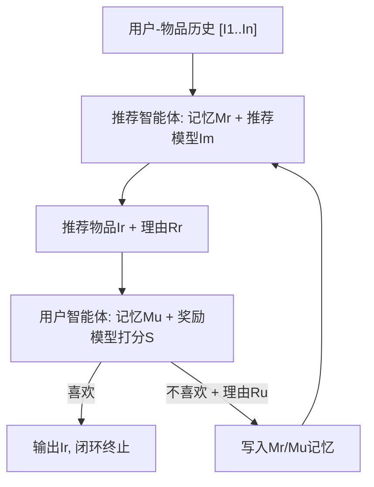
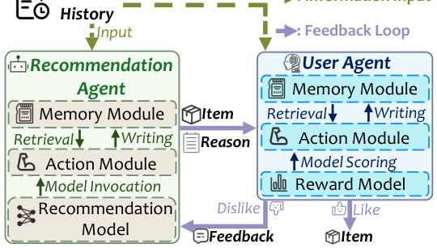

# Agentic Feedback Loop Modeling Improves Recommendation and User Simulation (智能体反馈闭环建模同时提升推荐与用户模拟)

- **会议/期刊**: SIGIR 2025
- **作者与机构**: Shihao Cai, Jizhi Zhang, Keqin Bao, Chongming Gao, Qifan Wang (Meta AI), Fuli Feng, Xiangnan He — 中国科学技术大学、Meta AI
- **推荐链路定位**: 重排（候选列表内选择下一物品）/ 端到端智能体决策
- **研究方向**: 对话推荐与智能体仿真 / 大语言模型推荐
- **论文原文**: [https://arxiv.org/abs/2410.20027v2](https://arxiv.org/abs/2410.20027v2)
- **开源代码**: [https://github.com/Lanyu0303/AFL](https://github.com/Lanyu0303/AFL)

## TL;DR (1分钟核心速览)

现有 LLM 智能体推荐工作要么只优化推荐智能体、要么只优化用户模拟智能体，忽略了真实推荐系统中"推荐器引导用户发现兴趣、用户反馈反过来修正推荐器"的反馈闭环。本文提出 AFL：让推荐智能体（GPT-4o-mini + 可插拔推荐模型 + 记忆）与用户智能体（GPT-4o-mini + 固定奖励模型 SASRec + 记忆）以文本反馈多轮交互，拒绝即写入记忆并重推。在 LastFM/Steam/MovieLens 的 20 候选 HitRatio@1 协议下，AFL 相对单推荐智能体平均提升 11.52%，相对单用户智能体平均提升 21.12%，且不放大流行度与位置偏差。

## Background & Motivation (背景与核心矛盾)

- **主流范式**: LLM 智能体在推荐中分两条独立路线——推荐智能体（RecMind、MACRec 借助工具调用与多角色协作做推荐）与用户智能体（Agent4Rec、AgentCF 用 LLM 模拟点击/评分/评论以评测系统或生成训练数据）。
- **前人局限**: 其一，两条路线各自为战，推荐智能体看不到"用户为何拒绝"的语义理由，用户智能体也拿不到"推荐器为何这样推"的解释，双方都无法从交互中进化；其二，真实反馈闭环会自我强化流行度偏差与位置偏差，而现有智能体工作既未建模闭环、也未检验闭环是否引入同类偏差。
- **核心洞察 (Key Insight)**: 真实推荐系统的本质是"推荐器帮用户发现兴趣、用户反馈帮系统理解偏好"的互惠过程，这恰好匹配 LLM 智能体擅长的交互与记忆能力；只要把拒绝理由与推荐理由都沉淀进双方记忆，就能在不微调模型的前提下实现双向增益。
- **本文切入点**: 用纯文本通信 + 记忆更新构建"智能体反馈闭环 (AFL)"，把推荐与用户模拟从两个孤立任务变成一次协同优化的多轮博弈。

## Method (核心方法设计)

### 1. 整体框架 (Overall Architecture)

输入为用户-物品交互历史 $[I_1,\dots,I_n]$，输出为下一物品预测$I_{n+1}$。用户历史先初始化用户智能体，同时作为推荐智能体输入；推荐智能体内部先调用一个在训练集上训练好的推荐模型给出参考物品$I_m$，再结合记忆$M_r$、历史与$I_m$生成推荐物品$I_r$及理由$R_r$；用户智能体调用固定奖励模型 SASRec 打分$S$，结合记忆$M_u$、历史、$I_r$、$R_r$判定"喜欢/不喜欢"并给出理由$R_u$。若喜欢则终止；否则将$(I_r,R_r,R_u)$ 同时写入双方记忆并进入下一轮，推荐智能体可"说服"用户或改推新物品。整个闭环只靠记忆更新驱动，不更新任何参数。

<figure class="paper-figure" markdown="span">
  <figcaption>图2：所提出的AFL方法概览。用户-物品历史记录初始化用户智能体，并作为推荐智能体的输入。推荐智能体随后推荐一个物品并给出理由。如果用户智能体批准，则过程结束。否则，用户智能体提供反馈以帮助改进未来的推荐。</figcaption>
</figure>

### 2. 关键设计拆解 (Key Designs)

1. **可插拔推荐模型 + 角色扮演/思维链的推荐智能体**：痛点是纯 LLM 推荐缺乏数据集特定的协同信号，而微调 LLM 代价高且损伤推理能力。做法是把任意训练好的推荐模型（SASRec/GRU4Rec/Caser/MoRec/LLaRA 等）作为"参考建议"注入提示，形式化为 $f_r(M_r,[I_1,\dots,I_n],I_m)=(I_r,R_r)$，并用角色扮演与 CoT 强制"先给理由再给物品"。直觉是让 LLM 的世界知识与协同过滤的统计信号互补，同时保持架构无关的通用性。

2. **固定奖励模型锚定的用户智能体**：痛点是纯 LLM 用户模拟容易"老好人化"（对一切推荐都说喜欢），导致高召回低精度。做法是保持奖励模型 SASRec 冻结，仅将其分数 $S$作为提示中的参考证据，用户智能体输出$f_u(M_u,[I_1,\dots,I_n],I_r,R_r,S)=(D_u,R_u)$。直觉是用一个稳定的偏好打分器约束 LLM 的判定，使其既保留语义推理又能校准偏好强度。

3. **记忆驱动的双向反馈闭环与训练/推理开销**：无显式损失函数，优化完全由记忆更新算子完成——拒绝时 $M_u\leftarrow M_u\cup\{I_r,R_r,R_u\}$、$M_r\leftarrow M_r\cup\{I_r,R_r,R_u\}$，循环至$D_u=\text{True}$或达到$Max\_Epoch$。无负采样、无梯度更新；推理开销即每轮 2 次 GPT-4o-mini API 调用，成本随迭代线性增长，故需在收益与 API 费用间折中（实验取 4 轮）。

## Experimental Setup & Evaluation Protocol (实验设置与评估协议)

- **数据集与预处理**: Steam 沿用 LLaRA 过滤（用户评论数 < 20 剔除，再随机采样 1/3 用户与游戏）；MovieLens 用 100k 子集以控制 API 成本。

| 数据集 | #Sequences | #Items | #Interactions | 说明 |
| :--- | :---: | :---: | :---: | :--- |
| LastFM | 1,220 | 4,606 | 73,510 | 用户-音乐人收听记录 |
| Steam | 11,938 | 3,581 | 274,726 | 游戏评论（过滤后） |
| MovieLens | 943 | 1,682 | 100,000 | MovieLens-100k |

- **数据划分与防穿越 (Splitting Strategy)**: 按时间排序后 `8:1:1` 比例划分训练/验证/测试，确保后续交互不进入训练集；Steam 测试集随机采样 200 条以对齐 LastFM/MovieLens 规模。
- **排名评测协议 (Ranking Protocol)**: 推荐任务采用 `Sampled Ranking`——正确下一物品 + 19 个随机未交互物品构成 20 候选列表，报告 `HitRatio@1`；用户模拟任务沿用 Agent4Rec 设置，每用户随机 20 物品，正负比 $1{:}k,\ k\in\{1,3,9\}$，报告 Precision/Recall/F1。
- **对比基线与超参设置**: 推荐侧基线含传统模型 SASRec/GRU4Rec/Caser 与 LLM 侧 MoRec/Llama3-8B/GPT-4o-mini/LLaRA；传统模型 lr=0.001、$d=64$、batch=256，LLM 模型按 LLaRA 训练 5 epoch、batch=128、cosine warm-up；智能体统一用 `GPT-4o-mini-2024-07-18`，奖励模型固定 SASRec，最大迭代 4 轮。

## Key Experimental Results (实验关键数据)

### 1. 主实验对比 (Main Results)

推荐任务 HitRatio@1（Base Model / Rec Agent / AFL）：

| 类型 | 模型 | LastFM | Steam | MovieLens |
| :--- | :--- | :---: | :---: | :---: |
| 传统 | SASRec | 0.2869 / 0.3197 / **0.3770** | 0.3800 / 0.3900 / **0.4100** | 0.4105 / 0.4105 / **0.4316** |
| 传统 | GRU4Rec | 0.2787 / 0.3114 / **0.3770** | 0.3750 / 0.3850 / **0.4100** | 0.4526 / 0.4526 / **0.4632** |
| 传统 | Caser | 0.2705 / 0.2705 / **0.3443** | 0.4200 / 0.4150 / **0.4500** | 0.3789 / 0.3895 / **0.4000** |
| LLM | MoRec | 0.1639 / 0.2131 / **0.3115** | 0.4100 / 0.4200 / **0.4250** | 0.3158 / 0.3158 / **0.3474** |
| LLM | Llama3-8B | 0.2131 / 0.2541 / **0.2869** | 0.1800 / 0.2250 / **0.3000** | 0.1368 / 0.1368 / **0.1684** |
| LLM | GPT-4o-mini | 0.3607 / 0.3607 / **0.3770** | 0.3350 / 0.3400 / **0.3500** | 0.1368 / 0.1368 / **0.1579** |
| LLM | LLaRA | 0.4426 / 0.4426 / **0.4836** | 0.4650 / 0.4650 / **0.4750** | 0.4842 / 0.4842 / **0.4947** |

用户模拟任务（$1{:}1$设置，F1）：LastFM Reward Model 0.0988 → User Agent 0.4865 → **AFL 0.6297**；Steam 0.7277 → 0.7422 → **0.7494**；MovieLens 0.4908 → 0.5941 → **0.6185**。$1{:}9$ 极端不平衡下增益更显著（LastFM F1 0.0952 → 0.2501 → **0.3974**）。

### 2. 消融实验 (Ablation Study)

| 设置 | LastFM | Steam | MovieLens |
| :--- | :---: | :---: | :---: |
| AFL (完整) | **0.3770** | **0.4100** | **0.4316** |
| AFL w/o Rec Model | 0.3525 | 0.3950 | 0.4000 |
| AFL w/o Reward Model | 0.3689 | 0.4000 | 0.4211 |
| AFL w/o Both | 0.3443 | 0.3250 | 0.2105 |
| Rec Agent + SASRec 重排 | 0.3525 | 0.3850 | 0.3895 |
| Rec Agent + User Agent 重排 | 0.3607 | 0.3950 | 0.4000 |

### 3. 关键实验发现 (Key Findings)

1. **闭环优于"加个重排器"**：在推荐智能体后串接 SASRec 或用户智能体做重排，MovieLens 上反而从 0.4105 掉到 0.3895/0.4000——重排器主导输出会压掉智能体本已正确的候选；而 AFL 通过把反馈回传给推荐智能体（允许其"说服"用户），在三个数据集上均取得最优（0.3770/0.4100/0.4316），说明反馈的"回流"比"后置过滤"更关键。
2. **双模型协同是增益主源**：去掉推荐模型与奖励模型后 MovieLens 从 0.4316 崩至 0.2105（跌幅超 50%），单去推荐模型跌至 0.4000、单去奖励模型跌至 0.4211，证明"更好的用户智能体"本身就能反哺推荐智能体，二者存在正向协同而非简单叠加。
3. **闭环不放大偏差且迭代收益递减**：随迭代 1→4，推荐中长尾物品占比上升、流行度偏差被缓解；位置实验中 `Random` 多数情况优于 `First`/`Last`，且 4 轮后三种位置设置收敛到同一水平，说明智能体学到的是偏好而非位置捷径；但 HitRatio@1 的边际增益随轮数递减（4 轮精度略低于 3 轮），需权衡 API 成本。

## Highlights & Limitations (亮点、对比与审稿批判)

- **与代表作对比 (vs. Prior Work)**: 相比 RecMind/MACRec 只强化推荐侧工具调用与多角色分工，AFL 首次把"用户拒绝理由"作为一等公民回灌推荐智能体；相比 Agent4Rec/AgentCF 只做用户行为模拟或用户-物品双智能体对齐，AFL 让用户智能体在闭环中被推荐理由"教会"潜在兴趣，实现推荐与模拟的双向提升。
- **可迁移亮点**: ①"记忆即优化"的免训练闭环范式可低成本套用到任意带记忆的推荐/对话智能体；②用冻结的轻量序列模型（SASRec）作为奖励锚点抑制 LLM"老好人偏差"，可直接迁移到 LLM 评判式重排与数据合成。
- **审稿级局限批判**: ①每轮 2 次 GPT-4o-mini 调用、4 轮上限，在线延迟与费用对工业场景偏重，且未报告 token 消耗与方差；②评测仅 20 候选的 Sampled Ranking 与 200 条 Steam 测试样本，规模偏小、缺少 Full-Ranking 与多随机种子显著性检验，结论的统计稳健性有待加强。

## Rating (四维评分)

- **方法创新性 (Novelty)**: ⭐⭐⭐⭐ （首次显式建模推荐智能体-用户智能体反馈闭环，思路简洁通用，但机制本质是提示工程+记忆拼接，理论深度有限）
- **评估协议与实验扎实度 (Protocol & Experiments)**: ⭐⭐⭐ （三数据集、七基线、消融与偏差分析较完整，但 Sampled 20 候选、Steam 仅 200 测试样本、缺显著性检验）
- **写作与数学规范度 (Clarity & Rigor)**: ⭐⭐⭐⭐ （框架与算法伪代码清晰、提示模板完整公开，但形式化较浅、无复杂度与成本量化分析）
- **工业落地与复现价值 (Industrial & Practical Value)**: ⭐⭐⭐⭐ （代码开源、智能体可插拔易集成，但多轮 API 成本与延迟是线上部署的主要门槛）

