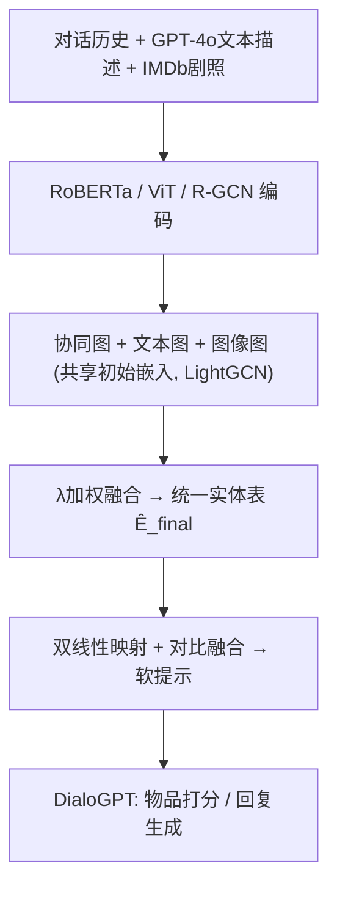
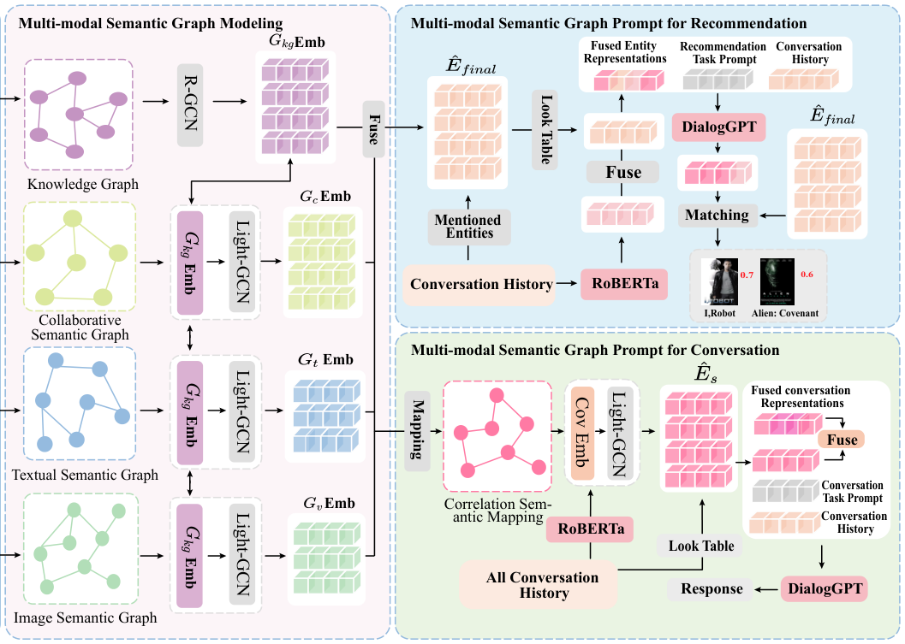

# MSCRS: Multi-modal Semantic Graph Prompt Learning Framework for Conversational Recommender Systems (面向对话推荐的多模态语义图提示学习框架)

- **会议/期刊**: SIGIR 2025
- **作者与机构**: Yibiao Wei, Jie Zou, Weikang Guo, Guoqing Wang, Xing Xu, Yang Yang（电子科技大学、西南财经大学）
- **推荐链路定位**: 端到端生成式（推荐 + 回复生成双任务）
- **研究方向**: 对话推荐与智能体仿真 / 多模态推荐
- **论文原文**: [https://arxiv.org/abs/2504.10921v2](https://arxiv.org/abs/2504.10921v2)
- **开源代码**: [https://github.com/BIAOBIAO12138/MSCRS-main](https://github.com/BIAOBIAO12138/MSCRS-main)

## TL;DR (1分钟核心速览)

对话推荐（CRS）的对话上下文短而稀疏，仅靠文本难以刻画细粒度偏好；已有知识增强方法又局限于单一文本模态，且跨模态直接对齐会破坏模态内语义关联。MSCRS 为协同、文本、图像三种模态各建一张语义图，用共享初始嵌入实现"免对齐"融合，再把图拓扑以软提示注入 DialoGPT。在 ReDial / INSPIRED 全库排序下，Recall@1 达 0.081 / 0.096（较最强基线 DCRS 提升 6.5% / 3.2%），回复生成 BLEU-2 亦全面领先。

## Background & Motivation (背景与核心矛盾)

- **主流范式**: 生成式 CRS 以 DialoGPT 等 LLM 为骨干，通过知识图谱（KBRD/KGSF）、评论与元数据（COLA）、相似对话检索（DCRS）或统一提示（UNICRS）增强实体与用户表征。
- **前人局限**: 其一，对话上下文短且稀疏，单靠文本偏好建模只能推荐"大众选项"，无法捕捉视觉特效、氛围等细粒度诉求；其二，现有增强几乎全是纯文本模态，且评论/元数据与对话之间存在表达形式与信息结构的**语义鸿沟**，直接融合（如对比对齐）反而破坏各模态内部独有的语义关联。
- **核心洞察 (Key Insight)**: 用户偏好本质上源于多模态体验（海报、剧照、剧情），而协同共现信息本身可视为一种"关系模态"——同一实体在不同对话中被共同提及，能揭示隐式偏好连接。
- **本文切入点**: 不做跨模态特征对齐，而是"分模态建图 + 共享初始嵌入"实现隐式融合，再用 GNN 邻域聚合为 LLM 提供拓扑线索。

## Method (核心方法设计)

### 1. 整体框架 (Overall Architecture)

模型输入为对话历史、GPT-4o 生成的物品文本描述（主题/情感/文化意义/剧情四维提示模板）与 IMDb 抓取的剧照。文本经 RoBERTa（768 维）、图像经 ViT（1024 维）编码后取均值池化；对话实体映射至 DBpedia 知识图谱并由 R-GCN 编码，其输出嵌入表同时作为三张语义图的**共享初始嵌入**。三图分别经 3 层 LightGCN 传播后池化，文本/图像图按 $\lambda$ 加权融合，再与协同图拼接得到统一实体表。推荐侧将对话实体嵌入经双线性映射与 RoBERTa 对话表征做对比融合，拼上软提示送入 DialoGPT 打分；对话侧则用"关联语义映射"检索相似对话增强上下文后生成回复。

<figure class="paper-figure" markdown="span">
  <figcaption>图2：MSCRS的框架。</figcaption>
</figure>

### 2. 关键设计拆解 (Key Designs)

1. **协同语义图（Co-mention Graph）**：知识图谱存在噪声与"数据孤岛"，故以实体在全部训练对话中的共提及频次建边，阈值化后得稀疏邻接矩阵：
$\mathbf{C}_{i,j}=\sum_{y=1}^{Y}\mathrm{count}(e_i,e_j\mid Q_y)$
直觉是共现即弱偏好关联，可补足 KG 缺失的"用户行为层"结构。

2. **模态专属语义图 + 免对齐融合**：文本/图像图以模态内余弦相似度建边并做 $k$NN 稀疏化（负值置零），避免全连接图引入无关边：
$\tilde{\mathbf{A}}^{m}_{ij}=\mathbb{I}\left[\mathbf{A}^{m}_{ij}\in \mathrm{top}\text{-}k(\mathbf{A}^{m}_{i})\right],\quad \mathbf{E}^{(l+1)}_{m}=(\mathbf{D}_m^{-\frac{1}{2}}\tilde{\mathbf{A}}^{m}\mathbf{D}_m^{-\frac{1}{2}})\mathbf{E}^{(l)}_{m}$三图共享 R-GCN 输出的初始嵌入表，从而在不做特征级对齐的前提下完成语义互通——这是本文规避跨模态语义鸿沟的核心技巧。融合式为$\hat{\mathbf{E}}_{m}=\lambda\hat{\mathbf{E}}_{t}+(1-\lambda)\hat{\mathbf{E}}_{v}$，再与协同图池化结果拼接：$\hat{\mathbf{E}}_{final}=\hat{\mathbf{E}}_{\alpha}[\mathbf{I}]+\hat{\mathbf{E}}_{m}$。

3. **图提示学习与训练目标**：对话实体嵌入经双线性映射 $\tilde{\mathbf{V}}_s=\mathbf{W}_1\mathbf{V}_s\mathbf{W}_2$对齐到 token 空间，与对话表征$\mathbf{T}_s$做双向 InfoNCE 融合（损失$\mathcal{L}_{fuse}$），最终提示$\mathbf{r}_s=[\hat{\mathbf{V}}_s;\mathbf{O}_{rec};s]$ 注入 DialoGPT。预训练以实体预测交叉熵为主，推荐任务损失为：
$\mathcal{L}_{rec}(\theta_{rec})=-\sum_{j\in S_{train}}\sum_{i=1}^{N}y_{ji}\log P^{j}_{item}(i\mid\hat{\mathbf{r}}_s,\theta_{rec})+\delta\mathcal{L}_{fuse}$
负样本来自全实体/全物品 softmax 分母（**免负采样**，in-batch 全库归一化）；对话任务用标准自回归 NLL。推理时仅需一次 LightGCN 前向 + 一次 DialoGPT 解码，图结构离线预构建。

## Experimental Setup & Evaluation Protocol (实验设置与评估协议)

- **数据集与预处理**: 两个电影对话推荐基准，作者额外补齐多模态特征（IMDb 剧照 + GPT-4o 描述）：

| 数据集 | #Conversations | #Utterances | #Entities/#Items | 特征/场景说明 |
| :--- | :---: | :---: | :---: | :--- |
| ReDial | 10,006 | 182,150 | 64,364 / 6,924 | 真实用户-客服电影推荐对话 |
| INSPIRED | 1,001 | 35,811 | 17,321 / 1,123 | 策略引导的推荐对话，更稀疏 |

- **数据划分与防穿越 (Splitting Strategy)**: 沿用 DCRS/UNICRS 的对话级划分（训练/验证/测试按对话切分），测试对话中的实体与物品不参与训练图构建。
- **排名评测协议 (Ranking Protocol)**: 无偏 **Full-Ranking**（在全部物品集 $\mathcal{I}$ 上做 softmax 排序），指标为 Recall@{1,10,50}、NDCG@{10,50}、MRR@{10,50}；生成任务用 BLEU-2/3、ROUGE-2/L、Distinct-2/3/4，另附 100 条样本的三人人工评分（流畅性/信息量，0–2 分）。
- **对比基线与超参设置**: 基线覆盖 Popularity/TextCNN/BERT 非个性化与纯文本类、ReDial/KBRD/KGSF/TREA/COLA/VRICR 知识增强类、UNICRS/DCRS 两类 LLM 提示类。R-GCN 1 层、LightGCN 3 层，软提示长度 10–50，batch 64（推荐）/8（对话），Adam，学习率 1e-5~1e-3，显著性 $p<0.05$。

## Key Experimental Results (实验关键数据)

### 1. 主实验对比 (Main Results)

| 模型 | ReDial R@1 | R@10 | R@50 | N@10 | INSPIRED R@1 | R@10 | R@50 | N@10 |
| :--- | :---: | :---: | :---: | :---: | :---: | :---: | :---: | :---: |
| Popularity | 0.011 | 0.053 | 0.183 | 0.029 | 0.031 | 0.155 | 0.322 | 0.085 |
| KGSF | 0.035 | 0.175 | 0.367 | 0.094 | 0.051 | 0.132 | 0.239 | 0.092 |
| TREA | 0.045 | 0.204 | 0.403 | 0.114 | 0.047 | 0.146 | 0.347 | 0.095 |
| VRICR | 0.054 | 0.244 | 0.406 | 0.138 | 0.043 | 0.141 | 0.336 | 0.091 |
| UNICRS | 0.065 | 0.241 | 0.423 | 0.143 | 0.085 | 0.230 | 0.398 | 0.149 |
| DCRS | 0.076 | 0.253 | 0.439 | 0.154 | 0.093 | 0.226 | 0.414 | 0.153 |
| **MSCRS** | **0.081** | **0.264** | **0.451** | **0.161** | **0.096** | **0.257** | **0.425** | **0.168** |
| Improv. vs DCRS | +6.5% | +4.3% | +2.7% | +4.5% | +3.2% | +13.7% | +2.6% | +9.8% |

生成任务上，MSCRS 在 ReDial 取得 BLEU-2 0.054 / ROUGE-L 0.294 / DIST-4 1.553，在 INSPIRED 取得 BLEU-2 0.040 / ROUGE-L 0.235 / DIST-4 6.556，均超 DCRS（0.048 / 0.285 / 1.386 与 0.033 / 0.229 / 6.233）；人工评测流畅性 1.79、信息量 1.67，同样第一。

### 2. 消融实验 (Ablation Study)

| 变体 | ReDial R@10 | INSPIRED R@10 | ReDial BLEU-2 | INSPIRED BLEU-2 |
| :--- | :---: | :---: | :---: | :---: |
| MSCRS (full) | **0.264** | **0.257** | **0.054** | **0.040** |
| w/o 协同图 (-co) | 下降 | 下降 | — | — |
| w/o 文本图 (-t) | 下降 | 下降 | — | — |
| w/o 图像图 (-i) | 下降 | 下降 | — | — |
| w/o 全部三图 (-r) | 最低 | 最低 | — | — |
| w/o 多模态实体 (-s) | — | — | 下降 | 下降 |
| w/o 关联语义映射 (-c) | — | — | 下降更多 | 下降更多 |
| w/o 两者 (-all) | — | — | 最低 | 最低 |

### 3. 关键实验发现 (Key Findings)

1. **协同图是单图消融中最关键的一环**：移除 -co 的 Recall@10 跌幅大于移除文本或图像图，说明共提及结构补足了 KG 的"数据孤岛"，是稀疏对话场景下最稳的偏好信号源。
2. **模态互补性在稀疏数据上被放大**：INSPIRED 仅 1,001 条对话，MSCRS 的 Recall@10 相对 DCRS 提升 13.7%（远高于 ReDial 的 4.3%），印证多模态语义在上下文极短时对偏好表达的补全价值。
3. **融合比例需平衡而非偏斜**：$\lambda=0.5$时两数据集 Recall@10 均达峰值，偏向任一模态（0.1 或 0.9）均下滑；$k$NN 的$k$亦呈倒 U 形（ReDial 最优$k=20$、INSPIRED 最优$k=10$），过小欠覆盖、过大引噪声。

## Highlights & Limitations (亮点、对比与审稿批判)

- **与代表作对比 (vs. Prior Work)**: 相较 KGSF/COLA 的纯文本知识增强，本文首次把协同 + 视觉 + 文本三模态同时引入生成式 CRS；相较 UNICRS 的统一提示，本文额外注入 GNN 拓扑线索；相较 DCRS 的相似对话检索，本文以图结构替代检索式增强，且规避了跨模态对比对齐的语义破坏问题。
- **可迁移亮点**: ①"共享初始嵌入 + 分模态建图"是低成本规避跨模态语义鸿沟的通用范式，可直接迁移至短视频/图文电商推荐；②用 GNN 邻域聚合结果作为 LLM 软提示的拓扑先验，适用于任何"结构化知识 + 生成式解码"的架构。
- **审稿级局限批判**: ①图像特征依赖 IMDb 外部抓取与 GPT-4o 生成描述，数据管线重、可复现性与时效性存疑，且未报告图构建与 ViT 编码的离线开销；②评测仅在两个电影域小数据集上，Full-Ranking 虽无偏但物品量仅千级，缺乏大规模工业场景与线上 A/B 验证；③$\lambda$、$k$、软提示长度均需逐数据集调参，超参敏感度较高。

## Rating (四维评分)

- **方法创新性 (Novelty)**: ⭐⭐⭐⭐ （三模态分图 + 共享嵌入免对齐融合 + 图提示注入 LLM 的组合首次用于生成式 CRS，思路清晰但单点算子多为已有组件重组）
- **评估协议与实验扎实度 (Protocol & Experiments)**: ⭐⭐⭐⭐ （Full-Ranking 无偏协议 + 推荐/生成/人工三维评测 + 完整消融与超参分析，但数据集规模偏小、缺线上验证）
- **写作与数学规范度 (Clarity & Rigor)**: ⭐⭐⭐⭐ （公式与符号定义完整、框架图清晰，但部分融合式（如 Eq.16 的索引拼接）表述略简，缺复杂度分析）
- **工业落地与复现价值 (Industrial & Practical Value)**: ⭐⭐⭐⭐ （代码与多模态增强数据集已开源，图结构可离线预构建，但外部数据依赖与 DialoGPT 解码延迟是部署瓶颈）

