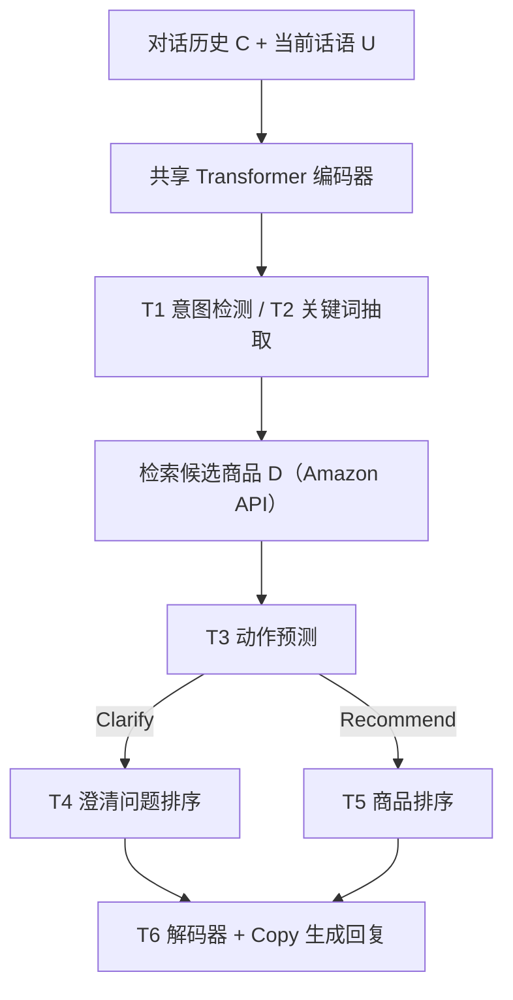

# PSCon: Product Search Through Conversations (对话式商品搜索)

- **会议/期刊**: SIGIR 2025
- **作者与机构**: Jie Zou, Shuxi Han, Heli Ma, Yang Yang, Heng Tao Shen (电子科技大学)；Mohammad Aliannejadi, Evangelos Kanoulas (阿姆斯特丹大学)；Zheng Wang (同济大学)
- **推荐链路定位**: 端到端对话式检索（意图理解 → 澄清提问 → 商品排序 → 回复生成）
- **研究方向**: 对话推荐与智能体仿真 / 大语言模型推荐
- **论文原文**: [https://arxiv.org/abs/2502.13881v3](https://arxiv.org/abs/2502.13881v3)
- **开源代码**: [https://github.com/JieZouIR/PSCon](https://github.com/JieZouIR/PSCon)

## TL;DR (1分钟核心速览)

现有对话式商品搜索（CPS）研究几乎全部建立在**模板化模拟对话**之上（基于评论挖掘的 aspect 提问 + 模拟用户反馈），既缺乏人味语言，也缺乏跨市场/跨语言资源。本文提出"教练式人-人"采集协议，构建首个双市场（Amazon 中国/美国）、双语（中/英）真实 CPS 数据集 PSCon（1,730 段对话、10,887 条话语、5,212 件商品），并将 CPS 形式化为六子任务流水线；配套 Transformer 统一基准在中文集 5 折交叉验证下，意图检测/动作预测 F1 达 0.92，问题选择与商品排序 nDCG 相对最强 LLM 基线（微调 Llama 2）提升约 40%/39%。

## Background & Motivation (背景与核心矛盾)

- **主流范式**: CPS 代表作（Zhang et al.、Bi et al.、Zou & Kanoulas、Zou et al.）均以评论挖掘出的 item aspect 或 informative term 为锚点，用**模板问题 + 模拟用户回答**驱动对话，本质是"脚本化"交互。
- **前人局限**: 其一，模拟对话无法反映真实用户的省略、指代、意图漂移与多轮修正，模型学到的提问策略在真人面前易失效；其二，现有电商对话数据集（如 Bernard & Balog 的多目标对话）仅覆盖单一语言单一市场、每类目不足 20 段对话，无法支撑跨市场/多语言迁移研究。
- **核心洞察 (Key Insight)**: 商品搜索的查询天然极短（平均话语仅 6.57–8.17 词），语义鸿沟必须靠**主动澄清提问**弥合；而澄清策略的优劣只能在真人对话中暴露——因此"真实人-人对话数据"本身即是该方向的第一性瓶颈。
- **本文切入点**: 用教练式人-人协议（一方扮演导购系统、一方扮演顾客）采集真实对话，并把 CPS 拆成六个可独立评测的子任务，使数据同时服务于意图理解、提问选择与排序研究。

## Method (核心方法设计)

### 1. 整体框架 (Overall Architecture)

PSCon 的贡献是"协议 + 数据 + 流水线 + 基准"四件套。采集侧：参与者先接受培训与人口统计问卷，随机分配 user/system 角色进入聊天室；system 角色每轮必须依次完成「抽关键词 → 选动作（Clarify/Recommend/Inquire/No-answer/Chitchat）→ 生成自然语言回复」，并可调用 Amazon 商品搜索 API 检索候选、扫描属性发起澄清提问；对话结束后 user 角色对推荐商品做 like/dislike 相关性标注并填写满意度问卷。建模侧：六子任务共享一个 Transformer 编码器，通过任务专属 `[T1]`–`[T6]` 前缀 token 区分，T6 用 Transformer 解码器 + copy 机制生成回复。

### 2. 关键设计拆解 (Key Designs)

1. **六子任务统一序列建模（任务前缀 token 化）**：痛点是六个子任务输入异构（有的含候选问题 $Q$、有的含候选商品$D$），难以共享参数。本文把每个子任务拼成一条序列，如$S_{T3}=[[T3],C,U,D]$、$S_{T4}=[[T4],C,U,Q]$，取前缀 token 的末层隐状态$\mathbf{h}^N$接线性层输出：$P=\mathrm{Softmax}(\mathrm{ReLU}(\mathbf{W}\mathbf{h}^N+\mathbf{b}))$。直觉上，前缀 token 充当"任务软提示"，让同一编码器在不同任务间复用对话上下文表征，而无需为每任务复制一套编码器。
2. **T4/T5 建模为候选集上的排序而非逐项二分类**：痛点在于澄清属性与候选商品数量大、正负极度不均，逐项二分类会退化为"全判负"。作者改为在候选集合上做 softmax 分布排序，直接优化"哪个问题/商品排第一"，与 nDCG/MAP 的评测目标对齐；论文明确报告该建模方式优于二分类变体。
3. **训练目标、负采样与推理效率**：T2 用逐 token 二分类交叉熵（sigmoid），T1/T3/T4/T5/T6 用交叉熵；因真实对话仅千余段，先用 DuConv、KdConv 两个知识驱动对话数据集预训练再在 PSCon 上微调。T6 在解码起始位注入 T3 预测的动作标签，并将 T1/T4/T5 表征 max-pooling 融合作为解码输入，配合 copy 机制从对话历史与商品文档中复制实体名，缓解 OOV。推理时六任务串行执行，单轮开销为一次编码 + 一次解码。

## Experimental Setup & Evaluation Protocol (实验设置与评估协议)

- **数据集与预处理**: 人工清洗（去重、纠错、修正错标），剔除未正常结束或无商品推荐的对话；构建含 user–item like/dislike 边与 item–attribute 边的知识图谱。

| 数据集 | #Conversations | #Utterances | #Turns | #Items | 平均话语数/轮次/商品 | 场景说明 |
| :--- | :---: | :---: | :---: | :---: | :---: | :--- |
| PSCon-ZH | 904 | 5,254 | 3,044 | 2,548 | 5.81 / 3.37 / 2.82 | Amazon 中国站，中文 |
| PSCon-EN | 826 | 5,633 | 3,187 | 2,664 | 6.82 / 3.86 / 3.23 | Amazon 美国站，英文 |

- **数据划分与防穿越 (Splitting Strategy)**: **5 折交叉验证**，每折按 6:2:2 划分 train/valid/test；未采用全局时间戳切分（对话本身即独立采集单元，无跨会话用户重叠泄漏风险）。
- **排名评测协议 (Ranking Protocol)**: T4/T5 为**候选集内排序**（候选来自当轮 Amazon API 检索返回集与澄清属性集），报告 nDCG 与 MAP；T1/T3 报告 P/R/F1；T2/T6 报告 BLEU-1 与 ROUGE-L。未做全库 Full-Ranking。
- **对比基线与超参设置**: 分类侧 Naive Bayes / LR / Random Forest / SVM；排序侧 MLP；LLM 侧 Llama-2-7B、GPT-3.5（零样本）及 Llama 2 微调版。嵌入与隐层维度 512，编码器 4 层、解码器 2 层，8 头，Adam lr=0.001，梯度裁剪 1；显著性用 $t$-test，$p<0.05$。

## Key Experimental Results (实验关键数据)

### 1. 主实验对比 (Main Results)

中文集结果（P/R/F1 为 T1、T3；BLEU/ROUGE 为 T2、T6；nDCG/MAP 为 T4、T5）：

| Model | T1 F1 | T2 BLEU | T2 ROUGE | T3 F1 | T4 nDCG | T4 MAP | T5 nDCG | T5 MAP | T6 BLEU | T6 ROUGE |
| :--- | :---: | :---: | :---: | :---: | :---: | :---: | :---: | :---: | :---: | :---: |
| Random Forest | 0.59 | 0.25 | 0.15 | 0.65 | – | – | – | – | – | – |
| SVM | 0.58 | 0.30 | 0.18 | 0.65 | – | – | – | – | – | – |
| MLP | – | – | – | – | 0.54 | 0.38 | 0.29 | 0.11 | – | – |
| Llama 2 (zero-shot) | 0.21 | 0.47 | 0.49 | 0.26 | 0.27 | 0.08 | 0.25 | 0.08 | 0.18 | 0.21 |
| GPT-3.5 (zero-shot) | 0.42 | 0.75 | 0.75 | 0.33 | 0.27 | 0.15 | 0.18 | 0.19 | 0.20 | 0.22 |
| Llama 2 w/ finetune | 0.88 | 0.77 | 0.79 | 0.64 | 0.50 | 0.38 | 0.28 | 0.10 | 0.22 | 0.23 |
| **PSCon (本文)** | **0.92\*** | 0.73 | 0.74 | **0.66\*** | **0.70\*** | **0.60\*** | **0.39\*** | **0.21\*** | 0.22 | 0.23 |

相对最强基线（Llama 2 w/ finetune）：T1 F1 +4.5%，T3 F1 +3.1%，T4 nDCG **+40.0%**、MAP +57.9%，T5 nDCG **+39.3%**、MAP +110%；T2 的 BLEU/ROUGE 略低于微调 Llama 2（0.73 vs 0.77、0.74 vs 0.79）。

### 2. 消融实验 (Ablation Study)

原文未提供组件级消融，仅给出按标签细分的分解结果，可视为"任务难度归因"分析：

| 细分维度 | 指标 | 表现 |
| :--- | :--- | :--- |
| T1: Reveal / Revise / Interpret / Chitchat | F1 | 0.96 / 0.83 / 0.91 / 0.97 |
| T3: Chitchat / Clarify / Recommend / No-answer | F1 | 0.81 / 0.90 / 0.97 / 0.63 |
| T3: No-answer | Precision / Recall | 1.00 / 0.46 |
| T4 vs T5 建模方式 | 排序 vs 二分类 | 排序更优（未给具体数值） |

### 3. 关键实验发现 (Key Findings)

1. **排序类子任务是真正瓶颈，且小模型显著优于零样本 LLM**：T5 商品排序上本文模型 nDCG 0.39，而 GPT-3.5 仅 0.18、Llama 2 仅 0.25——LLM 擅长语言任务（T2 BLEU 0.75）却在"从大量候选中挑一个"上失手，说明 CPS 的排序环节必须依赖下游任务训练而非通用语言能力。
2. **动作预测的召回短板集中在 No-answer**：Recommend/Clarify 的 F1 高达 0.97/0.90，但 No-answer 精确率 1.00 而召回仅 0.46，即系统几乎不敢说"找不到"，这在真实电商场景会持续输出低质推荐，是明确的改进靶点。
3. **对话轮次与满意度正相关**：单因素 ANOVA 显示不同轮次下"被点赞商品数"差异显著（$p<0.05$），轮次越多点赞商品越多；同时 97.2% 的对话中用户成功找到目标商品、平均满意度 4.91/5，验证了数据采集协议的有效性与数据可用性。

## Highlights & Limitations (亮点、对比与审稿批判)

- **与代表作对比 (vs. Prior Work)**: 相比 Zhang et al. / Bi et al. / Zou et al. 的 aspect 模板模拟对话，本文是首个真人-真人、双市场双语、带知识图谱的 CPS 数据；相比 Bernard & Balog 的多目标电商对话（单语言单市场、每类目 <20 段），本文在规模、语言覆盖与任务完备性（六子任务全覆盖）上均有实质扩展。
- **可迁移亮点**: ①"教练式人-人 + 强制每轮标注动作/关键词/属性"的协议可直接迁移到其他垂直领域（如本地生活、旅游）构建对话检索数据；②用任务前缀 token 让单编码器服务六个异构子任务，是低成本多任务基准的实用范式。
- **审稿级局限批判**: ①数据规模仅 1,730 段对话，作者自认不足以端到端训练大模型，必须依赖外部对话语料预训练，基准结论的可扩展性存疑；②基准模型本身"直白且简单"（作者原话），未与任何 CPS 专用模型（如基于知识图谱或 RL 提问策略的方法）对比，T4/T5 的提升幅度更多反映"有无下游训练"而非架构优势；③T6 生成指标普遍偏低（BLEU 0.22），且未做人工评价，回复质量结论偏弱。

## Rating (四维评分)

- **方法创新性 (Novelty)**: ⭐⭐⭐ （核心贡献在数据与任务形式化而非模型，六子任务流水线定义清晰但建模层面为常规 Transformer 多任务拼接）
- **评估协议与实验扎实度 (Protocol & Experiments)**: ⭐⭐⭐ （5 折交叉验证 + 显著性检验规范，但缺组件消融、缺 CPS 专用基线、英文集结果被省略）
- **写作与数学规范度 (Clarity & Rigor)**: ⭐⭐⭐⭐ （任务定义与协议描述详尽可复现，公式简洁；但部分表格排版混乱、T2/T6 指标口径解释略简）
- **工业落地与复现价值 (Industrial & Practical Value)**: ⭐⭐⭐⭐ （数据、采集系统与代码全开源，协议可直接复用；但千级对话规模对工业级训练仍偏小）

