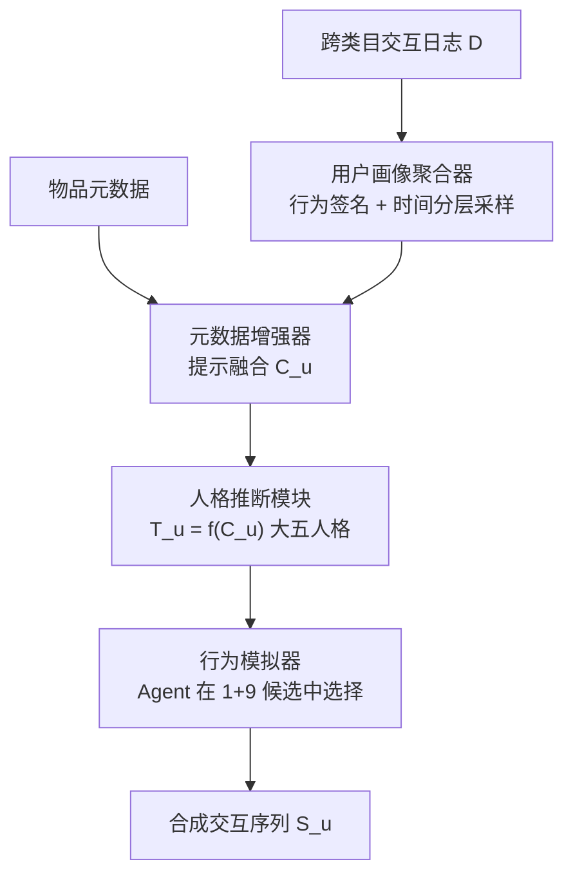
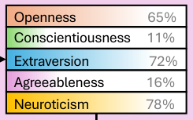
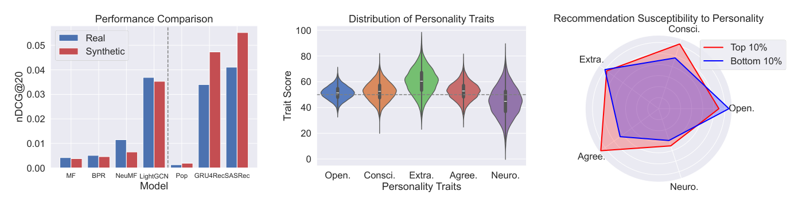

# PUB: An LLM-Enhanced Personality-Driven User Behaviour Simulator for Recommender System Evaluation (面向推荐系统评估的人格驱动 LLM 用户行为模拟器)

- **会议/期刊**: SIGIR 2025 (Short Paper, 5 pages)
- **作者与机构**: Chenglong Ma, Ziqi Xu, Yongli Ren, Danula Hettiachchi, Jeffrey Chan (RMIT University; ARC Centre of Excellence ADM+S)
- **推荐链路定位**: 离线评估 / 仿真数据生成（不涉及线上召回精排）
- **研究方向**: 对话推荐与智能体仿真 / 去偏公平与工业评测
- **论文原文**: [https://arxiv.org/abs/2506.04551v1](https://arxiv.org/abs/2506.04551v1)
- **开源代码**: [https://github.com/ChenglongMa/PUB](https://github.com/ChenglongMa/PUB)

## TL;DR (1分钟核心速览)

传统离线评估受困于行为信号稀疏、日志含噪且完全忽略用户人格差异；现有仿真器（RecSim/NEST/RecAgent）要么用马尔可夫链刻画"无个性"用户，要么给 LLM 随机指派年龄性别等浅层画像，生成序列的行为多样性严重失真。PUB 先用统计特征工程 + 元数据增强提示让 LLM 推断用户大五人格 (O/C/E/A/N)，再以人格为条件驱动 Agent 在候选列表中做选择，生成合成交互日志。在 Amazon Review 全类目数据上，PUB 合成序列与真实序列的平均 Jaccard 相似度达 **0.31**，且 7 种推荐算法在合成测试集上的 nDCG@20 排序趋势与真实数据高度一致，为可扩展、可控的推荐评估提供了高保真替代方案。

## Background & Motivation (背景与核心矛盾)

- **主流范式**: 推荐系统评估依赖真实离线日志或昂贵用户研究；近年兴起的 LLM 用户仿真（RecAgent 等）试图以 Agent 替代真人产生可控交互。
- **前人局限一（低保真）**: RecSim 用马尔可夫链、NEST 加"需求状态"，本质是统计转移，无法刻画个体决策差异；RecAgent 虽用 LLM，但画像（年龄/性别/职业）随机指派，与真实行为分布脱节。
- **前人局限二（个性化过简）**: 协同过滤混合或 MDP 类仿真器无法建模"人格特质—行为"的细粒度关联；而人格计算领域又只做静态社媒文本推断，未落到推荐交互生成。
- **核心洞察 (Key Insight)**: 用户交互日志（评分、评论、购买节奏）本身编码了丰富心理信号，可作为人格代理；且 LLM 在结构化提示下能输出稳定的大五人格画像，二者结合即可把"心理一致性"注入合成行为。
- **本文切入点**: 用心理语言学已验证的相关性（类别熵↔开放性、购买节奏规律性↔尽责性、LIWC 社交词频↔外向性等）约束 LLM 的人格推断，再以人格分布为条件采样行为，实现"心理可信 + 统计保真"的仿真闭环。

## Method (核心方法设计)

### 1. 整体框架 (Overall Architecture)

PUB 是四阶段流水线：**用户画像聚合器**从跨类目交互日志中抽取统计行为签名（购买频率、节奏、类目偏好、价格档位），并用指数递增时间窗做分层采样以压缩长序列；**元数据增强器**把物品标题/描述/价格与归一化统计特征经提示函数 $g(\cdot)$融合为上下文$\mathbf{C}_u$；**人格推断模块**以心理测量映射$f(\cdot)$将$\mathbf{C}_u$映射为大五人格向量$\mathbf{T}_u=\{O,C,E,A,N\}$；**行为模拟器**以$\mathbf{T}_u$ 为条件，让 LLM Agent 在"1 正样本 + 9 负样本"的候选列表中选出最相关物品，迭代生成合成序列。全流程数据集无关，可迁移至任意评论/交互域。

<figure class="paper-figure" markdown="span">
  <figcaption>图1：所提出的PUB架构概览。</figcaption>
</figure>

### 2. 关键设计拆解 (Key Designs)

1. **循环统计行为签名（Circular Behavioral Signature）**：痛点在于购买节奏是周期性变量，普通均值会被跨周期时间戳抹平。本文将时间戳映射到单位圆 $\theta_i=\frac{2\pi t_i}{y\times 24\times 60\times 60}$，用平均合向量$\gamma=\frac{1}{n}\sum_{i=1}^{n}e^{j\theta_i}$刻画节奏规律性，并辅以购买间隔香农熵$H_{\text{int}}=-\sum_{t\in\mathcal{T}}p(t)\log p(t)$。合向量模长越大说明行为越规律，直接对应尽责性维度，物理直觉清晰且可解释。

2. **心理语言学锚定的人格推断（Psychometric-Anchored Inference）**：若让 LLM 自由发挥，人格打分不稳定且不可复现。本文把每个维度绑定到已验证的数字足迹相关量——开放性用类目熵与隐喻密度、尽责性用评论长度一致性与评分偏离、外向性用 LIWC-22 社交词频、宜人性用 VADER 正向情感比、神经质用负向情绪波动——再以结构化提示注入 $\mathbf{C}_u$。这样把"LLM 推理能力"与"模型设计"解耦，换任何底座 LLM 都能保持人格语义一致。

3. **人格条件化候选选择与评估闭环**：Agent 每轮面对 $\mathcal{L}_t=\{i_p,i_{n_1},\dots,i_{n_9}\}$（正样本按时间从测试集抽取，负样本从$\mathcal{I}\setminus\mathcal{I}_u$均匀采样），依据人格选择最相关项，形成合成序列$\mathcal{S}_u$。训练侧无需梯度优化，全部"学习"发生在提示内；推理开销即每用户每轮一次 LLM 调用，成本随交互轮数线性增长，这是该方法最主要的工程瓶颈。

## Experimental Setup & Evaluation Protocol (实验设置与评估协议)

- **数据集与预处理**: Amazon Review 全类目（30 类、5.7154 亿交互、1996–2023）。三阶段预处理：跨类目聚合以建模跨域多样性 → 过滤交互数 < 20 的用户与物品（抑制稀疏噪声）→ 按时间戳切分训练/测试。

| 数据集 | #Users | #Items | #Interactions | 稀疏度/密度 | 特征/场景说明 |
| :--- | :---: | :---: | :---: | :---: | :--- |
| Amazon Review (30 类聚合) | 未在正文给出（经 20-core 过滤） | 未在正文给出 | 5.7154 亿（原始） | 极稀疏 | 评分 1–5 星、评论文本、时间戳、类目、价格 |

- **数据划分与防穿越 (Splitting Strategy)**: **全局时间戳切分**，训练集 $\mathcal{D}_{tr}$在前、测试集$\mathcal{D}_{te}$在后；人格推断仅使用训练期历史$\mathcal{I}_u$，测试期真实交互$\mathcal{P}_u$ 作为 ground truth，避免信息泄漏。
- **排名评测协议 (Ranking Protocol)**: 仿真侧采用 **Sampled Ranking（1 正 + 9 负，负样本均匀采样）** 构造候选列表；算法评估侧在合成测试集上做 nDCG@20 排序，并将合成测试集规模对齐真实测试集以保证公平。
- **对比基线与超参设置**: 仿真基线为 Random Sampling、RecSim（马尔可夫链）、NEST（需求状态扩展）、RecAgent（LLM + 随机画像）；推荐算法基线为 Pop、MF、BPR、NeuMF、LightGCN、GRU4Rec、SASRec。正文未报告嵌入维度与显著性检验细节（短文篇幅所限）。

## Key Experimental Results (实验关键数据)

### 1. 主实验对比 (Main Results)

**RQ1 行为保真度（Jaccard 相似度，越高越好）**：

| 仿真器 | 平均 Jaccard | 稳定性描述 |
| :--- | :---: | :--- |
| Random Sampling | 低（图 2a 底部） | 无偏好随机选，最差 |
| RecSim | 低 | 马尔可夫转移，无个体差异 |
| NEST | 低 | 加需求状态仍缺人格 |
| RecAgent | 个别用户高、整体波动大 | LLM 但画像随机指派 |
| **PUB** | **0.31** | 分布集中、方差小 |

**RQ2 算法评估一致性（nDCG@20，真实 vs 合成）**：

| 算法 | 真实测试集 | PUB 合成测试集 | 趋势判断 |
| :--- | :---: | :---: | :--- |
| Pop | 基准 | **高于真实** | 合成偏好流行度（人格已绑定流行度倾向） |
| MF | 基准 | 低于真实 | CF 依赖协同矩阵，合成数据缺协同信号 |
| BPR | 基准 | 低于真实 | 同上 |
| NeuMF | 基准 | 低于真实 | 同上 |
| LightGCN | 基准 | 低于真实 | 图协同结构在合成数据中被削弱 |
| GRU4Rec | 基准 | **高于真实** | 序列模式被 Agent 逐轮选择自然保留 |
| SASRec | 基准 | **高于真实** | 同上 |

（原文以柱状图呈现，未给绝对数值；核心结论是**排序趋势一致**而非绝对分数一致。）

### 2. 消融实验 (Ablation Study)

原文为 5 页短文，**未设置组件级消融表**（无 `w/o 人格推断`、`w/o 元数据增强`、`w/o 时间分层采样` 的对照）。这是本文实验设计上最明显的空缺，仅通过 RQ1 的仿真器横向对比间接体现各模块价值。

### 3. 关键实验发现 (Key Findings)

1. **交互频次决定人格推断精度**：将用户按交互频次分 10 组后，Jaccard 相似度随频次单调上升（图 2b），说明冷启动/低频用户的人格画像不可靠，PUB 的保真优势集中在头部活跃用户，长尾评估仍需谨慎。
2. **合成数据系统性偏向序列模型**：MF/BPR/NeuMF/LightGCN 在合成集上一致掉点，而 GRU4Rec/SASRec 一致提升，根因是 PUB 以人格而非协同共现为生成条件——这提示"用合成数据做算法选型"会引入生成机制偏置，需与真实数据交叉验证。
3. **人格—推荐效果存在显著关联**：以 GRU4Rec 为例，nDCG@20 前 10% 用户宜人性与尽责性显著更高，而后 10% 用户开放性更高（图 3c）；同时 Amazon 评论者整体神经质得分显著偏低，说明"愿写评论"本身是强交互信号，会系统性扭曲评估样本。

<figure class="paper-figure" markdown="span">
  <figcaption>图3：(a) 性能对比；(b) 人格特质分布；(c) 推荐对人格的敏感性。</figcaption>
</figure>

## Highlights & Limitations (亮点、对比与审稿批判)

- **与代表作对比 (vs. Prior Work)**: 相较 RecSim/NEST 的马尔可夫转移，PUB 把"个体心理状态"显式引入生成条件；相较 RecAgent 的随机人口统计学画像，PUB 用行为日志反推人格并以心理语言学相关性锚定，人格不再是噪声标签而是可解释的生成变量。
- **可迁移亮点**: (1) 循环统计 + 间隔熵的行为签名可直接用于任何带时间戳的推荐场景做用户节奏刻画；(2) "LLM 推断 + 心理学先验锚定"的提示设计范式，可迁移到对话推荐中的用户画像冷启动与可解释理由生成。
- **审稿级局限批判**: (1) **成本与延迟**：每用户每轮一次 LLM 调用，百万级用户仿真不可行，且未报告 token 开销与墙钟时间；(2) **评估缺口**：无消融、无显著性检验、无绝对 nDCG 数值，且合成数据缺失协同信号导致 CF 类算法被系统性低估，作为"评估替代品"的结论强度有限。

## Rating (四维评分)

- **方法创新性 (Novelty)**: ⭐⭐⭐⭐ （首次把大五人格以心理语言学锚定方式注入 LLM 用户仿真，生成条件从"随机画像"升级为"可解释心理变量"，思路新颖但技术组件多为已有工具的有机组合）
- **评估协议与实验扎实度 (Protocol & Experiments)**: ⭐⭐⭐ （时间切分与 1+9 采样协议规范、7 种算法横向验证趋势一致，但缺消融、缺显著性检验、缺绝对数值，5 页短文实验深度受限）
- **写作与数学规范度 (Clarity & Rigor)**: ⭐⭐⭐⭐ （四阶段流水线表述清晰、循环统计与熵公式定义完整，但部分特征仅指向代码、数据集统计量未在正文给出）
- **工业落地与复现价值 (Industrial & Practical Value)**: ⭐⭐⭐ （代码已开源、框架数据集无关易迁移，但逐轮 LLM 调用的成本与延迟使其难以支撑大规模线上评估，更适合小规模可控实验与冷启动场景研究）

