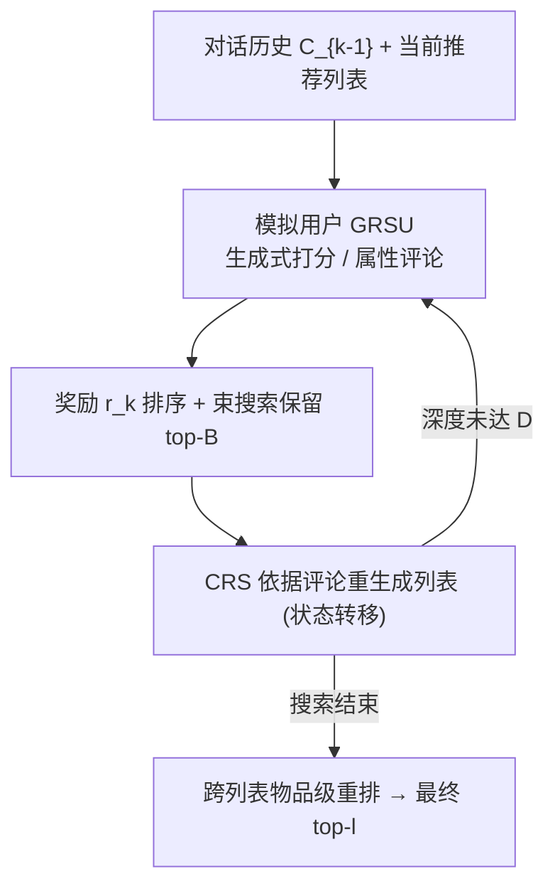
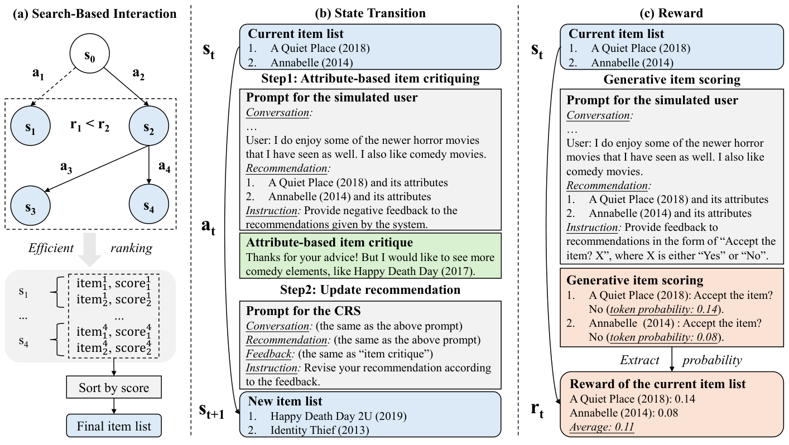

# Search-Based Interaction For Conversation Recommendation via Generative Reward Model Based Simulated User (基于生成式奖励模型模拟用户的搜索式对话推荐交互)

- **会议/期刊**: SIGIR 2025
- **作者与机构**: Xiaolei Wang, Chunxuan Xia, Junyi Li, Fanzhe Meng, Lei Huang, Jinpeng Wang, Wayne Xin Zhao, Ji-Rong Wen（中国人民大学高瓴人工智能学院、NUS、电子科技大学、美团）
- **推荐链路定位**: 重排（对话内多轮候选精炼与列表级重排）
- **研究方向**: 对话推荐与智能体仿真 / 大语言模型推荐
- **论文原文**: [https://arxiv.org/abs/2504.20458v1](https://arxiv.org/abs/2504.20458v1)
- **开源代码**: [https://github.com/RUCAIBox/GRSU](https://github.com/RUCAIBox/GRSU)

## TL;DR (1分钟核心速览)

对话推荐的核心痛点是用户偏好多维复杂（如同时爱"恐怖"与"喜剧"），而现有 CRS 多为单轮生成、无法在推理时获得真实用户反馈；已有 LLM 模拟用户又依赖 ground-truth 偏好标签，推理时不可得。本文提出 GRSU：以生成式奖励模型（GRM）为骨架，把"生成式物品打分"（粗粒度）与"基于属性的物品评论"（细粒度）统一为指令格式，用合成数据指令微调出**无标签模拟用户**，再将其与 CRS 的多轮交互形式化为 MDP 并用束搜索求解，最后用搜索过程中已算好的物品分数做高效候选重排。在 INSPIRED 上 Recall@10 从 0.192（DCRS）提升至 0.352（+83.3%），且仅 1 轮交互即超越最强基线。

## Background & Motivation (背景与核心矛盾)

- **主流范式**: 现有 LLM-based CRS 通过引入知识图谱、LLM 内部知识或对话推荐语料（DCRS 检索示例、ReFICR 指令微调）来补足对话上下文稀疏问题，本质仍是**单轮**：仅凭对话历史一次性生成推荐列表。
- **前人局限**: 其一，用户偏好是多面的（multi-faceted），单轮生成只能抓住对话中显式提及的某一侧面（如只抓"horror"而漏掉"comedy"），NBCRS 靠相似对话的物品频率缓解，但无法泛化到新偏好；其二，让真实用户频繁参与交互会损害体验，而现有 LLM 模拟用户（如 iEvaLM 类工作）必须喂入 ground-truth 偏好才能 role-play，**推理时该标签不存在**。
- **核心洞察 (Key Insight)**: 复杂推理任务中的奖励模型能在**无 ground-truth 答案**时评估候选轨迹正确性并给出反馈；生成式奖励模型（GRM）进一步把奖励表示为特定 token（"Yes"/"No"）的生成概率，天然适配"以自然语言反馈"为输出形式的模拟用户。
- **本文切入点**: 把"模拟用户"重新定义为"面向推荐列表的生成式奖励模型"，用两种粒度的反馈动作驱动 CRS 迭代修正推荐，从而在不接触真实用户、不需要偏好标签的前提下解锁多轮交互收益。

## Method (核心方法设计)

### 1. 整体框架 (Overall Architecture)

GRSU 分三段闭环：(1) **模拟用户构建**——以 Llama-3.1-8B-Instruct 为底座，用 Llama-3.3-70B 合成两类指令数据（评论 + 打分），统一做指令微调；(2) **搜索式交互**——把 CRS 与模拟用户的多轮对话建模为 MDP，状态 $s_k$为当前推荐列表$\hat{\mathcal{I}}_k$、动作$a_k$为模拟用户给出的属性评论$f^c_k$、转移$T$由 CRS 依据"历史+列表+评论"重新生成列表实现、奖励$r_k$取生成式打分$f^s_k$，用束搜索在深度$D$内扩展；(3) **高效重排**——汇总搜索过程中所有候选列表里的物品，按搜索时已算出的单品分数排序取 top-$l$ 作为最终推荐。CRS 侧不微调，直接用通用 LLM（主实验 Phi-4）零样本扮演。

<figure class="paper-figure" markdown="span">
  <figcaption>图 1：方法概览。(a) 我们在 CRS 与模拟用户之间使用基于搜索的交互来生成候选物品，随后通过高效的排序方法得出最终物品列表。(b) 简化的状态转移示例：从当前状态（即物品列表）出发，模拟用户提供基于属性的物品评论，CRS 利用这些评论改进其先前的推荐，从而转移到下一个状态。(c) 简化的奖励示例：给定当前状态（即物品列表），模拟用户提供生成式物品评分。</figcaption>
</figure>

### 2. 关键设计拆解 (Key Designs)

1. **生成式物品打分（粗粒度奖励）**：判别式打分需外挂线性头、割裂 LLM 文本生成能力，且与模拟用户的生成式输出形式不匹配。本文把打分改写为单选题"Accept the recommendation (Yes/No)?"，取所选选项 token 的预测概率作为单品分数，列表分数取单品均值：
$$f^s_k=\frac{1}{|\hat{\mathcal{I}}^a_k|}\sum_{j=1}^{|\hat{\mathcal{I}}^a_k|}\Phi_s\big(M_u(C_{k-1},\hat{i}^a_j,d_s)\big)$$
逐品打分再平均比直接给整列表打分更易学习，且概率值天然可跨列表比较，为后续重排提供统一尺度。

2. **基于属性的物品评论（细粒度反馈）**：早期 critiquing 受限于预定义属性空间，纯 LLM 评论又易与真实偏好错位（奖励模型存在"抓表面特征"的 reward hacking）。本文在提示中注入推荐物品的 genre/actor/writer/director 属性，令模拟用户从属性视角生成**具体且可操作**的评论 $f^c_k=M_u(C_{k-1},\hat{\mathcal{I}}^a_k,d_c)$，使 CRS 能定位"缺喜剧元素"这类可修正的偏差。合成数据时特意构造两类列表（含 ground-truth 物品的子集采样 / 全负样本列表），并在训练指令中注入用户偏好$p_k$、推理时移除，实现"训练有监督、推理无标签"的桥接。

3. **训练目标、负采样与推理效率**：两类动作共享上下文、仅任务描述不同，故统一为序列到序列损失 $\mathcal{L}=-\sum_{(I,o)\in\mathcal{D}}\sum_{i=1}^{|o|}\log \Pr(o_i\mid o_{<i},I;\Theta_u)$。打分行为的负样本为每个 ground-truth 物品额外采 1 个负例；评论行为用"全负列表"隐式提供负信号。推理侧束宽/扩展宽均为 4、深度 5，重排仅需一次排序（分数已在搜索中算好），无额外模型调用。

## Experimental Setup & Evaluation Protocol (实验设置与评估协议)

- **数据集与预处理**: 沿用 LLM-based CRS 通用设定，去除每个对话内重复物品以保证评测可靠：

| 数据集 | #Conversations | #Turns | #Users | #Items | 特征/场景说明 |
| :--- | :---: | :---: | :---: | :---: | :--- |
| INSPIRED | 999 | 35,686 | 999 | 1,967 | 低资源电影对话推荐 |
| ReDial | 11,348 | 139,557 | 764 | 6,281 | 高资源电影对话推荐 |

- **数据划分与防穿越 (Splitting Strategy)**: 沿用 DCRS/ReFICR 的对话级划分，测试对话内已推荐物品去重；模拟用户训练数据由 Llama-3.3-70B 在**训练集对话**上合成，测试集偏好不参与合成。
- **排名评测协议 (Ranking Protocol)**: 列表长度固定 $l=10$，报告 Recall@{10,50}、NDCG@{10,50}、MRR@{10,50}，三次运行取均值；显著性用$t$-test（$p<0.05$，表中 `*` 标注）。属**候选列表内排序**评测（非全库 Full-Ranking），指标上限受列表长度约束。
- **对比基线与超参设置**: 两组基线——传统模型（Popularity、TextCNN）与零样本通用 LLM（Llama-3.1-8B、Phi-4、Llama-3.3-70B、GPT-4o），以及代表性 CRS（TREA、VRICR、DCRS、NBCRS、ReFICR）。模拟用户底座 Llama-3.1-8B，lr=$10^{-6}$、batch=4、1 epoch、AdamW + cosine decay、bf16 + FlashAttention-2 + ZeRO-3。

## Key Experimental Results (实验关键数据)

### 1. 主实验对比 (Main Results)

| 方法 | ReDial R@10 | ReDial N@10 | ReDial MRR@10 | INSPIRED R@10 | INSPIRED N@10 | INSPIRED MRR@10 |
| :--- | :---: | :---: | :---: | :---: | :---: | :---: |
| Popularity | 0.053 | 0.029 | 0.021 | 0.155 | 0.085 | 0.064 |
| Llama-3.1-8B (zero-shot) | 0.147 | 0.077 | 0.055 | 0.166 | 0.090 | 0.066 |
| GPT-4o (zero-shot) | 0.187 | 0.104 | 0.079 | 0.217 | 0.124 | 0.096 |
| TREA | 0.175 | 0.083 | 0.055 | 0.136 | 0.080 | 0.063 |
| DCRS | 0.179 | 0.091 | 0.064 | 0.192 | 0.123 | 0.101 |
| ReFICR | 0.216 | 0.099 | 0.065 | 0.147 | 0.074 | 0.051 |
| **GRSU (Ours)** | **0.250\*** | **0.135\*** | **0.100\*** | **0.352\*** | **0.212\*** | **0.170\*** |
| Improv. (vs 最优基线) | +15.7% | +29.8% | +26.6% | +83.3% | +72.4% | +68.3% |

### 2. 消融实验 (Ablation Study)

| 配置 | Recall@10 | Recall@50 | NDCG@10 | NDCG@50 |
| :--- | :---: | :---: | :---: | :---: |
| GRSU 完整 | **0.352** | **0.559** | **0.212** | **0.258** |
| w/o 属性评论（critiquing） | 0.300 | 0.511 | 0.184 | 0.232 |
| w/o 生成式打分（scoring） | 0.156 | 0.382 | 0.083 | 0.131 |
| w/o 高效重排（ranking） | 0.317 | 0.436 | 0.196 | 0.223 |
| 评论：去指令微调 | 0.300 | 0.511 | 0.184 | 0.232 |
| 评论：去物品属性 | 0.299 | 0.487 | 0.169 | 0.212 |
| 打分：去指令微调 | 0.156 | 0.382 | 0.083 | 0.131 |
| 打分：判别式打分 | 0.287 | 0.503 | 0.124 | 0.191 |
| 打分：多数投票 | 0.189 | 0.387 | 0.093 | 0.136 |

### 3. 关键实验发现 (Key Findings)

1. **生成式打分是性能命门，且直接决定排序质量**：移除打分后 Recall@10 从 0.352 崩至 0.156（-55.7%），NDCG@10 跌幅更大（0.212→0.083），说明奖励信号既决定搜索方向也决定列表内排序；判别式打分（0.287）与多数投票（0.189）均远逊，印证 LLM 与真实用户存在分布鸿沟、必须靠指令微调对齐。
2. **模拟用户具备跨数据集可迁移性**：仅在 ReDial（高资源）上训练的模拟用户，在 INSPIRED 上 Recall@10 达 0.304，远超仅用 INSPIRED 自训练的 0.234；两者合并训练进一步升至 0.352。原因在于模拟用户只学"对推荐列表给反馈"而非直接生成物品，与物品集解耦，天然规避了 CRS 的跨域物品集不匹配问题。
3. **交互收益随深度单调增长且效率占优**：深度 1→5 时两数据集指标持续上升；INSPIRED 上第 1 轮即超越 ReFICR，ReDial 上第 3 轮超越。搜索策略对比中，束搜索（0.352/0.212）优于 Monte Carlo（0.293/0.192）与同搜索空间的贪心（0.338/0.210），证明"评论驱动的状态转移"本身贡献了增益，而非单纯扩大采样。

## Highlights & Limitations (亮点、对比与审稿批判)

- **与代表作对比 (vs. Prior Work)**: 与 ReFICR 的本质区别是"微调 CRS"vs"微调模拟用户"——后者与物品集解耦，故可跨数据集迁移且 CRS 侧零样本；与 DCRS 的区别是检索相似对话的集体模式 vs 在线多轮反馈的个体偏好澄清；与既有 LLM 模拟用户（评测导向）的区别是**无需 ground-truth 偏好标签**，可直接用于推理期增强而非仅离线评测。
- **可迁移亮点**: (1) "训练时注入偏好、推理时移除"的指令合成技巧，可推广到任何需要无标签监督的模拟器/评审器构建；(2) 把搜索过程中已计算的单品分数复用于跨列表重排，几乎零额外开销，可迁移到 Best-of-N 类 LLM 推荐解码。
- **审稿级局限批判**: (1) 效率账未算全——每轮需 CRS 与模拟用户各一次 LLM 调用，束宽 4×深度 5 意味着数十次前向，论文只报"轮数"未报 token/延迟成本，线上部署代价存疑；(2) 评测限于列表长度 10 的候选内排序，未做全库 Full-Ranking，且仅两个电影域数据集、属性仅 4 类，跨域（电商/POI）与属性稀疏场景的泛化性未验证。

## Rating (四维评分)

- **方法创新性 (Novelty)**: ⭐⭐⭐⭐ （首次将生成式奖励模型迁移为无标签模拟用户，把 CRS 交互形式化为奖励引导搜索，视角新颖但组件均为已有技术的巧妙重组）
- **评估协议与实验扎实度 (Protocol & Experiments)**: ⭐⭐⭐⭐ （两数据集 + 三组基线 + 显著性检验 + 消融/迁移/搜索策略/深度分析齐全，但缺全库排序与效率量化）
- **写作与数学规范度 (Clarity & Rigor)**: ⭐⭐⭐⭐ （MDP 形式化与两动作公式定义清晰、图示直观，但部分符号在正文与公式间略有重复冗余）
- **工业落地与复现价值 (Industrial & Practical Value)**: ⭐⭐⭐⭐ （代码开源、CRS 侧零微调、模拟用户可跨域复用，落地门槛低；但多轮 LLM 调用的推理成本是主要工程障碍）

