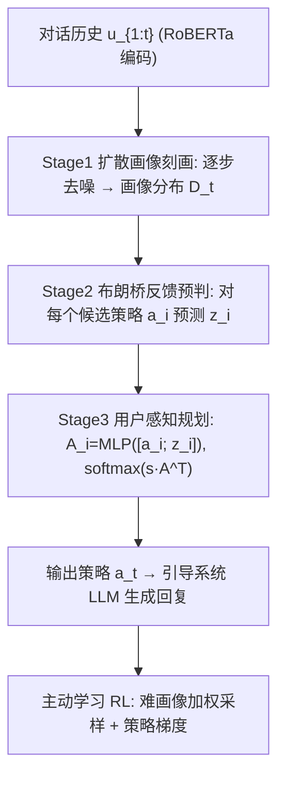
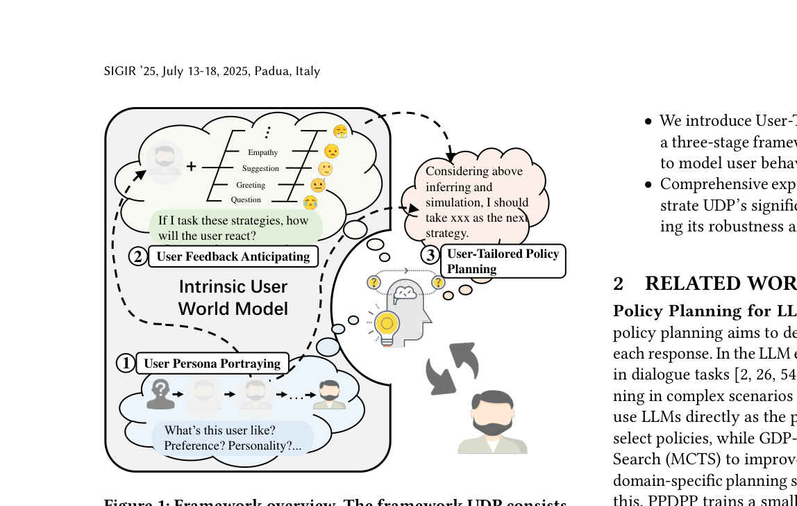

# Simulating Before Planning: Constructing Intrinsic User World Model for User-Tailored Dialogue Policy Planning (先模拟后规划：面向用户定制对话策略规划的内在用户世界模型)

- **会议/期刊**: SIGIR 2025
- **作者与机构**: Tao He, Ming Liu, Bing Qin (哈尔滨工业大学)；Lizi Liao (新加坡管理大学)
- **推荐链路定位**: 对话策略规划（对话推荐/对话搜索中的策略选择层，等价于对话交互的"重排/决策"环节）
- **研究方向**: 对话推荐与智能体仿真 / 大语言模型推荐
- **论文原文**: [https://arxiv.org/abs/2504.13643v1](https://arxiv.org/abs/2504.13643v1)
- **开源代码**: 暂未开源

## TL;DR (1分钟核心速览)

现有 LLM 对话策略规划器只用**统一的中性用户提示**做自博弈，忽视了用户画像差异，导致面对"拒绝型/内向型/神经质"用户时策略失效（P4G 上 SR 跨画像最大差 19.2%，ESConv 达 34.9%）。本文提出 UDP：先用**条件扩散模型**在对话轮次中逐步"去噪"推断用户画像，再用**布朗桥过程**预判各候选策略下的用户反馈，最后融合二者做用户感知的策略打分，并配合**难画像优先的主动学习**在线 RL。在 P4G/ESConv 自博弈评测上 SR 达 0.598/0.832，较最强基线 TRIP 提升 0.103/0.024。

## Background & Motivation (背景与核心矛盾)

- **主流范式**: 对话策略规划分两派——提示工程派（ProCoT 用 CoT 选策略、GDP-Zero 用 MCTS 搜索）与外部训练小规划器派（PPDPP 用 RL 训练 RoBERTa 规划器、TRIP 让 LLM 推断用户心理状态）。
- **前人局限**: 其一，所有方法都用**固定统一的用户提示**模拟用户，用户 agent 退化为 LLM 的"默认人格"，无法体现收入、性格、决策风格等差异；其二，TRIP 虽引入 20 种 BIG-5 画像，但画像是**任务无关**的，且仅靠 LLM 零样本推断，缺乏可学习的用户状态估计。
- **核心洞察 (Key Insight)**: 作者用任务定制画像做验证实验，发现同一规划器在不同画像上的成功率差异巨大（P4G 平均 |Δ|SR=0.192，ESConv 达 0.349），且"Rejective"用户在 P4G 上 SR 仅 0.35–0.375，说明**用户多样性是策略规划的一阶变量而非噪声**。
- **本文切入点**: 把"用户"显式建模为智能体的**内在世界模型**——先推断"用户是什么样的人"，再模拟"我这么做他会怎么反应"，最后据此选策略，即"先模拟、后规划"。

## Method (核心方法设计)

### 1. 整体框架 (Overall Architecture)

UDP 将对话策略规划建模为 MDP $(\mathcal{S},\mathcal{A},r,\mathcal{T})$，策略$\pi_\theta(a_t|s_{t-1})$ 在每轮从专家预定义策略集中选一个动作。三阶段串行：Stage 1 用条件扩散模型把"对话历史"作为条件，随轮次推进逐步去噪出用户画像分布；Stage 2 以画像为布朗桥终点状态，对每个候选策略扰动桥的密度，输出该策略下用户下一轮反馈的高斯分布；Stage 3 将对话状态与画像融合，并把"策略特征 + 预判反馈"拼接为动作表征，用点积 softmax 打分。训练上先分阶段预训练（画像分类 CE、反馈对比学习、策略监督），再冻结前两阶段、仅对 Planner 做策略梯度在线 RL，并按画像难度动态调整采样权重。

<figure class="paper-figure" markdown="span">
  <figcaption>图1：框架概览。UDP框架包含三个阶段：用户画像刻画、用户反馈预判和用户定制策略规划。</figcaption>
</figure>

### 2. 关键设计拆解 (Key Designs)

1. **扩散式用户画像刻画 (Diffusion-based Portrayer)**：痛点是 LLM 零样本推断画像能力弱且随轮次不收敛。作者把"对话开始时对用户一无所知 → 结束时画像清晰"类比为扩散去噪：$t=0$时$x_N\sim\mathcal{N}(0,1)$为纯噪声，每轮对话后执行$N/T$步去噪（$N=1000,T=10$），条件为历史用户话语编码$\mathbf{u}_{1:t}$。关键是不直接用中间态$x_t^i$，而是用 Tweedie 式估计$\hat{x}_0=\frac{1}{\sqrt{\bar\alpha_i}}x_t^i-\frac{\sqrt{1-\bar\alpha_i}}{\sqrt{\bar\alpha_i}}\hat\epsilon_t$，再与$M$个预编码画像表征$\mathbf{p}_i$算相似度得分布$D_t$。直觉：画像推断本质是"信息逐步注入的渐进消歧"，与去噪轨迹同构。
2. **布朗桥反馈预判 (Brownian Bridge Anticipator)**：痛点是逐策略模拟用户反应若用 LLM 自博弈则开销爆炸。作者为每个画像建一条布朗桥，起点 $z_0=\vec{0}$、终点$z_T=f_P(p_i)$（画像经 MLP 映射），并引入策略扰动项$z_a=f_a(a_t)$，得到下一轮用户反馈分布：
$$p(z_t)\sim\mathcal{N}\Big(\underbrace{\tfrac{(T-t)(z_{t-1}+z_a)}{T-t+1}+\tfrac{z_T}{T-t+1}}_{\mu_t},\ \underbrace{\tfrac{4(T-t)\psi(z_a)}{(T-t+1)^2}}_{\sigma_t^2}\Big)$$
   利用布朗桥在子区间 $[\tau,T]$ 上仍成立的性质做前向预测，方差随轮次递减，天然表达"越聊越确定"。与 COLOR 用布朗桥建模**系统策略轨迹**不同，本文用它建模**用户反馈状态**。
3. **训练目标、负采样与推理效率**：三阶段损失分别为 $\mathcal{L}_{upp}=\text{CE}(D_t,y_p)$、$\mathcal{L}_{ufa}=-\log\frac{\exp(d(\hat z_t;z_t^+))}{\sum_{z\in\mathcal{B}}\exp(d(\hat z_t;z))}$（批内对比，距离$d=-\frac{1}{2\sigma_t^2}\|\hat z_t-z\|_2^2$，即高斯核负样本）、$\mathcal{L}_{uapp}=-\sum_t\log\pi_\theta(a_t|s_{t-1})$；在线阶段$\mathcal{L}_{rl}=-\sum_t\log\pi_\theta(a_t|s_{t-1})\cdot R_t$。主动学习权重更新：成功则$w_i\leftarrow w_i+\mathbb{I}(i=j)$，失败则$w_i\leftarrow w_i-\mathbb{I}(i=j)$，使难画像被更频繁采样。推理时画像与反馈均由轻量模块给出，无需额外 LLM 调用。

## Experimental Setup & Evaluation Protocol (实验设置与评估协议)

- **数据集与预处理**: 两个任务基准，画像由 GPT-3.5-turbo 按任务定制维度生成：

| 数据集 | 任务类型 | 画像维度 | #Train Profiles | #Valid/#Test | 场景说明 |
| :--- | :---: | :---: | :---: | :---: | :--- |
| P4G | 非合作（劝捐） | 收入×性格×决策型 × 难度 = 16 类 | 400 (25/类) | 80 / 80 | 说服用户捐款，含 hard/easy 难度 |
| ESConv | 合作（情感支持） | 外向性×开放性×神经质 = 8 类 | 40 (5/类) | 8 / 8 | 情绪疏导，每画像配 10 个问题 |

- **数据划分与防穿越 (Splitting Strategy)**: 按**用户画像分层划分**训练/验证/测试 profile，测试画像与训练画像不重叠；对话由 system/user/critic 三个 LLM 自博弈生成，非真实日志。
- **排名评测协议 (Ranking Protocol)**: 非检索式排序，采用**自博弈闭环评测**——critic（GPT-3.5-turbo，温度 1.1，采样 10 次取标量奖励）判定目标是否达成，阈值 0.6，最大 10 轮。指标为 SR（成功率）、SSR（末轮奖励均值）、AvgT（平均轮数）。结果取 5 次推理平均，$t$检验$p<0.05$。
- **对比基线与超参设置**: 提示类（Standard、Proactive、ProCoT、ICL-AIF、GDP-Zero）与规划器类（PPDPP、TRIP）；编码器为冻结 RoBERTa-base，扩散步数 $N=1000$，最大轮数$T=10$。

## Key Experimental Results (实验关键数据)

### 1. 主实验对比 (Main Results)

| Models | P4G SSR↑ | P4G SR↑ | P4G AvgT↓ | ESConv SSR↑ | ESConv SR↑ | ESConv AvgT↓ |
| :--- | :---: | :---: | :---: | :---: | :---: | :---: |
| Standard | 0.250 | 0.445 | 8.265 | 0.612 | 0.640 | 8.097 |
| ProCoT | 0.352 | 0.543 | 7.975 | 0.392 | 0.475 | 8.670 |
| ICL-AIF | 0.301 | 0.465 | 8.085 | 0.709 | 0.744 | 7.429 |
| GDP-Zero | 0.067 | 0.328 | 9.119 | 0.525 | 0.595 | 8.041 |
| PPDPP | 0.266 | 0.463 | 8.185 | 0.664 | 0.709 | 7.652 |
| TRIP | 0.290 | 0.495 | 8.200 | 0.744 | 0.808 | **6.835** |
| **UDP (Ours)** | **0.433** | **0.598** | **7.705** | **0.774** | **0.832** | 7.585 |
| Improv. vs TRIP | +49.3% | +20.8% | — | +4.0% | +3.0% | — |

### 2. 消融实验 (Ablation Study)

| 配置 | P4G SSR | P4G SR | ESConv SSR | ESConv SR |
| :--- | :---: | :---: | :---: | :---: |
| UDP 完整 | **0.433** | **0.598** | 0.742 | 0.791 |
| w/o Active Learning | 0.392 | 0.563 | 0.729 | 0.774 |
| w/o Stage 2 (反馈预判) | 0.344 | 0.525 | **0.774** | **0.832** |
| w/o Stage 1&2 (退化为纯规划器) | 0.322 | 0.500 | 0.713 | 0.773 |
| w/o Pretraining (仅 RL) | 0.305 | 0.513 | 0.736 | 0.772 |
| w/o RL (仅预训练) | 0.353 | 0.533 | 0.455 | 0.531 |

### 3. 关键实验发现 (Key Findings)

1. **反馈预判是任务相关的双刃剑**：P4G（非合作）去掉 Stage 2 后 SR 从 0.598 掉到 0.525，说明对抗场景下"预判对方反应"是核心；但 ESConv（合作）去掉 Stage 2 反而升到 0.832，作者归因于情绪支持中用户反应高度不可预测（尤其 Neurotic 用户），预判噪声反而干扰策略选择。
2. **主动学习显著抬升难画像下限**：在 ESConv 的 Introvert/Neurotic/Conservative 三类难画像上，UDP 较 TRIP 的 SR 分别提升 0.125/0.769/0.109；但代价是 Emotional 与 Financially-tight 画像出现轻微下降，暴露难样本加权带来的分布偏移。
3. **扩散画像器优于 LLM 零样本推断且随轮次收敛**：F1 随对话轮次单调上升（ESConv 末轮达 0.77），而 ChatGPT 推断在 ESConv 上不升反降；策略分布分析中 UDP 的 Intra/Inter JS 散度为 0.052/0.193（P4G），远优于 ProCoT 的 0.105/0.118，证明其真正做到了"同画像内策略一致、跨画像策略分化"。

## Highlights & Limitations (亮点、对比与审稿批判)

- **与代表作对比 (vs. Prior Work)**: 相比 PPDPP 仅训练规划器、用户侧用统一提示，UDP 把用户建模为可学习模块；相比 TRIP 用 LLM 零样本猜心理状态且画像任务无关，UDP 用扩散模型做**有监督的渐进画像推断**并用布朗桥做**显式反馈模拟**；相比 COLOR 用布朗桥建模系统策略轨迹，UDP 将其迁移到用户侧，形成"世界模型"闭环。
- **可迁移亮点**: ①"扩散去噪 ≡ 随交互逐步消歧的隐状态推断"这一类比可迁移到会话推荐中的实时兴趣推断；②布朗桥 + 策略扰动项 $z_a$ 的轻量反事实模拟，可替代昂贵的 LLM 自博弈做候选策略预筛。
- **审稿级局限批判**: ①评测完全依赖 LLM 自博弈与 LLM critic，缺乏真实用户在线 A/B，SR 的绝对数值可信度存疑；②ESConv 上 AvgT 劣于 TRIP（7.585 vs 6.835），且 Stage 2 在合作场景负增益，说明框架的任务泛化性依赖人工判断；③扩散步数 $N=1000$与每轮$N/T$ 步去噪的超参敏感性、以及主动学习导致的画像分布偏斜均未充分讨论。

## Rating (四维评分)

- **方法创新性 (Novelty)**: ⭐⭐⭐⭐ （扩散去噪类比画像渐进推断 + 布朗桥建模用户反馈，两处迁移均有清晰物理直觉，但均为已有工具的跨域借用）
- **评估协议与实验扎实度 (Protocol & Experiments)**: ⭐⭐⭐ （任务定制画像协议与消融较完整，但全链路 LLM 自博弈评测、无真实用户验证，指标绝对值说服力有限）
- **写作与数学规范度 (Clarity & Rigor)**: ⭐⭐⭐⭐ （三阶段公式与损失定义清晰，布朗桥条件分布的推导交代完整，符号一致性良好）
- **工业落地与复现价值 (Industrial & Practical Value)**: ⭐⭐⭐ （画像与预判模块轻量、推理不需额外 LLM 调用，但依赖自博弈数据构造与多 LLM 训练管线，且未开源）

