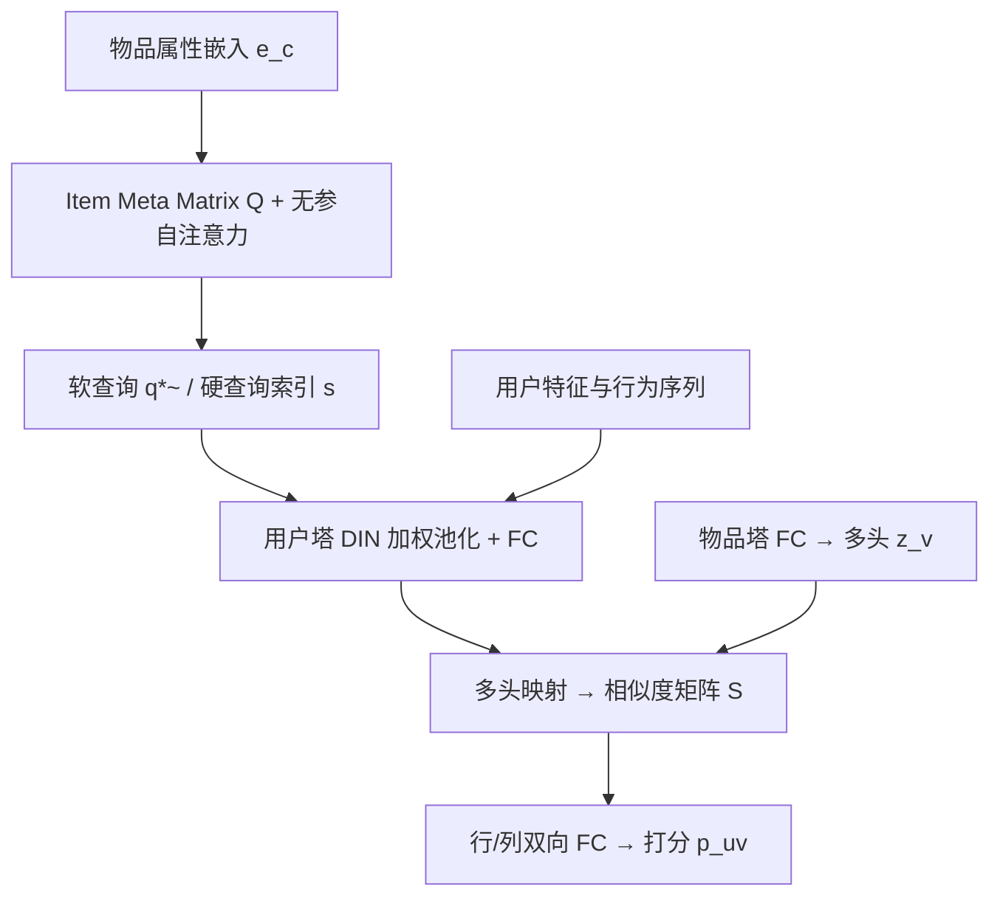
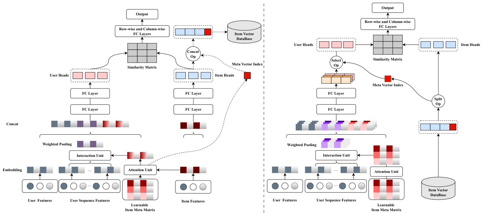

# A Learnable Fully Interacted Two-Tower Model for Pre-Ranking System (面向粗排系统的可学习全交互双塔模型)

- **会议/期刊**: SIGIR 2025
- **作者与机构**: Chao Xiong, Xianwen Yu, Wei Xu, Lei Cheng, Chuan Yuan, Linjian Mo（蚂蚁集团 Ant Group）
- **推荐链路定位**: 粗排 (Pre-Ranking)
- **研究方向**: 协同过滤与双塔召回 / CTR 预估与特征交叉
- **论文原文**: [https://arxiv.org/abs/2509.12948v1](https://arxiv.org/abs/2509.12948v1)
- **开源代码**: 暂未开源

## TL;DR (1分钟核心速览)

粗排双塔模型因用户/物品塔完全解耦，只能在输出层做点积，导致早期特征交互缺失、晚期交互表达力受限。本文提出 FIT：用可学习 Item Meta Matrix 生成"硬/软查询"注入用户塔，实现**显式早期交互**且不破坏解耦范式；再用行/列双向 FC 处理相似度矩阵替代 sum-max 打分，实现**高效晚期交互**。在 ML-1M、Amazon Electro/Books、Taobao 四个数据集上，AUC 相对 Two-Tower 提升 4.58%–14.34%，推理延迟仅 26.9ms（2000 候选），存储成本与双塔持平。

## Background & Motivation (背景与核心矛盾)

- **主流范式**: 工业粗排普遍采用双塔（DSSM）结构，物品表征离线预计算入库，在线仅算用户塔，复杂度 $O(N+kM)$远优于单塔$O(kN)$。
- **前人局限**: ① 双塔解耦使两塔在输出层前零交互，用户行为序列只能做 sum/average pooling，无法像 DIN 那样用目标物品做 attention；② 晚期交互仅靠点积或手工 sum-max 归约，LITE 已证明 sum-max 表达力受限，且多头物品表征带来 8× 存储与额外延迟。
- **核心洞察 (Key Insight)**: 若能把"物品侧泛化信息"压缩成一组可学习的聚类中心（meta 向量）并提前注入用户塔，就能在**不破坏物品离线预计算**的前提下获得显式早期交互。
- **本文切入点**: 用 Item Meta Matrix 做"物品聚类代理"，训练时软查询、推理时硬查询索引，兼顾表达力与解耦效率。

## Method (核心方法设计)

### 1. 整体框架 (Overall Architecture)

FIT 保留双塔解耦范式。物品塔输出表征 $\mathbf{h}_v$的同时，用物品属性嵌入$\mathbf{e}_c$对可学习 Item Meta Matrix$\mathbf{Q}\in\mathbb{R}^{N\times D}$做无参自注意力与 softmax 加权，得到软查询$\tilde{\mathbf{q}}^*$（训练）或硬查询索引$s$（推理）。用户塔将$\tilde{\mathbf{q}}^*$作为 query 对行为序列做 DIN 式加权池化，拼入用户特征后过 FC 得$\mathbf{h}_u$。两塔表征再映射到多头子空间，计算相似度矩阵$\mathbf{S}$，经行/列双向 FC 得最终打分。推理时物品侧仅存$[s\|\mathbf{z}_v]$，用户塔并行算出全部$N$ 组用户表征，按索引选一组完成打分。

<figure class="paper-figure" markdown="span">
  <figcaption>图2：我们提出的FIT的整体架构。左侧部分展示训练阶段，右侧部分展示推理阶段。</figcaption>
</figure>

### 2. 关键设计拆解 (Key Designs)

1. **Meta Query Module（MQM，显式早期交互）**：痛点是无物品信息时序列池化只能平均。做法是用无参自注意力 $\mathbf{Q}^*=(\mathbf{Q}\mathbf{Q}^\top)\mathbf{Q}$ 生成查询组，再以温度 softmax 加权得软查询：
$$\tilde{\mathbf{q}}^*=\mathbf{k}\mathbf{Q}^*,\quad k_i=\frac{\exp(\mathbf{e}_c\mathbf{q}_i^\top/\tau)}{\sum_{t=1}^{N}\exp(\mathbf{e}_c\mathbf{q}_t^\top/\tau)}$$
   温度 $\tau$ 从 1.0 线性衰减至 0.001，前期多查询同时更新加速收敛，后期逼近 argmax 保证训推一致。直觉：meta 向量是物品簇中心，用户塔借它"预知"候选物品类别，从而做有目标的序列注意力。

2. **Lightweight Similarity Scorer（LSS，高效晚期交互）**：痛点 sum-max 是手工归约且多头存储昂贵。做法是把 $\mathbf{h}_u,\mathbf{h}_v$映射为$H_u\times H_v$头，算相似度矩阵$S_{ij}=(\mathbf{z}_u^i)^\top\mathbf{z}_v^j$，再依次做行向、列向 FC：
$$\mathbf{S}'_{i,:}=\text{ReLU}(\mathbf{W}_1\mathbf{S}_{i,:}+\mathbf{b}_1),\quad \mathbf{S}''_{:,j}=\text{ReLU}(\mathbf{W}_2\mathbf{S}'_{:,j}+\mathbf{b}_2)$$
   最后 $\mathbf{w}^\top\text{Flatten}(\mathbf{S}'')$输出标量。相比直接 flatten 全连接，参数量从$O(H_uH_v d)$降至$O((H_u+H_v)d)$，且 LITE 已证该结构在紧致头数下仍是连续打分函数的通用逼近器。

3. **训练目标与推理效率**：采用交叉熵损失 $\mathcal{L}=-\frac{1}{T}\sum_{(u,v,y)}(y\log\sigma(p_{uv})+(1-y)\log(1-\sigma(p_{uv})))$，负样本为随机采样未交互物品（1:1）。推理时物品侧仅多存 1 bit 查询索引，用户塔并行计算$N$ 组表征后按索引选取，延迟与标准双塔同量级。

## Experimental Setup & Evaluation Protocol (实验设置与评估协议)

- **数据集与预处理**:

| 数据集 | #Users | #Items | #Interactions | 稀疏度/密度 | 特征/场景说明 |
| :--- | :---: | :---: | :---: | :---: | :--- |
| ML-1M | 6,040 | 3,668 | 1,000,000 | 4.51% | 电影评分，评分视为行为 |
| Amazon Electro | 192,403 | 63,001 | 1,689,188 | 0.014% | 评论视为行为，序列截断 50 |
| Amazon Books | 603,668 | 367,982 | 8,898,041 | 0.004% | 同上 |
| Taobao | 1,061,768 | 785,597 | 26,557,961 | 0.003% | 展示广告点击，序列截断 50 |

- **数据划分与防穿越 (Splitting Strategy)**: 按用户行为时间排序，用前 $T-1$条预测第$T$ 条（类 `Leave-One-Out` 时序切分）；训练集内随机 20% 作验证集早停。
- **排名评测协议 (Ranking Protocol)**: 采用 `Sampled Ranking`，每正样本随机配 1 个未交互负样本，指标为 AUC、Logloss 与 RelaImpr（式 22），非全库 Full-Ranking。
- **对比基线与超参设置**: 基线含 Two-Tower、DAT、COLD、IntTower、RankTower；嵌入维度 16，FC 深度 3、隐层 [300,300,128]，batch 2048，Adam lr=0.001，$N=64$，$H_u=H_v=2$、子空间 64 维；实验重复 10 次取均值，双侧 t 检验$p<0.05$。

## Key Experimental Results (实验关键数据)

### 1. 主实验对比 (Main Results)

| Model | ML-1M AUC | RelaImpr | Amazon Electro AUC | RelaImpr | Amazon Books AUC | RelaImpr | Taobao AUC | RelaImpr |
| :--- | :---: | :---: | :---: | :---: | :---: | :---: | :---: | :---: |
| Two-Tower | 0.8695 | 0.00% | 0.8441 | 0.00% | 0.8742 | 0.00% | 0.6577 | 0.00% |
| DAT | 0.8784 | 2.41% | 0.8465 | 0.70% | 0.8802 | 1.61% | 0.6605 | 1.74% |
| COLD | 0.9009 | 8.51% | 0.8504 | 1.82% | 0.8996 | 6.80% | 0.6645 | 4.28% |
| IntTower | 0.9036 | 9.24% | 0.8490 | 1.42% | 0.8972 | 6.15% | 0.6638 | 3.81% |
| RankTower | 0.9095 | 10.82% | 0.8520 | 2.31% | 0.9031 | 7.75% | 0.6630 | 3.34% |
| **FIT** | **0.9225\*** | **14.34%** | **0.8598\*** | **4.58%** | **0.9171\*** | **11.47%** | **0.6736\*** | **10.03%** |

效率对比（Taobao，2000 候选）：FIT 训练 260s、延迟 26.9ms、存储 1×；RankTower 延迟 33.3ms，IntTower 存储 8×，COLD 延迟 31.4ms 且无存储但需在线算物品塔。

### 2. 消融实验 (Ablation Study)

| 变体 | 说明 | 效果趋势 |
| :--- | :--- | :--- |
| w/o MQM | 去掉 MQM，序列改平均池化 | 性能显著下降（降幅最大） |
| w/o LSS | 输出层退回点积 | 明显下降 |
| w SumMax | LSS 换 sum-max 打分 | 低于 FIT |
| w FC | 相似度矩阵直接 flatten 接 FC | 低于 FIT，参数更多 |

### 3. 关键实验发现 (Key Findings)

1. **早期交互是主要增益来源**：去掉 MQM 后性能跌幅最大，说明把物品侧泛化信息注入用户塔、让序列池化"有目标"是 FIT 相对纯晚期交互方案（IntTower/RankTower）拉开差距的核心。
2. **LSS 在同等头数下全面优于 sum-max**：图 8 显示所有头数设置下 LSS 均领先，且仅需 $H=2$ 即可达到 sum-max 多头效果，存储与标准双塔持平（1×），而 IntTower 需 8× 存储。
3. **软/硬查询与温度机制缺一不可**：图 5 表明软查询+衰减温度时验证 AUC 最优且查询相似度 QS≈1.0（训推一致）；纯硬查询虽一致但 meta 矩阵训练不充分，无温度软查询则因训推不一致而变差；meta 向量尺寸增至 256 时性能最优但延迟上升，故主实验取 64 折中。

## Highlights & Limitations (亮点、对比与审稿批判)

- **与代表作对比 (vs. Prior Work)**: DAT 用增广向量做隐式早期交互但表达力弱；COLD 单塔全交互但需逐对在线推理、效率受损；IntTower/RankTower 仅在输出层做 sum-max 或 cross-attention 晚期交互，前者表达力受限、后者延迟最高（33.3ms）。FIT 是首个在**保持物品离线预计算**前提下同时实现显式早期交互与可学习晚期交互的方案。
- **可迁移亮点**: ① "可学习聚类代理 + 硬索引"模式可迁移到任何需要跨塔传递物品侧信息的解耦召回/粗排场景；② 温度衰减的软→硬查询调度是解决"训练用软、推理用硬"离散选择不一致的通用技巧。
- **审稿级局限批判**: ① 评估采用 1:1 负采样 Sampled Ranking，未报告 Full-Ranking 或真实曝光分布下的表现，AUC 增益在工业全库排序中可能被稀释；② 缺少线上 A/B 与 LTV/点击率等业务指标，且 meta 向量尺寸与头数对延迟敏感（256 尺寸时延迟明显上升），超参需按延迟预算重调。

## Rating (四维评分)

- **方法创新性 (Novelty)**: ⭐⭐⭐⭐ （用可学习 meta 矩阵做物品聚类代理实现解耦下的显式早期交互，思路简洁且有 t-SNE 聚类可视化佐证）
- **评估协议与实验扎实度 (Protocol & Experiments)**: ⭐⭐⭐ （四数据集+10 次重复+t 检验较规范，但仅 1:1 负采样排序、缺 Full-Ranking 与线上验证）
- **写作与数学规范度 (Clarity & Rigor)**: ⭐⭐⭐⭐ （MQM/LSS 公式与训推流程交代清晰，LSS 通用逼近性引用 LITE 理论支撑，复杂度分析到位）
- **工业落地与复现价值 (Industrial & Practical Value)**: ⭐⭐⭐⭐ （延迟 26.9ms、存储 1×、仅多存 1 bit 索引，来自蚂蚁真实粗排场景，落地价值高；可惜未开源）

