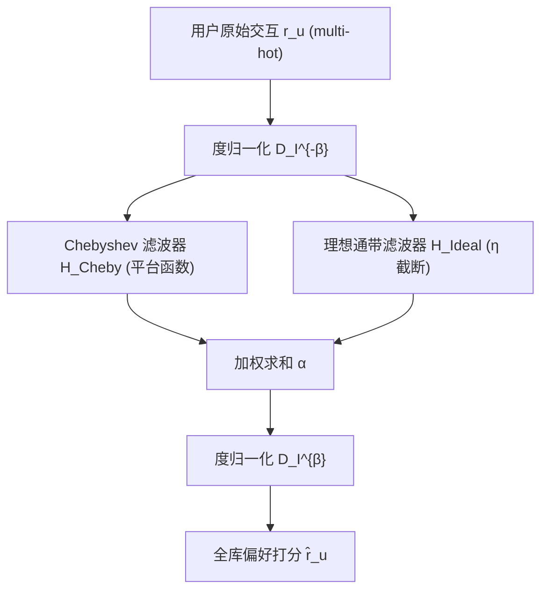

# Graph Spectral Filtering with Chebyshev Interpolation for Recommendation (基于切比雪夫插值的图谱滤波推荐)

- **会议/期刊**: SIGIR 2025
- **作者与机构**: Chanwoo Kim, Jinkyu Sung, Yebonn Han, Joonseok Lee (首尔大学)
- **推荐链路定位**: 召回 (全库打分)
- **研究方向**: 协同过滤与双塔召回 / 图神经网络与知识图谱推荐
- **论文原文**: [论文原文链接](https://arxiv.org/abs/2505.00552v1)
- **开源代码**: [开源代码仓库链接](https://github.com/chanwoo0806/ChebyCF)

## TL;DR (1分钟核心速览)

本文从谱图理论指出 GCN-based CF 的两大瓶颈：嵌入层导致频谱截断（丢弃 $d$ 维以外的高频），邻域聚合等价于**线性**低通滤波，无法精细利用中频局部偏好。作者提出 ChebyCF：直接以用户原始交互向量为图信号，用切比雪夫插值逼近**非线性平台型**传递函数，再叠加理想通带滤波与度归一化。在 LastFM/Gowalla/Amazon-Book 的 Full-Ranking 协议下，Recall@20 分别达 0.1199/0.1941/0.0738，全面超越 BSPM 等 SOTA，且推理比 BSPM-RK4 快至 8.1 倍。

## Background & Motivation (背景与核心矛盾)

- **主流范式**: 以 LightGCN 为代表的 GCN-based CF 用可学习嵌入 + 对称归一化邻域聚合传播高阶协同信号，是当前主导范式。
- **前人局限**: ① 嵌入层把偏好压缩进 $d$ 维隐空间，只保留全局最显著的低频信号，丢弃局部观测到的中高频偏好；② 邻域聚合形式固定为简单加权平均，图是 CF 唯一信息源却未被精细利用。
- **核心洞察 (Key Insight)**: 在嵌入最优保持交互矩阵的假设下，LGCN 的传播等价于在 item-item 图上做传递函数 $h(\lambda)=(1-\lambda)\cdot\mathbb{I}[\lambda\le\lambda_d]$的滤波——既有**截断**（$d$ 维以外频率不可达）又**线性**（各频率权重只能线性衰减）。而中频信号对应"局部共看"电影，虽非全局主导却蕴含细粒度个性化价值。
- **本文切入点**: 抛弃嵌入层，直接在 item-item 图上对原始交互信号做**可设计的非线性谱滤波**，用切比雪夫插值在免特征分解的前提下逼近任意灵活传递函数。

## Method (核心方法设计)

### 1. 整体框架 (Overall Architecture)

ChebyCF 以 item-item 图拉普拉斯 $L^*=I-\tilde{R}^\top\tilde{R}$为基础，用户$u$的图信号即交互矩阵第$u$行$r_u\in\{0,1\}^{|I|}$。信号先经度归一化$D_I^{-\beta}$，送入由切比雪夫滤波器（逼近平台函数）与理想通带滤波器（在$\lambda_\eta$处陡峭截断）并联组成的综合滤波器，输出再经$D_I^{\beta}$归一化得到全库偏好打分$\hat{r}_u$。训练阶段无需梯度学习嵌入，仅需在验证集上网格搜索$\phi,\alpha,\eta,\beta$ 四个滤波器超参，推理时用切比雪夫递推做矩阵多项式乘法。

### 2. 关键设计拆解 (Key Designs)

1. **切比雪夫插值滤波器（免分解逼近非线性传递函数）**：任意解析传递函数需 $O(n^3)$特征分解，不可行；改为约束为多项式形式即可只用拉普拉斯矩阵多项式。采用第一类切比雪夫多项式递推$T_k(x)=2xT_{k-1}(x)-T_{k-2}(x)$，以切比雪夫节点（边界密集，抑制 Runge 现象）做插值，系数$c_k=\frac{a_k}{K+1}\sum_{i=1}^{K+1}g(x_i)T_k(x_i)$，滤波器为$H_{\text{Cheby}}(L^*)=\sum_{k=0}^{K}c_kT_k(\tilde{L})$，其中$\tilde{L}=2L^*-I$把特征值映到$[-1,1]$。目标函数选**平台函数**$g_{\text{plateau}}(\lambda)=\frac{1}{2}(-|\lambda|)^\phi+\frac{1}{2}$：低频强、中频保持恒定不衰减、高频再降，$\phi$ 控制平坦区宽度——这正是线性低通做不到的"三段式"精细加权。

2. **理想通带滤波 + 度归一化（补陡峭性与流行度偏置）**：切比雪夫多项式基平滑，难以逼近阶跃；引入 $H_{\text{Ideal}}(L^*)=V_\eta V_\eta^\top$（$\tilde{R}$前$\eta$个右奇异向量），在$\lambda_\eta$处强制陡降，只需部分 SVD（广义幂法高效求解）。度归一化通过广义拉普拉斯$\bar{L}=D_I^{\beta}L^*D_I^{-\beta}$实现，$\beta$ 越大热门物品信号收缩越强，缓解流行度偏置。最终打分：
$$\hat{r}_u=D_I^{\beta}\big(H_{\text{Cheby}}(L^*;\phi)+\alpha H_{\text{Ideal}}(L^*;\eta)\big)D_I^{-\beta}r_u$$

3. **训练目标、负采样与推理效率**：本方法**无参数、免负采样、免训练**，超参在验证集网格搜索（$K=8$，$\phi\in[1,20]$步长 0.5，$\alpha\in[0,0.5]$，$\eta\in\{2^7,\dots,2^{11}\}$，$\beta\in[0,0.5]$）。推理复杂度$O(K\cdot\text{nnz}(R))$，切比雪夫递推免矩阵分解，是相对 BSPM 多步 ODE 求解器的核心速度优势来源。

## Experimental Setup & Evaluation Protocol (实验设置与评估协议)

- **数据集与预处理**:

| 数据集 | #Users | #Items | #Interactions | 密度 | 场景说明 |
| :--- | :---: | :---: | :---: | :---: | :--- |
| LastFM | 23,566 | 48,123 | 1,542,856 | 0.136% | 音乐社交 |
| Gowalla | 29,858 | 40,981 | 1,027,370 | 0.084% | LBS 签到 |
| Amazon-book | 52,643 | 91,599 | 2,984,108 | 0.062% | 图书电商 |

- **数据划分与防穿越 (Splitting Strategy)**: 沿用前作 [5,10,21,39,41,52,62] 的固定 train/test 划分（非本文新设），保证与基线可比。
- **排名评测协议 (Ranking Protocol)**: 无偏 `Full-Ranking`（对全库未交互物品排序），指标 Recall@N 与 NDCG@N，默认 $N=20$并附$N=10$。
- **对比基线与超参设置**: 覆盖非图模型（MF-BPR/NeuMF/Mult-VAE）、GCN-based（NGCF/LightGCN/UltraGCN/GTN/JGCF/CAGCN/Adap-$\tau$/GTE/AFD-GCF/GiffCF）与 GSF-based（GF-CF/LinkProp/PGSP/BSPM/SGFCF）三大类；基线超参遵循原论文/官方代码。

## Key Experimental Results (实验关键数据)

### 1. 主实验对比 (Main Results)

| 类别 | 模型 | LastFM R@20 | LastFM N@20 | Gowalla R@20 | Gowalla N@20 | Amazon R@20 | Amazon N@20 |
| :--- | :--- | :---: | :---: | :---: | :---: | :---: | :---: |
| 非图 | Mult-VAE | 0.0747 | 0.0672 | 0.1567 | 0.1297 | 0.0403 | 0.0310 |
| GCN | LightGCN | 0.0832 | 0.0738 | 0.1786 | 0.1526 | 0.0413 | 0.0322 |
| GCN | UltraGCN | 0.0867 | 0.0772 | 0.1849 | 0.1565 | 0.0683 | 0.0558 |
| GCN | GiffCF | 0.1025 | 0.0946 | 0.1478 | 0.1271 | 0.0670 | 0.0566 |
| GSF | GF-CF | 0.1107 | 0.1011 | 0.1850 | 0.1518 | 0.0710 | 0.0584 |
| GSF | PGSP | 0.1136 | 0.1037 | 0.1917 | 0.1606 | 0.0710 | 0.0584 |
| GSF | BSPM | 0.1157 | 0.1057 | 0.1921 | 0.1597 | 0.0733 | 0.0610 |
| GSF | SGFCF | 0.1143 | 0.1054 | 0.1898 | 0.1566 | 0.0640 | 0.0519 |
| — | **ChebyCF** | **0.1199** | **0.1101** | **0.1941** | **0.1616** | **0.0738** | **0.0613** |
| — | Improv. vs BSPM | +3.6% | +4.2% | +1.0% | +1.2% | +0.7% | +0.5% |

### 2. 消融实验 (Ablation Study)

| 设置 | LastFM R@20 | Gowalla R@20 | Amazon R@20 |
| :--- | :---: | :---: | :---: |
| ChebyCF 完整 | **0.1199** | **0.1941** | **0.0738** |
| w/o Chebyshev Filter（退化为线性） | 0.1107 | 0.1928 | 0.0675 |
| w/o Normalization（$\beta=0$） | 0.1159 | 0.1665 | 0.0738 |
| w/o Ideal Pass Filter | 0.1194 | 0.1915 | 0.0725 |

### 3. 关键实验发现 (Key Findings)

1. **高频确实含有效信号，但只有精细滤波才能榨取**：截断实验（图 6）显示 ChebyCF 性能随保留频率比例单调上升至 1.0，而理想通带滤波仅保留最低 10–20% 频率时最优、之后骤降——证明高频信息存在但粗暴截断无法利用，必须靠平台函数的平滑加权。
2. **嵌入层是性能拖累而非助力**：同为线性低通，无嵌入的 1-layer 滤波在 LastFM 达 0.1107，显著高于带嵌入的 LightGCN 0.0832；且堆叠线性层（2–4 层）性能持续下降，复现了过平滑问题，而 ChebyCF 通过引入中频规避该退化。
3. **各模块收益高度依赖数据分布**：度归一化在 LastFM/Gowalla 移除后掉点最多（Gowalla 0.1941→0.1665），但 Amazon-Book 上 $\beta=0$反而最优，说明流行度偏置强度因数据集而异；Gowalla 最优滤波器接近线性（$\phi\approx1$），故 w/o Chebyshev 掉点最小，印证平台函数可按数据自适应退化。

## Highlights & Limitations (亮点、对比与审稿批判)

- **与代表作对比 (vs. Prior Work)**: 相比 GF-CF/PGSP/SGFCF 等 GSF 基线，本文本质区别是把滤波器从"理想通带/线性低通"推广为**可学习的非线性平台函数**，首次系统利用中频局部偏好；相比 LightGCN 类 GCN 模型，彻底去除嵌入层与邻域聚合的线性约束，且免训练。
- **可迁移亮点**: ① 用切比雪夫插值 + 平台目标函数逼近任意传递函数、免特征分解的范式，可直接迁移到任何需要灵活谱滤波的图任务；② 度归一化的广义拉普拉斯 $D^\beta L D^{-\beta}$ 是低成本缓解流行度偏置的通用技巧。
- **审稿级局限批判**: ① 超参（$\phi,\alpha,\eta,\beta$）需在验证集网格搜索，且最优值跨数据集差异大（Gowalla 近线性、Amazon 免归一化），缺乏自适应学习机制，泛化到新域需重新调参；② 理想通带滤波仍需部分 SVD，且实验仅在三个中等规模学术数据集上验证，未涉及工业级千万物品规模与在线 A/B，实际部署的冷启动与增量更新成本未讨论。

## Rating (四维评分)

- **方法创新性 (Novelty)**: ⭐⭐⭐⭐ （从谱域严格证明 LGCN 的截断+线性双重瓶颈，并用切比雪夫插值给出免分解的非线性滤波方案，理论动机扎实）
- **评估协议与实验扎实度 (Protocol & Experiments)**: ⭐⭐⭐⭐ （三数据集 Full-Ranking、三大类 20+ 基线、消融与截断/效率分析完整，但缺显著性检验与工业规模验证）
- **写作与数学规范度 (Clarity & Rigor)**: ⭐⭐⭐⭐⭐ （定理 3.1 及附录证明严谨，谱域直觉配图清晰，符号与复杂度分析规范）
- **工业落地与复现价值 (Industrial & Practical Value)**: ⭐⭐⭐⭐ （代码开源、免训练、推理比 BSPM 快 8.1 倍，但超参搜索与部分 SVD 在超大规模下仍需工程优化）

