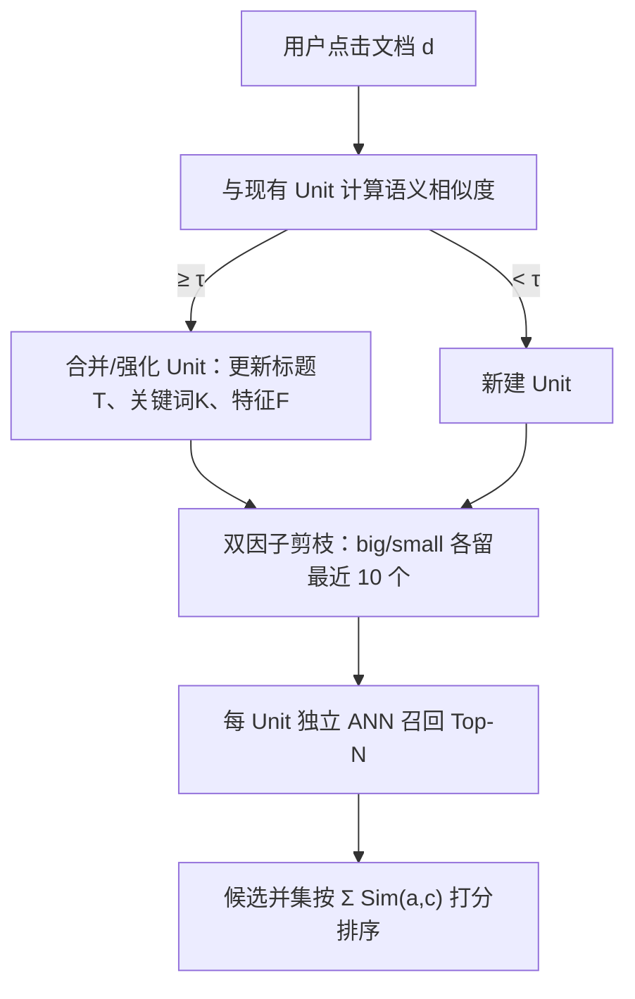
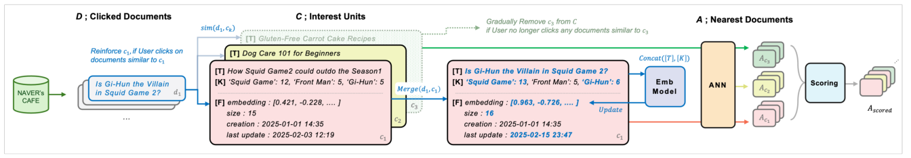

# IRA: Adaptive Interest-aware Representation and Alignment for Personalized Multi-interest Retrieval (自适应兴趣感知表征与对齐的个性化多兴趣召回)

- **会议/期刊**: SIGIR 2025 (Industry Track)
- **作者与机构**: Youngjune Lee, Haeyu Jeong 等, NAVER Corporation
- **推荐链路定位**: 召回 (ANN 多兴趣检索)
- **研究方向**: 协同过滤与双塔召回 / 大语言模型推荐
- **论文原文**: [论文原文链接](https://arxiv.org/abs/2504.17529v2)
- **开源代码**: 暂未开源

## TL;DR (1分钟核心速览)

针对社区平台用户兴趣漂移快、新文档持续涌入导致模型需频繁重训的痛点，IRA 将用户兴趣表示为可累积合并、可剪枝的文本化 **Interest Unit** 集合，并用一个经 BCE+RankNet 微调的韩语 GPT 嵌入模型把 Unit 与文档对齐到同一语义空间，召回时对每个 Unit 做 ANN 再按相似度和聚合打分，**完全摆脱点击信号与重训依赖**。在 NAVER CAFE 一周日志上，IRA 的 H@20 达 0.7043（较最强基线 Hybrid 的 0.5860 提升 20.2%），线上 A/B 点击量 +5.4%、人均阅读时长 +1.2%。

## Background & Motivation (背景与核心矛盾)

- **主流范式**: 工业界普遍把用户历史编码为 item ID 序列，用 CF（MF-BPR/NeuMF）或序列模型（SASRec）产出单一用户向量；LLM 文本化方案虽语义强但推理慢、成本高。
- **前人局限**: ① CF 依赖共现模式，单一向量难以承载用户并存的多个独立兴趣；② 序列模型假设兴趣平滑演化，对"跳跃式、非时序"的多元偏好失效；③ 两者都需频繁重训才能吸收新文档与新行为，且基于点击训练会引入**时间偏置**（某时段点击模式被固化）。
- **核心洞察 (Key Insight)**: 用户兴趣本质是"若干可解释的语义主题"，其生命周期表现为**被相似点击强化、被长期冷落而衰减**；若把兴趣直接写成文本并做语义匹配，则新文档无需重训即可被召回。
- **本文切入点**: 用"累积构建 + 双因子剪枝"的 Interest Unit 替代静态用户向量，用语义对齐替代点击共现作为召回依据。

## Method (核心方法设计)

### 1. 整体框架 (Overall Architecture)

IRA 的闭环是：用户每产生一次点击，就把该文档与现有 Unit 集合做语义相似度匹配——超过阈值 $\tau=0.65$则并入（可能多 Unit 合并），否则新建 Unit；随后按"大小 × 新鲜度"剪枝，使兴趣集合持续新陈代谢。离线侧，用检索 query + 20 候选文档 + 韩语 LLM 相关性标注构造训练对，微调嵌入模型使 Unit 与文档同空间对齐。在线召回时，对每个 Unit 分别做 ANN 取 Top-$N$，合并候选池后以"对全部 Unit 的相似度之和"作为最终排序分，无需额外精排模型。

<figure class="paper-figure" markdown="span">
  <figcaption>图1：IRA 流程概览。当用户点击与已有 Unit 𝑐1 相似的 𝑑1 时，𝑐1 被强化。当用户不再点击与 𝑐3 相似的任何文档时，𝑐3 被逐步移除。原文为韩文，但已翻译为英文。</figcaption>
</figure>

### 2. 关键设计拆解 (Key Designs)

1. **Interest Unit 的累积构建与双因子剪枝**：Unit 由 $[T]$（最近点击文档标题）、$[K]$（标题中实体等关键词及频次，推理时仅留 Top-10）、$[F]$（最近更新时间、包含文档数）拼接成上下文文本。合并时$[T]$刷新为最新标题、$[K]$聚合、嵌入重建，从而"近期兴趣"与"核心兴趣"同时被编码。剪枝把 Unit 分为 big（size$\ge 5$）与 small 两组，各保留最近更新的 10 个——这一设计直接对应"短期消费 + 中长期兴趣"并存的假设，避免大 Unit 因体量优势挤死新兴小兴趣，也避免纯按时间淘汰掉稳定的长期偏好。
2. **语义对齐替代点击信号**：训练数据来自搜索 query 的 20 个候选文档，用韩语专用 LLM 打相关性标签，负样本额外混入 2 个无关 query 的文档；相关集内按与 query 的关键词重叠度排序，以强化关键词级信号。损失为 $\mathcal{L}=\mathcal{L}_{\text{BCE}}+\mathcal{L}_{\text{RankNet}}$，前者校准绝对相关性、后者保证相关文档排序优于负例。由于监督来自"语义相关性"而非"是否被点击"，模型不会把某时间段的曝光偏置学进表征，这是 IRA 免重训仍鲁棒的根因。
3. **多兴趣聚合打分与推理开销**：对候选 $a$的打分$a_{\text{score}}=\sum_{c\in C}\text{Sim}(a,c)$，即"被越多兴趣单元共同命中越靠前"，天然实现多兴趣融合而无需学习权重。推理侧只有$|C|$ 次 ANN 查询（每用户 Unit 数受剪枝约束在约 20 量级）+ 一次求和排序，无 Transformer 在线前向，成本远低于 LLM 方案。

## Experimental Setup & Evaluation Protocol (实验设置与评估协议)

- **数据集与预处理**: NAVER CAFE 一周点击日志；仅保留点击数 $\ge 15$的用户，剔除$>200$ 的异常用户。

| 数据集 | #Users | #Items | #Interactions | 稀疏度/密度 | 特征/场景说明 |
| :--- | :---: | :---: | :---: | :---: | :--- |
| Train | 14,558 | 248,075 | 659,283 | 密度约 0.018% | 社区帖子点击日志 |
| Test | 14,558 | 49,997 | 72,790 | 冷物品 19,149 个 | 每用户最近 5 次交互 |

- **数据划分与防穿越 (Splitting Strategy)**: 按用户取**最近 5 次交互为测试集**、其余为训练/Unit 构建，属时间序留出；测试集冷物品占比高，对所有基线统一采用"映射到训练集中语义最相似文档"的冷启动处理。
- **排名评测协议 (Ranking Protocol)**: `Sampled Ranking`——每用户随机采 495 个与测试物品嵌入相似度低（cosine $<0.4$）的语义相异物品作候选，5 次评测取均值；指标 H@N / N@N（N=5/20/50）。
- **对比基线与超参设置**: ItemPop、MF-BPR、NeuMF、SASRec、Hybrid（冻结文本嵌入 + 可训练 ID 嵌入拼接入 SASRec）；嵌入模型为 128M 韩语 GPT，合并阈值 $\tau=0.65$。

## Key Experimental Results (实验关键数据)

### 1. 主实验对比 (Main Results)

| 模型 | H@5 | N@5 | H@20 | N@20 | H@50 | N@50 |
| :--- | :---: | :---: | :---: | :---: | :---: | :---: |
| ItemPop | 0.0610 | 0.0366 | 0.1809 | 0.0701 | 0.3219 | 0.0979 |
| MF-BPR | 0.4441 | 0.3741 | 0.5551 | 0.4062 | 0.6330 | 0.4216 |
| NeuMF | 0.4140 | 0.2766 | 0.5248 | 0.3093 | 0.6007 | 0.3243 |
| SASRec | 0.2527 | 0.1704 | 0.3885 | 0.2097 | 0.4951 | 0.2308 |
| Hybrid | 0.3962 | 0.2612 | 0.5860 | 0.3165 | 0.7018 | 0.3396 |
| IRA (no alignment) | 0.4340 | 0.2860 | 0.6092 | 0.3372 | 0.7214 | 0.3595 |
| **IRA (ours)** | **0.5687** | **0.3677** | **0.7043** | **0.4074** | **0.7862** | **0.4237** |
| Improv. vs Hybrid | +43.5% | +40.8% | +20.2% | +28.7% | +12.0% | +24.8% |

### 2. 消融与适应性实验 (Ablation & Adaptability)

| 配置 | H@5 | N@5 | H@20 | N@20 | H@50 | N@50 |
| :--- | :---: | :---: | :---: | :---: | :---: | :---: |
| Hybrid (A) | 0.2199 | 0.1515 | 0.3531 | 0.1895 | 0.4720 | 0.2130 |
| Hybrid (A+B) | 0.2248 | 0.1527 | 0.3543 | 0.1897 | 0.4698 | 0.2125 |
| IRA (A) | 0.4366 | 0.2857 | 0.5693 | 0.3242 | 0.6646 | 0.3431 |
| **IRA (A+B)** | **0.4583** | **0.2993** | **0.5976** | **0.3398** | **0.6948** | **0.3591** |

组件级消融（图 3）：仅用关键词或仅用标题均低于二者拼接；剪枝仅按"最近 20 个"或仅按"最大 20 个"均劣于双因子策略；Unit 数量限制为 5/10/20/不限时，性能呈倒 U 形，10–20 区间最优。

### 3. 关键实验发现 (Key Findings)

1. **免重训的时间鲁棒性是最大增量**：在未见过的新一周 C 上，IRA(A) 的 H@20 为 0.5693，而 Hybrid(A) 仅 0.3531、MF-BPR 仅 0.2921；且 IRA 吸收 B 周数据后升至 0.5976（+5.0%），而序列模型 Hybrid 加入 B 周几乎无增益（0.3531→0.3543），说明"累积 Unit"比"序列拼接"更能吸收兴趣漂移。
2. **对齐训练贡献显著但非全部**：即使不做对齐（no alignment），IRA 的 H@20 已达 0.6092，超过所有 ID 类基线；对齐后进一步提升至 0.7043（+15.6%），证明语义结构本身即强，微调主要补足关键词级匹配精度。
3. **剪枝策略是性能关键而非工程细节**：双因子剪枝优于任一单因子策略，且 Unit 数不设上限会掉点——印证用户兴趣"既需探索新主题、又需淘汰失效主题"，动态新陈代谢不可省。

## Highlights & Limitations (亮点、对比与审稿批判)

- **与代表作对比 (vs. Prior Work)**: 相比 MF-BPR/NeuMF 的单一 ID 向量，IRA 用可解释文本集合承载多兴趣且天然支持新物品；相比 SASRec 的平滑时序假设，IRA 允许兴趣跳跃与并行；相比 LLM 个性化方案，IRA 把大模型成本一次性摊销到离线嵌入，在线仅 ANN，工业可落地性明显更强。
- **可迁移亮点**: ① "文本化兴趣单元 + 阈值合并 + 双因子剪枝"可作为任意内容平台的轻量用户画像中间件；② 用 LLM 做相关性标注替代点击监督，是缓解时间偏置的通用低成本手段。
- **审稿级局限批判**: ① 评测采用 495 负样本的采样排序而非全库 Full-Ranking，且负样本刻意选语义相异物品，可能高估语义检索的真实优势；② 线上仅报告点击/时长相对提升，缺少与强个性化基线的 A/B 对照；③ 阈值 $\tau$、Top-10 关键词、每组保留 10 个 Unit 等超参均靠经验设定，缺少敏感性曲线；④ 依赖韩语专用 LLM 与 GPT 嵌入，跨语言/跨域迁移成本未评估。

## Rating (四维评分)

- **方法创新性 (Novelty)**: ⭐⭐⭐⭐ （把"兴趣"从隐向量改写为可累积剪枝的文本单元，思路朴素但工程洞察扎实，理论深度有限）
- **评估协议与实验扎实度 (Protocol & Experiments)**: ⭐⭐⭐ （有离线+跨周适应性+线上 A/B，但采样排序协议偏宽松、缺全库对比与超参敏感性）
- **写作与数学规范度 (Clarity & Rigor)**: ⭐⭐⭐⭐ （算法伪代码与流程清晰，公式极简；但关键超参缺乏推导依据）
- **工业落地与复现价值 (Industrial & Practical Value)**: ⭐⭐⭐⭐⭐ （已在 NAVER CAFE 首页全量验证，在线仅 ANN 开销，落地价值极高；可惜未开源）

