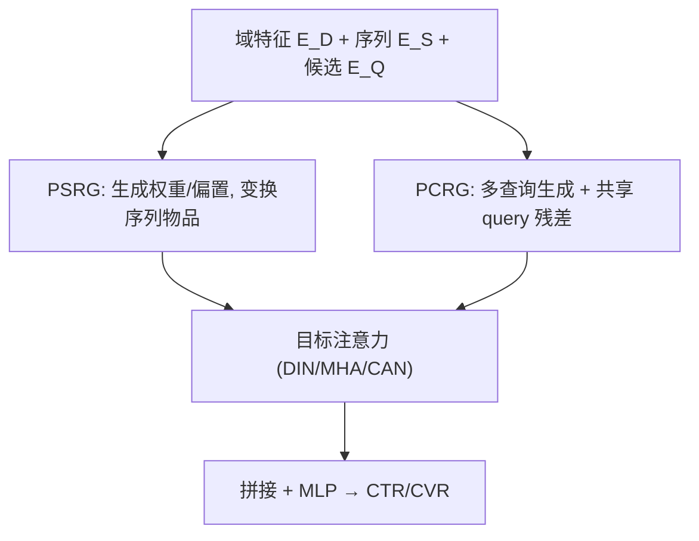
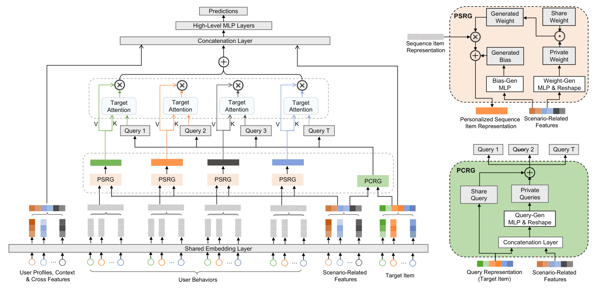

# Adaptive Domain Scaling for Personalized Sequential Modeling in Recommenders (推荐系统中面向个性化序列建模的自适应域缩放)

- **会议/期刊**: SIGIR 2025
- **作者与机构**: Zheng Chai, Hui Lu, Di Chen, Qin Ren, Yuchao Zheng, Xun Zhou（字节跳动）
- **推荐链路定位**: 精排（Ranking / CTR-CVR 预估）
- **研究方向**: 跨域与多场景推荐 / 序列推荐
- **论文原文**: [https://arxiv.org/abs/2502.05523v3](https://arxiv.org/abs/2502.05523v3)
- **开源代码**: 暂未开源

## TL;DR (1分钟核心速览)

现有多域推荐把精力全砸在特征交叉网络结构上（STAR/PLE/APG/AdaSparse），却忽略了目标注意力序列建模中的域差异：同一物品在不同域用户序列里共享同一 embedding，同一候选物品对所有序列物品共享同一 query。本文提出 ADS，用域相关特征动态生成序列物品的个性化 MLP 权重/偏置（PSRG）与候选物品的多查询表示（PCRG），即插即用地嵌入 DIN/MHA/CAN。在 Taobao 与两个十亿级抖音工业数据集上，DIN+ADS 的 CVR AUC 相对提升 0.46%（对比 DIN 的 0.23%），线上抖音电商 GMV/U +0.79%、广告 ADVV +1.00%。

## Background & Motivation (背景与核心矛盾)

- **主流范式**: 工业多域推荐普遍采用 shared-bottom + multi-head 结构，近年 STAR（域级星型拓扑）、PLE（渐进分层抽取）、APG/AdaSparse（实例级参数生成）等专注打磨**特征交叉网络**的多域适配。
- **前人局限**: 其一，序列建模侧几乎无人处理域差异——候选物品与行为物品的 embedding 表完全共享，同一视频对新用户与老用户是同一向量；其二，候选物品作为**单一共享 query** 去 attend 全部序列物品，无法体现"同一候选对不同历史物品影响力不同"（如商城看价格、短视频看创作者）。
- **核心洞察 (Key Insight)**: 多域差异不应只体现在特征交叉层，更应注入目标注意力的 query-key-value 三要素本身——让 key/value（序列物品）与 query（候选物品）都随域动态变化。
- **本文切入点**: 用域特征作为"元网络"输入，直接生成序列物品的变换参数与候选物品的多查询，把多域信息前移到注意力计算之前。

## Method (核心方法设计)

### 1. 整体框架 (Overall Architecture)

输入为域相关特征 $\boldsymbol{E}_D$（显式域指示 + 隐式统计特征如活跃度）、用户序列 embedding$\boldsymbol{E}_S\in\mathbb{R}^{T\times d_S}$与候选物品 embedding$\boldsymbol{E}_Q$。PSRG 以$\boldsymbol{E}_D$生成个性化 MLP 的权重与偏置，逐样本变换序列物品；PCRG 以$\boldsymbol{E}_D\oplus\boldsymbol{E}_Q$生成$T$个（或$G$ 个 chunk 的）私有 query 并与共享 query 残差相加。二者输出送入标准目标注意力（DIN/MHA/CAN 均可），聚合后拼接用户/物品/上下文特征经 MLP 输出预测。两模块均采用 share-and-private 范式，兼顾域共性与个性。

<figure class="paper-figure" markdown="span">
  <figcaption>图2：ADS概览。ADS由PCRG、PSRG和目标注意力模块组成。给定场景相关特征和目标物品作为输入，PCRG首先考虑目标物品（查询）与场景特征的共现模式生成多个查询。对于PSRG，它以场景特征为输入生成权重和偏置参数以构建个性化MLP，然后将原始序列物品嵌入通过生成的MLP获得个性化表示。PCRG和PSRG均采用共享与私有学习范式。最后，生成的序列为</figcaption>
</figure>

### 2. 关键设计拆解 (Key Designs)

1. **PSRG：序列物品的实例级个性化变换**：痛点是共享 embedding 表让同一物品在所有用户序列中同质。做法是用两层 MLP 从 $\boldsymbol{E}_D$生成私有权重，再与全局可学习矩阵做逐元素缩放：$\boldsymbol{W}_{generated}=\eta\cdot(\boldsymbol{W}_{shared}\odot\boldsymbol{W}_{private})$，其中$\boldsymbol{W}_{private}=\sigma(\mathrm{ReLU}(\boldsymbol{E}_D\boldsymbol{W}_1^\top+\boldsymbol{b}_1)\boldsymbol{W}_2^\top+\boldsymbol{b}_2)$；偏置同理生成，最终$\boldsymbol{E}_{S\text{-}pers}=\mathrm{Reshape}(\boldsymbol{E}_S\boldsymbol{W}_{generated})+\boldsymbol{b}_{generated}$。用两层低秩 MLP（$d_h\ll d_S^2$）而非直接输出$d_S\times d_S$矩阵，参数量与算力大幅可控；Sigmoid 保证私有权重落在$[0,1]$ 形成对全局矩阵的"自适应缩放"，这正是模型名 ADS 的由来。

2. **PCRG：候选物品的多查询生成**：痛点是单一 query 无法区分候选对不同序列物品的作用。做法是拼接域特征与候选 embedding 生成 $T$个私有 query：$\boldsymbol{E}_{Q\text{-}private}=\mathrm{ReLU}((\boldsymbol{E}_D\oplus\boldsymbol{E}_Q)\boldsymbol{W}_{q1}^\top+\boldsymbol{b}_{q1})\boldsymbol{W}_{q2}^\top+\boldsymbol{b}_{q2}$，再与 tile 后的共享 query 残差相加得$\boldsymbol{E}_{Q\text{-}pers}$。对长序列进一步提出 **Chunked-Query**：相邻行为多属同域，将序列按$G$个 chunk 分组生成后 repeat 回$T$，复杂度从$O(d_hTd_Q)$降至$O(d_hGd_Q)$。

3. **训练目标与推理开销**：损失为标准二分类交叉熵，无额外对比/正则项，负采样沿用各 backbone 原有设定（工业日志天然含曝光未点击负例）。线上部署采用多 GPU 分片 + 数据并行、低频 embedding 裁剪与 Dense Computation Asynchrony 流水线；抖音广告场景训练时长仅从 41.3h 增至 42.8h（+3.6%），线上延迟维持 30ms 不变。

## Experimental Setup & Evaluation Protocol (实验设置与评估协议)

- **数据集与预处理**:

| 数据集 | #Users | #Items | #Instances | 稀疏度/密度 | 特征/场景说明 |
| :--- | :---: | :---: | :---: | :---: | :--- |
| Taobao | 101,342 | 500,272 | 24.02M | 极稀疏 | 过滤 ≥200 交互用户、≥10 正行为、≥10 交互物品；9,439 类目各视为一域 |
| Douyin-Ads | 688M | 270M | 2.52B | 极稀疏 | CVR 任务；3 域：直播间支付/直播间下单/短视频购物 |
| Douyin-Ecom | 596M | 12.91M | 24.65B | 极稀疏 | Click & Order 双任务；2 域：Live-Preview / Live-Slide |

- **数据划分与防穿越 (Splitting Strategy)**: 均为**全局时间戳切分**——Taobao 前 7 天训练后段测试；Douyin-Ads 前 77 天训练、后 10 天评估；Douyin-Ecom 前 54 天训练、最后一周验证。
- **排名评测协议 (Ranking Protocol)**: 工业场景采用真实曝光日志的 **AUC**（非采样排序，全量线上流量），并以相对提升 $\text{AUC Imp.}=\left(\frac{\text{AUC}_{model}-0.5}{\text{AUC}_{base}-0.5}-1\right)\times100\%$归一化；显著性$p<0.05$，工业侧 0.1%（Ads）/0.2%（Ecom）即视为可影响 A/B 的显著提升。
- **对比基线与超参设置**: 两组基线——DNN 类（DNN、DeepFM、DCNv2、APG、AdaSparse、DFFM、MaskNet）与目标注意力骨干（DIN、MHA、CAN）叠加多域方法 FRNet、PEPNet；TensorFlow 实现，Adam，初始学习率 2e-5。

## Key Experimental Results (实验关键数据)

### 1. 主实验对比 (Main Results)

| 模型组 | Taobao Order AUC (Imp.) | Douyin-Ads CVR AUC (Imp.) | Ecom Click AUC (Imp.) | Ecom Order AUC (Imp.) |
| :--- | :---: | :---: | :---: | :---: |
| DNN | 0.6490 (-) | 0.8461 (-) | 0.8456 (-) | 0.8439 (-) |
| DCNv2 | 0.6505 (+1.01%) | 0.8470 (+0.26%) | 0.8456 (+0.00%) | 0.8439 (+0.00%) |
| AdaSparse | 0.6498 (+0.54%) | 0.8465 (+0.11%) | 0.8455 (-0.03%) | 0.8438 (-0.03%) |
| DFFM | 0.6487 (-0.20%) | 0.8465 (+0.11%) | 0.8469 (+0.46%) | 0.8455 (+0.46%) |
| DIN | 0.6498 (+0.54%) | 0.8469 (+0.23%) | 0.8472 (+0.49%) | 0.8456 (+0.49%) |
| DIN+PEPNet | 0.6500 (+0.67%) | 0.8470 (+0.26%) | 0.8472 (+0.49%) | 0.8456 (+0.49%) |
| **DIN+ADS** | **0.6507 (+1.14%)** | **0.8477 (+0.46%)** | **0.8477 (+0.66%)** | **0.8462 (+0.66%)** |
| MHA+ADS | 0.6501 (+0.74%) | 0.8475 (+0.40%) | 0.8473 (+0.55%) | 0.8458 (+0.55%) |
| CAN+ADS | 0.6503 (+0.87%) | 0.8474 (+0.37%) | 0.8470 (+0.49%) | 0.8456 (+0.49%) |

线上 A/B（$p<0.01$）：抖音广告 CPM +0.52%、ADVV +1.00%（短视频域 ADVV +1.66%）；抖音电商 GMV/U +0.79%、Order/U +0.36%、GPM +0.89%。

### 2. 消融实验 (Ablation Study)

| 骨干 | 配置 | D1 | D2 | D3 | Overall | Imp. |
| :--- | :--- | :---: | :---: | :---: | :---: | :---: |
| DIN | ADS 完整 | 0.8245 | 0.8262 | 0.8733 | 0.8477 | - |
| DIN | w/o PCRG | 0.8242 | 0.8257 | 0.8730 | 0.8475 | -0.06% |
| DIN | w/o PCRG&PSRG | 0.8235 | 0.8251 | 0.8724 | 0.8469 | -0.23% |
| MHA | ADS 完整 | 0.8242 | 0.8256 | 0.8730 | 0.8475 | - |
| MHA | w/o PCRG | 0.8241 | 0.8252 | 0.8730 | 0.8474 | -0.03% |
| MHA | w/o PCRG&PSRG | 0.8232 | 0.8238 | 0.8721 | 0.8467 | -0.23% |
| CAN | ADS 完整 | 0.8240 | 0.8256 | 0.8731 | 0.8474 | - |
| CAN | w/o PCRG | 0.8230 | 0.8240 | 0.8723 | 0.8466 | -0.23% |
| CAN | w/o PCRG&PSRG | 0.8227 | 0.8238 | 0.8721 | 0.8464 | -0.29% |

### 3. 关键实验发现 (Key Findings)

1. **序列建模骨干本身贡献最大，ADS 是稳定的增量**：DIN 相对 DNN 在 Douyin-Ads 已带来 +0.23%，而 DIN+ADS 进一步到 +0.46%，恰好翻倍；且 ADS 在 DIN/MHA/CAN 三种骨干上均一致最优，证明其"即插即用"而非依赖特定注意力实现。
2. **PCRG 与 PSRG 互补，且 PCRG 在弱骨干上更关键**：CAN 去掉 PCRG 即掉 0.23%（几乎等于全部增益），说明当骨干注意力本身较弱时，多查询带来的候选侧个性化是主要收益来源；而 DIN 上去掉 PCRG 仅掉 0.06%，剩余增益由 PSRG 承担。
3. **个性化粒度与成本呈可控权衡**：Chunk 从 10→5→2→无 chunk，性能单调上升，无 chunk（逐物品生成 query）最优；即便 Chunk 10 这种"微小成本增量"配置仍显著优于 vanilla，实践中可按算力预算灵活选点。

## Highlights & Limitations (亮点、对比与审稿批判)

- **与代表作对比 (vs. Prior Work)**: 与 PEPNet 的 bitwise 缩放、DFFM 的线性变换相比，ADS 用生成式元网络做**矩阵级**变换，表达力更强且天然 share-and-private；与 STAR/PLE 等域级/特征交叉方法正交，可叠加使用；相较 DIN/CAN 的本质区别是把"单 query 对多 key"改为"多 query 对多 key"，这是此前序列推荐中未被探索的视角。
- **可迁移亮点**: (1) 用低秩两层 MLP 生成 $d\times d$ 变换矩阵的"参数生成 + 全局矩阵逐元素缩放"技巧，可低成本迁移到任何需要实例级 embedding 适配的场景；(2) Chunked 生成思路对长序列（数百级）的 query 生成是通用降本手段。
- **审稿级局限批判**: (1) 评估完全依赖 AUC 与线上业务指标，缺少 NDCG/HR 等排名指标与公开可复现的采样排序协议，Taobao 仅报告 Overall 结果、未给分域明细；(2) 域划分依赖人工构造的显式/隐式指示特征，域数量增长时生成网络参数量线性膨胀，论文未讨论域数扩展性与冷启动新域的泛化表现。

## Rating (四维评分)

- **方法创新性 (Novelty)**: ⭐⭐⭐⭐ （"多 query 目标注意力 + 生成式矩阵缩放"组合新颖，但单点技术均为已有元学习/参数生成思路的工程化重组）
- **评估协议与实验扎实度 (Protocol & Experiments)**: ⭐⭐⭐⭐ （两个十亿级工业数据集 + 双场景线上 A/B 极具说服力，但缺公开数据集的分域细粒度与排名指标）
- **写作与数学规范度 (Clarity & Rigor)**: ⭐⭐⭐⭐ （公式与模块职责清晰、复杂度分析到位，但部分符号（如 $\boldsymbol{W}_2$ 维度）在正文与公式间存在轻微不一致）
- **工业落地与复现价值 (Industrial & Practical Value)**: ⭐⭐⭐⭐⭐ （已在字节数十个服务全量部署、延迟零增长、训练开销 +3.6%，落地证据极强；可惜未开源）

