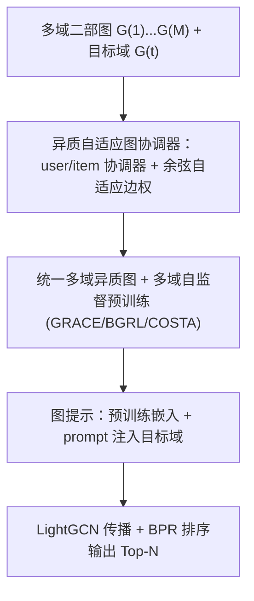
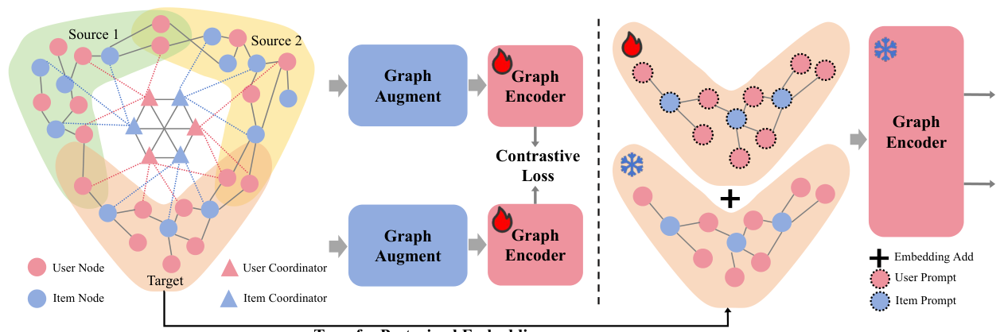

# Adaptive Graph Integration for Cross-Domain Recommendation via Heterogeneous Graph Coordinators (基于异质图协调器的跨域推荐自适应图整合)

- **会议/期刊**: SIGIR 2025
- **作者与机构**: Hengyu Zhang, Chunxu Shen, Xiangguo Sun, Jie Tan, Yu Rong, Chengzhi Piao, Hong Cheng, Lingling Yi（香港中文大学 / 腾讯微信 / 香港浸会大学）
- **推荐链路定位**: 召回（多域预训练 + 目标域 Top-N 排序）
- **研究方向**: 跨域与多场景推荐 / 图神经网络与知识图谱推荐
- **论文原文**: [https://arxiv.org/abs/2410.11719v2](https://arxiv.org/abs/2410.11719v2)
- **开源代码**: [https://github.com/zhy99426/HAGO](https://github.com/zhy99426/HAGO)

## TL;DR (1分钟核心速览)

现有跨域推荐（CDR）几乎都是 **model-centric**：共享底层、映射函数、对比学习，但理论研究表明其性能天花板被域间**数据本身的固有差异**锁死。HAGO 转向 **data-centric**：引入可学习的**异质自适应图协调器**（user/item 协调器各 $n$个），用余弦相似度动态加权把$M$ 个源域图与目标域图缝合成一张统一异质图，在其上做多域自监督预训练，再用**图提示**把知识迁到目标域。在 Douban（Book 为目标）与 Amazon（Toy 为目标）上采用 **Full-Ranking** 全库排序评估，Recall@10 达 0.1689 / 0.1662，相对最强基线 CUT 分别提升约 1.2% / 1.3%，且对 GCN/GAT 骨干与 BGRL/COSTA 预训练策略均即插即用。

## Background & Motivation (背景与核心矛盾)

- **主流范式**: 两条路线——(a) shared-bottom 共享表征/表征融合；(b) transfer-based 用映射函数把源域用户/物品表征投影到目标域，常辅以对比学习增强迁移。
- **前人局限**: 其一，理论工作指出 model-centric 方法的上界由域间数据固有 gap 严格限制，模型再强也无法突破；其二，源域知识并非都对目标域有用，**盲目迁移会引发负迁移**，实验中多个 CDR 基线（CMF、EMCDR、SSCDR）甚至打不过单域 LightGCN/XSimGCL。
- **核心洞察 (Key Insight)**: 图数据的核心信息载体是**节点连通性**，而图提示（prompt as graph）已被证明能以可学习方式等价实现任意图变换 $f_{\theta^*}(P(\mathcal{G})) = f_{\theta^*}(T(\mathcal{G})) + O_{fp}$，因此可在**数据层**而非模型层缝合多域图。
- **本文切入点**: 把"图提示"从下游任务阶段前移到**预训练阶段**，用异质协调器充当跨域信息交换枢纽，并以自适应边权抑制负迁移。

## Method (核心方法设计)

### 1. 整体框架 (Overall Architecture)

输入为 $M$个源域二部图$\mathcal{G}^{(k)}=(\mathcal{V}^{(k)},\mathcal{E}^{(k)})$与目标域$\mathcal{G}^{(t)}$。HAGO 先为每个域挂载$n$个 user 协调器与$n$ 个 item 协调器，协调器之间跨域全连接（仅 user–item 异质连接），协调器与域内节点之间用自适应权重连边，从而把全部图拼成一张统一异质图；随后在该图上以 GRACE 式图增广 + InfoNCE 做多域协同预训练；最后在目标域把预训练嵌入与可学习 prompt 相加，经 LightGCN 传播与 BPR 损失完成下游 Top-N 推荐。整个框架不改动消息传递算子，因此与骨干、预训练算法均解耦。

<figure class="paper-figure" markdown="span">
  <figcaption>图2：所提出的HAGO的示意图，以两个源域和一个目标域为例。不同域之间的用户节点存在部分重叠。为清晰起见，我们省略了所有域中都存在的重叠用户节点。HAGO采用异质自适应图协调器来协同组织多域预训练，然后利用图提示将预训练获得的知识迁移到目标域，从而增强下游推荐任务。</figcaption>
</figure>

### 2. 关键设计拆解 (Key Designs)

1. **异质自适应图协调器（Heterogeneous Adaptive Coordinator）**：手工对齐策略对不同拓扑的域根本不可行，且同质协调器会把 user 与 item 混为一谈造成信息混淆。本文为每域设 $n$个 user 协调器与$n$ 个 item 协调器，user 协调器只连 user 节点、item 协调器只连 item 节点，协调器间邻接矩阵保持二部结构：

$$R_C=\begin{bmatrix}\mathbf{0}_{|C_u|\times|C_u|} & \boldsymbol{J}_{|C_u|\times|C_i|}\\ \boldsymbol{J}_{|C_i|\times|C_u|} & \mathbf{0}_{|C_i|\times|C_i|}\end{bmatrix}$$

直觉是：协调器成为跨域"路由器"，既保留异质二部语义，又打通域间通路。

2. **自适应边权（软/硬双模式）**：固定权重无法区分有用与有害的源域信息。节点 $e$与协调器$e_c$ 的边权定义为

$$w=\begin{cases}\dfrac{\boldsymbol{e}\cdot\boldsymbol{e}_c}{\|\boldsymbol{e}\|\|\boldsymbol{e}_c\|}, & \boldsymbol{e}\cdot\boldsymbol{e}_c>0\ (\text{Soft})\\ 0, & \boldsymbol{e}\cdot\boldsymbol{e}_c\le 0\ (\text{Hard})\end{cases}$$

即余弦相似度截断到 $[0,1]$：相似则连通且强度可调，方向相反则**直接断边**，从结构上物理阻断负迁移通路。

3. **训练目标、负采样与推理效率**：预训练阶段用图增广（边删除/特征掩码）构造正样本对，InfoNCE 拉近正对、推远批内负样本；下游目标域用 BPR + $L_2$：

$$\mathcal{L}=-\frac{1}{|\mathcal{B}|}\sum_{(u,i,j)\in\mathcal{B}}\ln\sigma(\hat{y}_{ui}-\hat{y}_{uj})+\lambda\|\Theta\|^2$$

负样本为标准均匀采样（每正样本配 1 负）。复杂度上，预训练为 $O\big((\sum_k|\mathcal{E}^{(k)}|+|\mathcal{E}^{(t)}|+|\mathcal{E}_C|)Ld\big)$，而**迁移到下游后复杂度回落到$O(|\mathcal{E}^{(t)}|Ld)$**，与纯 LightGCN 同阶，协调器不进入线上推理图。

## Experimental Setup & Evaluation Protocol (实验设置与评估协议)

- **数据集与预处理**: 两平台共 7 个域，取交互最少的域为目标域。

| 数据集 | 域 | #Users | #Items | #Interactions | 稀疏度 |
| :--- | :--- | :---: | :---: | :---: | :---: |
| Douban | Music | 15,996 | 39,749 | 1,116,984 | 99.82% |
| Douban | Movie | 22,041 | 25,802 | 2,552,305 | 99.55% |
| Douban | Book (目标) | 18,086 | 33,068 | 809,248 | 99.86% |
| Amazon | Book | 135,110 | 115,173 | 4,042,382 | 99.97% |
| Amazon | Electronic | 112,988 | 41,905 | 1,880,865 | 99.96% |
| Amazon | Movie | 26,969 | 18,564 | 762,957 | 99.85% |
| Amazon | Toy (目标) | 11,687 | 8,289 | 202,230 | 99.79% |

- **数据划分与防穿越**: 采用 RecBole 标准跨域划分（每用户留出交互做测试，源域全量参与预训练），目标域训练/验证/测试按用户级切分，源域数据不触碰目标域测试标签。
- **排名评测协议**: 明确采用 **Full-Ranking（全库未交互物品排序）**，而非采样排序，作者强调这更贴近工业场景且难度更高；指标为 Recall@10、HR@10、NDCG@10、MRR。
- **对比基线与超参设置**: 单域 NGCF / LightGCN / XSimGCL，跨域 CMF / EMCDR / DeepAPF / SSCDR / BiTGCF / CUT 共 9 个基线；统一 $d=64$、LightGCN 2 层且层权$[0,0,1]$；HAGO 预训练 lr=0.005、batch=1024，下游 lr=0.1、batch=4096，协调器数$n=5$；显著性$p<0.05$。

## Key Experimental Results (实验关键数据)

### 1. 主实验对比 (Main Results)

| 数据集 | 指标 | NGCF | LightGCN | XSimGCL | BiTGCF | CUT | **HAGO** | Improv. vs CUT |
| :--- | :--- | :---: | :---: | :---: | :---: | :---: | :---: | :---: |
| Douban | Recall@10 | 0.1195 | 0.1665 | 0.1660 | 0.1543 | 0.1669 | **0.1689** | +1.20% |
| Douban | HR@10 | 0.2382 | 0.3116 | 0.3117 | 0.2879 | 0.3123 | **0.3168** | +1.44% |
| Douban | NDCG@10 | 0.0807 | 0.1210 | 0.1213 | 0.1103 | 0.1211 | **0.1227** | +1.32% |
| Douban | MRR | 0.0997 | 0.1516 | 0.1526 | 0.1362 | 0.1532 | **0.1535** | +0.20% |
| Amazon | Recall@10 | 0.1064 | 0.1627 | 0.1630 | 0.1605 | 0.1641 | **0.1662** | +1.28% |
| Amazon | HR@10 | 0.1236 | 0.1902 | 0.1913 | 0.1874 | 0.1918 | **0.1950** | +1.67% |
| Amazon | NDCG@10 | 0.0675 | 0.1141 | 0.1147 | 0.1131 | 0.1158 | **0.1177** | +1.64% |
| Amazon | MRR | 0.0601 | 0.1074 | 0.1088 | 0.1056 | 0.1055 | **0.1116** | +5.78% |

### 2. 消融实验 (Ablation Study)

| 变体 | Douban Recall@10 | Douban HR@10 | Amazon Recall@10 | Amazon HR@10 |
| :--- | :---: | :---: | :---: | :---: |
| Backbone (LightGCN) | 0.1665 | 0.3116 | 0.1627 | 0.1902 |
| w/o GO（孤立预训练） | 0.1671 | 0.3121 | 0.1624 ↓ | 0.1901 ↓ |
| HomoGO（同质协调器，权重=1） | 0.1667 ↓ | 0.3115 ↓ | 0.1630 | 0.1901 |
| HeterGO（异质协调器，权重=1） | 0.1676 | 0.3130 | 0.1646 | 0.1917 |
| **HAGO（异质 + 自适应权重）** | **0.1689** | **0.3168** | **0.1662** | **0.1950** |

### 3. 关键实验发现 (Key Findings)

1. **负迁移在数据上被直接观测到**：Amazon 上 w/o GO 的 Recall@10 从 0.1627 掉到 0.1624，Douban 上 HomoGO 相对 w/o GO 也出现下降——说明"有跨域连接"不等于"有收益"，同质协调器把 user/item 混连正是负迁移来源；而 HeterGO 在两个数据集上均稳定优于 HomoGO，验证异质约束的必要性。
2. **自适应权重是主要增益来源**：从 HeterGO 到 HAGO（仅加自适应边权），Douban HR@10 从 0.3130 升至 0.3168、Amazon MRR 从 0.1110 升至 0.1116，说明"按相似度开合边"比"全连通"更能筛掉冲突信息；协调器数量 $2n$呈倒 U 形，$n=5$ 附近最优，过多协调器带来过度迁移反而掉点。
3. **框架与骨干/预训练算法正交可叠加**：HAGO(GCN) 在 Amazon 上把 GCN 的 Recall@10 从 0.1183 提到 0.1274（+7.7%），HAGO(BGRL) 在 Douban 上达 0.1704，高于 Backbone+BGRL 的 0.1679；t-SNE 可视化显示 w/o GO 的三域物品嵌入在单位圆上聚成三个分离方向，而 HAGO 的分布相互交织，证明表征空间被真正对齐。

## Highlights & Limitations (亮点、对比与审稿批判)

- **与代表作对比 (vs. Prior Work)**: 相比 BiTGCF（跨域信息通过用户重叠做图卷积融合）与 CUT（对比学习做跨域对齐），二者仍在模型层做迁移、受数据 gap 上界约束；HAGO 在**图结构层**新增可学习节点与边，属于数据层操作，且下游推理图与 LightGCN 完全一致，工程代价几乎为零。相比同期的图提示工作（如 GPF/ProG），本文把 prompt 前移到预训练阶段并赋予其"跨域路由"语义。
- **可迁移亮点**: (1) 余弦截断的软/硬边权可直接用于任何多源知识融合场景（多场景、多任务、跨模态图融合）；(2) "预训练期加协调器、下游期只留 prompt"的两段式设计，是把重型结构挡在线上推理之外的可复用范式。
- **审稿级局限批判**: 其一，增益幅度偏小（多数指标 1%–2%），且 MRR 在 Douban 上仅 +0.20%，与 LightGCN/XSimGCL 的差距在部分指标上接近噪声量级，缺少多随机种子方差报告；其二，协调器数量 $n$、预训练轮次等超参需逐数据集网格搜索，且预训练阶段需同时载入全部$M$ 个域图，在工业千域规模下的显存与调度成本未被讨论；其三，实验仅用 ID 特征，未验证与多模态/语义特征的兼容性。

## Rating (四维评分)

- **方法创新性 (Novelty)**: ⭐⭐⭐⭐ （把图提示从下游任务前移到预训练阶段做跨域数据缝合，异质 + 自适应双约束设计有清晰的理论锚点与物理直觉）
- **评估协议与实验扎实度 (Protocol & Experiments)**: ⭐⭐⭐⭐ （Full-Ranking 全库排序 + 9 个基线 + 7 个域 + 显著性检验 + 骨干/预训练双兼容实验，但缺方差报告与更大规模验证）
- **写作与数学规范度 (Clarity & Rigor)**: ⭐⭐⭐⭐ （公式简洁、复杂度分析完整、可视化与案例研究支撑充分，但部分符号如 $\boldsymbol{J}$、$R_C$ 的维度标注略拥挤）
- **工业落地与复现价值 (Industrial & Practical Value)**: ⭐⭐⭐⭐⭐ （代码已开源，下游推理复杂度与 LightGCN 同阶，协调器不进入线上图，腾讯微信场景背书，迁移成本极低）

