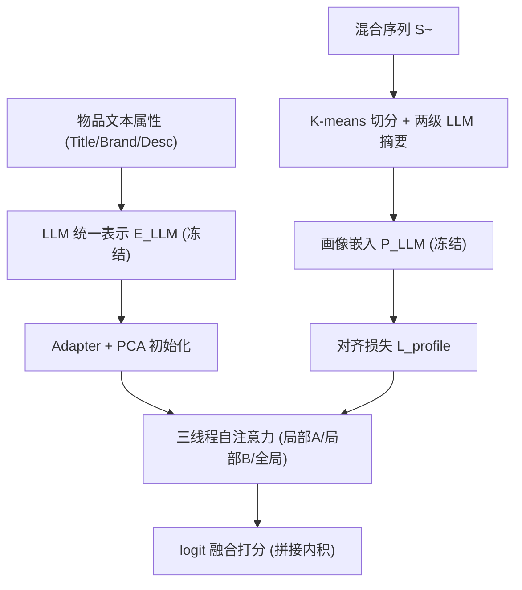

# Bridge the Domains: Large Language Models Enhanced Cross-domain Sequential Recommendation (桥接领域：大语言模型增强的跨域序列推荐)

- **会议/期刊**: SIGIR 2025
- **作者与机构**: Qidong Liu, Xiangyu Zhao, Yejing Wang, Zijian Zhang, Howard Zhong, Chong Chen, Xiang Li, Wei Huang, Feng Tian（西安交通大学、香港城市大学、吉林大学、清华大学、南洋理工大学）
- **推荐链路定位**: 召回（跨域序列 Next-Item 预测）
- **研究方向**: 跨域与多场景推荐 / 大语言模型推荐
- **论文原文**: [https://arxiv.org/abs/2504.18383v1](https://arxiv.org/abs/2504.18383v1)
- **开源代码**: [https://github.com/Applied-Machine-Learning-Lab/LLM4CDSR-pytorch](https://github.com/Applied-Machine-Learning-Lab/LLM4CDSR-pytorch)

## TL;DR (1分钟核心速览)

跨域序列推荐（CDSR）长期受困于**重叠困境**（依赖同时在两域交互的重叠用户建图）与**转移复杂性**（混合序列兴趣漂移难建模）。本文提出 LLM4CDSR：用 LLM 生成物品语义嵌入并经可训练 Adapter 适配，绕开共现依赖；再用分层 LLM 画像（K-means 切分子序列 + 两级摘要）刻画跨域整体偏好，并以对比对齐注入三线程框架。在 Cloth-Sport、Electronic-Phone、Book-Movie 三数据集上，H@10 相对最优基线提升 4.3%–31.7%，且推理时 LLM 完全离线（嵌入可缓存），延迟与 TriCDR 持平。

## Background & Motivation (背景与核心矛盾)

- **主流范式**: CDSR 分两条路线——物品视角用 GNN 在跨域交互图上传播（C2DSR、AMID），用户视角用对比学习从混合序列抽取细粒度兴趣（TriCDR、SyNCRec）。
- **前人局限**: ① **重叠困境**：GNN 路线靠重叠用户建立跨域物品边，非重叠用户对（如图 1(b) 中黄电影—绿书）在图上根本无连通路径；AMID 虽用相似用户分组扩展重叠，仍被共现统计绑架。② **转移复杂性**：混合序列中书籍与电影交替出现，纯协同信号难以刻画兴趣切换的语义动因。
- **核心洞察 (Key Insight)**: 物品的文本属性（标题、品牌、描述）本身携带跨域语义桥梁——"历史剧"与"历史书"在语义空间天然接近，与是否被同一用户共购无关；LLM 的整体摘要能力则能把长混合序列压缩为可对齐的偏好文本。
- **本文切入点**: 以**语义视角**替代协同视角重建跨域桥梁，同时用"离线 LLM 生成 + 在线轻量模型"规避 LLM 推理开销。

## Method (核心方法设计)

### 1. 整体框架 (Overall Architecture)

模型由三线程骨干与两个 LLM 侧模块构成。输入为域 A 序列 $\mathcal{S}_A$、域 B 序列$\mathcal{S}_B$与混合序列$\tilde{\mathcal{S}}$；三线程分别用自注意力编码局部（域内）与全局（跨域）偏好，得到$\mathbf{u}_A,\mathbf{u}_B,\tilde{\mathbf{u}}$，最终以拼接内积做 logit 融合打分。物品嵌入来自统一 LLM 表示模块（LLM 嵌入 + Adapter + PCA 初始化），用户侧由分层 LLM 画像模块产出偏好文本嵌入，经对齐损失注入全局线程。训练时 LLM 嵌入与画像嵌入全部冻结，仅更新 Adapter、注意力层与投影层；推理阶段画像模块整体移除，LLM 零调用。

### 2. 关键设计拆解 (Key Designs)

1. **统一 LLM 表示 + Adapter + 对比正则（破解重叠困境）**：痛点是用 ID 嵌入从零学跨域关系必须依赖共现。本文将物品属性填入模板送入 LLM 取末层隐状态得 $\mathbf{E}_{LLM}\in\mathbb{R}^{(|\mathcal{A}|+|\mathcal{B}|)\times d_{LLM}}$，经两层 Adapter 降维：$\tilde{\mathbf{e}}_i=\mathbf{W}_1(\mathbf{W}_2\mathbf{e}^{LLM}_i+\mathbf{b}_2)+\mathbf{b}_1$。局部嵌入层则用 PCA 将$\mathbf{E}_{LLM}$投影到$d$维初始化，缓解全局（预训练好）与局部（从零训）之间的训练异步性。此外设计域间对比正则，把混合序列中共现的跨域物品对拉近、无关对推远：$\mathcal{L}_{reg}=-\frac{1}{Z}\sum_{i=1}^{Z}\log\frac{\exp(\cos(\tilde{\mathbf{e}}^A_i,\tilde{\mathbf{e}}^B_i)/\gamma)}{\sum_{j=1}^{Z}\mathbb{I}[i\neq j]\exp(\cos(\tilde{\mathbf{e}}^A_i,\tilde{\mathbf{e}}^B_j)/\gamma)}$。直觉：Adapter 让通用语义适配推荐任务，对比正则则补回被语义平滑掉的域别信息。

2. **分层 LLM 画像（破解转移复杂性 + 长 Prompt）**：直接把整条混合序列塞进 LLM 会因 prompt 过长而失效。本文先在 $\mathbf{E}_{LLM}$上做 K-means 将$\tilde{\mathcal{S}}$切成$K$段语义相近的子序列，第一级让 LLM 对每段生成 ≤50 词偏好摘要$\{P_k\}_{k=1}^{K}$，第二级再汇总为 ≤100 词的整体偏好$\tilde{P}$。随后用两层 MLP 将$\tilde{P}^{LLM}$投影为$\tilde{\mathbf{p}}$，与全局用户表示$\tilde{\mathbf{u}}$做双向 InfoNCE 对齐：$\mathcal{L}_{align}=-\frac{1}{Z}\sum_{i=1}^{Z}\log\frac{\exp(\cos(\tilde{\mathbf{u}}_i,\tilde{\mathbf{p}}_i)/\tau)}{\sum_{j=1}^{Z}\mathbb{I}[i\neq j]\exp(\cos(\tilde{\mathbf{u}}_i,\tilde{\mathbf{p}}_j)/\tau)}$。直觉：聚类切分把"长序列理解"降解为"短片段理解 + 层级归纳"，既控 prompt 长度，又让摘要粒度与兴趣簇对齐。

3. **训练目标与推理效率**：总损失 $\mathcal{L}=(\mathcal{L}^A_{SRS}+\mathcal{L}^B_{SRS})+\alpha\cdot\mathcal{L}_{reg}+\beta\cdot\mathcal{L}_{profile}$，其中$\mathcal{L}_{SRS}$为 BPR 式成对排序损失，负样本采用**均匀随机采样**（每正样本 1 负）。打分采用拼接内积$P(v_{n_u+1}=v_i)=[\tilde{\mathbf{e}}_i:\mathbf{e}^A_i]^\top[\tilde{\mathbf{u}}:\mathbf{u}_A]$。关键工程点：$\mathbf{E}_{LLM}$与$\{\tilde{P}^{LLM}_i\}$ 离线预计算并缓存，服务时仅跑 2 层自注意力，参数量 7.72M、全用户推理 5.89s，与 TriCDR 完全一致。

## Experimental Setup & Evaluation Protocol (实验设置与评估协议)

- **数据集与预处理**: 每域过滤交互数 <5 的用户与 <3 的物品（类 `5-core`），全部评论视为隐式正反馈。

| 数据集 | #Users | #Items | 稀疏度 | 重叠用户 | 平均序列长 |
| :--- | :---: | :---: | :---: | :---: | :---: |
| Cloth / Sport | 9,933 | 3,278 / 1,021 | 99.70% / 99.04% | 3,962 | 10.71 |
| Electronic / Phone | 20,728 | 10,492 / 2,246 | 99.93% / 99.88% | 11,698 | 8.30 |
| Book / Movie | 1,381 | 12,426 / 16,537 | 99.88% / 99.92% | 1,265 | 68.30 |

- **数据划分与防穿越**: `Leave-One-Out`——混合序列倒数第二个交互作验证、最后一个作测试；且**仅取混合序列末位物品作为测试目标**，避免跨域标签泄漏。
- **排名评测协议**: 采用 `Full-Ranking` 全库未交互物品排序（Top-10），指标 H@10 / N@10，3 个随机种子（42/43/44）取均值，双侧 t 检验 $p<0.05$。
- **对比基线与超参**: 三组基线——SDSR（GRU4Rec、Bert4Rec、SASRec、DuoRec）、CDSR（C2DSR、TriCDR、SyNCRec、AMID）、LLM-based（SAID、TSLRec、LLM-ESR、URLLM）。嵌入维度 $d=128$，自注意力 2 层，batch 128，lr 0.01，$K=10$，$\gamma=\tau=1$，$\alpha\in\{0.01,\dots,1\}$，$\beta\in\{0.1,\dots,10\}$。Amazon 用 `text-ada-embedding-002` + `gpt-3.5-turbo-0125`，Douban 用 `Embedding-3` + `GLM-4-Flash`。

## Key Experimental Results (实验关键数据)

### 1. 主实验对比 (Main Results)

| Model | Cloth H@10 | Cloth N@10 | Sport H@10 | Sport N@10 | Elec H@10 | Elec N@10 | Book H@10 | Book N@10 | Movie H@10 | Movie N@10 |
| :--- | :---: | :---: | :---: | :---: | :---: | :---: | :---: | :---: | :---: | :---: |
| SASRec | 0.7057 | 0.6543 | 0.5964 | 0.4900 | 0.3586 | 0.2234 | 0.2684 | 0.1740 | 0.7839 | 0.6181 |
| DuoRec | 0.7116 | 0.6528 | 0.6254 | 0.5782 | 0.3891 | 0.2442 | 0.2856 | 0.1885 | 0.8078 | 0.6507 |
| C2DSR | 0.7251 | 0.6760 | 0.6072 | 0.5703 | 0.4548 | 0.3196 | 0.3226 | 0.2368 | 0.7925 | 0.6285 |
| TriCDR | 0.7301 | 0.6789 | 0.6157 | 0.5779 | 0.4543 | 0.3232 | 0.3333 | 0.2405 | 0.7909 | 0.6263 |
| SyNCRec | 0.7359 | 0.6642 | 0.6262 | 0.5664 | 0.4391 | 0.3093 | 0.3818 | 0.2601 | 0.7879 | 0.6176 |
| AMID | 0.7475 | 0.6814 | 0.6377 | 0.5867 | 0.4683 | 0.3211 | 0.4488 | 0.2851 | 0.8199 | 0.6453 |
| LLM-ESR | 0.7472 | 0.6810 | 0.6436 | 0.5965 | 0.4599 | 0.2828 | 0.4183 | 0.2705 | 0.8319 | 0.6676 |
| URLLM | 0.7327 | 0.6785 | 0.6384 | 0.5813 | 0.4448 | 0.3133 | 0.3582 | 0.2510 | 0.8230 | 0.6919 |
| **LLM4CDSR** | **0.8018\*** | **0.7316\*** | **0.7046\*** | **0.6312\*** | **0.4886\*** | **0.3342\*** | **0.5912\*** | **0.3857\*** | **0.8791\*** | **0.7820\*** |
| Improv.% | +7.26 | +7.37 | +9.48 | +5.82 | +4.33 | +3.40 | +31.73 | +35.29 | +5.67 | +13.02 |

### 2. 消融实验 (Ablation Study)

| 变体 | Cloth H@10 | Cloth N@10 | Sport H@10 | Sport N@10 | Book H@10 | Book N@10 | Movie H@10 | Movie N@10 |
| :--- | :---: | :---: | :---: | :---: | :---: | :---: | :---: | :---: |
| LLM4CDSR | **0.8018** | **0.7316** | **0.7046** | **0.6312** | **0.5912** | **0.3857** | **0.8791** | **0.7820** |
| w/o Unified | 0.7402 | 0.6361 | 0.5992 | 0.5368 | 0.4728 | 0.3068 | 0.8385 | 0.6836 |
| w/o Profile | 0.7888 | 0.7200 | 0.6842 | 0.6256 | 0.5387 | 0.3669 | 0.8712 | 0.7780 |
| w/o Reg | 0.7807 | 0.7154 | 0.6830 | 0.6162 | 0.5661 | 0.3843 | 0.8698 | 0.7746 |
| w/o Cluster | 0.7908 | 0.7206 | 0.6896 | 0.6195 | 0.5761 | 0.3681 | 0.8809 | 0.7787 |
| w/o Init | 0.7439 | 0.6822 | 0.6829 | 0.6208 | 0.5352 | 0.3773 | 0.8710 | 0.7510 |

### 3. 关键实验发现 (Key Findings)

1. **统一 LLM 表示是绝对主力，且对稀疏域增益最大**：移除后 Cloth H@10 掉 6.16pt、Book 掉 11.84pt，远超其他组件；Book 域仅 1,381 用户、平均序列长 68.3，说明语义桥梁在协同信号最匮乏处价值最高。
2. **重叠率实验直接验证动机**：将重叠率从 100% 降至 25% 时，C2DSR/TriCDR 性能断崖式下滑，而 LLM4CDSR 在所有比例下均领先——证明语义连接确实不依赖共现；但 SyNCRec/AMID 仍随比例下降明显退化，说明"扩展重叠"只是缓解而非根治。
3. **效率与精度双赢，且画像模块可零成本下线**：LLM4CDSR 参数量 7.72M、推理 5.89s，与 TriCDR 完全相同，远优于 URLLM（6,335M 参数、7,065s）；`w/o Cluster` 在 Movie 上 H@10 反而略高（0.8809 vs 0.8791），暗示数据充足时聚类切分带来的收益被摘要噪声抵消，与 $\beta$ 在 Movie 上需取更小值的超参观察一致。

## Highlights & Limitations (亮点、对比与审稿批判)

- **与代表作对比 (vs. Prior Work)**: 相比 C2DSR/AMID 的"共现图 + 重叠扩展"，本文彻底换轨到语义空间，非重叠物品对也能建立关系；相比 TriCDR 的纯协同三重对比，本文引入 LLM 画像提供整体偏好锚点；相比 URLLM 的"LLM 直接生成推荐"，本文保留判别式骨干、LLM 仅作离线编码器，规避了 out-of-corpus 与协同信号缺失两大硬伤。
- **可迁移亮点**: ① "LLM 嵌入离线缓存 + 轻量 Adapter 在线适配"是低成本落地 LLM4Rec 的通用范式；② "K-means 语义切分 + 两级摘要"可迁移到任意长行为序列的 LLM 画像场景（如长会话推荐、用户生命周期建模）。
- **审稿级局限批判**: ① 画像质量强依赖闭源 LLM API（GPT-3.5 / GLM-4），跨数据集需换模型，复现成本与结果可迁移性存疑，且摘要噪声在 Movie 域已显现负面效应；② 仅验证两域设定，多域（≥3）下 K-means 切分与三线程框架如何扩展未讨论；③ 负采样仅为均匀随机，未探索难负样本对跨域对比正则的影响。

## Rating (四维评分)

- **方法创新性 (Novelty)**: ⭐⭐⭐⭐ （首次将 LLM 语义桥梁系统引入 CDSR，物品侧 Adapter+对比正则与用户侧分层画像组合自洽，但各组件均为已有技术的跨域重组）
- **评估协议与实验扎实度 (Protocol & Experiments)**: ⭐⭐⭐⭐ （三数据集 + Full-Ranking + 显著性检验 + 重叠率受控实验设计精巧，但缺线上 A/B 与多域验证）
- **写作与数学规范度 (Clarity & Rigor)**: ⭐⭐⭐⭐ （三线程与两模块的动机—公式对应清晰，算法伪代码完整；Adapter 维度符号与 PCA 初始化细节略简）
- **工业落地与复现价值 (Industrial & Practical Value)**: ⭐⭐⭐⭐⭐ （代码开源，LLM 全离线、推理延迟与 TriCDR 持平，是少数"LLM 增强但不增延迟"的可部署方案）

