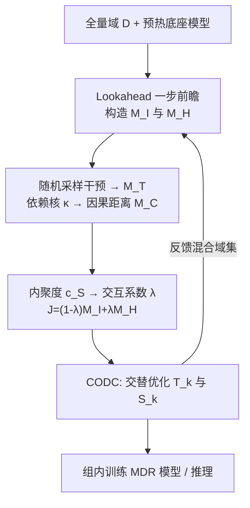
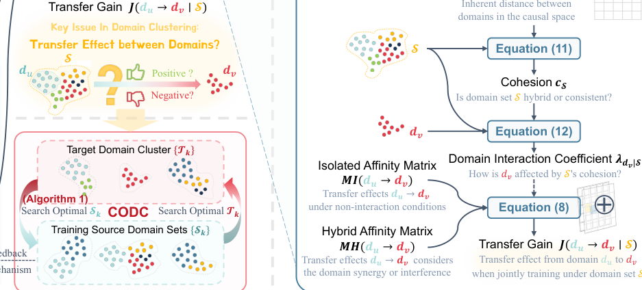

# CDC: Causal Domain Clustering for Multi-Domain Recommendation (面向多域推荐的因果域聚类)

- **会议/期刊**: SIGIR 2025
- **作者与机构**: Huishi Luo, Yiqing Wu, Yiwen Chen, Fuzhen Zhuang, Deqing Wang（北航人工智能学院、中科院计算所）
- **推荐链路定位**: 精排前的域分组阶段（模型无关，可套任意 MDR 底座）
- **研究方向**: 跨域与多场景推荐 / 工业级全链路架构
- **论文原文**: [https://arxiv.org/abs/2507.06877v1](https://arxiv.org/abs/2507.06877v1)
- **开源代码**: [https://github.com/Chrissie-Law/Causal-Domain-Clustering-for-Multi-Domain-Recommendation](https://github.com/Chrissie-Law/Causal-Domain-Clustering-for-Multi-Domain-Recommendation)

## TL;DR (1分钟核心速览)

当平台扩展到几十上百个推荐域时，全量联合训练因域间差异巨大而负迁移严重，而现有域分组依赖业务逻辑或数据分布相似度，无法反映"训练后真实迁移效果"。本文提出 CDC：用 lookahead 一步前瞻损失差构造**孤立亲和矩阵 $M_I$**（无交互迁移）与**混合亲和矩阵$M_H$**（联合训练下的协同/干扰），再用因果发现算出的内聚系数$\lambda$自适应融合二者得到迁移增益$J$，最后由 CODC 算法交替优化目标域簇$\{T_k\}$与训练源域集$\{S_k\}$（允许$S_k \neq T_k$）。在 Amazon/AliCCP 的 25/50 域上 DomainAUC 分别提升 4.14‰ 与 6.76‰，工业 64 域 14 天 A/B 测试 eCPM +4.9%。

## Background & Motivation (背景与核心矛盾)

- **主流范式**: STAR/HiNet 用共享-独享参数解耦，PEPNet/DTRN 用超网络按域特征动态生成参数；域分组方法（TAG、ADL）则先按分布相似度或梯度相似度分组，再组内联合训练。
- **前人局限**: ① 现有 MDR 方法多针对 <10 个域设计，扩展到上百域时显存与计算不可承受；② 相似度度量是**静态、无方向**的——数据分布相近不等于迁移有效（如大类目与其子类目分布差异大，但联合训练反而给子类目带来通用知识），且 $d_u \to d_v$与$d_v \to d_u$ 被视作等价，违背迁移的方向性。
- **核心洞察 (Key Insight)**: 域间真实关系只有在**训练之后**才显现，且高阶联合训练存在**协同或干扰**（如男装+女装联合可逼近全局分布，单独训练反而负迁移），一对一相似度无法刻画这种高阶效应。
- **本文切入点**: 用"一步前瞻的损失变化"直接度量迁移效果，并用因果发现的内聚度自适应决定"该信孤立迁移还是该信交互迁移"，同时把"训练用哪些域"从"评估哪些域"中解耦出来独立搜索。

## Method (核心方法设计)

### 1. 整体框架 (Overall Architecture)

CDC 分三步闭环：(1) 预热底座模型后，通过 lookahead 更新分别估计 $M_I$与$M_H$；(2) 以随机域采样为"干预/treatment"构造因果处理矩阵$M_T$，经依赖贡献核$\kappa$得到因果距离矩阵$M_C$，据此算域集内聚度与交互系数$\lambda$，融合出迁移增益$J$；(3) CODC 启发式交替执行"给定$T_k$搜最优$S_k$"与"给定$S_k$重分配域到$T_k$"，$S_k$又反馈回$M_H$的混合域集$\mathcal{M}^t_u$，随训练推进分组策略收敛。

<figure class="paper-figure" markdown="span">
  <figcaption>图2：因果域聚类（CDC）框架。(1) 我们学习两个域间亲和矩阵𝑀𝐼和𝑀𝐻，以独立和交互方式捕获域关系。(2) 因果发现计算交互系数𝜆，从而能够自适应整合𝑀𝐼和𝑀𝐻，以评估任意可能训练源域集合S下的迁移增益𝐽。(3) CODC联合优化目标域簇{T𝑘}和最优训练源域集合{S𝑘}。</figcaption>
</figure>

### 2. 关键设计拆解 (Key Designs)

1. **双视角亲和矩阵（$M_I$与$M_H$）**：痛点是用分布/梯度相似度衡量迁移会失真。做法是保存当前参数$\Theta_t$，仅用域$d_u$数据更新一步得$\Theta_{t+1}^{\{d_u\}}$，再看$d_v$上损失下降比例，带平滑因子$\alpha$ 累积：
$$M_I^t[u,v]=\alpha M_I^{t-1}[u,v]+(1-\alpha)\left(1-\frac{\sum_{d\in d_v}\mathcal{L}(f_{\Theta_{t+1}^{\{d_u\}}}(x,d),y)}{\sum_{d\in d_v}\mathcal{L}(f_{\Theta_t}(x,d),y)}\right)$$
$M_H$则把更新域集换成含$d_u$的混合集$\mathcal{M}^t_u$与其去掉$d_u$的版本，二者损失比即"$d_u$在交互环境下的边际贡献"。正值代表正迁移、负值代表负迁移，天然带方向性；$\mathcal{M}^t_u$随聚类结果动态更新（$t>0$时取$S_k$），形成反馈闭环，使$M_H$ 逐步逼近最终分组下的真实亲和。

2. **因果发现驱动的双视角融合**：痛点是一对一矩阵无法表达高阶协同/干扰。做法是把"随机采样一批域联合训练"视为因果干预，记录 $R$次采样的域损失增益得$M_T\in\mathbb{R}^{R\times D}$，再用依赖贡献核$\kappa$（因果空间中的余弦相似）取$\arccos$得对称因果距离$M_C^t[u,v]=\arccos(\kappa(M_T^t[:,u],M_T^t[:,v]))$。域集内聚度$c_\mathcal{S}^t=\frac{1}{|\mathcal{S}|^2}\sum_{d_u\in\mathcal{S}}\sum_{d_v\in\mathcal{S}}M_C^t[u,v]$，交互系数
$$\lambda_{d_v|\mathcal{S}}=\min\left(1,\frac{|\mathcal{S}|\sum_{d_u\in\mathcal{S}}M_C^t[u,v]}{2\sum_{d_u\in\mathcal{S}}\sum_{d_v\in\mathcal{S}}M_C^t[u,v]}\right)$$
最终 $J(d_u\to d_v|\mathcal{S})=(1-\lambda_{d_v|\mathcal{S}})M_I[u,v]+\lambda_{d_v|\mathcal{S}}M_H[u,v]$。直觉：域集内聚度高（彼此相似）时$\lambda\to 0$，信$M_I$；目标域与集合差异大时$\lambda\to 1$，交互效应主导，信$M_H$。

3. **CODC 联合优化与训练目标**：痛点是最优训练域集未必等于目标域簇本身。算法先用 $\lambda$最小的$N$个域初始化$S_{k,0}$，再按$\arg\max_{d_u\notin S_{k,i}}\left[J(d_u\to T_k^t|S_{k,i}\cup\{d_u\})+\rho_t P(d_u|k)\right]$逐个吸纳外部域，其中归属分$P(d_u|k)=(1-2\lambda_{d_u|S_{k,0}})\sqrt{w_u}$提供全局视野、$\rho_t=\rho_0\beta^t$衰减；增益转负即停。外层按$J(S_k\to d_v)=\sum_{d_u\in S_k}J(d_u\to d_v|S_k)$把未分配域归入增益最大的簇。总目标即$\mathcal{L}_{total}=\sum_k\sum_{d\in T_k}\mathcal{L}(f_{\Theta_{S_k}}(x,d),y)$。CDC 本身**不引入新负采样**，沿用底座 MDR 模型的训练方式；额外开销仅为 lookahead 的一批前向/反向，线上部署版训练时间与基线持平（1.09×）。

## Experimental Setup & Evaluation Protocol (实验设置与评估协议)

- **数据集与预处理**:

| 数据集 | #Users | #Items | #Interactions | 稀疏度/密度 | 特征/场景说明 |
| :--- | :---: | :---: | :---: | :---: | :--- |
| Amazon | 2,899,335 | 1,286,361 | 17,664,862 | 正样本 12.0M | 25 个类目为 25 域，近 12 个月，评分>4 为正 |
| AliCCP | 234,952 | 107,694 | 18,952,318 | 正样本 0.83M | 采样 50 个类目为域，另随机并入 10 个类目模拟真实平台 |
| MDR-229M（工业） | — | — | 229M | 正样本 4.73% | 81 个业务域 + 3 个高流量辅助域，8 天 |
| MDR-865M（工业） | — | — | 865M | — | 31 天，仅测 PEPNet 与 CDC-PEPNet |

- **数据划分与防穿越 (Splitting Strategy)**: Amazon 按时间 **90:5:5** 切分；AliCCP 用官方训练段，原测试集均分为验证/测试；工业数据取最后一天为测试、其余训练。
- **排名评测协议 (Ranking Protocol)**: 域内独立评估，主指标 **DomainAUC**（按各域样本量加权平均），辅以 Major5AUC（最大 5 域）、Minor10AUC（最小 10 域）、TotalAUC（全局参考）。工业场景 AUC 提升 1‰ 即视为显著。
- **对比基线与超参设置**: 三类基线——单域模型（DeepFM/DCN/AutoInt/DCNv2）、多域模型（MMoE/PLE/STAR/AdaSparse/HiNet/PEPNet/ADL）、域分组方法（Random/Manual/TAG）。底座可选 MMoE/STAR/HiNet/PEPNet；学习率 $\{5e{-}4,1e{-}3,2e{-}3,3e{-}3\}$，batch$\{1024,2048,4096\}$，簇数$K\in\{3,4,5\}$，$\alpha$最优 0.3，$\rho_0=0.01$、$\beta=0.95$，$N=2$；结果五次平均，$p<0.01$ 显著性检验。

## Key Experimental Results (实验关键数据)

### 1. 主实验对比 (Main Results)

| 方法 | Amazon DomainAUC | Amazon Minor10AUC | AliCCP DomainAUC | AliCCP Minor10AUC |
| :--- | :---: | :---: | :---: | :---: |
| DCNv2 (单域最优) | 0.6532 | 0.6605 | 0.5835 | 0.5692 |
| STAR | 0.6563 | 0.6603 | 0.5878 | 0.5622 |
| AdaSparse | 0.6572 | **0.6696** | 0.5855 | 0.5634 |
| PEPNet (single) | 0.6566 | 0.6648 | 0.5905 | 0.5771 |
| TAG (分组 SOTA) | 0.6523 | 0.6536 | 0.5889 | 0.5682 |
| CDC (end-to-end) | 0.6592* | 0.6680 | 0.5923* | 0.5813 |
| **CDC** | **0.6613*** | **0.6728*** | **0.5972*** | **0.5855*** |
| Improv. (vs 最优基线) | +4.14‰ | +3.2‰ | +6.76‰ | +8.4‰ |

组内独立训练设定（表 3）下，CDC (split) 在 Amazon/AliCCP 的 DomainAUC 分别达 0.6660 / 0.5906，较 TAG 提升 **8.46‰ / 10.15‰**。工业 MDR-229M 上，CDC-S_k 相对 DCN 基准 DomainAUC **+2.85‰**、Major5AUC +2.65‰；MDR-865M 上 CDC-PEPNet 较 PEPNet DomainAUC **+7.24‰**、TotalAUC +7.09‰。

### 2. 消融实验 (Ablation Study)

| 配置 | DomainAUC (Amazon) | 说明 |
| :--- | :---: | :--- |
| Full (CDC split) | **0.6660** | 完整模型 |
| w/o $M_I$ | 0.659 | 去掉孤立亲和，仅剩交互视角 |
| w/o $M_H$ | 0.655 | 去掉混合亲和，高阶交互失效，降幅最大 |
| w/o Causal | 0.660 | 用余弦替代因果核 $\kappa$ |
| w/o CODC | 0.661 | 直接令 $S_k=T_k$，不搜源域集 |

### 3. 关键实验发现 (Key Findings)

1. **$M_H$是性能主引擎**：去掉混合亲和矩阵后 DomainAUC 从 0.6660 掉到 0.655（-11‰），降幅大于去掉$M_I$（-7‰），说明几十域场景下高阶协同/干扰的刻画比一对一迁移更关键，也印证了"相似≠可迁移"的动机。
2. **源域集与目标簇解耦确有收益**：工业数据上 CDC-S_k（用 $S_k$ 训练）DomainAUC +2.85‰ 显著优于 CDC-T_k（+1.63‰）与 CDC-D（+2.19‰），证明"训练用域"应独立搜索而非简单取目标簇本身；Amazon 上 CDC (split) 也优于全量联合训练的 CDC (end-to-end)。
3. **小域受益最明显但存在波动**：AliCCP 上 Minor10AUC 提升达 8.4‰，说明聚类缓解了小域数据稀疏；但 Amazon 上 CDC (end-to-end) 的 Minor10AUC（0.6680）反低于 AdaSparse（0.6696），作者归因于训练中分组动态漂移对小域扰动更大——这是该方法最值得警惕的短板。

## Highlights & Limitations (亮点、对比与审稿批判)

- **与代表作对比 (vs. Prior Work)**: 相比 TAG 仅用孤立的一对一 lookahead 亲和并用分支定界搜索，CDC 额外引入 $M_H$显式建模高阶交互、用因果内聚系数自适应加权，并把搜索空间从"如何划分$T_k$"扩展到"为每个$T_k$另找$S_k$"；相比 STAR/PEPNet 等参数解耦路线，CDC 是**模型无关的前置分组层**，可直接套在任意 MDR 底座上（实验已验证 STAR/PEPNet 两种底座均受益）。
- **可迁移亮点**: ① "随机域采样作为干预 + 依赖贡献核算因果距离"可迁移到任意多任务/多场景的相似度度量；② 用 $\rho_t$衰减的归属分$P$ 做"早期全局视野、后期放开灵活性"的退火式搜索约束，是启发式组合搜索的通用技巧。
- **审稿级局限批判**: ① 因果距离依赖 $R$次随机采样与多次 lookahead 更新，$D$达数百时$O(R\cdot D)$的前瞻开销与$D\times D$矩阵存储会显著膨胀，论文仅在 25/50/81 域上验证；② 分组在训练中动态漂移，对小域稳定性不利（Amazon Minor10AUC 已被 AdaSparse 反超），且$K$、$\alpha$、$\rho_0$、$\beta$ 均需网格搜索，工业迁移的调参成本未讨论。

## Rating (四维评分)

- **方法创新性 (Novelty)**: ⭐⭐⭐⭐ （首次将因果发现引入 MDR 域聚类，双亲和矩阵+内聚系数的设计有清晰物理直觉，但本质仍是 lookahead 亲和的加权组合）
- **评估协议与实验扎实度 (Protocol & Experiments)**: ⭐⭐⭐⭐⭐ （两个公开数据集+两个亿级工业数据集+14 天 64 域线上 A/B，三类基线齐全，消融与超参分析完整）
- **写作与数学规范度 (Clarity & Rigor)**: ⭐⭐⭐⭐ （公式与算法伪代码完整、符号一致，但 $M_T$/$M_C$的采样次数$R$ 与收敛性缺少理论分析）
- **工业落地与复现价值 (Industrial & Practical Value)**: ⭐⭐⭐⭐⭐ （模型无关、代码开源、部署版训练开销与基线持平 1.09×，线上 eCPM +4.9% 且 56/64 域为正收益）

