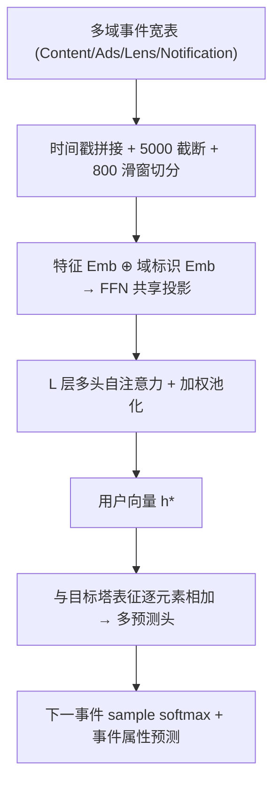
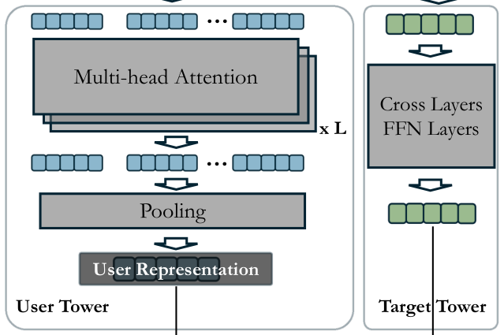
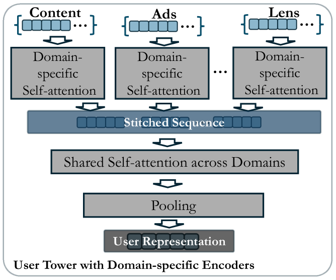
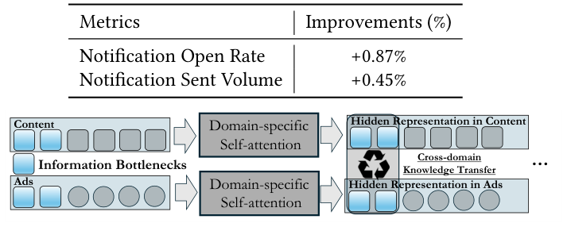

# Learning Universal User Representations Leveraging Cross-domain User Intent at Snapchat (利用跨域用户意图学习通用用户表征)

- **会议/期刊**: SIGIR 2025 (Industrial Track)
- **作者与机构**: Clark Mingxuan Ju, Leonardo Neves, Bhuvesh Kumar, Tong Zhao, Neil Shah 等，Snap Inc.
- **推荐链路定位**: 召回（EBR 辅助特征）+ 精排（L2 Ranking 特征）
- **研究方向**: 跨域与多场景推荐 / 序列推荐
- **论文原文**: [https://arxiv.org/abs/2504.21838v2](https://arxiv.org/abs/2504.21838v2)
- **开源代码**: 暂未开源

## TL;DR (1分钟核心速览)

Snapchat 各业务面（长视频、Lens、广告、通知）的用户表征长期各自独立训练，跨域信息只能事后拼接为辅助特征，无法直接编码跨域协同过滤信号，且多域共存时运维成本随域数线性膨胀。本文提出通用用户建模 UUM：把多域事件按时间戳拼接成一条平台级序列，用共享 Transformer 用户塔做下一事件预测，产出可复用的通用用户向量。线上 A/B 中长视频 EBR 打开率 +2.78%、长视频 L2 观看时长 +19.2%、Lens 播放 +1.76%、通知打开率 +0.87%；离线迭代版本（域专属编码器 + 信息瓶颈）Recall@20 由 0.483 升至 0.522。

## Background & Motivation (背景与核心矛盾)

- **主流范式**: 每个业务面独立训练自己的用户塔，跨域共享仅停留在 post-hoc 层面——把 A 域 embedding 当作 B 域的辅助特征或额外召回源。
- **前人局限**: 其一，post-hoc 拼接无法直接编码跨域协同过滤信号，平台级"行为—偏好"的复杂关联被割裂；其二，多域共存时需聚合各域 embedding，形成域间强耦合依赖，带来跨团队协调与基础设施的沉重负担。
- **核心洞察 (Key Insight)**: 用户在不同 surface 上的行为本质是同一意图的不同投影，若把多域事件放进同一条时间轴，单一序列模型即可隐式学到跨域迁移；且通用表征不应替代域专属表征，而应作为互补信息注入。
- **本文切入点**: 将 UUM 形式化为跨域序列推荐（下一事件检索），用一条拼接序列 + 共享 Transformer 一次性产出平台级用户向量，直接服务多下游。

## Method (核心方法设计)

### 1. 整体框架 (Overall Architecture)

原始数据以 user ID 为行、事件为列组织成宽表，每列按时间戳排序，稀疏特征以 null 填充，序列截断至 5000；随后用长度 800 的滑动窗口切分为多条子序列以扩充样本并抑制 padding 开销。每条子序列经特征 embedding 与域标识 embedding 拼接后送入 FFN 投影到共享隐空间，再经 $L$层多头自注意力与加权求和池化得到用户向量$\mathbf{h}^{*}$；目标塔对末位事件做同样编码并过 Cross 层与 FFN，二者逐元素相加后分发给多个预测头，以多任务方式联合优化。

<figure class="paper-figure" markdown="span">
  <figcaption>图3：UUM的模型架构。</figcaption>
</figure>

### 2. 关键设计拆解 (Key Designs)

1. **域标识感知的共享投影（Domain-Aware Shared Projection）**：多域特征空间异构（广告有 vendor ID、内容没有），直接共享 ID embedding 会互相污染。本文在事件编码时显式拼接域标识 $d(x_i)$ 再统一投影：
$\mathbf{h}_i = \mathrm{FFN}\big(\mathrm{Concat}(\mathrm{Feature}(x_i),\, \mathbf{e}_{d(x_i)})\big)$
直觉上，域标识充当"路由信号"，让同一 FFN 在不同域上学到条件化的映射，从而在共享参数下保留域间差异。

2. **域专属编码器 + 共享自注意力（缓解跨域不均衡）**：共享编码器隐含假设各域行为同分布，但真实数据域间严重不均衡，弱势域会沦为噪声。改进版先用独立域内自注意力捕获域内序列性与协同信号，再经跨域共享自注意力统一，实现"域内保真、域间对齐"的折中。

<figure class="paper-figure" markdown="span">
  <figcaption>图5：UUM中带有领域特定编码器的用户塔。</figcaption>
</figure>

3. **信息瓶颈 Token 的跨域知识迁移**：为避免域间交互无差别扩散，在每个域序列中插入 IB token 作为注意力瓶颈：IB token 只 attend 本域事件以吸收域内知识，跨域交换仅通过 IB token 的 LayerNorm 逐元素相加完成，随后域内元素再回 attend 更新后的 IB token 取回迁移知识。该设计把跨域带宽压缩到极少数 token 上，天然过滤域间噪声。

<figure class="paper-figure" markdown="span">
  <figcaption>图4：结合IB的领域特定注意力。</figcaption>
</figure>

4. **训练目标、负采样与推理效率**：总损失为下一事件预测的 sample softmax（in-batch 负采样）与事件属性预测（CE / MSE）的多任务加权和。推理侧用户塔离线批量产出向量并写入特征库，下游仅做一次查表，在线开销可忽略；训练侧 800 长度滑窗把单用户样本数放大数倍，是长序列可训练的关键工程折中。

## Experimental Setup & Evaluation Protocol (实验设置与评估协议)

- **数据集与预处理**: 工业私有数据，覆盖 Content（长视频）、Ads、Lens、Notification 等多域事件；序列上限 5000，高意图事件优先保留、低意图事件按时间戳裁剪。

| 数据集 | #Users | #Items | #Interactions | 稀疏度/密度 | 特征/场景说明 |
| :--- | :---: | :---: | :---: | :---: | :--- |
| Snapchat 内部多域日志 | 未披露 | 未披露（全平台事件） | 未披露 | 长尾幂律分布 | Content / Ads / Lens / Notification 四类 surface |

- **数据划分与防穿越 (Splitting Strategy)**: 序列内按时间戳排序，取序列末位事件为标签、其余为历史，属严格的时间先后切分（next-event 预测），无未来信息泄漏。
- **排名评测协议 (Ranking Protocol)**: 离线采用 `Sampled Ranking`——每个测试样本从全库事件中随机采 50,000 个负例，计算 Recall@20 与 NDCG@20；线上采用多场景真实 A/B 实验。
- **对比基线与超参设置**: 离线仅对比 Base UUM 与两个改进变体（域专属编码器、+IB），未与公开跨域基线对比；序列长度 800、隐层维度 $f$与层数$L$ 未在正文披露；线上以 A/B 显著性为准。

## Key Experimental Results (实验关键数据)

### 1. 主实验对比 (Main Results)

线上 A/B（相对提升，四类下游场景）：

| 应用场景 | 核心指标 | 提升幅度 |
| :--- | :--- | :---: |
| 长视频 EBR（召回） | Long-form Video Open Rate | **+2.78%** |
| 长视频 EBR（召回） | Long-form Video Direct Open Sum | **+2.86%** |
| 长视频 EBR（召回） | App Open DAU | +0.04% |
| 长视频 L2 Ranking | Long-form Video View Time Sum | **+19.20%** |
| 长视频 L2 Ranking | Long-form Video Direct Open Sum | +1.01% |
| Lens L2 Ranking | Lens Long Play | **+1.76%** |
| Lens L2 Ranking | Lens Swipe | +0.72% |
| Notification L2 Ranking | Notification Open Rate | **+0.87%** |
| Notification L2 Ranking | Notification Sent Volume | +0.45% |

离线下一事件检索（50,000 随机负例）：

| 模型变体 | Recall@20 | NDCG@20 |
| :--- | :---: | :---: |
| Base UUM | 0.483 | 0.254 |
| + Domain-specific Encoder | 0.519 | 0.270 |
| + Information Bottleneck | **0.522** | **0.281** |

### 2. 消融实验 (Ablation Study)

| 配置 | Recall@20 | NDCG@20 | ΔRecall |
| :--- | :---: | :---: | :---: |
| Base（共享编码器） | 0.483 | 0.254 | — |
| w/o 共享编码器 → 域专属编码器 | 0.519 | 0.270 | +7.5% |
| 域专属编码器 + IB token | **0.522** | **0.281** | +8.1% |

### 3. 关键实验发现 (Key Findings)

1. **域专属编码器贡献了绝大部分离线增益**：Recall@20 从 0.483 提升到 0.519（+7.5%），说明跨域不均衡导致的噪声污染是共享编码器的主要瓶颈，域内先建模、域间后对齐的顺序至关重要。
2. **IB token 主要改善排序质量而非召回广度**：加入 IB 后 Recall@20 仅再涨 0.003，但 NDCG@20 从 0.270 升至 0.281（+4.1%），表明瓶颈机制压缩的是跨域噪声而非有效信号，头部排序受益更明显。
3. **通用表征在精排阶段的收益远大于召回**：长视频 L2 观看时长 +19.2% 远超 EBR 打开率 +2.78%，说明 UUM 向量携带的跨域意图信息在特征交叉充分的精排模型中才被完全释放，作为辅助特征注入比作为独立召回源更有价值。

## Highlights & Limitations (亮点、对比与审稿批判)

- **与代表作对比 (vs. Prior Work)**: 相较传统 post-hoc 跨域特征共享（如将源域 embedding 直接拼入目标域），UUM 在训练阶段就联合编码多域协同信号，避免了域间耦合与运维膨胀；相较经典 CDR（如跨域映射/共享底层），UUM 不要求重叠用户对齐，而是用统一时间轴天然对齐，工程可扩展性更强。
- **可迁移亮点**: 其一，"域标识 embedding + 共享 FFN"是在异构特征空间下复用单塔的轻量技巧，可直接迁移到多业务线统一用户塔；其二，IB token 作为跨域带宽瓶颈，适合任何需要"域内保真 + 域间受控迁移"的多场景联合建模。
- **审稿级局限批判**: 其一，离线评估仅与自身 Base 对比、无公开数据集与 SOTA 基线，且 50,000 随机负例的采样排序协议显著弱于 Full-Ranking，结论外部效度有限；其二，正文未披露隐层维度、层数、多任务损失权重等关键超参，且 800 长度滑窗与 5000 截断的敏感性缺乏分析，复现与调参成本高。

## Rating (四维评分)

- **方法创新性 (Novelty)**: ⭐⭐⭐ （通用用户建模范式在工业界有实践价值，但 Transformer 序列建模本身无新意，IB token 迁移属已有技术的组合应用）
- **评估协议与实验扎实度 (Protocol & Experiments)**: ⭐⭐⭐ （四场景线上 A/B 数据亮眼且可信，但离线仅采样排序、无公开基线对比，学术说服力偏弱）
- **写作与数学规范度 (Clarity & Rigor)**: ⭐⭐⭐ （工业 track 短文，公式极简、符号定义够用，但关键超参与模型细节大量省略，推导深度有限）
- **工业落地与复现价值 (Industrial & Practical Value)**: ⭐⭐⭐⭐ （已全量上线并覆盖召回与精排多链路，工程折中（滑窗、截断、离线查表）极具参考价值，可惜未开源）

