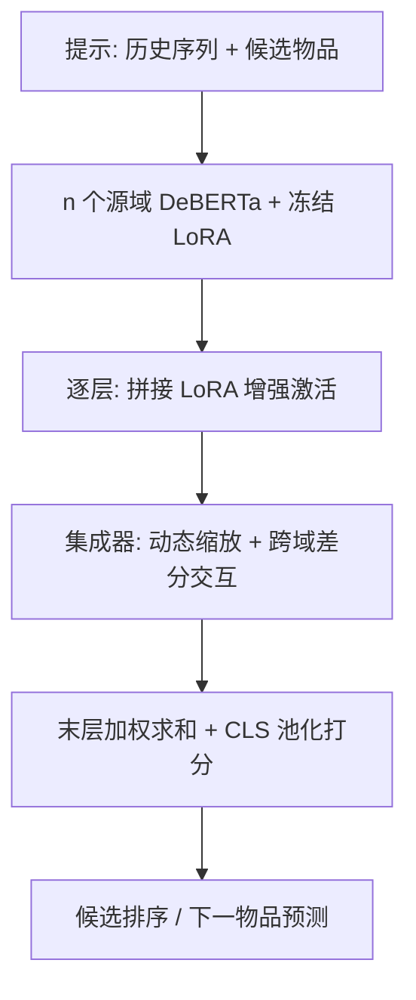
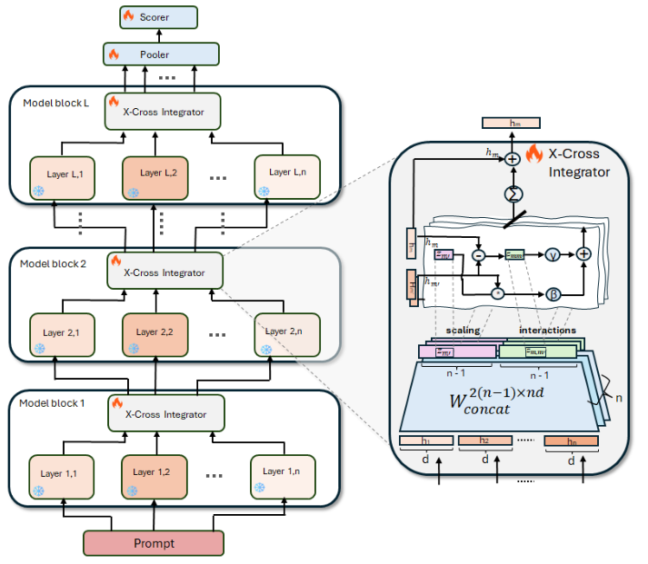

# X-Cross: Dynamic Integration of Language Models for Cross-Domain Sequential Recommendation (面向跨域序列推荐的语言模型动态集成)

- **会议/期刊**: SIGIR 2025
- **作者与机构**: Guy Hadad, Haggai Roitman, Yotam Eshel, Bracha Shapira, Lior Rokach (Ben-Gurion University of the Negev / eBay)
- **推荐链路定位**: 精排（候选打分）/ 端到端生成式打分
- **研究方向**: 跨域与多场景推荐 / 大语言模型推荐
- **论文原文**: [https://arxiv.org/abs/2504.20859v1](https://arxiv.org/abs/2504.20859v1)
- **开源代码**: 暂未开源

## TL;DR (1分钟核心速览)

针对新域冷启时"重训 LoRA 参数贵、数据缺"的痛点，X-Cross 将多个源域 LoRA 微调语言模型在**每一 Transformer 层**做动态加权集成：用可训练集成器对拼接后的 LoRA 增强激活计算正负缩放因子与跨域交互项，逐层精炼后加权求和打分。在 Amazon 四域（Tools/Sports/Toys/Electronics）多选打分协议下，仅用 LoRA 约 25% 参数即在 Tools/Electronics 上超越 LoRA 微调，且比 LoRA 少 50%–75% 微调数据即可超过零样本参考模型。

## Background & Motivation (背景与核心矛盾)

- **主流范式**: 跨域序列推荐多用 BERT 类编码器 + 域适配器（UniSRec 的 MoE 适配器、VQ-Rec 的向量量化、RecFormer 的语言表征），或对目标域单独训练 LoRA 适配器。
- **前人局限**: ① 现有跨域模型依赖**预训练权重的固定激活** $Wx$，而推荐任务上预训练表征区分度不足，难以刻画相近域的细微差异；② 仅用最后一层隐状态，丢弃中间层富含的迁移知识；③ 多 LoRA 集成方法（XLoRA/MeteoRA）依赖 softmax 仅产生正权重，无法抑制噪声域。
- **核心洞察 (Key Insight)**: 域特异性信息其实藏在 **LoRA 适配后的激活** $(W+AB)x$中而非原始$Wx$；且不同层对推荐信号的贡献不均，需**逐层**而非仅末层集成。
- **本文切入点**: 在每层插入"热"可训练集成器，对冻结的 LoRA 增强激活做带正负号的动态加权与跨域差分交互，实现免域标签、免重训源适配器的跨域迁移。

## Method (核心方法设计)

### 1. 整体框架 (Overall Architecture)

输入为文本化提示 `[History: S_u, Candidate: i]`，经 $n\ge2$个源域 DeBERTa（各挂冻结 LoRA 适配器）并行编码。每层先拼接各域 LoRA 增强激活，再由该层集成器算出$2n(n-1)$ 个缩放/交互权重，回写精炼各域表征并传入下一层；末层加权求和后经 [CLS] 池化与线性打分头输出候选分数，以负采样 NLL 训练、取最高分候选为预测。

<figure class="paper-figure" markdown="span">
  <figcaption>图2：X-Cross模型架构。每个源域语言模型由若干Transformer（垂直）层实现。左侧：在每一层，“热”可训练集成器接收来自“冻结”层的激活，然后将集成表示传递给下一层。右侧：对位于某一网络层的X-Cross集成器的“放大”视图。</figcaption>
</figure>

### 2. 关键设计拆解 (Key Designs)

1. **LoRA 增强激活的逐层集成（Stage 1–2）**：痛点在于原始 $Wx$区分度弱。X-Cross 改为对$h_m^{(l)}=(W_m^{(l)}+A_m^{(l)}B_m^{(l)})x_m^{(l)}$拼接后线性映射出权重$z^{(l)}=W^{(l)}_{concat}h^{(l)}_{concat}$，其中$z^{(l)}\in\mathbb{R}^{2n(n-1)}$同时含$n-1$个域缩放因子与$n-1$ 个成对交互项。**不用 softmax**，允许负权重以"远离"噪声域，这是相对 MeteoRA 的关键增量。

2. **带差分交互的表征精炼（Stage 3）**：仅加权求和无法刻画域间相对关系，故引入差分项：
$$\tilde{h}_m^{(l)}=h_m^{(l)}+\sum_{m'\neq m}\left(\beta\, z^{(l,m)}_{[m']}h_{m'}^{(l)}+\gamma\, z^{(l,m)}_{[m,m']}(h_m^{(l)}-h_{m'}^{(l)})\right)$$
残差结构保留域内特性、抑制冗余知识；差分项显式建模域间偏移，使相近域也能被区分。超参 $\beta=0.5,\gamma=0.4$。

3. **训练目标、负采样与推理效率**：总损失为多选 NLL $\mathcal{L}=-\log\frac{\exp(score(S_u,i))}{\sum_{i'\in\{i\}\cup I_{neg}}\exp(score(S_u,i'))}$，每正样本采 29 个**流行度负采样**（共 30 选 1）。仅训练集成器、池化层与打分头，源 LoRA 与主干全冻结；$n=2$时每层集成器仅$4\times2\times768$ 参数，约为 LoRA 的 25%，推理时多域并行前向但无额外重训开销。

## Experimental Setup & Evaluation Protocol (实验设置与评估协议)

- **数据集与预处理**: Amazon Reviews 四域，均按 `5-core` 过滤，历史截断为 5–15 个唯一物品、标题截断 8 词；每日随机取一条交互以缓解日级时间戳歧义。

| 数据集 | #Users | #Items | #Interactions | 密度 | 源域 |
| :--- | :---: | :---: | :---: | :---: | :--- |
| Electronics | 26,319 | 12,031 | 165,541 | 5.2e-4 | Tools+Toys |
| Sports | 19,244 | 10,036 | 120,122 | 6.2e-4 | Toys+Electronics |
| Tools | 10,962 | 5,820 | 66,164 | 1.0e-3 | Sports+Electronics |
| Toys | 21,342 | 10,457 | 131,485 | 5.9e-4 | Sports+Electronics |

- **数据划分与防穿越 (Splitting Strategy)**: 按用户 `3:1:1` 比例划分 train/valid/test（用户级切分，非全局时间戳）。
- **排名评测协议 (Ranking Protocol)**: `Sampled Ranking`——训练与评测一致地每正样本配 29 个流行度负样本（30 选 1），指标 Hit@{1,3,10} 与 MRR@10；显著性用双尾配对 t 检验 $p\le0.05$。
- **对比基线与超参设置**: 单域（SASRec/BERT4Rec/FDSA/S³-Rec/LLM-Rec）、零样本 LoRA、跨域（UniSRec/VQ-Rec/RecFormer）、集成（XLoRA/MeteoRA/Pooler+Scorer）；主干 DeBERTa-V3-base，LoRA $r=16,\alpha=32$，仅改顶部 9 层，AdamW lr=$5\times10^{-5}$，40 epoch。

## Key Experimental Results (实验关键数据)

### 1. 主实验对比 (Main Results)

| Model | Tools Hit@1 | Tools MRR | Sports Hit@1 | Sports MRR | Toys Hit@1 | Toys MRR | Elec. Hit@1 | Elec. MRR |
| :--- | :---: | :---: | :---: | :---: | :---: | :---: | :---: | :---: |
| LLM-Rec | 14.77 | 30.14 | 22.29 | 39.38 | 23.45 | 40.87 | 25.57 | 42.82 |
| RecFormer | 12.80 | 23.35 | 18.76 | 31.83 | 16.74 | 26.96 | 14.19 | 25.59 |
| XLoRA | 18.01 | 31.44 | 24.45 | 38.68 | 23.28 | 38.66 | 15.14 | 28.23 |
| MeteoRA | 17.74 | 31.26 | 21.38 | 35.10 | 22.30 | 37.00 | 17.65 | 31.91 |
| 目标域 LoRA | 18.74 | 33.69 | **27.98** | **43.49** | **27.99** | **44.05** | 25.56 | 42.40 |
| **X-Cross** | **20.11** | **34.87** | **28.40** | 43.36 | 28.23 | 44.65 | **26.25** | **42.84** |
| Improv. vs LoRA | +7.3% | +3.5% | +1.5% | -0.3% | +0.9% | +1.4% | +2.7% | +1.0% |

（X-Cross 相对最佳单域、集成器、跨域基线均显著，$p\le0.05$。）

### 2. 消融实验 (Ablation Study)

| 变体 | Tools Hit@1 | Sports Hit@1 | Toys Hit@1 | Elec. Hit@1 |
| :--- | :---: | :---: | :---: | :---: |
| X-Cross 完整 | **20.11** | **28.40** | **28.23** | **26.25** |
| - Layers（去逐层集成） | 16.60 | 24.24 | 22.96 | 15.67 |
| - Interactions（$\gamma=0$） | 17.46 | 26.73 | 26.10 | 23.02 |
| - Experts（$\beta=0$） | 19.33 | 27.57 | 25.81 | 26.06 |

### 3. 关键实验发现 (Key Findings)

1. **逐层集成是命脉**：去掉层间协作（-Layers）在 Electronics 上 Hit@1 从 26.25 暴跌至 15.67（-40%），远超其他消融，证明中间层迁移知识不可替代。
2. **数据效率显著**：X-Cross 比 LoRA 少用 60%/62.5%/66.7%/83.3%（Tools/Sports/Toys/Electronics）微调数据即可超过零样本参考模型，且在小样本区间（如 Electronics <300 样本）显著优于 LoRA。
3. **提示质量主导收敛差异**：域内嵌入余弦相似度高达 0.95，提示长度（系数 -0.65）与多样性（+1.60）可解释 86% 的准确率方差——短而多样的提示收敛更快。

## Highlights & Limitations (亮点、对比与审稿批判)

- **与代表作对比 (vs. Prior Work)**: 相较 UniSRec/VQ-Rec 用固定预训练表征、RecFormer 仅用末层语言表征，X-Cross 用 LoRA 增强激活 + 逐层集成；相较 XLoRA/MeteoRA 的 softmax 正权重门控，本文引入**正负缩放 + 差分交互**，可主动抑制噪声域。
- **可迁移亮点**: ① "冻结源适配器 + 逐层轻量集成器"范式可迁移到多业务线多场景融合；② 差分交互项 $(h_m-h_{m'})$ 是低成本刻画域间偏移的通用技巧。
- **审稿级局限批判**: ① 评测采用 30 选 1 采样排序而非全库 Full-Ranking，绝对数值偏乐观、跨模型可比性受限；② 需 $n$ 个源域模型并行前向，推理显存/延迟随域数线性增长；③ 源域选择依赖 holdout 零样本表现，域间关系与负权重可解释性未深入分析。

## Rating (四维评分)

- **方法创新性 (Novelty)**: ⭐⭐⭐⭐ （LoRA 增强激活逐层集成 + 正负差分交互，机制新颖但理论分析偏经验）
- **评估协议与实验扎实度 (Protocol & Experiments)**: ⭐⭐⭐ （四域覆盖与消融完整，但采样排序协议与用户级切分削弱说服力）
- **写作与数学规范度 (Clarity & Rigor)**: ⭐⭐⭐⭐ （四阶段公式清晰、符号一致，复杂度与参数对比交代到位）
- **工业落地与复现价值 (Industrial & Practical Value)**: ⭐⭐⭐⭐ （25% 参数、省 50-75% 数据极具工程价值，但未开源且多域并行推理成本需权衡）

