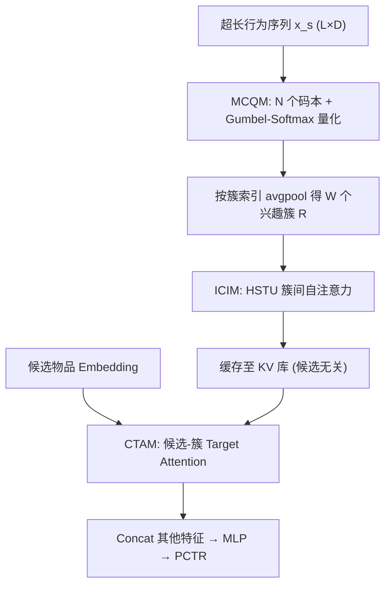
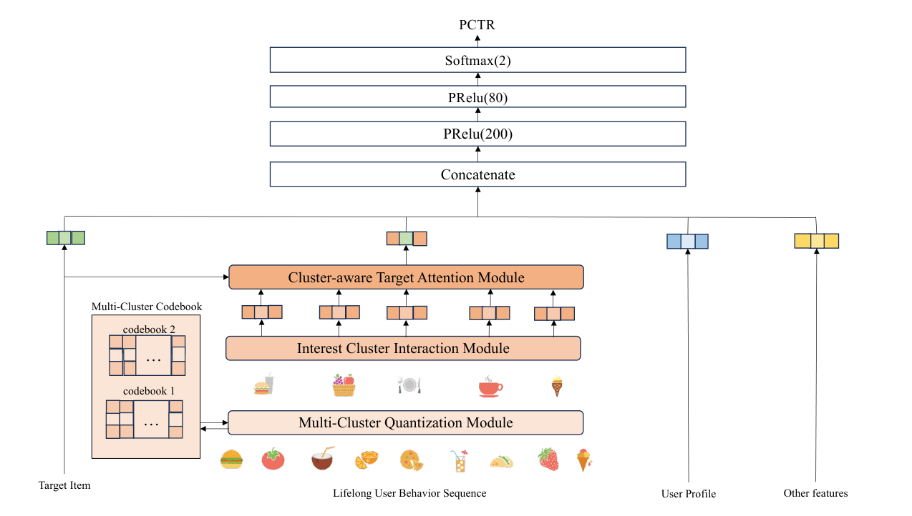

# Deep Multiple Quantization Network on Long Behavior Sequence for Click-Through Rate Prediction (面向 CTR 预估的长行为序列深度多量化网络)

- **会议/期刊**: SIGIR 2025 (5 pages, short paper)
- **作者与机构**: Zhuoxing Wei, Qingchen Xie (美团)；Qi Liu (中国科学技术大学，通讯作者)
- **推荐链路定位**: 精排 (Ranking Stage, CTR 预估)
- **研究方向**: CTR 预估与特征交叉 / 序列推荐
- **论文原文**: [https://arxiv.org/abs/2508.20865v1](https://arxiv.org/abs/2508.20865v1)
- **开源代码**: 暂未开源

## TL;DR (1分钟核心速览)

长行为序列建模的主流两阶段范式（先检索约百条候选相关行为、再做 target attention）存在**检索子集与全序列之间的相关性分布偏差**，导致兴趣估计有偏且不完整。DMQN 改用多码本向量量化把整条超长序列端到端压缩为约百个可学习"兴趣簇码字"，用 HSTU 建模簇间交互后再与候选做注意力。在工业 LBS 广告数据集与 Taobao 上 AUC 分别达 0.7104 / 0.7724，均超最强基线 DIN Full；线上 A/B 一个月 CTR 相对提升 3.5%、RPM 提升 2.0%，推理延迟仅从 4.6 ms 增至 7.4 ms。

## Background & Motivation (背景与核心矛盾)

- **主流范式**: SIM/ETA/SDIM/TWIN 等两阶段方案先从长序列中检索约百条与候选相关的行为（按类目、LSH 汉明距离或多轮哈希碰撞），再对检索结果做 target attention；TWIN V2、DGIN 进一步改为检索"簇"以保留更多信息。
- **前人局限**: ① 检索阶段用轻量代理度量（类目、哈希）近似相关性，检索子集上的相关性分布与全序列分布不一致，兴趣向量系统性有偏；② 无论检索 item 还是检索 cluster，被丢弃的行为信息不可恢复，长尾兴趣被截断。
- **核心洞察 (Key Insight)**: 偏差的根源不是"检索得不够准"，而是"检索"这一操作本身——只要存在候选无关的硬截断，分布偏差就不可避免。若能把全序列**无损压缩**到与检索结果同量级（约百个 token），就能既保留全量信息又满足线上延迟。
- **本文切入点**: 用多码本向量量化（VQ）把 $L$条行为聚类成$W \ll L$ 个兴趣簇码字，实现端到端全序列建模，且量化与簇间交互均与候选无关，可离线预计算缓存。

## Method (核心方法设计)

### 1. 整体框架 (Overall Architecture)

输入为用户画像、超长行为序列 $\mathbf{x}_s\in\mathbb{R}^{L\times D}$、候选物品与上下文特征。MCQM 先用$N$个独立码本对序列做多视角量化，将每条行为映射到各码本下的簇索引，再按索引池化得到$W$个兴趣簇表示$\mathbf{R}$；ICIM 用 HSTU 在簇序列上做自注意力，建模兴趣之间的相互影响；CTAM 以候选物品为 query 对簇表示做 target attention 得到长期兴趣向量，与其余特征拼接后经 MLP 输出 PCTR。由于 MCQM 与 ICIM 均与候选无关，其输出可按 user_id 预计算并缓存至 Redis，线上仅需执行 CTAM 与 MLP。

<figure class="paper-figure" markdown="span">
  <figcaption>图1：Deep Multiple Quantization Network（DMQN）的整体框架。DMQN由Multi-Cluster Quantization Module（MCQM）、Interest Cluster Interaction Module（ICIM）和Cluster-aware Target Attention Module（CTAM）组成。</figcaption>
</figure>

### 2. 关键设计拆解 (Key Designs)

1. **多码本量化 MCQM（用聚类替代检索，消除分布偏差）**：单码本量化只能刻画单一维度的兴趣划分，信息损失大。本文为每个码本 $j$设独立投影$\mathbf{W}^{c_j}_2$将行为映射到该码本空间，以点积（而非欧氏距离）计算与$W$个码字的匹配分数以节省算力：$\mathbf{score}_s=\mathrm{concat}(\mathbf{h}^s_1,\dots,\mathbf{h}^s_L)\,\mathbf{c}^{\top}$。随后用 Gumbel-Softmax 做可微的软选择并退火至 one-hot：$\mathrm{prob}^s_{ik}=\frac{\exp((\log \mathrm{score}^s_{ik}+g_k)/\tau)}{\sum_{p=1}^{W}\exp((\log \mathrm{score}^s_{ip}+g_p)/\tau)}$，其中$g_k\sim\mathrm{Gumbel}(0,1)$。引入 Gumbel 噪声的关键直觉是避免 argmax 恒选最高分码字导致簇分配塌缩，促使簇使用更均匀；最终$\mathbf{z}^s_i=\arg\max_k \mathrm{prob}^s_{ik}$，并对同簇行为做平均池化$\mathbf{r}_k=\mathrm{avgpool}(\mathbf{e}^s_i\mid \mathbf{z}^s_i=k)$ 得到簇表示。多码本从多个特征视角并行量化，等价于用"软聚类"覆盖全序列，从根本上绕开了硬检索的截断偏差。
2. **兴趣簇交互 ICIM（让簇之间互相"说话"）**：池化后的簇表示彼此独立，丢失了兴趣之间的时序与共现关联（如"看火锅"与"看甜品"共同指向聚餐场景）。本文引入 HSTU 的 gated self-attention：$\mathbf{U},\mathbf{V},\mathbf{Q},\mathbf{K}=\mathrm{Split}(\varphi_1(f_1(\mathbf{R})))$，$\mathbf{A}(\mathbf{R})\mathbf{V}(\mathbf{R})=\varphi_2(\mathbf{Q}\mathbf{K}^{\top}+\mathbf{bias}_p)\mathbf{V}(\mathbf{R})$，$\mathbf{Y}(\mathbf{R})=f_2(\mathrm{Norm}(\mathbf{A}\mathbf{V})\odot\mathbf{U})$，其中$\mathbf{bias}_p$为相对簇位置偏置，$f_1,f_2$退化为单层线性以控制复杂度。门控$\mathbf{U}$ 起到特征选择作用，使模型聚焦于与当前场景相关的兴趣子空间。
3. **训练目标、负采样与推理效率**：沿用标准 CTR 二分类交叉熵 $\mathcal{L}_{ctr}=-\frac{1}{N}\sum_i y_i\log\hat{y}_i+(1-y_i)\log(1-\hat{y}_i)$，无额外对比/重构损失，量化通过 Gumbel-Softmax 直通梯度端到端训练。整体复杂度为$O(LWD+NW^2D+NWD^2)$，因$W\ll L$显著低于全序列 HSTU 的$O(NL^2D+NLD^2)$；线上通过缓存 ICIM 输出，仅保留 CTAM 的$O(WD)$ 级开销。

## Experimental Setup & Evaluation Protocol (实验设置与评估协议)

- **数据集与预处理**:

| 数据集 | #Users | #Items | #Fields | #Instances | 特征/场景说明 |
| :--- | :---: | :---: | :---: | :---: | :--- |
| Taobao | 988K | 4M | 7 | 0.1B | 公开淘宝推荐交互数据 |
| Industry | 400M | 5M | 317 | 6.6B | 美团 LBS 广告平台线上 CTR 数据 |

- **数据划分与防穿越 (Splitting Strategy)**: 原文未明确披露划分细节（短论文篇幅所限），工业数据按线上日志时间顺序构造样本，属常规工业时间切分范式。
- **排名评测协议 (Ranking Protocol)**: 采用 CTR 任务标准的 **AUC** 指标，在完整样本集上评估（非采样排序），与 DIN/SIM/TWIN 系列基线口径一致。
- **对比基线与超参设置**: 基线覆盖短序列（DIN Small、DSIN、DIEN）、两阶段长序列（SIM、TWIN、SDIM、TWIN V2）与全序列（DIN Middle、DIN Full）三类；码本数 $N$、码字数$W$、温度$\tau$ 等超参原文未逐一列出；未报告显著性检验细节（表中以 * 标注优于最优基线）。

## Key Experimental Results (实验关键数据)

### 1. 主实验对比 (Main Results)

| 方法 | Industry AUC | Taobao AUC |
| :--- | :---: | :---: |
| DIN Small | 0.7011 | 0.7043 |
| DSIN | 0.7029 | 0.7057 |
| DIEN | 0.7035 | 0.7094 |
| SIM | 0.7043 | 0.7419 |
| TWIN | 0.7051 | 0.7523 |
| SDIM | 0.7073 | 0.7347 |
| DIN Middle | 0.7077 | 0.7573 |
| TWIN V2 | 0.7078 | 0.7572 |
| DIN Full | 0.7087 | 0.7684 |
| **DMQN** | **0.7104*** | **0.7724*** |
| Improv. (vs. 最优基线) | +0.24% | +0.52% |

### 2. 消融实验 (Ablation Study)

| 配置 | Industry AUC |
| :--- | :---: |
| TWIN V2 | 0.7078 |
| DIN Full | 0.7087 |
| DMQN-simple (量化 + 直接 target attention，无 ICIM) | 0.7089 |
| **+ICIM (完整 DMQN)** | **0.7103** |

### 3. 关键实验发现 (Key Findings)

1. **量化本身即已超越全序列基线**：DMQN-simple 仅做多码本压缩后直接做 target attention，AUC 0.7089 已略高于全序列 DIN Full 的 0.7087，说明"压缩到约百个兴趣簇"几乎不损失信息，反而因去噪带来增益——这直接证伪了"必须检索"的隐含假设。
2. **簇间交互是主要增量来源**：加入 ICIM 后 AUC 从 0.7089 提升至 0.7103（+0.14%），占总提升的六成以上，说明兴趣簇之间的相互调制（而非单簇独立表达）才是刻画用户兴趣结构的关键。
3. **线上收益与成本可控**：一个月 A/B 测试中 DMQN 相对 SIM Hard 取得 CTR +3.5%、RPM +2.0%；参数存储从 2.85 GB 增至 4.00 GB，平均推理延迟从 4.6 ms 升至 7.4 ms，以约 2.8 ms 的额外延迟换取显著商业收益，工程性价比成立。

## Highlights & Limitations (亮点、对比与审稿批判)

- **与代表作对比 (vs. Prior Work)**: 与 SIM/ETA/SDIM 的本质区别在于**取消检索阶段**——后者在候选相关子集上做注意力，DMQN 在候选无关的全序列压缩表示上做注意力，从机制上消除分布偏差；与 TWIN V2 的层次聚类相比，DMQN 的码本通过 Gumbel-Softmax 端到端学习且多码本并行，簇划分由 CTR 损失直接驱动而非启发式相似度；与直接跑全序列 HSTU 相比，复杂度从 $O(L^2)$降至$O(W^2)$ 且支持缓存。
- **可迁移亮点**: ① "候选无关模块离线缓存 + 候选相关模块在线计算"的切分范式，可直接迁移到任何超长序列精排模型；② 多码本 + Gumbel-Softmax 的软量化可作为通用序列压缩算子，用于用户画像、多模态 token 化等场景。
- **审稿级局限批判**: ① 作为 5 页短文，码本数 $N$、码字数$W$、温度$\tau$等关键超参及敏感性分析完全缺失，且未报告多次运行的方差与显著性检验，AUC 提升幅度（0.2%–0.5%）是否稳健存疑；② 量化必然引入信息瓶颈，对**低频/长尾兴趣**（在$W$ 个簇中可能被高频兴趣淹没）的影响未做分桶实验验证；③ 缓存机制要求用户行为序列在两次请求间不变，对实时性强的场景（如秒级兴趣漂移）存在陈旧性风险，原文未讨论缓存失效策略。

## Rating (四维评分)

- **方法创新性 (Novelty)**: ⭐⭐⭐⭐ （用多码本 VQ 替代检索来消除两阶段分布偏差，思路干净且首次实现端到端全序列建模，但 VQ + HSTU 均为已有组件的组合式创新）
- **评估协议与实验扎实度 (Protocol & Experiments)**: ⭐⭐⭐ （工业 6.6B 样本 + 公开 Taobao + 真实 A/B 测试颇具说服力，但缺超参分析、方差报告与长尾分桶实验）
- **写作与数学规范度 (Clarity & Rigor)**: ⭐⭐⭐ （公式与模块职责清晰，但部分符号（如 $N$ 同时指码本数与样本数）存在歧义，复杂度分析略简）
- **工业落地与复现价值 (Industrial & Practical Value)**: ⭐⭐⭐⭐ （缓存设计使延迟仅增 2.8 ms 且线上验证充分，落地价值高；但未开源，复现需自行调参）

