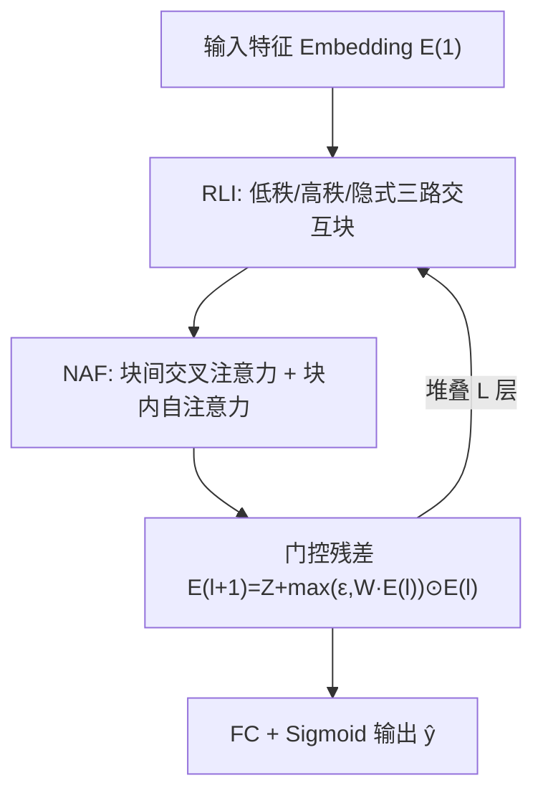
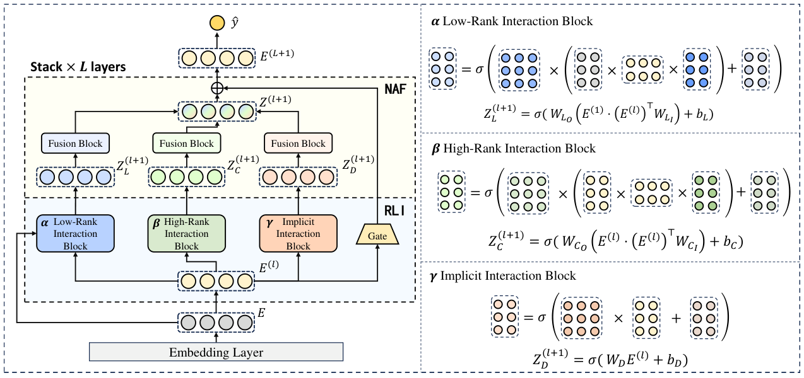

# DLF: Enhancing Explicit-Implicit Interaction via Dynamic Low-Order-Aware Fusion for CTR Prediction (基于动态低阶感知融合的显隐式交互增强)

- **会议/期刊**: SIGIR 2025
- **作者与机构**: Kefan Wang, Hao Wang, Defu Lian, Enhong Chen (中国科学技术大学)；Wei Guo, Yong Liu (华为诺亚方舟实验室)；Jianghao Lin (上海交通大学)
- **推荐链路定位**: 精排 (CTR 预估)
- **研究方向**: CTR预估与特征交叉
- **论文原文**: [https://arxiv.org/abs/2505.19182v1](https://arxiv.org/abs/2505.19182v1)
- **开源代码**: [https://github.com/USTC-StarTeam/DLF](https://github.com/USTC-StarTeam/DLF)

## TL;DR (1分钟核心速览)

针对双流 CTR 模型中显式流受数据稀疏困扰、隐式流缺乏低阶归纳偏置、且两流仅在末层融合导致信息共享不足与梯度失衡的痛点，本文提出 DLF：用残差感知低阶交互网络（RLI）显式保留低阶信号并以门控残差抑制冗余，用网络感知注意力融合模块（NAF）在每层做块间交叉注意力+块内自注意力融合。在 Avazu/Criteo/Movielens/Frappe 四数据集上 AUC 全面超越 14 个基线，Frappe 上较 Wukong 提升 0.18 个点、Logloss 降 10.1%。

## Background & Motivation (背景与核心矛盾)

- **主流范式**: 显式交互（FM/CIN/CrossNet）靠内积等预定义算子高效建模低阶交叉；隐式交互（MLP）靠非线性变换学习复杂高阶模式；双流模型（DeepFM/DCNv2/FinalMLP）并行两路、末层拼接。
- **前人局限**: 其一，两流独立建模、仅末层融合，显式流在稀疏 CTR 数据上表征退化，隐式流难以高效学到乘性交叉，信息无法互补；其二，反向传播时一路主导优化，梯度失衡；其三，残差通路虽传递低阶信号，但高阶交互的噪声放大使低阶信号在深层被压缩、向量空间被次优嵌入占据。
- **核心洞察 (Key Insight)**: 低阶交互阶数随层数线性增长（$l+1$），层内高阶交互阶数指数增长（$2^{l+1}$），二者增长率与分布严重失配，简单拼接/门控池化无法弥合这一"阶数鸿沟"。
- **本文切入点**: 在每层内部同时构造"与初始嵌入交互"的低阶通路和"层内自交互"的高阶通路，并用门控残差 + 多层注意力做逐层动态融合。

## Method (核心方法设计)

### 1. 整体框架 (Overall Architecture)

输入特征经 Embedding 层得到 $\mathbf{E}^{(1)}$，随后堆叠$L$个交互层。每层中，RLI 网络并行产出三路表征：低秩交互块$\mathbf{Z}_L$（当前层与初始嵌入交互，保低阶）、高秩交互块$\mathbf{Z}_C$（层内自交互，取高阶）、隐式交互块$\mathbf{Z}_D$（MLP 非线性）。三路输出送入 NAF，经块间交叉注意力与块内自注意力融合得$\mathbf{Z}^{(l+1)}$，再与当前层输入做门控残差相加得$\mathbf{E}^{(l+1)}$。末层表征经全连接 + Sigmoid 输出点击概率，以 BCE 损失端到端训练。

<figure class="paper-figure" markdown="span">
  <figcaption>图2：所提出的DLF模型的整体框架。左侧部分展示了DLF的完整工作流程，核心模块为残差感知低阶交互网络（RLI）和网络感知注意力融合模块（NAF）。右侧部分详细可视化了RLI中的三个交互块：低秩交互块、高秩交互块和隐式交互块，突出展示了它们各自不同的计算机制。</figcaption>
</figure>

### 2. 关键设计拆解 (Key Designs)

1. **残差感知低阶交互网络 RLI（显式保住低阶信号）**：痛点是深层高阶交互的稀疏放大使低阶信号被残差通路"稀释"。RLI 增设一条与初始嵌入显式交互的通路，低秩块计算 $\mathbf{Z}_L^{(l+1)}=\sigma(\mathbf{W}_{LO}(\mathbf{E}^{(1)}\cdot(\mathbf{E}^{(l)})^{\top}\mathbf{W}_{LI})+\mathbf{b}_L)$，高秩块以$\mathbf{E}^{(l)}(\mathbf{E}^{(l)})^{\top}$替代上式中的$\mathbf{E}^{(1)}$取高阶，隐式块为$\sigma(\mathbf{W}_D\mathbf{E}^{(l)}+\mathbf{b}_D)$。直觉：让低阶交叉不依赖残差"顺带"传递，而是每层被重新显式计算，从而在深层仍保有可辨识的低阶模式。
2. **门控残差（消解低阶通路与残差的冗余冲突）**：RLI 显式低阶项与残差隐式保留的低阶项可能重复甚至冲突。更新式改为 $\mathbf{E}^{(l+1)}=\mathbf{Z}^{(l+1)}+\max(\epsilon,\mathbf{W}_{Gate}\mathbf{E}^{(l)})\odot\mathbf{E}^{(l)}$，用可学习门控矩阵按维度动态调节残差贡献，$\epsilon$ 保数值稳定。直觉：门控充当"低阶信号滤波器"，只放行有价值的残差分量，避免噪声在深层累积。
3. **网络感知注意力融合 NAF（逐层弥合梯度失衡）**：替代末层拼接，对三块输出分别做块间交叉注意力 $\mathrm{Att}^C_M=\sigma(\mathbf{W}^C_M[\mathbf{A}^C_{MX}\mathbf{V}_X;\mathbf{A}^C_{MY}\mathbf{V}_Y]+\mathbf{b}^C_M)$与块内自注意力$\mathrm{Att}^S_M=\mathbf{A}^S_M\mathbf{V}_M$，再拼接聚合$\mathbf{Z}=[\mathbf{Z}_L;\mathbf{Z}_C;\mathbf{Z}_D;\mathrm{Att}]$。直觉：交叉注意力让稀疏的显式流从隐式流"借"信息，自注意力保住各块自身特性，逐层融合使两流梯度同步回传，缓解一路主导。
4. **训练目标与开销**：总损失为 BCE $\mathcal{L}=-\frac{1}{N}\sum_i[y_i\log\hat{y}_i+(1-y_i)\log(1-\hat{y}_i)]$；CTR 场景为逐样本二分类，无负采样环节。推理仅需一次前向，主要开销来自每层 3 组注意力的$O(d^2)$矩阵乘，作者实验显示$L=8$ 时仍稳定，工程上可通过减层或降维控制延迟。

## Experimental Setup & Evaluation Protocol (实验设置与评估协议)

- **数据集与预处理**: 沿用 AFN 的预处理流程，类别特征做 Embedding、数值特征归一化后嵌入。

| 数据集 | #Interactions | #Feature Fields | #Features | 场景说明 |
| :--- | :---: | :---: | :---: | :--- |
| Criteo | 45,840,617 | 39 | 1,086,810 | 工业广告 CTR，13 连续 + 26 类别 |
| Avazu | 40,428,968 | 22 | 2,018,012 | 移动广告点击，11 天日志 |
| Movielens | 2,006,859 | 3 | 90,242 | 个性化标签推荐 |
| Frappe | 288,609 | 10 | 5,339 | 上下文感知 App 使用，最稀疏 |

- **数据划分与防穿越 (Splitting Strategy)**: 按时间顺序以 7:2:1 划分训练/验证/测试，严格防穿越。
- **排名评测协议 (Ranking Protocol)**: 采用 AUC 与 Logloss 两项指标，在完整测试集上评估（非采样负例），AUC 反映全库排序能力。
- **对比基线与超参设置**: 基线分三类——纯显式（FM/AFM/SAM/AutoInt）、双流末层融合（DCN/DCNv2/DeepFM/xDeepFM/FinalNet/FinalMLP/GDCN/PNN）、逐层融合（EDCN/Wukong）。统一 Embedding 维度 $d=64$、batch size 10,000，学习率$\{10^{-1},\dots,10^{-4}\}$、$L_2$与 dropout 网格搜索，Adam 优化，每实验重复 5 次取均值，显著性$p<0.05$。

## Key Experimental Results (实验关键数据)

### 1. 主实验对比 (Main Results)

| 类别 | 模型 | Avazu AUC | Avazu Logloss | Criteo AUC | Criteo Logloss | Movielens AUC | Frappe AUC | Frappe Logloss |
| :--- | :--- | :---: | :---: | :---: | :---: | :---: | :---: | :---: |
| 显式 | AutoInt | 0.7539 | 0.3740 | 0.8084 | 0.4435 | 0.9430 | 0.9680 | 0.2231 |
| 双流 | DCNv2 | 0.7565 | 0.3722 | 0.8085 | 0.4431 | 0.9423 | 0.9717 | 0.2137 |
| 双流 | FinalNet | 0.7577 | 0.3711 | 0.8088 | 0.4430 | 0.9495 | 0.9788 | 0.1810 |
| 双流 | PNN | 0.7543 | 0.3741 | 0.8096 | 0.4416 | 0.9472 | 0.9743 | 0.2116 |
| 逐层 | EDCN | 0.7578 | 0.3709 | 0.8092 | 0.4418 | 0.9472 | 0.9649 | 0.2357 |
| 逐层 | Wukong | 0.7580 | 0.3715 | 0.8091 | 0.4424 | 0.9502 | 0.9794 | 0.1867 |
| **本文** | **DLF** | **0.7601** | **0.3706** | **0.8106** | **0.4412** | **0.9515** | **0.9812** | **0.1679** |
| — | Improv. (vs 最强基线) | +0.28% | -0.08% | +0.22% | -0.09% | +0.14% | +0.18% | -10.07% |

### 2. 消融实验 (Ablation Study)

| 变体 | Criteo AUC | Criteo Logloss | Avazu AUC | Avazu Logloss |
| :--- | :---: | :---: | :---: | :---: |
| DLF 完整 | **0.8106** | **0.4412** | **0.7601** | **0.3706** |
| w/o gate | 0.8095 | 0.4422 | 0.7591 | 0.3719 |
| w/o RLI | 0.8091 | 0.4428 | 0.7590 | 0.3721 |
| w/o NAF | 0.8083 | 0.4438 | 0.7575 | 0.3726 |
| w/o RLI + NAF | 0.8084 | 0.4437 | 0.7563 | 0.3731 |

### 3. 关键实验发现 (Key Findings)

1. **NAF 是最大贡献项**：去掉 NAF（退化为末层融合）后 Criteo AUC 掉 0.23 个点、Avazu 掉 0.26 个点，几乎等于同时去掉 RLI+NAF 的损失（0.22/0.38），说明逐层融合而非低阶通路本身才是性能主引擎。
2. **门控与 RLI 存在耦合**：单独去 gate 掉 0.11 点，但再去掉 RLI 后反而回升至 0.8091（Avazu 0.7590），印证无门控时 RLI 引入的低阶信息与残差冲突，门控是让 RLI 生效的必要前提。
3. **稀疏场景收益最大**：Frappe（仅 28.8 万交互、5,339 特征）上 DLF 较 Wukong AUC +0.18 点、Logloss 相对降 10.1%，而稠密的 Criteo 仅 +0.22%，说明显式低阶保持对稀疏高维特征空间的价值随稀疏度上升而放大；同时 $L=8$ 时 AUC 仍不衰减，远深于传统模型的最优 2–3 层。

## Highlights & Limitations (亮点、对比与审稿批判)

- **与代表作对比 (vs. Prior Work)**: 相较 DCNv2/DeepFM 等末层拼接双流，DLF 把融合下沉到每层并引入块间交叉注意力；相较 EDCN 的 bridge+regulation 模块，DLF 用注意力替代固定桥接，且额外显式重建低阶通路；相较同为逐层融合的 Wukong，DLF 的关键差异是 RLI 的"初始嵌入-当前层"显式交互 + 门控残差，直接针对低阶信号在深层被压缩的问题。
- **可迁移亮点**: 门控残差 $\max(\epsilon,\mathbf{W}_{Gate}\mathbf{E})\odot\mathbf{E}$ 可低成本移植到任意深层堆叠的推荐/序列模型以抑制残差噪声；"块间交叉 + 块内自注意力"的双层融合范式可迁移到多模态或多场景多塔融合。
- **审稿级局限批判**: 其一，增益幅度偏小（Criteo/Avazu AUC 提升仅 0.2% 量级），且未报告方差与置信区间，5 次均值下的显著性说服力有限；其二，每层 3 组注意力的 $O(Ld^2)$开销与$L=8$ 的深层配置在工业万亿样本场景下的训练/推理延迟未做量化，缺少线上 A/B 或吞吐对比。

## Rating (四维评分)

- **方法创新性 (Novelty)**: ⭐⭐⭐⭐ （低阶/高阶阶数增长率失配的分析视角清晰，RLI+门控残差+NAF 组合有针对性，但各组件单独看均属已有范式的重组）
- **评估协议与实验扎实度 (Protocol & Experiments)**: ⭐⭐⭐⭐ （四数据集 + 14 基线 + 时间序划分 + 5 次重复较规范，但缺方差报告与线上验证）
- **写作与数学规范度 (Clarity & Rigor)**: ⭐⭐⭐⭐ （公式与三块结构定义清楚，阶数增长分析直观；部分符号如 $\mathbf{W}_{LI}$维度与$R$ 的含义交代略简）
- **工业落地与复现价值 (Industrial & Practical Value)**: ⭐⭐⭐⭐ （代码开源、基于 FuxiCTR 易复现、模块可插拔，但深层注意力的延迟开销需工业侧再评估）

