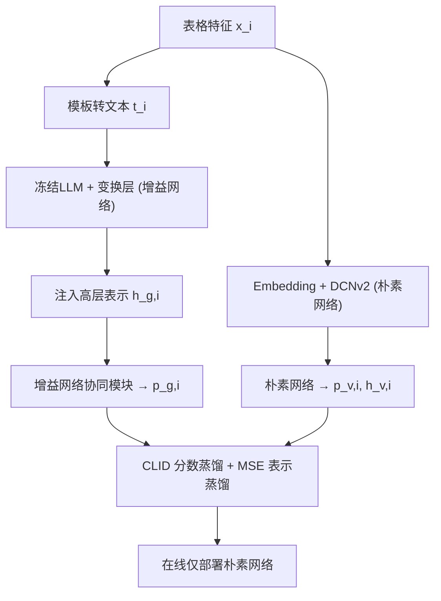
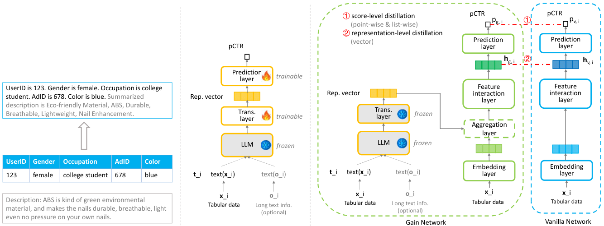

# ELEC: Efficient Large Language Model-Empowered Click-Through Rate Prediction (高效大模型赋能点击率预估)

- **会议/期刊**: SIGIR 2025
- **作者与机构**: Rui Dong, Wentao Ouyang, Xiangzheng Liu（阿里巴巴集团）
- **推荐链路定位**: 精排（CTR 预估）
- **研究方向**: CTR/CVR 预估与特征交叉 / 大语言模型推荐
- **论文原文**: [https://arxiv.org/abs/2509.07594v1](https://arxiv.org/abs/2509.07594v1)
- **开源代码**: 暂未开源

## TL;DR (1分钟核心速览)

传统 CTR 模型靠表格特征交叉抓协同信号却丢失文本语义，LLM 懂语义却抓不住协同信号且在线推理延迟高。ELEC 用伪孪生结构：增益网络把冻结 LLM 的高层表示注入 DCNv2，再通过分数级 CLID 与表示级 MSE 双蒸馏把知识迁移到只吃表格特征的朴素网络，在线仅跑朴素网络。在 Amazon 与工业新闻流数据集上，AUC 分别达 0.7509 / 0.8015，较最强基线 FLIP 提升 0.0020 / 0.0034，且在线单样本推理仅 0.087s / 0.116s，与所用 LLM 规模无关。

## Background & Motivation (背景与核心矛盾)

- **主流范式**: 工业 CTR 以 "Embedding & Feature Interaction" 为主（DNN/DeepFM/AutoInt/DCNv2），仅处理表格类别特征；另一支以 CTR-BERT、P5 为代表直接把文本喂给语言模型做预测。
- **前人局限**: 其一，纯语言模型（CTR-BERT/P5/M-LLM）在表格数据上 AUC 反而低于 DCNv2（Amazon 0.7115 vs 0.7430），因其不显式建模协同信号；其二，CTRL/FLIP 虽融合两模态，但依赖原始语言模型且在线仍需过 LLM，推理延迟不可接受。
- **核心洞察 (Key Insight)**: 语言模型与协同模型提供的是**互补**信息——前者给语义、后者给协同；且 LLM 的增益可在**离线**注入、**在线**剥离，性能与延迟可解耦。
- **本文切入点**: 用伪孪生双网络 + 双层级蒸馏，把 LLM 语义"炼"进轻量表格模型，使在线推理完全摆脱 LLM。

## Method (核心方法设计)

### 1. 整体框架 (Overall Architecture)

输入侧先把表格数据 $x_i$按 "<field_name> is <feature_value>" 模板转成文本$t_i$，可选拼接长描述摘要。增益网络 = 冻结 LLM（取末层隐状态均值池化）+ 变换层 MLP + 与朴素网络同构的协同模块（DCNv2），输出$p_{g,i}$与表示$h_{g,i}$；朴素网络仅吃$x_i$，输出$p_{v,i}$、$h_{v,i}$。两网络联合训练，蒸馏损失只作用于朴素网络；在线推理只部署朴素网络。

<figure class="paper-figure" markdown="span">
  <figcaption>图1：ELEC 框架。(a) 表格数据转换为文本数据。(b) 修改 LLM 用于 CTR 预测（Trans. - 转换；Rep. - 表示）。(c) 将修改后的 LLM 与协同 CTR 模型集成。为简单起见，增益网络中的聚合层使用向量拼接。在线推理仅使用原始网络。</figcaption>
</figure>

### 2. 关键设计拆解 (Key Designs)

1. **LLM 的 CTR 任务适配（变换层 + 预测层）**：LLM 原生输出文本而非概率。做法是冻结 LLM 全部参数，仅对末层隐状态做平均池化得语义向量，接 MLP 变换层（512-256-128）映射到 CTR 空间，再经 sigmoid 预测层输出 $p$。只训练新增参数，既保留语义先验又避免灾难性遗忘，且训练成本可控。

2. **CLID 分数级蒸馏（兼顾校准与排序）**：朴素网络若只做 point-wise BCE，会丢失增益网络的列表排序能力。采用 Calibration-compatible LIstwise Distillation，在 mini-batch 内对两网络概率做归一化后计算交叉熵：
$$\mathcal{L}_{score}=-\frac{1}{N}\sum_{i=1}^{N}Q_{g,i}\log Q_{v,i},\quad Q_{g,i}=\frac{p_{g,i}}{\sum_{j=1}^{N}p_{g,j}},\ Q_{v,i}=\frac{p_{v,i}}{\sum_{j=1}^{N}p_{v,j}}$$
归一化使蒸馏对两网络的绝对校准差异不敏感，同时把 batch 内相对次序（list-wise 排序）传给朴素网络，这是消融中掉点最多的组件。

3. **表示级 MSE 蒸馏与总目标**：仅蒸馏标量分数信息量太粗，进一步约束中间向量对齐：
$$\mathcal{L}_{rep}=\frac{1}{N}\sum_{i=1}^{N}\lVert h_{v,i}-h_{g,i}\rVert^{2}$$
总损失 $\mathcal{L}_{total}=\mathcal{L}_{gain}+\mathcal{L}_{van}+\mathcal{L}_{score}+\alpha\mathcal{L}_{rep}$，其中$\mathcal{L}_{gain},\mathcal{L}_{van}$为各自 BCE，$\alpha$ 平衡表示蒸馏权重。训练无需额外负采样（CTR 为二分类点式任务），在线推理零 LLM 开销。

## Experimental Setup & Evaluation Protocol (实验设置与评估协议)

- **数据集与预处理**: Amazon "All Beauty" 子集（评分 >3 记为正）与某工业新闻流广告点击日志：

| 数据集 | #Fields | #Train | #Val | #Test | #Show | #Click |
| :--- | :---: | :---: | :---: | :---: | :---: | :---: |
| Amazon | 8 | 67.80M | 8.47M | 8.48M | 84.75M | 60.50M |
| Industry | 32 | 571.0M | 81.3M | 80.2M | 732.5M | 284.7M |

- **数据划分与防穿越 (Splitting Strategy)**: 按 Train/Val/Test 三段比例划分（原文未显式声明时间戳切分，属随机/固定划分），测试集独立评估。
- **排名评测协议 (Ranking Protocol)**: 采用 AUC 与 LogLoss 两项指标，在完整测试集上做全局评估（非采样负例排序），属无偏全量评估口径。
- **对比基线与超参设置**: 三类基线——协同模型（DNN/DeepFM/AutoInt/DCNv2）、语言模型（CTR-BERT/P5/M-LLM）、语言模型增强协同模型（CTRL/FLIP）。Embedding 维度 32，DCNv2 交叉层 2 层、深层维度 {256,128,64}，变换层 {512,256,128}，LLM 统一用 gte-Qwen2-7B-instruct；显著性用 paired t-test，$p\le 0.01$。

## Key Experimental Results (实验关键数据)

### 1. 主实验对比 (Main Results)

| 模型 | Amazon AUC↑ | Amazon LogLoss↓ | Industry AUC↑ | Industry LogLoss↓ |
| :--- | :---: | :---: | :---: | :---: |
| DNN | 0.7408 | 0.5201 | 0.7922 | 0.4843 |
| DeepFM | 0.7413 | 0.5181 | 0.7926 | 0.4844 |
| AutoInt | 0.7421 | 0.5172 | 0.7935 | 0.4825 |
| DCNv2 | 0.7430 | 0.5166 | 0.7946 | 0.4812 |
| CTR-BERT | 0.7095 | 0.5373 | 0.7602 | 0.4980 |
| P5 | 0.7102 | 0.5359 | 0.7591 | 0.4991 |
| M-LLM | 0.7115 | 0.5347 | 0.7617 | 0.4963 |
| CTRL | 0.7475 | 0.5103 | 0.7973 | 0.4768 |
| FLIP | 0.7489 | 0.5087 | 0.7981 | 0.4756 |
| **ELEC** | **0.7509\*** | **0.5051\*** | **0.8015\*** | **0.4694\*** |
| Improv. vs FLIP | +0.0020 | -0.0036 | +0.0034 | -0.0062 |

### 2. 消融实验 (Ablation Study)

| 变体 | Amazon AUC↑ | Amazon LogLoss↓ | Industry AUC↑ | Industry LogLoss↓ |
| :--- | :---: | :---: | :---: | :---: |
| w/o textual input（退化为 DCNv2） | 0.7430 | 0.5166 | 0.7946 | 0.4812 |
| w/o CLID loss | 0.7487 | 0.5095 | 0.7992 | 0.4760 |
| w/o MSE loss | 0.7496 | 0.5072 | 0.8006 | 0.4708 |
| **ELEC 完整** | **0.7509** | **0.5051** | **0.8015** | **0.4694** |

### 3. 关键实验发现 (Key Findings)

1. **语义增益真实存在但必须"注入"而非"替代"**：去掉文本输入直接退化为 DCNv2，Amazon AUC 从 0.7509 掉到 0.7430（-0.0079），说明 LLM 语义对协同模型是净增量；而纯语言模型 M-LLM 仅 0.7115，反证语义单独使用远不如协同信号。
2. **CLID 分数蒸馏是最大贡献组件**：去掉 CLID 后 Amazon AUC 降至 0.7487（-0.0022）、Industry 降至 0.7992（-0.0023），降幅大于去掉 MSE（-0.0013 / -0.0009），说明 list-wise 排序知识的迁移比向量对齐更关键。
3. **性能随底座 LLM 增强而提升，但延迟不变**：roberta-base → chatglm-6B → Qwen2-7B，Amazon AUC 从 0.7481 升至 0.7509；而朴素网络单样本推理恒为 0.087s（Amazon）/ 0.116s（Industry），与底座 LLM 无关（增益网络则需 0.734s / 1.023s），验证了"离线换性能、在线保效率"的解耦设计。

## Highlights & Limitations (亮点、对比与审稿批判)

- **与代表作对比 (vs. Prior Work)**: CTRL 用表格-文本对比学习预训练协同模型，FLIP 做更细粒度对齐，二者均使用**原始**语言模型且在线仍需过 LLM；ELEC 先用变换层+预测层把 LLM **适配**为 CTR 预测器，再以伪孪生双网络 + 双层级蒸馏把语义离线固化进表格模型，在线彻底剥离 LLM，这是与 CTRL/FLIP 的本质差异。
- **可迁移亮点**: ①"冻结大模型 + 轻量变换层"的任务适配范式，可低成本迁移到 CVR、时长预估等精排任务；②CLID 的 batch 内归一化 list-wise 蒸馏，可直接用于任何"重模型离线、轻模型在线"的级联蒸馏场景。
- **审稿级局限批判**: ①仅 5 页短文，数据集划分未明确时间戳切分，工业数据仅一个平台，泛化性证据偏弱；②增益网络离线训练需对全量样本过 7B LLM（0.734s/样本），离线算力成本与特征/文本模板的敏感性均未量化分析；③未与 DIN/DIEN 等行为序列模型对比（作者以"特征口径不同"为由排除），削弱了工业说服力。

## Rating (四维评分)

- **方法创新性 (Novelty)**: ⭐⭐⭐⭐ （伪孪生 + 双层级蒸馏组合虽非全新范式，但"LLM 适配 + 离线注入 + 在线剥离"的工程化闭环设计清晰且 model-agnostic）
- **评估协议与实验扎实度 (Protocol & Experiments)**: ⭐⭐⭐ （双数据集 + 显著性检验 + 消融 + 效率表齐全，但划分方式交代不清、缺时间切分与线上 A/B）
- **写作与数学规范度 (Clarity & Rigor)**: ⭐⭐⭐⭐ （公式简洁、符号一致、CLID 与 MSE 动机解释到位，5 页篇幅内信息密度高）
- **工业落地与复现价值 (Industrial & Practical Value)**: ⭐⭐⭐⭐ （在线 0.087s 且与 LLM 规模解耦，落地价值明确；但未开源、离线 LLM 推理成本需自建）

