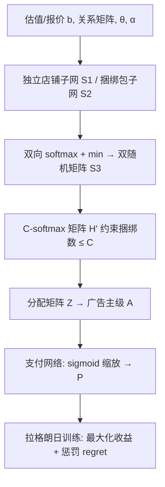

# Hybrid Advertising in the Sponsored Search (赞助搜索中的混合广告)

- **会议/期刊**: SIGIR 2025
- **作者与机构**: Zhen Zhang, Weian Li, Yuhan Wang, Qi Qi (中国人民大学高瓴人工智能学院 / 山东大学软件学院), Kun Huang (美团)
- **推荐链路定位**: 精排（广告拍卖分配与定价阶段）
- **研究方向**: CTR预估与特征交叉 / 多任务学习与列表级重排
- **论文原文**: [https://arxiv.org/abs/2507.07711v1](https://arxiv.org/abs/2507.07711v1)
- **开源代码**: 暂未开源

## TL;DR (1分钟核心速览)

电商广告存在"店铺独立展示"与"店铺-品牌捆绑展示"两种范式，二者各自吸引不同用户群体（实测前者用户占比≥60%，后者<40%），单一范式必然导致部分用户 CTR 折损。本文提出**混合广告 (Hybrid Advertising)** 模型：每个广告位可灵活分配给独立店铺或捆绑包，并限制获胜捆绑包数量不超过 $C$。为求解该场景下的最优拍卖机制，提出 **HRegNet**，通过双子网络分别建模独立店铺与捆绑包的 CTR 差异、以 C-softmax 实现捆绑数量约束、以 sigmoid 缩放保证 IR，在满足近 DSIC 与 IR 前提下最大化平台收益。合成与真实数据上收益较 VCG 提升约 10%–80%，单样本前向推理仅 1–3 ms。

## Background & Motivation (背景与核心矛盾)

- **主流范式**: 传统广告以店铺为中心拍卖（RegretNet 类），近期联合广告 (Joint Advertising) 让店铺与品牌共同竞价、每槽展示"店铺+品牌"捆绑包（JRegNet），平台可同时向两方收费。
- **前人局限**: ① 两种范式面向不同用户意图——探索型用户偏好店铺列表的广度，目标明确型用户偏好捆绑包的价格对比，单一范式必然牺牲另一部分流量；② 混合场景下店铺既可独立出现又可属于多个捆绑包，产生**竞价相关性**，Myerson 类机制失效，GSP 均衡难以定义，实际仅 VCG 可用但收益不佳。
- **核心洞察 (Key Insight)**: 真实平台日志显示探索型用户占比至少 60%，若全部强制捆绑展示将损失大量点击；而混合展示可在同一列表中兼顾两类意图，且平台能从店铺、品牌双侧收费。
- **本文切入点**: 将混合广告建模为带约束的自动机制设计 (AMD) 问题，用神经网络参数化分配与定价规则，在近 DSIC/IR 下直接最大化期望收益。

## Method (核心方法设计)

### 1. 整体框架 (Overall Architecture)

输入为各店铺/品牌的私有估值采样 $v$（训练时）或报价$b$（推理时）、店铺-品牌关系矩阵$\{\mathbb{1}_{ij}\}$、位置 CTR$\theta_k$与店铺质量因子$\alpha_i$。HRegNet 由**分配网络**（独立店铺子网 + 捆绑包子网）与**支付网络**构成：两子网分别输出原始打分矩阵$S_1, S_2$，经行列双向 softmax 与逐元素取 min 得到双随机矩阵$S_3$，再与 C-softmax 矩阵$H'$逐元素取 min 得最终分配矩阵$Z$；$Z$聚合为广告主级分配概率$A$后送入支付网络输出支付$P$。训练以外层拉格朗日乘子法最小化"负收益 + 遗憾惩罚"，内层用梯度上升搜索最优谎报以估计 ex-post regret。

### 2. 关键设计拆解 (Key Designs)

1. **双分支分配子网 + 逐元素 min 融合（解耦两种展示形态的 CTR 差异）**：痛点在于独立店铺与捆绑包 CTR 不同（独立展示需乘质量因子 $\alpha_i$），单一网络无法区分。HRegNet 让两子网各自经列/行 softmax 归一化后取逐元素最小值：
$$s_{3dk}=\min\left(\frac{e^{s_{1dk}}}{\sum_{x=1}^{R+m}e^{s_{1xk}}},\ \frac{e^{s_{2dk}}}{\sum_{x=1}^{K+1}e^{s_{2dx}}}\right)$$
由 Lemma 1 保证 $S_3$ 为双随机矩阵，天然满足"每槽至多一个赢家、每赢家至多占一槽"两条可行性约束，无需额外惩罚项。

2. **C-softmax 捆绑数量约束（灵活控制混合比例）**：为限制获胜捆绑包总数不超过 $C$，对辅助矩阵$H$做全局 softmax 后乘$C$：
$$h'_{rk}=C\cdot\frac{e^{h_{rk}}}{\sum_{x=1}^{R}\sum_{y=1}^{K}e^{h_{xy}}}$$
使 $H'$元素总和恰为$C$，再与$S_3$逐元素取 min 得$Z$，从而在保持前两条约束的同时硬性封顶捆绑数，$C$成为可调的业务旋钮（$C=1$ 即退化为近似联合广告）。

3. **sigmoid 缩放定价与拉格朗日训练**：支付定义为 $\tilde{p}_{i\cdot}\in[0,1]$乘以期望价值$\sum_k a_{i\cdot k}q_{i\cdot k}$，sigmoid 保证支付不超报价，直接满足 IR。总目标为增广拉格朗日：
$$\mathcal{L}_\rho(w;\lambda)=-\frac{1}{L}\sum_{\ell}\Big[\sum_i p^w_{i\cdot}+\sum_j p^w_{\cdot j}\Big]+\sum_i\lambda_{i\cdot}\widehat{rgt}_{i\cdot}+\frac{\rho}{2}\sum_i(\widehat{rgt}_{i\cdot})^2$$
其中 regret 由内层梯度上升（100 次初始化 × 200 步）估计最优谎报；每 $\gamma$ 轮更新乘子。推理阶段仅需一次前向传播，单样本 1–3 ms，无需负采样。

## Experimental Setup & Evaluation Protocol (实验设置与评估协议)

- **数据集与预处理**: 合成数据训练集 640,000 样本 / 测试集 12,800 样本，关系矩阵 $\{\mathbb{1}_{ij}\}$随机生成，$\alpha_i\sim U[0.5,1.5]$；真实数据来自某电商平台在线广告拍卖日志（含广告主 ID、报价、捆绑包与独立店铺预测 CTR、店铺-品牌关系），裁剪/补零至每样本 10 店铺 × 10 品牌 × 5 广告位，测试集 6,912 样本。

| 数据集 | #Stores | #Brands | #Slots | 测试样本 | 特征/场景说明 |
| :--- | :---: | :---: | :---: | :---: | :--- |
| Synthetic A/B/C/D | 2/3/3/4 | 2/4/4/4 | 1/3/4/3 | 12,800 | 估值 $U[0,1]$，$\theta$ 递减 |
| Real E1/E2/E3 | 10 | 10 | 5 | 6,912 | 2024-12-24~28 分三日训练/测试 |

- **数据划分与防穿越 (Splitting Strategy)**: 真实数据采用**全局时间戳切分**（E1: 12/24–25 训练、12/26 测试；E2、E3 依次顺延一天），严格避免未来拍卖样本泄漏。
- **排名评测协议 (Ranking Protocol)**: 非检索式排序任务，评测指标为**期望收益 rev**、**社会福利 sw** 与**平均 ex-post regret**；真实数据因广告主效用差异大，改用相对遗憾 $r_u=\text{regret}/\text{truthful utility}$ 衡量 DSIC 程度（阈值 <0.065）。
- **对比基线与超参设置**: RegretNet（仅店铺）、JRegNet（仅捆绑）、VCG（DSIC 但收益次优）、Revised JRegNet（加虚拟零价品牌 + 归一化到 $C$模块 + CTR 加权矩阵的适配版）；$C\in\{1,\dots,5\}$，显著性用配对 t 检验$p<0.05$。

## Key Experimental Results (实验关键数据)

### 1. 主实验对比 (Main Results)

真实数据 E1（$C$为最大获胜捆绑数，† 表示$p<0.05$ 显著）：

| Method | $C$| rev | sw |$r_u$ |
| :--- | :---: | :---: | :---: | :---: |
| RegretNet | – | 10.815 | 18.072 | <0.065 |
| JRegNet | – | 19.067 | 32.711 | <0.065 |
| VCG | 3 | 22.109 | 50.782 | – |
| VCG | 5 | 23.566 | 54.823 | – |
| Revised JRegNet | 3 | 18.213 | 27.953 | <0.065 |
| Revised JRegNet | 5 | 25.010 | 40.276 | <0.065 |
| **HRegNet** | 3 | **23.794†** | 38.907 | <0.065 |
| **HRegNet** | 5 | **25.705†** | 40.666 | <0.065 |

合成 Setting B（3 店铺 × 4 品牌 × 3 槽，$U[0,1]$）：

| Method | $C$ | rev | sw | rgt |
| :--- | :---: | :---: | :---: | :---: |
| RegretNet | – | 0.333 | 0.496 | <0.001 |
| JRegNet | – | 0.607 | 0.918 | <0.001 |
| VCG | 3 | 0.537 | 1.223 | – |
| Revised JRegNet | 3 | 0.718 | 1.016 | <0.001 |
| **HRegNet** | 3 | **0.770†** | 1.067 | <0.001 |

### 2. 消融实验 (Ablation Study)

原文未设标准消融表，但通过"退化对比"实现等价消融（Setting B，$C=1$）：

| 配置 | rev | 相对 HRegNet 差距 | 说明 |
| :--- | :---: | :---: | :--- |
| w/o 混合（RegretNet，仅店铺） | 0.333 | −49.8% | 丢失品牌侧收入 |
| w/o 混合（JRegNet，仅捆绑） | 0.607 | −8.4% | 丢失探索型用户点击 |
| w/o 双分支（Revised JRegNet） | 0.606 | −8.6% | 单网络难捕捉 CTR 差异 |
| w/o C 约束（VCG） | 0.496 | −25.2% | 社会福利最优但收益次优 |
| **HRegNet 完整版** | **0.663** | – | 双分支 + C-softmax + sigmoid 定价 |

### 3. 关键实验发现 (Key Findings)

1. **混合范式本身即带来增益**：即便把 $C$ 压到 1（几乎退化为联合广告），HRegNet 在 Setting A 仍取得 0.347 收益，高于 JRegNet 的 0.245（+41.6%）与 RegretNet 的 0.214（+62.1%），证明"允许独立店铺参与竞争"这一建模自由度本身就有价值。
2. **双分支结构是收益提升的主因**：在真实数据 $C=1$ 时，HRegNet 收益 20.092 远超结构相近的 Revised JRegNet 的 11.676（+72.1%），说明用两个独立子网分别刻画店铺与捆绑包的 CTR 差异，比"虚拟品牌 + 加权矩阵"的补丁式改造更有效。
3. **收益与社会福利存在可控权衡**：HRegNet 社会福利普遍低于 VCG（如 E1 $C=5$时 40.666 vs 54.823），但收益反超（25.705 vs 23.566），且随$C$增大收益单调上升（E1 从 20.092 增至 25.705），验证了$C$ 作为业务调节旋钮可在收益与用户体验间灵活取舍。

## Highlights & Limitations (亮点、对比与审稿批判)

- **与代表作对比 (vs. Prior Work)**: 相较 RegretNet（仅店铺单边收费）与 JRegNet（仅捆绑、丢失探索型流量），本文首次将两种展示形态纳入统一拍卖并给出可学习的约束实现；相较 VCG（DSIC 但收益次优），HRegNet 以近 DSIC 换取显著收益提升；相较 Revised JRegNet 的补丁式适配，双分支结构在真实数据上收益高出 70%+。
- **可迁移亮点**: ① "双随机矩阵 + 逐元素 min"的约束硬编码技巧可迁移到任何带"每槽至多一个、每主体至多一槽"约束的分配问题；② C-softmax 的"总量封顶"思路可用于多类型广告混排、多样性约束重排等场景。
- **审稿级局限批判**: ① 真实数据实验仅覆盖单一平台 5 天日志，且需裁剪/补零至固定 10×10 规模，对广告主数量动态变化的鲁棒性未验证；② 近 DSIC 依赖内层梯度上升近似，真实数据 $r_u$阈值放宽至 0.065，理论上无法保证严格 DSIC，且训练需 2–4 小时、对$\rho,\lambda$ 更新节奏敏感；③ 论文自承仅覆盖精排阶段，召回阶段需同步改造（独立店铺与捆绑包均需召回），端到端落地成本未量化。

## Rating (四维评分)

- **方法创新性 (Novelty)**: ⭐⭐⭐⭐ （首次形式化混合广告拍卖，双分支 + C-softmax 的约束硬编码设计巧妙，但整体仍属 RegretNet 框架的场景化扩展）
- **评估协议与实验扎实度 (Protocol & Experiments)**: ⭐⭐⭐⭐ （合成 4 组设定 + 3 种估值分布 + 真实 3 组时间切分实验较完整，配对 t 检验规范；但缺标准消融表与线上 A/B）
- **写作与数学规范度 (Clarity & Rigor)**: ⭐⭐⭐⭐ （机制定义、DSIC/IR 与可行性约束表述清晰，Lemma 1 引用得当；支付网络与分配网络的耦合细节略简）
- **工业落地与复现价值 (Industrial & Practical Value)**: ⭐⭐⭐⭐ （推理 1–3 ms 满足在线要求、$C$ 可调契合业务，且有美团真实数据背书；但代码未开源、训练成本与召回改造是落地门槛）

