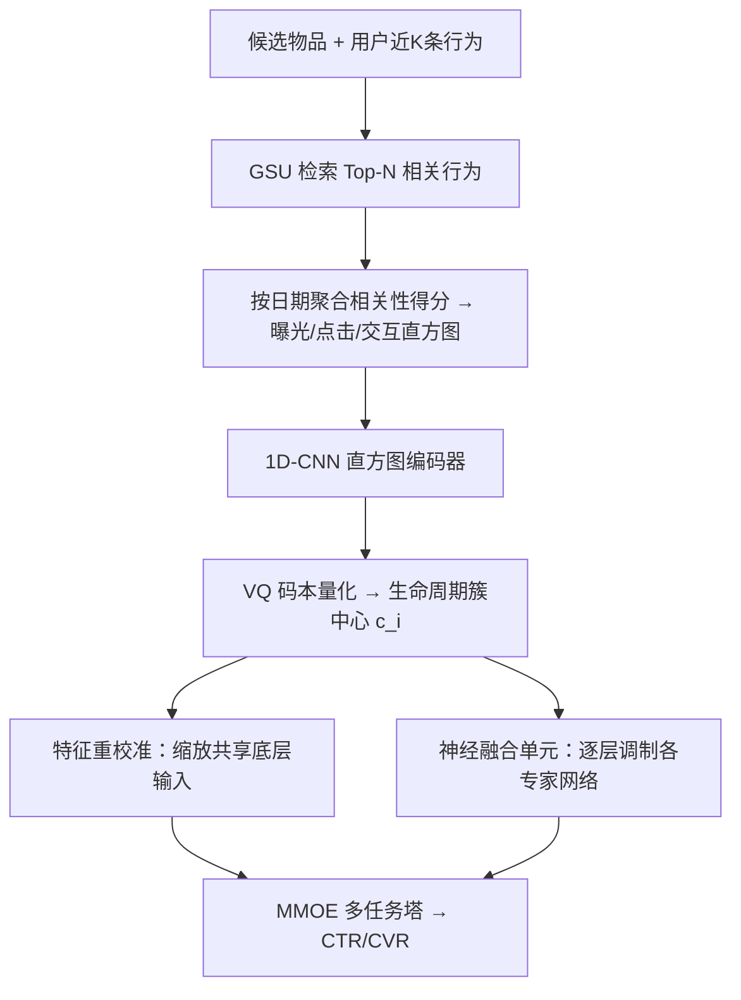
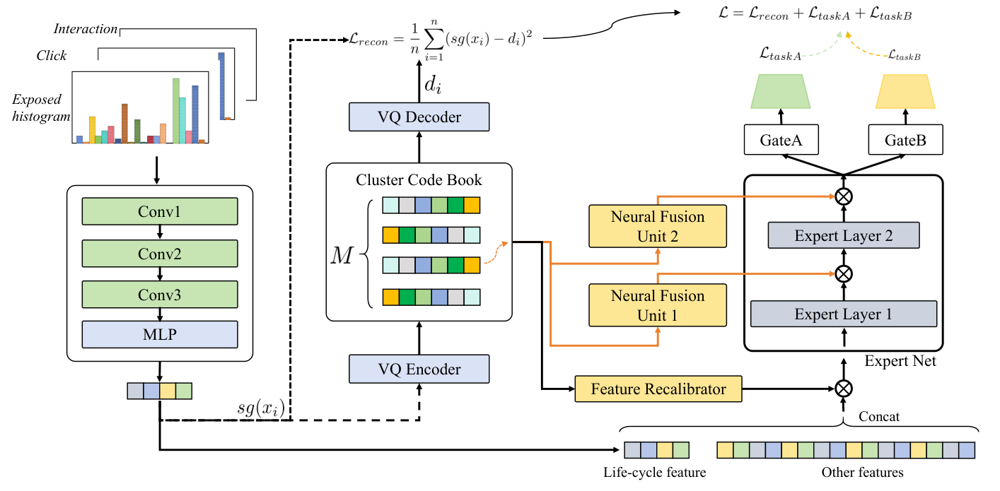

# Interest Changes: Considering User Interest Life Cycle in Recommendation System (兴趣变迁：在推荐系统中考虑用户兴趣生命周期)

- **会议/期刊**: SIGIR 2025
- **作者与机构**: Yinjiang Cai, Jiangpan Hou, Yangping Zhu, Yuan Nie（网易杭州娱乐技术有限公司 / Lofter）
- **推荐链路定位**: 精排（多任务排序）
- **研究方向**: CTR/CVR 预估与特征交叉 / 多任务学习与列表级重排
- **论文原文**: [https://arxiv.org/abs/2505.08471v1](https://arxiv.org/abs/2505.08471v1)
- **开源代码**: 暂未开源

## TL;DR (1分钟核心速览)

现有兴趣建模（SIM/DIEN/DSIN）只算目标物品与历史行为的相关性，忽略了兴趣本身存在"萌发—稳定—衰退"的生命周期，导致萌发期信号稀疏被埋没、衰退期历史丰富却被过度推荐。本文提出 DILN：用 GSU 检索结果按日期聚合出曝光/点击/交互三条活跃度直方图，经 1D-CNN 编码后用 VQ 码本离散成生命周期簇，再通过特征重校准与专家网络逐层调制注入 MMOE。KuaiRand 与 Lofter 工业集上 GAUC 全面领先，线上三周 A/B 取得 CTR +0.38%、CVR +1.04%、人均时长 +0.25%。

## Background & Motivation (背景与核心矛盾)

- **主流范式**: 以 SIM 为代表的搜索式兴趣建模，用 GSU 从终身行为序列中检索与候选物品最相关的 Top-N 行为，再由精排网络聚合；多任务侧普遍采用 MMOE/PLE 共享底层加专家门控。
- **前人局限**: 其一，相关性打分只看"行为与候选物品有多像"，萌发期兴趣行为信号稀疏，相关性分数天然偏低而被压制；其二，衰退期兴趣历史行为极其丰富，相关性分数虚高，模型持续过度分发已失效内容。
- **核心洞察 (Key Insight)**: 作者在 Lofter 上按业务逻辑把推荐结果分为 Unexplored / Emergent / Long-term / Declining 四类，发现 Emergent 兴趣历史行为远少于 Long-term，却在 CTR、CVR、Collect、Duration 四项任务效率上全面最高；Declining 兴趣行为最丰富但效率最低（图 1）。即"行为量"与"任务效率"严重错位，生命周期本身就是强信号。
- **本文切入点**: 不做更复杂的行为相关性匹配，而是把"候选兴趣近期的活跃度时间形态"显式编码为稠密向量，并用它去调制精排网络的特征权重与专家表征。

## Method (核心方法设计)

### 1. 整体框架 (Overall Architecture)

对每个候选物品，先用 GSU 在用户近 K 条行为中检索 N 条最相关行为，按行为类型（曝光/点击/交互）分别按活跃日期聚合相关性得分，得到长度 K 的活跃度直方图；直方图经 1D-CNN 编码后送入 VQ 码本做最近邻量化，输出簇中心作为生命周期稠密表征；该表征一方面在共享底层做特征重校准（逐维缩放输入），另一方面在 MMOE 每个专家网络的每一层生成门控因子做逐层调制，最终由多任务塔输出 CTR/CVR 等目标。

<figure class="paper-figure" markdown="span">
  <figcaption>图3：所提出的深度兴趣生命周期网络的架构。</figcaption>
</figure>

### 2. 关键设计拆解 (Key Designs)

1. **兴趣生命周期编码器 ILEM（把"活跃度时间形态"变成可学习离散簇）**：痛点是原始行为序列既稀疏又噪声大，直接喂 RNN 难以稳定刻画趋势。做法是先把 GSU 检索结果按活跃日期求和成直方图数据点 $h_{d_i}=\sum_k \alpha_{d_i,k}$（Soft Search 取相关性分$r_{d_i,k}$，Hard Search 统一取 0.1），再用 kernel size 为 5、3、2、filter 数为 8、16、32 的两层 1D-CNN 提时序形态，最后用 VQ 量化：$c_i=\text{NearestCode}(\text{encoder}(x_i),Q)$，$Q\in\mathbb{R}^{M\times d}$，并以重构损失$\mathcal{L}_{rec}=\frac{1}{n}\sum_i(\text{sg}(x_i)-d_i)^2$ 监督码本。直觉是：连续活跃度曲线经离散化后，同一生命周期阶段的样本被强制共享同一簇中心，天然起到去噪与阶段对齐的作用；选 CNN 而非 Transformer 是显式的时延/效果折衷。

2. **兴趣生命周期融合模块 ILFM（让不同阶段激活不同专家）**：痛点是同一套特征权重无法同时适配"萌发期该看短期信号"与"衰退期该压制终身序列"。特征重校准层用 $g'_i=\gamma\cdot\text{Sigmoid}(W'\text{ReLU}(Wc_i+b)+b')$，$z'_i=g'_i\odot z_i$对共享底层输入逐维缩放（$\gamma=2$放大动态范围）；神经融合单元则在每个专家层生成门控$f_i=\gamma\cdot\text{Sigmoid}(W_g c_i+b_g)$，$x_e=f_i\odot\sigma(W_e x+b_e)$，实现按生命周期簇对专家中间表征做个性化变换。直觉是：把生命周期当作"软任务标签"，用逐层 Hadamard 调制替代硬性分塔，既保留 MMOE 参数共享，又让不同阶段走不同的表征通路。

3. **训练目标、负采样与推理效率**：总损失为多任务 BCE（CTR/CVR）加权和加 VQ 重构项 $\mathcal{L}=\mathcal{L}_{ctr}+\mathcal{L}_{cvr}+\lambda\mathcal{L}_{rec}$；精排阶段为全量曝光样本训练，不涉及负采样。推理侧仅增加一次 GSU 检索（N=100、K=20）与轻量 CNN+VQ 前向，作者强调其开销可忽略，已在 Lofter 生产环境部署。

## Experimental Setup & Evaluation Protocol (实验设置与评估协议)

- **数据集与预处理**:

| 数据集 | #Users | #Items | #Interactions | 稀疏度/密度 | 特征/场景说明 |
| :--- | :---: | :---: | :---: | :---: | :--- |
| KuaiRand | 27,000+ | — | 3 亿+ | 极稀疏 | 公开短视频交互集，仅 30 天日志 |
| Industry (Lofter) | 600 万+ | — | 27 亿样本 | 极稀疏 | 10 天曝光日志，图文社区 |

- **数据划分与防穿越 (Splitting Strategy)**: 均为**全局时间戳切分**。KuaiRand 前 20 天构建特征、随后 8 天训练、1 天验证、1 天测试；工业集前 8 天训练、1 天验证、最后 1 天测试。
- **排名评测协议 (Ranking Protocol)**: 离线采用 **GAUC**（用户级分组 AUC），在真实曝光日志上评估，属工业界标准排序评估，未采用采样负例。
- **对比基线与超参设置**: 基线为 MMOE + SIM (Hard Search)；超参 $N=100$、直方图长度$K=20$、VQ 簇数$M=10$；未报告显著性检验与 Embedding 维度。

## Key Experimental Results (实验关键数据)

### 1. 主实验对比 (Main Results)

| 方法 | KuaiRand CTR | KuaiRand CVR | Industry CTR | Industry CVR |
| :--- | :---: | :---: | :---: | :---: |
| SIM (baseline) | 0.6436 | 0.6364 | 0.5832 | 0.6636 |
| SIM + ILEM | 0.6708 | 0.6497 | 0.5921 | 0.6726 |
| **DILN (ILEM+ILFM)** | **0.6726** | **0.6512** | **0.5934** | **0.6751** |
| Improv. (vs. SIM) | +4.51% | +2.33% | +1.75% | +1.73% |

线上 A/B（三周、20%+ 用户）：CTR **+0.38%**、CVR **+1.04%**、人均 Duration **+0.25%**。

### 2. 消融实验 (Ablation Study)

| 配置 | KuaiRand CTR | KuaiRand CVR | Industry CTR | Industry CVR |
| :--- | :---: | :---: | :---: | :---: |
| w/o ILEM & ILFM (=SIM) | 0.6436 | 0.6364 | 0.5832 | 0.6636 |
| w/o ILFM (仅 ILEM) | 0.6708 | 0.6497 | 0.5921 | 0.6726 |
| Full DILN | **0.6726** | **0.6512** | **0.5934** | **0.6751** |

### 3. 关键实验发现 (Key Findings)

1. **ILEM 是主要增益来源**：仅加 ILEM 即在 KuaiRand 上带来 CTR +2.72pt、CVR +1.33pt 的 GAUC 提升，说明"活跃度直方图 + VQ 离散化"本身已能有效区分生命周期阶段；ILFM 再贡献约 +0.18pt/+0.15pt，增益虽小但方向一致，证明逐层调制比单纯拼接特征更有效。
2. **VQ 簇与业务语义高度对齐**：图 4 显示 Unexplored 兴趣主要激活 cluster 0，Emergent 主要激活 cluster 3 与 4，Long-term 与 Declining 的激活分布又明显不同，说明无监督 VQ 在无阶段标签下自发学到了可解释的生命周期分层。
3. **线上分发结构被主动纠偏**：表 2 显示 DILN 使 Unexplored 曝光 -2.17%、Declining 曝光 -4.4%，而 Emergent 曝光 +5.11%，且四类兴趣的 CTR/CVR 全部为正增益（Declining 的 CVR 甚至 +2.20%），说明模型不是简单砍掉低效流量，而是把曝光重新分配到高效率阶段并提升了剩余流量的转化。

## Highlights & Limitations (亮点、对比与审稿批判)

- **与代表作对比 (vs. Prior Work)**: 与 SIM 的本质区别在于 SIM 只回答"哪条历史行为与候选最相关"，DILN 额外回答"这个兴趣当前处于什么阶段"；与 DIEN/DSIN 用 RNN 建模兴趣演化不同，DILN 不建模序列本身而建模**活跃度分布的形态**，并用 VQ 把连续形态离散成可共享的阶段簇，计算更轻且更易与 MMOE 耦合。
- **可迁移亮点**: 其一，"按日期聚合相关性得分成直方图 + 轻量 CNN + VQ 离散化"是一套通用的时序形态特征工程模板，可迁移到复购周期、内容消费疲劳度等场景；其二，用离散簇中心作为门控信号逐层调制专家网络，是一种低成本的多任务条件化技巧。
- **审稿级局限批判**: 其一，实验规模偏小，仅报告 GAUC 单一指标，缺少与 DIN/DIEN/DSIN 等更强序列基线的对比，也未做显著性检验与超参敏感性分析（$K$、$M$、$\gamma$ 均未扫）；其二，VQ 码本需与主任务联合训练，存在码本坍缩与训练不稳定风险，论文未讨论；此外生命周期阶段完全依赖 GSU 检索质量，冷启动用户直方图近乎全零，方法在严格零样本场景下的表现未评估。

## Rating (四维评分)

- **方法创新性 (Novelty)**: ⭐⭐⭐⭐ （首次把兴趣生命周期作为显式特征引入精排，VQ 离散化阶段的设计简洁且有可视化佐证，但整体是特征工程+MMOE 调制的组合式创新）
- **评估协议与实验扎实度 (Protocol & Experiments)**: ⭐⭐⭐ （有公开集+工业集+三周线上 A/B 的完整链路，但基线仅 SIM 一个、指标仅 GAUC、缺显著性检验与超参分析）
- **写作与数学规范度 (Clarity & Rigor)**: ⭐⭐⭐⭐ （公式简洁、模块边界清晰、图 1 与图 4 的动机论证有力，但 VQ 损失与主损失的权重、码本更新细节交代不足）
- **工业落地与复现价值 (Industrial & Practical Value)**: ⭐⭐⭐⭐ （已在 Lofter 全量部署并有明确线上收益与分发结构分析，工程开销低；但未开源，复现需自行补齐 GSU 与特征管线细节）

