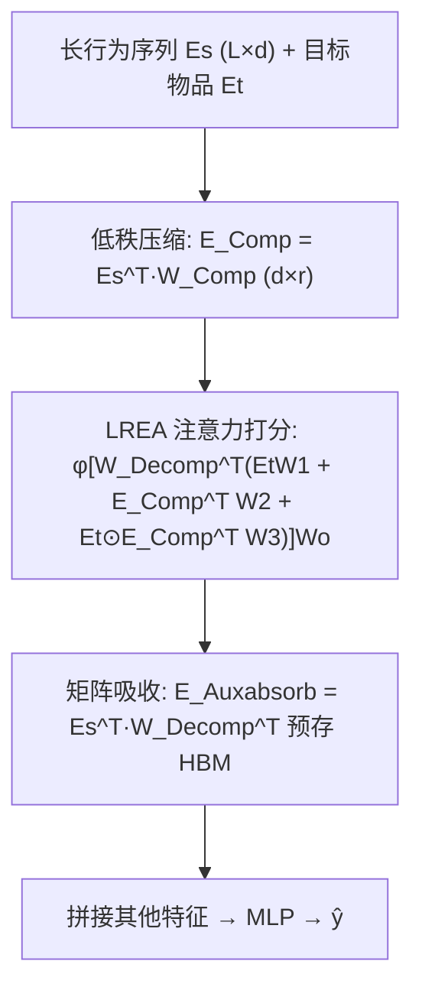
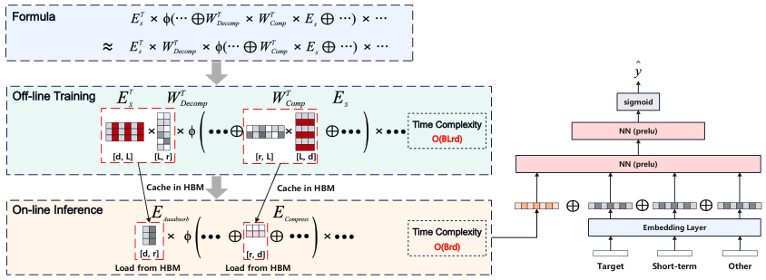

# LREA: Low-Rank Efficient Attention on Modeling Long-Term User Behaviors for CTR Prediction (面向 CTR 预估的长行为序列低秩高效注意力)

- **会议/期刊**: SIGIR 2025 (Short Paper Track)
- **作者与机构**: Xin Song, Xiaochen Li, Jinxin Hu, Hong Wen, Zulong Chen, Yu Zhang, Xiaoyi Zeng, Jing Zhang（阿里巴巴国际数字商业集团、阿里巴巴集团、武汉大学）
- **推荐链路定位**: 精排（长序列用户兴趣建模）
- **研究方向**: CTR/CVR 预估与特征交叉 / 序列与会话推荐
- **论文原文**: [https://arxiv.org/abs/2503.02542v4](https://arxiv.org/abs/2503.02542v4)
- **开源代码**: 暂未开源

## TL;DR (1分钟核心速览)

工业界长行为序列建模普遍靠 SIM/ETA/SDIM 等"先检索 Top-K 再注意力"的两阶段过滤，代价是丢弃弱相关但有用的行为（如买裤子时忽略浅色衣服购买所隐含的深色偏好）。LREA 提出在**序列长度维度**做低秩分解 $E_s^T W_{Comp}W_{Decomp}$，把$L$维序列压到秩$r$，再用矩阵吸收把$W_{Decomp}$提前并入缓存，使在线复杂度从$O(BLd)$降到$O(Brd)$；配合非负正则保证$\phi(AB)=A\phi(B)$ 近似成立。在 Amazon/Taobao/工业数据集上 AUC 追平甚至超过不可部署的全序列 DIN，线上 A/B 12 天 CTR +5.88%、RPM +4.26%，延迟仅 +3ms。

## Background & Motivation (背景与核心矛盾)

- **主流范式**: 精排阶段用多目标注意力（MHTA）让候选物品作 Query、长行为序列作 Key/Value；为控延迟，工业界普遍采用两阶段过滤（SIM 的属性倒排 Top-K）或低精度注意力（ETA 哈希、SDIM 多轮哈希采样）。
- **前人局限**: ① 过滤式方法按物品属性或哈希碰撞选 Top-K，会系统性丢弃"弱相关但语义互补"的行为，造成信息不可逆损失；② 全序列 DIN 精度最高但在线复杂度 $O(BLd)$，序列涨到万级时延迟不可容忍（实测平均 +30ms，15% 请求超时）。
- **核心洞察 (Key Insight)**: DeepSeek MLA 式的隐层压缩只省 KV Cache 显存、不减推理计算量，不适用于本场景；真正需要压缩的是**序列长度维度**本身，且压缩必须可被"吸收"进预计算缓存才能兑现线上收益。
- **本文切入点**: 用低秩矩阵分解在长度维压缩序列，并设计使 $W_{Decomp}$ 可被吸收的激活函数与配套非负损失，实现"全量行为 + 低延迟"兼得。

## Method (核心方法设计)

### 1. 整体框架 (Overall Architecture)

离线训练阶段，LREA 在标准 DIN 目标注意力旁挂两个低秩矩阵 $W_{Comp}\in\mathbb{R}^{L\times r}$、$W_{Decomp}\in\mathbb{R}^{r\times L}$，与主任务联合更新，但不做任何计算图优化；训练收敛后将$E_s^TW_{Decomp}^T$（记为$E_{Auxabsorb}$）与$E_s^TW_{Comp}$（记为$E_{Comp}$）预先算好并缓存至 HBM。在线推理时不再加载原始万级序列，仅用两个$r$维压缩表征完成注意力打分，输出与其余特征拼接后过 MLP 出$\hat{y}$。

<figure class="paper-figure" markdown="span">
  <figcaption>图1：LREA的结构。在离线训练阶段，LREA在不进行计算优化的情况下更新矩阵𝑊𝐶𝑜𝑚𝑝和𝑊𝐷𝑒𝑐𝑜𝑚𝑝，随后将其与𝐸𝑠和𝐸𝑇𝑠一起缓存于HBM中。在离线推理期间，LREA利用压缩序列𝐸𝐴𝑢𝑥𝑎𝑏𝑠𝑜𝑟𝑏和𝐸𝐶𝑜𝑚𝑝，缩短了用户行为序列的长度，从而提升计算效率。</figcaption>
</figure>

### 2. 关键设计拆解 (Key Designs)

1. **长度维低秩压缩（Low-Rank Sequence Compression）**：针对"过滤丢信息"的痛点，把序列表征改写为 $E_s^{LREA}=(E_s^TW_{Comp}W_{Decomp})^T$，其中$E_{Comp}=E_s^TW_{Comp}\in\mathbb{R}^{d\times r}$是压缩序列。将 DIN 打分式中的$E_s$替换为$E_s^{LREA}$、$E_s\odot E_t$替换为$W_{Decomp}^T(E_t\odot E_{Comp}^T)$，得到
$$\text{AttScore}_{LREA}=\phi\big[W_{Decomp}^T(E_tW_1+E_{Comp}^TW_2+E_t\odot E_{Comp}^TW_3)\big]W_o$$
直觉上，$r$ 维子空间保留了全序列的线性组合信息，而非硬性截断，因此弱相关行为仍能以投影形式贡献梯度。

2. **矩阵吸收与激活函数选择（Matrix Absorption）**：若激活满足 $\phi(AB)=A\phi(B)$，则输出可写成$E_s^TW_{Decomp}^T\cdot\phi(\cdot)W_o$，$W_{Decomp}$被$E_{Auxabsorb}=(E_s^TW_{Decomp}^T)_{d\times r}$完全吸收，在线只需读两个$d\times r$缓存。严格解$\phi(x)=kx$会丧失非线性，故选用 Leaky ReLU 系列近似，但要求$A$、$B$ 元素同号（尽量非负）才能近似成立——这引出下一条损失。

3. **非负正则与训练目标**：为让 $\phi(AB)\approx A\phi(B)$ 成立，对负元素施加 Frobenius 惩罚：
$$\mathcal{L}_{non\text{-}neg}=\|\max(0,-W_{Decomp}^T)\|_F^2+\|\max(0,-W_{Comp}^TE_s)\|_F^2,\quad \mathcal{L}_{LREA}=\mathcal{L}_{CE}+\lambda\mathcal{L}_{non\text{-}neg}$$
$\lambda$在"非线性表达力"与"可吸收性"之间权衡。训练沿用 CTR 常规交叉熵，无额外负采样设计；推理复杂度$O(Brd)$，相较 DIN 的$O(BLd)$在$r\ll L$ 时降一个量级以上。

## Experimental Setup & Evaluation Protocol (实验设置与评估协议)

- **数据集与预处理**:

| 数据集 | #Users | #Items | #Interactions | 稀疏度/密度 | 特征/场景说明 |
| :--- | :---: | :---: | :---: | :---: | :--- |
| Amazon (Books) | 未披露 | 未披露 | 未披露 | — | 近 10 条短期 + 近 90 条长期行为，预处理沿用 SIM |
| Taobao | 未披露 | 未披露 | 89M 记录 | — | 前 64 条短期 + 其余 500 条点击作长期 |
| Industrial | 10M | 未披露 | 2B 记录 | — | 2024-12-03~12-23 广告曝光日志，近 64 条短期 + 10000 条长期 |

- **数据划分与防穿越 (Splitting Strategy)**: 原文未明确交代划分方式（短论文篇幅所限），工业集按时间窗（12/03–12/23）取日志，隐含时间切分；公开集沿用 SIM 的预处理流程。
- **排名评测协议 (Ranking Protocol)**: 采用 CTR 任务标准的 **AUC** 与 **GAUC**（按用户请求分组加权平均，权重为该用户样本数）；GAUC 仅在工业集报告（公开集分组数过少）。未涉及 Full-Ranking / Sampled Ranking 的召回式评测。
- **对比基线与超参设置**: 基线含 DIN(W/o long seq.)、DIN(Long sequence)、SIM、ETA、SDIM、TWIN；隐层 [512,256,128]，Leaky ReLU + BatchNorm，Adagrad，学习率 {0.01, 0.005, 0.001}，batch 1024，embedding 维度 $d=16$，$r=128$，$\lambda=0.3$。

## Key Experimental Results (实验关键数据)

### 1. 主实验对比 (Main Results)

| Models | Amazon AUC | Taobao AUC | Industrial AUC | Industrial GAUC |
| :--- | :---: | :---: | :---: | :---: |
| DIN (W/o long seq.) | 0.7833 | 0.8535 | 0.7005 | 0.6187 |
| SIM | 0.7919 | 0.8667 | 0.7031 | 0.6208 |
| ETA | 0.7984 | 0.8651 | 0.7083 | 0.6235 |
| SDIM | 0.8013 | 0.8734 | 0.7097 | 0.6239 |
| TWIN | 0.8015 | 0.8838 | 0.7103 | 0.6258 |
| DIN (Long sequence) | 0.8101 | 0.8903 | 0.7149 | 0.6337 |
| **LREA** | **0.8098** | **0.8904** | **0.7154** | **0.6343** |
| Improv. vs 最佳两阶段 | +1.04% | +0.75% | +0.72% | +1.36% |

### 2. 消融与超参分析 (Ablation & Hyper-parameter)

| 配置 | AUC | GAUC | 说明 |
| :--- | :---: | :---: | :--- |
| $r=32$ | 0.7081 | 0.6222 | 秩过小，压缩损失显著 |
| $r=64$| 0.7097 | 0.6254 | 仍低于$r=128$ |
| $r=128$ | **0.7154** | **0.6343** | 最优秩 |
| $\lambda=0.05$ | 0.7121 | 0.6298 | 非负约束过弱，吸收近似失效 |
| $\lambda=0.1$ | 0.7138 | 0.6312 | 次优 |
| $\lambda=0.3$ | **0.7154** | **0.6343** | 最优平衡点 |
| $\lambda=0.5$ | 0.7137 | 0.6315 | 非线性被压制 |
| $\lambda=0.8$ | 0.7129 | 0.6297 | 过度非负，退化近线性 |

### 3. 关键实验发现 (Key Findings)

1. **全量行为 > 过滤行为**：LREA 在三个数据集上均超过所有两阶段方法（Amazon +1.04%、Taobao +0.75%、工业 AUC +0.72%/GAUC +1.36%），且与不可部署的 DIN(Long sequence) 基本持平（工业集甚至 +0.05% AUC），证明低秩压缩几乎无损地替代了全序列注意力。
2. **秩 $r$是性能-显存的主开关**：$r$从 128 降到 32 时工业 AUC 掉 0.73 个点，说明万级序列无法压到极低秩；作者未测$r>128$，暗示存在缓存容量与精度的工程折中点。
3. **$\lambda$呈单峰效应**：$\lambda$ 从 0.05 增至 0.3 时 GAUC 提升 0.45 个点，超过 0.5 后回落，定量印证了"非负性 vs 非线性"的理论张力——约束太松则矩阵吸收不成立，太紧则注意力退化为线性。
4. **线上收益与延迟双赢**：12 天 A/B 相对 DIN+SIM 产品模型 CTR +5.88%、RPM +4.26%，推理延迟仅 +3ms；对照 DIN(Long sequence) 平均 +30ms 且 15% 请求超时，说明矩阵吸收的预存策略真正兑现了复杂度优势。

## Highlights & Limitations (亮点、对比与审稿批判)

- **与代表作对比 (vs. Prior Work)**: 与 SIM/ETA/SDIM 的本质区别在于"不丢弃任何行为"，用可学习的低秩投影替代硬检索/哈希碰撞；与 TWIN 的 GPU 分层注意力相比，LREA 走的是代数压缩路线，在线只需读两个 $d\times r$ 缓存而非重算分层注意力；与 DeepSeek MLA 相比，MLA 压缩隐层省显存但不减 FLOPs，LREA 压缩长度维直接降在线计算量。
- **可迁移亮点**: ① "矩阵吸收 + 预存 HBM" 的推理范式可迁移到任何 Query 固定、Key/Value 为长序列的注意力场景（如多模态长视频序列、超长会话）；② 用正则项强制激活函数满足代数同态 $\phi(AB)=A\phi(B)$ 的思路，可用于其他需要把线性变换提前折叠的网络模块。
- **审稿级局限批判**: ① 公开数据集未给出用户/物品规模与划分细节，且 GAUC 缺失，复现与公平比较存疑；② 矩阵吸收依赖 Leaky ReLU 近似同态，理论上只在同号区间成立，非负约束与非线性表达力存在不可消除的张力，$r$与$\lambda$ 需逐场景调参；③ 仅报告 AUC/GAUC，缺少校准性（calibration）与延迟-精度 Pareto 曲线的系统分析。

## Rating (四维评分)

- **方法创新性 (Novelty)**: ⭐⭐⭐⭐ （长度维低秩分解 + 矩阵吸收 + 非负正则三者闭环，工程导向明确，理论深度中等但组合巧妙）
- **评估协议与实验扎实度 (Protocol & Experiments)**: ⭐⭐⭐ （三数据集 + 12 天线上 A/B 有说服力，但公开集划分与统计细节缺失、无显著性检验）
- **写作与数学规范度 (Clarity & Rigor)**: ⭐⭐⭐⭐ （公式推导链条清晰，复杂度对比表直观；短论文篇幅下部分符号与数据集统计略欠交代）
- **工业落地与复现价值 (Industrial & Practical Value)**: ⭐⭐⭐⭐⭐ （+3ms 延迟换 +5.88% CTR 的线上实证极稀缺，矩阵吸收方案可直接落地；可惜未开源）

