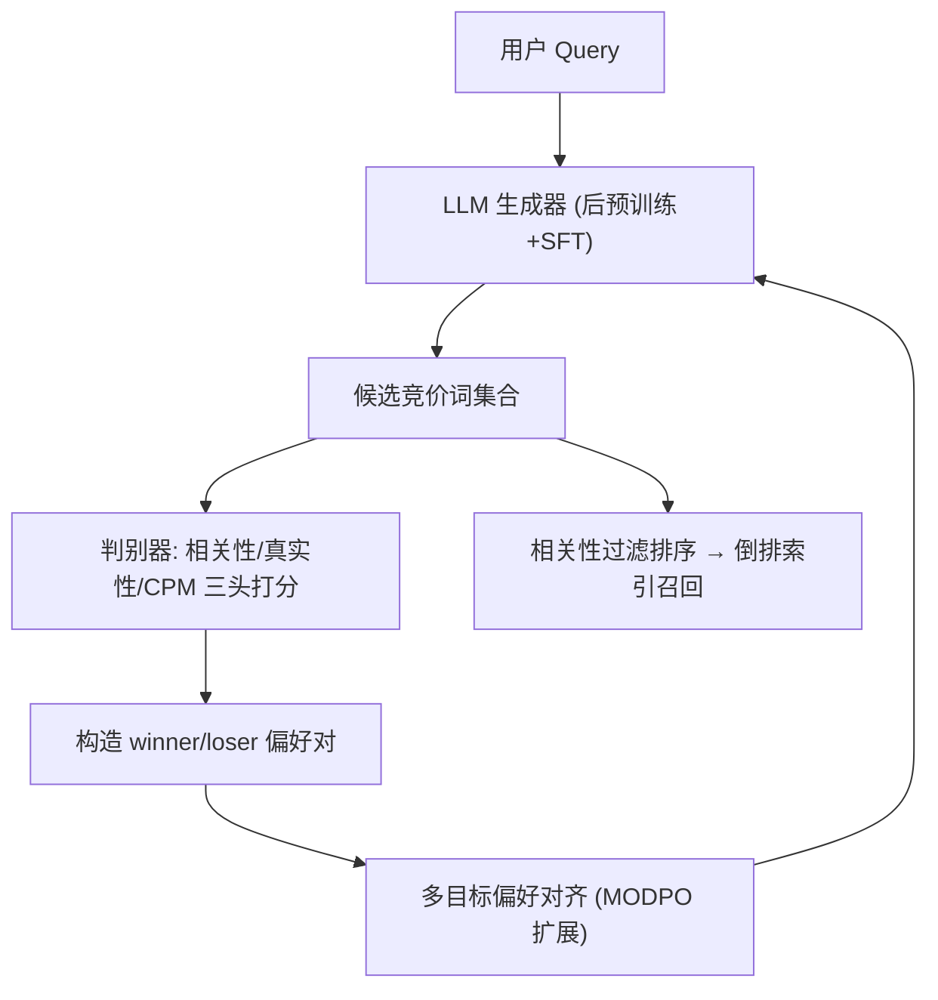
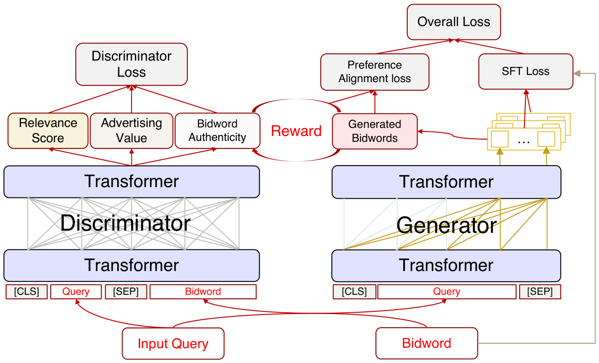

# Multi-objective Aligned Bidword Generation Model for E-commerce Search Advertising (电商搜索广告多目标对齐竞价词生成模型)

- **会议/期刊**: SIGIR 2025
- **作者与机构**: Zhenhui Liu, Chunyuan Yuan, Ming Pang 等（京东 JD.COM；北京大学深圳研究生院）
- **推荐链路定位**: 召回（查询改写 → 倒排索引广告召回分支）
- **研究方向**: CTR预估与特征交叉 / 大语言模型推荐
- **论文原文**: [https://arxiv.org/abs/2506.03827v1](https://arxiv.org/abs/2506.03827v1)
- **开源代码**: 暂未开源

## TL;DR (1分钟核心速览)

电商搜索广告中大量长尾 query 无法匹配商家竞价词，导致广告召回缺失。已有挖掘/向量匹配/生成式改写方法无法同时兼顾「query-改写相关性」「改写真实性（是否像真实用户搜索词）」与「广告收入潜力」三目标。本文提出 MoBGM：先用电商语料后预训练 + SFT 训练 LLM 生成器，再用 BERT 判别器分别建模相关性、真实性、CPM 三维奖励，最后扩展 MODPO 做多目标偏好对齐。在京东 9 万 query 黄金集上 Recall@10 达 40.67%、NDCG@10 达 29.42%，线上 A/B 广告收入 +2.13%、CPM +1.74%。

## Background & Motivation (背景与核心矛盾)

- **主流范式**: 查询改写分三派——日志挖掘（GQS、Simrank++）、向量匹配（RQRF）、生成式改写（BART、EGRM、EEQR/BEQUE 等 LLM 微调方案）。
- **前人局限**: ① 挖掘/匹配类依赖高频交互日志，长尾 query 数据稀缺直接失效，且向量相似度无法反映广告收益；② 生成式方法虽缓解长尾，但仅优化语义相似，生成词可能"语义相关却不是真实竞价词"（如把"洗衣机"改写成"4K 144Hz 洗衣机"），召回为空；③ RL/PPO 类对齐训练不稳定，且单目标 DPO 无法平衡三维偏好。
- **核心洞察 (Key Insight)**: 改写词的价值 = 相关性 × 真实性 × 商业价值，三者存在张力——单纯提升相关性会牺牲真实性（Trie 约束解码实验证实相关性反降 5.24%），单纯拟合 CPM 又会损害语义。
- **本文切入点**: 把三目标拆成三个可独立训练的判别器打分头，再将打分转化为偏好奖励，用 MODPO 的闭式对齐损失一次性融合，绕开 RL 的不稳定性。

## Method (核心方法设计)

### 1. 整体框架 (Overall Architecture)

MoBGM 由生成器与判别器两大部分构成。生成器基于 Llama-3-Chinese-8B-Instruct，先以 query↔商品标题双向生成任务做电商域后预训练（约 3 亿样本），再在 3700 万 query-竞价词对上做 SFT。判别器为三个 BERT 打分头：相关性四分类、真实性二分类、CPM 回归。训练完成后，判别器对同一 query 下的候选竞价词打分，构造 winner/loser 偏好对，送入多目标偏好对齐模块微调生成器。线上部署时蒸馏至 1B 模型，Top 1000 万高频 query 预生成 15 个竞价词入缓存，其余实时生成，保证延迟不劣化。

<figure class="paper-figure" markdown="span">
  <figcaption>图1：多目标对齐竞价词生成模型的架构。</figcaption>
</figure>

### 2. 关键设计拆解 (Key Designs)

1. **三维判别器奖励建模（把业务目标变成可微奖励）**：相关性头用专家标注的同义/上下位/错误四类关系做四分类，奖励定义为 $\mathcal{R}_{rele}(q,b)=\Pr_{syn}(q,b)+\Pr_{hyper}(q,b)-\Pr_{error}(q,b)$，即正向关系概率减去错误改写概率，直接惩罚"语义漂移"；真实性头以"能否匹配竞价词且搜索频次超阈值"构造正负样本做二分类，$\mathcal{R}_{au}(b)=\Pr_{au}(b)$，本质是判别"这句话像不像真人会搜的词"，比 Trie 硬约束更柔性；CPM 头用 MSE 回归$\mathcal{L}_{val}=\|\hat{y}_{val}(b)-\text{CPM}_b\|^2$。三头解耦的好处是每个目标可用各自最合适的数据与损失独立训练，避免联合训练时的梯度冲突。

2. **多目标偏好对齐损失（MODPO 的三目标扩展）**：标准 DPO 只处理单一奖励，直接加权求和多奖励是次优的。本文将 MODPO 的 margin reward 机制扩展为三维，核心损失为
$$\mathcal{L}_{PA}=-\mathbb{E}_{(q,b_w,b_l)}\Big[\log\sigma\Big(\tfrac{\beta_w}{w_{rel}}\log\tfrac{\pi_\theta(b_w|q)}{\pi_{SFT}(b_w|q)}-\tfrac{\beta_l}{w_{rel}}\log\tfrac{\pi_\theta(b_l|q)}{\pi_{SFT}(b_l|q)}-\tfrac{w_{au}}{w_{rel}}\Delta\mathcal{R}_{au}-\tfrac{w_{val}}{w_{rel}}\Delta\mathcal{R}_{val}\Big)\Big]$$
其中 $\Delta\mathcal{R}_{au}$、$\Delta\mathcal{R}_{val}$为 winner 与 loser 在真实性与 CPM 上的奖励差，$w_{rel}=0.5, w_{au}=0.2, w_{val}=0.3$ 控制三目标相对权重。直觉上，相关性作为主项进入 log-ratio 项，真实性与 CPM 作为 margin 偏置项调节偏好强度——这样既保留了 DPO 的闭式稳定性，又能让商业目标以"软约束"方式注入，且权重可按业务需求灵活调参。

3. **训练目标、负采样与推理效率**：总损失为 $\mathcal{L}=\mathcal{L}_{SFT}+\mathcal{L}_{PA}$（判别器三头各自独立训练）。偏好对构造采用同 query 下判别器打分排序的 winner/loser 采样，无需人工标注。推理端用 beam search（length penalty 2.0，最多 16 token），8×H800 训练，batch 64/卡；线上通过 8B→1B 蒸馏 + 高频缓存 + 长尾实时生成的三级策略，使全流量覆盖而不增加检索延迟。

## Experimental Setup & Evaluation Protocol (实验设置与评估协议)

- **数据集与预处理**: 京东搜索广告日志，SFT 集经高频降采样、长尾升采样并按三目标阈值过滤：

| 数据集 | #Queries | #Bidwords | #Pairs | 说明 |
| :--- | :---: | :---: | :---: | :--- |
| 后预训练集 | — | — | ~300M | query↔商品标题点击对 |
| SFT 训练集 | 17,778,056 | 706,702 | 37,253,452 | 平均 2.10 词/query |
| 偏好对齐训练集 | 984,271 | 223,680 | 7,466,588 | 平均 7.59 词/query |
| Golden 评测集 | 90,000 | 125,909 | 900,000 | 每 query 10 个黄金竞价词 |

- **数据划分与防穿越 (Splitting Strategy)**: 按 query 频次分层（头/中/尾各采样 36 万）后划分训练/验证/黄金集，黄金集 query 与对齐集完全不重叠，避免偏好对齐数据泄漏到评测。
- **排名评测协议 (Ranking Protocol)**: 生成式 Top-k 排序评测（Recall@k / NDCG@k，k∈{3,5,10}），黄金标准由点击日志启发式挖掘每 query 的 10 个最有价值竞价词构成；辅以人工专家评估的 Relevance / Authenticity 通过率。
- **对比基线与超参设置**: 基线含挖掘类（GQS、Simrank++）、匹配类（RQRF）、生成类（EGRM、BART、CLOVER、EEQR、BEQUE）；基础模型 Llama-3-Chinese-8B-Instruct，预训练 lr=1e-5、SFT lr=1e-5、对齐 lr=1e-6，$\beta_w=1.0, \beta_l=0.25$；线上 A/B 采用 5% vs 5% 流量、至少一周、配对 t 检验$p<0.05$。

## Key Experimental Results (实验关键数据)

### 1. 主实验对比 (Main Results)

| Models | R@3 | R@5 | R@10 | N@3 | N@5 | N@10 | Rele. | Auth. |
| :--- | :---: | :---: | :---: | :---: | :---: | :---: | :---: | :---: |
| GQS | 5.24 | 7.31 | 10.63 | 12.21 | 10.82 | 9.82 | 21.31 | 98.86 |
| Simrank++ | 6.25 | 9.16 | 13.30 | 14.06 | 12.95 | 10.64 | 59.69 | 98.13 |
| RQRF | 8.44 | 13.70 | 23.57 | 18.72 | 18.50 | 17.17 | 97.45 | 67.21 |
| EGRM | 12.18 | 20.14 | 38.49 | 26.97 | 27.03 | 26.90 | 72.17 | 95.43 |
| BART | 11.20 | 19.92 | 39.67 | 26.53 | 26.66 | 27.27 | 80.10 | 93.69 |
| EEQR | 14.60 | 21.73 | 39.28 | 32.10 | 30.38 | 28.74 | 90.17 | 94.56 |
| BEQUE | 13.30 | 22.13 | 39.87 | 29.42 | 29.66 | 28.52 | 92.58 | 91.12 |
| **MoBGM** | **15.18** | **22.47** | **40.67** | **33.38** | **31.06** | **29.42** | **97.49** | **98.65** |
| Improv.% | +4.0% | +1.5% | +2.0% | +4.0% | +2.2% | +2.4% | +4.9% | +4.2% |

线上 A/B（相对线上基线）：Ad. impressions **+0.39%**、CPC **+1.72%**、CPM **+1.74%**、Ad. revenue **+2.13%**。

### 2. 消融实验 (Ablation Study)

| 变体 | R@3 | R@10 | N@10 | Rele. | Auth. |
| :--- | :---: | :---: | :---: | :---: | :---: |
| MoBGM | 15.18 | 40.67 | 29.42 | 92.49 | 98.65 |
| w. Trie decoding | 12.25 | 40.92 | 28.04 | 87.25 | 98.82 |
| w/o. finetune | 12.28 | 40.55 | 27.92 | 92.25 | 96.88 |
| w/o. alignment | 14.17 | 38.16 | 27.76 | 88.71 | 92.92 |
| w/o. multi-obj. (纯 DPO) | 14.59 | 38.88 | 28.36 | 88.23 | 94.90 |
| w/o. relevance | 12.54 | 36.42 | 27.91 | 75.24 | 98.71 |
| w/o. authenticity | 14.56 | 40.12 | 29.16 | 93.31 | 90.85 |
| w/o. CPM | 14.24 | 39.56 | 27.28 | 93.47 | 98.75 |

### 3. 关键实验发现 (Key Findings)

1. **相关性是三维目标中的"命门"**：移除相关性对齐后 Relevance 从 92.49% 暴跌至 75.24%（-17.25pt），R@10 掉 4.25pt，跌幅远超移除真实性（-0.55pt）或 CPM（-1.11pt），说明语义对齐是召回质量的地基，权重配置 $w_{rel}=0.5$ 最高是合理的。
2. **Trie 硬约束是"伪安全"**：加 Trie 解码虽把真实性微升 0.17pt，却使 Relevance 掉 5.24pt、NDCG@3 掉 6.39pt——强制生成词落在竞价词表内会扭曲语义，验证了"软奖励优于硬约束"的设计判断。
3. **多目标对齐优于朴素 DPO 与纯 SFT**：去掉对齐模块 N@10 掉 1.66pt，换成单目标 DPO 仍掉 1.06pt；线上侧，多目标对齐是 CPC 提升的主因（+1.72% vs 变体 +0.26%），而 SFT 微调是曝光量提升的主因（+0.39% vs +0.13%），二者贡献互补。

## Highlights & Limitations (亮点、对比与审稿批判)

- **与代表作对比 (vs. Prior Work)**: 相比 EEQR/BEQUE 等 RL/排序损失对齐方案，MoBGM 用 MODPO 闭式损失规避了 PPO 的训练不稳定；相比 EGRM 的 Trie 约束解码，本文用真实性判别器软约束，在保持真实性的同时不牺牲相关性；相比 RQRF 等向量匹配，本文显式引入 CPM 商业目标，这是纯语义方法的结构性盲区。
- **可迁移亮点**: ① "判别器打分 → 构造偏好对 → 多目标 margin 对齐"的三段式范式可平移到任何需要平衡语义与商业指标的生成任务（如标题生成、卖点文案）；② 8B 蒸馏 1B + 高频缓存 + 长尾实时的三级部署策略，是 LLM 落地高 QPS 检索场景的通用工程模板。
- **审稿级局限批判**: ① 黄金标准由点击日志启发式挖掘而非纯人工标注，存在"日志即真理"的循环论证风险，且 Relevance/Authenticity 的人工评估未报告标注者间一致性；② 三维权重 $w_{rel}, w_{au}, w_{val}$ 靠验证集网格搜索确定，论文未给出权重敏感性曲线，跨业务场景迁移时调参成本不明；③ 线上收益幅度（收入 +2.13%）虽显著但绝对量级偏小，且未报告长尾 query 分桶的单独增益，难以判断方法对核心痛点的实际贡献占比。

## Rating (四维评分)

- **方法创新性 (Novelty)**: ⭐⭐⭐⭐ （将 MODPO 多目标 margin 机制首次系统迁移到查询改写，三目标解耦判别 + 软对齐的组合有工程巧思，但单点技术均为已有组件的重组）
- **评估协议与实验扎实度 (Protocol & Experiments)**: ⭐⭐⭐⭐ （离线黄金集 + 完整消融 + 一周线上 A/B 三重验证扎实，但黄金标准构造依赖日志启发式、缺人工一致性报告）
- **写作与数学规范度 (Clarity & Rigor)**: ⭐⭐⭐⭐ （三目标公式与损失推导清晰，符号统一；判别器各头的训练细节与数据构造描述充分，略欠权重敏感性分析）
- **工业落地与复现价值 (Industrial & Practical Value)**: ⭐⭐⭐⭐⭐ （已在京东全流量部署、日请求亿级，蒸馏+缓存+实时三级方案可直接复用；扣分项为未开源代码与数据）

