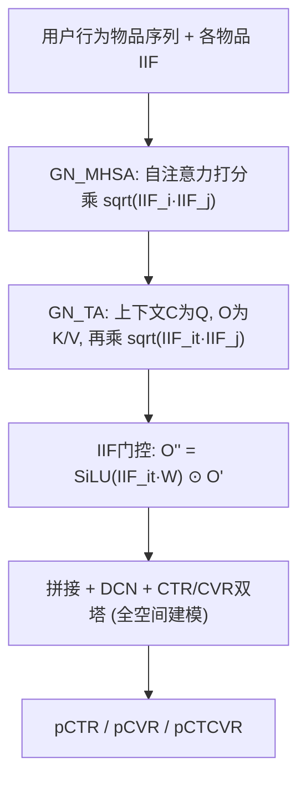
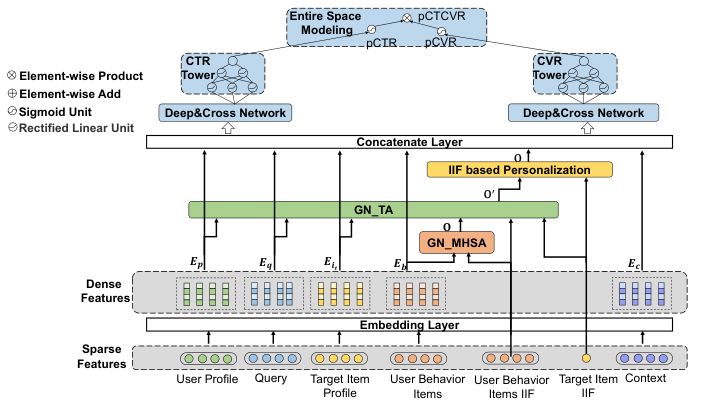

# NAM: A Normalization Attention Model for Personalized Product Search In Fliggy (飞猪个性化商品搜索的归一化注意力模型)

- **会议/期刊**: SIGIR 2025 (Padua, Italy)
- **作者与机构**: Shui Liu, Mingyuan Tao, Maofei Que, Dong Li, Shenghua Ni, Zhuoran Zhuang (阿里巴巴/飞猪)；Pan Li (Georgia Tech)
- **推荐链路定位**: 精排 (CTR/CVR 多目标预估，全空间建模)
- **研究方向**: CTR/CVR 预估与特征交叉 / 序列推荐
- **论文原文**: [https://arxiv.org/abs/2506.08382v1](https://arxiv.org/abs/2506.08382v1)
- **开源代码**: 暂未开源

## TL;DR (1分钟核心速览)

个性化商品搜索中，现有注意力模型只从 query–用户行为侧建模个性化，忽略物品流行度视角，导致热门物品转化率被系统性高估、长尾被低估（马太效应），且用户历史行为对长尾物品的预测价值远高于热门物品。NAM 提出两条改造：用逆物品频率 (IIF) 对自注意力与目标注意力的相似度做**全局归一化**（"how to personalize"），并用目标物品 IIF 做**门控**自适应调节个性化强度（"when to personalize"）。在飞猪 3.83 亿曝光工业数据集上，CTCVR AUC 较次优基线 +0.001、较线上基线 AEM +0.0027；线上 7 天 A/B 的 CTCVR 提升 0.8%。

## Background & Motivation (背景与核心矛盾)

- **主流范式**: 以 AEM/ZAM/TEM/DAM 为代表的个性化搜索模型，用 query 与用户行为序列的注意力权重来调节个性化强度（权重可从 0 到 1），本质是 query-dependent attention。
- **前人局限**: ① 仅依赖共现频率计算物品相似度/注意力，热门物品被过度曝光与高估、长尾被压制，形成马太效应；② 用户购买倾向对目标物品流行度高度异质——热门物品的转化几乎不依赖历史行为，长尾物品则强依赖，而现有模型对所有物品施加同一个人个性化强度。
- **核心洞察 (Key Insight)**: 作者在飞猪日志上做了三组数据分析验证：(a) 按曝光量分 5 档，PCOC（预测 CTCVR/真实 CTCVR）在 Top 1% 档为 1.1715（高估 17%），在 (20%,100%] 长尾档仅 0.8174（低估 18%）；(b) 用 Jaccard/Cosine 替代共现频率做相似度，HitRate@30 从 22.61% 升至 28.24%/30.33%，说明"全局频率归一化"本身即有效；(c) 长尾档中"历史交互过"物品的转化率是未交互的 19.72 倍，而 Top 1% 档仅 11.5 倍。
- **本文切入点**: 把余弦相似度分母中的 $\sqrt{\#U_i\#U_j}$ 显式搬进注意力打分，并用目标物品 IIF 门控个性化通路，实现"何时个性化"与"如何个性化"的双重自适应。

## Method (核心方法设计)

### 1. 整体框架 (Overall Architecture)

输入为用户画像、query 上下文、目标物品特征与用户行为物品序列；行为序列先经 **GN_MHSA**（全局归一化多头自注意力）编码为 $O$，再以上下文特征$C$为 Query、$O$为 Key/Value 经 **GN_TA**（全局归一化目标注意力）聚合为$O'$；随后 **IIF-based Personalization** 门控层用目标物品 IIF 缩放$O'$得$O''$，与$E_q,E_p,E_{it},E_c$ 拼接后送入 DCN + 三层 MLP 的 CTR/CVR 双塔，采用全空间 (Entire Space) 建模输出 pCTR、pCVR 与 pCTCVR。

<figure class="paper-figure" markdown="span">
  <figcaption>图1：NAM 的总体结构，由嵌入层、全局归一化多头自注意力模块（GN_MHSA）、全局归一化目标注意力模块（GN_TA）、基于 IIF 的个性化模块、拼接层、CTR 塔与 CVR 塔以及全空间建模组成。</figcaption>
</figure>

### 2. 关键设计拆解 (Key Designs)

1. **GN_MHSA / GN_TA：把余弦分母搬进注意力打分**：痛点是点积注意力对高频物品天然给高分。做法是在标准缩放点积上逐元素乘一个由 IIF 构成的相似度掩码：$GlobalNorm_{MHSA}^h=\frac{Q_hK_h^\top}{\sqrt{d_k}}\odot M_{Q,K}$，其中$M_{Q,K}=\mathrm{SiLU}\big(\sqrt{IIF_Q(IIF_K)^\top}\odot W_{M_{Q,K}}\big)$，$IIF_i=1/\#U_i$。直觉：$\sqrt{IIF_i\cdot IIF_j}$正是 Cosine 相似度的分母，等价于对注意力权重做全局频率归一化，压制热门物品的"共现霸权"；用 SiLU 而非 Sigmoid/ReLU 是为保证掩码落在$(0,1)$且平滑可导。GN_TA 同构，只是把$IIF_Q$换成目标物品的$IIF_{it}$。
2. **IIF-based Personalization 门控：决定"何时个性化"**：痛点是热门物品的转化由从众效应主导、与历史行为弱相关。做法是用目标物品 IIF 生成标量门：$O''=\mathrm{SiLU}(IIF_{it}W_{IIF_{it}})\odot O'$。直觉：$IIF_{it}$ 越小（越热门）门越闭合，个性化通路被抑制；越冷门门越打开，历史行为权重上升——与数据分析中"长尾更依赖历史"的结论严格对齐，且门是连续可学的，避免 ZAM 式零向量硬切换。
3. **训练目标、负采样与推理效率**：采用全空间建模的联合损失 $\mathcal{L}=\mathcal{L}_{CTR}+\mathcal{L}_{CVR}+\mathcal{L}_{CTCVR}$（pCTCVR = pCTR × pCVR），均为交叉熵；精排场景为真实曝光样本，无负采样环节。推理仅增加两次$O(n)$ 的 IIF 掩码逐元素乘与一个标量门控，相对 Transformer 主干开销可忽略，满足线上毫秒级延迟。

## Experimental Setup & Evaluation Protocol (实验设置与评估协议)

- **数据集与预处理**: 飞猪商品搜索真实消费日志，按日期切分，约 3.74 亿训练样本 / 900 万测试样本。

| 数据集 | #Users | #Items | #Interactions(曝光) | 点击/转化 | 特征/场景说明 |
| :--- | :---: | :---: | :---: | :---: | :--- |
| Fliggy 工业日志 | 6,267,425 | 975,170 | 383,224,804 | 34,106,927 / 2,766,688 | 用户画像+query+目标物品+行为序列，酒店/旅游商品搜索 |

- **数据划分与防穿越 (Splitting Strategy)**: 按日期切分训练/测试集（时间切分，避免未来信息泄漏）。
- **排名评测协议 (Ranking Protocol)**: 工业精排场景，采用 AUC 与 GAUC（分组 AUC，按用户分组）评估 CTR 与 CTCVR 两个目标，非全库排序/采样排序。
- **对比基线与超参设置**: 基线含 QEM、HEM、AEM（线上基线）、ZAM、TEM、DAM；所有模型共享特征与结构，CTR/CVR 塔为 512-256-128 三层 MLP + BN，自注意力头数 $H=4$，物品 embedding 维度$d_{ei}=98$，Adam，学习率 0.001，batch size 1024。

## Key Experimental Results (实验关键数据)

### 1. 主实验对比 (Main Results)

| Models | CTR AUC | CTCVR AUC | CTR GAUC | CTCVR GAUC |
| :--- | :---: | :---: | :---: | :---: |
| QEM | 0.7621 | 0.9032 | 0.7126 | 0.8181 |
| HEM | 0.7626 | 0.9034 | 0.7121 | 0.8179 |
| AEM (Base) | 0.7615 | 0.9041 | 0.7148 | 0.8205 |
| ZAM | 0.7647 | 0.9055 | 0.7175 | 0.8225 |
| TEM | 0.7651 | 0.9058 | 0.7166 | 0.8217 |
| DAM | 0.7644 | 0.9049 | 0.7158 | 0.8201 |
| **NAM** | **0.7665** | **0.9068** | **0.7192** | **0.8245** |
| Improv. vs 次优 | +0.0014 | +0.0010 | +0.0017 | +0.0020 |

### 2. 消融实验 (Ablation Study)

| 变体 | CTR AUC | CTCVR AUC | CTR GAUC | CTCVR GAUC |
| :--- | :---: | :---: | :---: | :---: |
| NAM w/o IIF-based P13n | 0.7633 | 0.9054 | 0.7184 | 0.8232 |
| NAM w/o GlobalNorm | 0.7621 | 0.9057 | 0.7177 | 0.8218 |
| **NAM (full)** | **0.7665** | **0.9068** | **0.7192** | **0.8245** |

### 3. 关键实验发现 (Key Findings)

1. **两个模块互补且缺一不可**：去掉 IIF 门控后 CTCVR AUC 掉 0.0014、GAUC 掉 0.0013；去掉全局归一化后 CTR AUC 从 0.7665 跌至 0.7621（甚至低于 AEM 的 0.7615），说明全局归一化是收益主来源，门控负责进一步校准个性化强度。
2. **PCOC 校准确实生效**：相较 AEM，NAM 在 Top 1% 热门档 PCOC 从 1.1715 降至 1.1262（-3.87%），长尾档从 0.8174 升至 0.8394（+2.69%），双向收敛至 1，直接验证了"抑制热门、扶持长尾"的设计动机而非仅指标虚涨。
3. **线上收益可折算为真金白银**：7 天 A/B 中 NAM 的 CTCVR 曲线全程高于 AEM，均值 +0.8%；结合飞猪日均销量与数百元级酒店客单价，作者估算对应近千万元级营收增量，证明离线 AUC 的千分位提升在工业场景具备实际商业价值。

## Highlights & Limitations (亮点、对比与审稿批判)

- **与代表作对比 (vs. Prior Work)**: 与 AEM/ZAM 的本质区别在于个性化信号来源——AEM 只用 query 决定注意力权重，ZAM 用零向量做硬切换，TEM 用 Transformer 但仍是 query-dependent；NAM 首次把**物品流行度**作为个性化调节变量，且 DAM 虽用 Cosine 相似度但仅作用于 query–item 打分并引入阈值超参，NAM 则把归一化下沉到行为序列内部的自注意力与目标注意力两层，粒度更细、无额外阈值。
- **可迁移亮点**: ① "把相似度分母显式乘进注意力打分"是一个极轻量的通用去偏算子，可直接移植到任何序列精排模型（如 SIM、ETA）压制热门偏置；② 用物品侧统计量（IIF）做门控调节个性化通路的思路，可迁移到跨域/多场景推荐中按场景热度调节迁移强度。
- **审稿级局限批判**: ① 实验仅限飞猪单一工业数据集，缺乏公开基准（如 Amazon/淘宝公开集）复现，且 AUC 提升幅度在千分位，统计显著性与方差未报告；② IIF 依赖全量用户交互统计，存在冷启动物品 $IIF$不稳定与训练/推理统计口径漂移风险，论文未讨论 IIF 的平滑（如$1/(\#U_i+\alpha)$）与在线更新策略；③ 门控为标量、表达力有限，未与 FiLM/多头门控等更强条件化方案对比。

## Rating (四维评分)

- **方法创新性 (Novelty)**: ⭐⭐⭐⭐ （把 Cosine 分母显式嵌入注意力打分并用 IIF 门控个性化强度，思路简洁且有数据分析支撑，但属对现有注意力机制的轻量改造）
- **评估协议与实验扎实度 (Protocol & Experiments)**: ⭐⭐⭐ （有 3.8 亿级工业数据与 7 天线上 A/B，但仅单数据集、无公开基准与显著性检验，AUC 增益在千分位）
- **写作与数学规范度 (Clarity & Rigor)**: ⭐⭐⭐⭐ （三组直觉—数据分析—公式的对应链条清晰，公式与符号定义完整，但部分符号如 $W_{M_{Q,K}}$ 的维度说明略简）
- **工业落地与复现价值 (Industrial & Practical Value)**: ⭐⭐⭐⭐ （改动仅两次逐元素乘加一个标量门，线上延迟可忽略且已验证 +0.8% CTCVR，落地价值高；但未开源，复现需自建工业数据）

