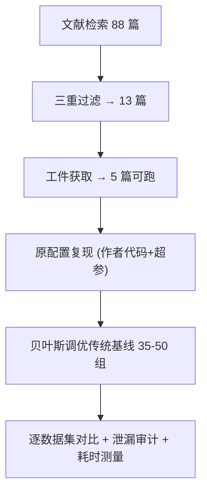

# A Worrying Reproducibility Study of Intent-Aware Recommendation Models (意图感知推荐模型令人担忧的可复现性研究)

- **会议/期刊**: ACM SIGIR 2025
- **作者与机构**: Faisal Shehzad、Dietmar Jannach（University of Klagenfurt），Maurizio Ferrari Dacrema（Politecnico di Milano）
- **推荐链路定位**: 召回（Top-N 推荐）
- **研究方向**: 去偏公平、可信隐私与工业架构 / 协同过滤
- **论文原文**: [https://arxiv.org/abs/2501.10143v1](https://arxiv.org/abs/2501.10143v1)
- **开源代码**: 暂未开源（作者公开了实验代码、数据划分与调参范围：`recsysevaluation.github.io/IntentAwareRS/`）

## TL;DR (1分钟核心速览)

本文针对"意图感知推荐（IARS）"这一新兴方向做系统性复现审计：从 88 篇文献筛出 13 篇顶会/高影响因子论文，仅 5 篇（38.46%）代码可跑通。作者用原作者代码+数据+超参复现，并对比 6 个**经贝叶斯优化充分调参**的传统非神经基线（TopPop/ItemKNN/UserKNN/P3α/RP3β/EASE_R）。结果：DGCF 与 KGIN 无法复现（KGIN 的 Last-FM 划分存在影响 17,290/23,566 用户的数据泄漏），且**全部 5 个 IARS 模型在所有数据集上均被至少一个传统模型超越**，KGIN 训练耗时比 ItemKNN 高约 800 倍。

## Background & Motivation (背景与核心矛盾)

- **主流范式**: IARS 通过解耦图卷积、知识图谱路径聚合、对比自监督等复杂神经结构建模用户潜在意图，宣称在 Top-N 上超越 GNN 基线。
- **前人局限**: (i) 复现率低——13 篇中仅 5 篇可运行，与 2019 年水平几乎持平；(ii) 基线选择与调参存在系统性缺陷：多数论文只对比近期神经模型，且将 embedding 维度**固定为 32/50/64** 而非作为超参搜索，人为压制基线表达力。
- **核心洞察 (Key Insight)**: 在统一"原作者工件 + 原作者超参"的复现框架下，若把传统模型调到最优，所谓 SOTA 增益可能完全消失——即"幻影进步 (phantom progress)"在 IARS 中同样成立。
- **本文切入点**: 不做新模型，而是以 ACM 可复现定义（独立团队用作者工件得到相同结果）为标尺，逐篇审计并引入强调优传统基线作为"照妖镜"。

## Method (核心方法设计)

### 1. 整体框架 (Overall Architecture)

流程为：文献检索（Google Scholar + IEEE Xplore，关键词 intent/intent awareness + recommend）→ 88 篇 → 三重过滤（Top-N 任务、近四年、CORE A* 或 IF≥5）→ 13 篇 → 邮件索要工件并等 30 天 → 5 篇满足"代码可跑 + 至少一个公开数据集且划分可重建"。对每篇采用**原配置复现法**（而非统一框架重实现），即完全沿用作者代码与评测脚本，仅额外接入自建基线；基线统一用贝叶斯优化搜索 35–50 组超参（前 5 组随机初始化防早熟）。

### 2. 关键设计拆解 (Key Designs)

1. **原配置复现 + 强调优基线对照**：痛点在于跨论文评测协议不一致导致模型间不可比，作者放弃统一框架，改为"每篇论文内部闭环对比"。基线覆盖非个性化（TopPop）、邻域（Item/UserKNN，含 shrinkage 与加权策略）、二部图游走（$P3\alpha$的相似度缩放系数$\alpha$、$RP3\beta$额外引入流行度系数$\beta$）与线性浅层模型（EASE_R，单超参闭式解）。直觉：这些模型参数量极小但历史多次击败神经模型，是检验"增益真实性"的最低成本探针。
2. **数据泄漏审计（KGIN 案例）**：作者发现 KGIN 提供的 Last-FM 划分中 17,290/23,566 用户存在训练-测试重叠，遂取训练测试并集去重后重建 80/20 划分，记为 Last-FM*。此举揭示 Recall 虚高（论文 0.097 vs 复现 0.202）的根因并非模型强弱而是**划分污染**，是本文最具方法论价值的增量。
3. **训练目标与开销审计**：本文无新损失函数；其"目标"是复现一致性判据——对每个模型比较 $\text{metric}_{\text{paper}}$与$\text{metric}_{\text{code}}$的相对偏差，并记录训练时间$T$、全用户预测时间$P$与单用户延迟$P/|\mathcal{U}|$。KGIN 在 Alibaba-iFashion（11.4 万用户、3 万物品、170 万交互）上$T=117{,}360$ s，而 ItemKNN 仅 140.8 s。

## Experimental Setup & Evaluation Protocol (实验设置与评估协议)

- **数据集与预处理**: 各论文沿用自身数据集，过滤阈值不一（DGCF/KGIN 为 10-core，IDS4NR 为 5-core），DCCF/BIGCF 未做标准预处理且未说明划分方式。

| 数据集 | #Users | #Items | #Interactions | 稀疏度/密度 | 特征/场景说明 |
| :--- | :---: | :---: | :---: | :---: | :--- |
| Gowalla | 29,858 | 40,981 | 1,027,370 | 8.4e-4 | 签到，DGCF/DCCF/BIGCF |
| Yelp2018 | 31,668 | 38,048 | 1,561,406 | 1.3e-3 | 商户点评，DGCF |
| Amazon Book | 52,643 | 91,599 | 2,984,108 | 6.2e-4 | 图书，DGCF/KGIN/DCCF/BIGCF |
| Last-FM | 23,566 | 48,123 | 3,034,796 | 2.7e-3 | 音乐，KGIN（含泄漏） |
| Alibaba-iFashion | 114,737 | 30,040 | 1,781,093 | 5.2e-4 | 服饰电商，KGIN |
| MovieLens-100k | 943 | 1,682 | 100,000 | 6.3e-2 | 电影，IDS4NR |
| Amazon Music / Beauty | — | — | — | — | 5-core，IDS4NR |
| Tmall | — | — | — | — | 电商，DCCF/BIGCF |

- **数据划分与防穿越 (Splitting Strategy)**: DGCF/KGIN 为**用户级 80/20 比例划分**（作者明确指出用户级划分可能因他人未来交互造成泄漏）；KGIN 另用 Leave-One-Out 从训练集切验证集；DCCF/BIGCF 划分方式未披露；IDS4NR 提供划分但未说明协议。
- **排名评测协议 (Ranking Protocol)**: 沿用各原文指标与截断（Recall@20/NDCG@20 为主，DCCF/BIGCF 用 @20/@40，IDS4NR 用 @5/@10 并附 Coverage/Novelty/F1）。原文多依赖**采样指标**，本文在 Amazon Book 上引用 [62] 的**全库排序**结果以规避采样偏差。
- **对比基线与超参设置**: 6 个传统基线全部贝叶斯调优 35–50 组；IARS 模型沿用作者公布的最优超参（不再二次调优，以避免算力不对等）。未报告显著性检验，以"是否被任一基线超越"为判据。

## Key Experimental Results (实验关键数据)

### 1. 主实验对比 (Main Results)

| 模型 | Gowalla R@20 | Gowalla N@20 | Yelp R@20 | AmazonBook R@20 | Last-FM* R@20 | Tmall R@20 |
| :--- | :---: | :---: | :---: | :---: | :---: | :---: |
| TopPop | 0.013 | 0.031 | 0.012 | 0.002 | 0.015 | 0.010 |
| ItemKNN | 0.156 | 0.123 | 0.064 | 0.056 | 0.234 | 0.110 |
| UserKNN | 0.155 | 0.128 | 0.061 | 0.051 | 0.200 | 0.087 |
| $P3\alpha$ | 0.175 | 0.146 | 0.064 | 0.056 | 0.239 | 0.109 |
| $RP3\beta$ | **0.183** | **0.152** | **0.067** | 0.068 | **0.253** | **0.116** |
| EASE_R | 0.163 | 0.136 | 0.064 | **0.071** | 0.227 | 0.093 |
| DGCF (Paper / Code) | 0.179 / 0.133 | 0.152 / 0.109 | 0.064 / 0.037 | 0.039 / 0.011 | — | — |
| KGIN (Paper / Code) | — | — | — | 0.168 / 0.143 | 0.097 / 0.202 | — |
| DCCF (Paper / Code) | 0.187 / 0.189 | 0.112 / 0.112 | — | 0.088 / 0.092 | — | 0.066 / 0.064 |
| BIGCF (Paper / Code) | 0.208 / 0.206 | 0.124 / 0.123 | — | 0.098 / 0.099 | — | 0.075 / 0.075 |

**复现偏差**：DGCF 代码结果较原文低 25.7%（Gowalla R@20: 0.133 vs 0.179）；KGIN 在 Amazon Book 低 14.9%，Last-FM 因泄漏反而"虚低"；DCCF/BIGCF 偏差 <2%，判定可复现。**Improv.%**：$RP3\beta$ 相对 DCCF 在 Gowalla R@20 上 +29.6%，相对 BIGCF +18.9%。

### 2. 消融实验 (Ablation Study)

本文无模型消融，代之以"复现一致性 + 调参敏感性"分析：

| 分析项 | 设置 | 关键结果 |
| :--- | :--- | :--- |
| DGCF 超参来源 | 作者超参 vs. [2] 调优超参（batch 1024→2000） | R@20 0.133 → 0.173，接近原文 0.179 |
| KGIN 数据划分 | 原始 Last-FM vs. 去重 Last-FM* | R@20 0.202 → 0.163，泄漏贡献 +24% |
| BIGCF 早停 | 固定 epoch vs. 验证集早停 | Gowalla/Amazon Book 精度显著下降 |
| 计算开销 | KGIN vs. ItemKNN（Alibaba-iFashion） | 训练 117,360 s vs. 140.8 s（≈833×）；单用户预测 3.15 ms vs. 1.76 ms |

### 3. 关键实验发现 (Key Findings)

1. **"调参即翻盘"**：DGCF 仅把 batch size 从 1024 调到 2000，Gowalla R@20 就从 0.133 升至 0.173，说明原文低复现值主要源于超参未充分搜索，而非实现错误——这同时反证了原文基线固定 embedding 维度的做法会系统性低估对手。
2. **泄漏比模型更能解释"提升"**：KGIN 在 Last-FM 上的 Recall 从论文 0.097 跳到复现 0.202，去重后回落至 0.163，且 $RP3\beta$ 在干净划分上仍达 0.253，说明原报告的"意图建模收益"被划分污染与弱基线双重放大。
3. **精度-开销严重失衡**：5 个 IARS 模型无一例外被传统模型全面超越，而 KGIN 训练成本高约 833 倍、预测慢 50%，在离线增益为负的前提下，其碳足迹与工程复杂度完全缺乏正当性。

## Highlights & Limitations (亮点、对比与审稿批判)

- **与代表作对比 (vs. Prior Work)**: 相较 Ferrari Dacrema 等 [10,11] 对通用神经推荐的复现，本文首次将审计聚焦 IARS 这一新兴子领域，并新增**数据泄漏取证**（KGIN）与**计算成本量化**（表 7）两个维度；相较 Anelli 等 [2] 通过重实现得到"GNN 可胜传统模型"的结论，本文坚持只用作者工件，因而结论更保守但更贴近"可复现"定义。
- **可迁移亮点**: (i) 把 embedding 维度纳入超参搜索而非固定，是审稿与自评时最低成本的公平性检查；(ii) 训练/测试集并集去重后重建划分的泄漏检测流程，可直接复用于任何使用公开划分的论文自查。
- **审稿级局限批判**: (i) 未对 IARS 模型做二次调参，若原作者因算力受限未搜到最优，结论可能对 IARS 略偏严苛；(ii) 基线池仅含 EASE_R 一个线性模型，缺 ALS/BPR 等矩阵分解族，且未做显著性检验，5 篇样本量也限制了对 IARS 整体的外推。

## Rating (四维评分)

- **方法创新性 (Novelty)**: ⭐⭐⭐ （无新模型，但"泄漏取证 + 成本审计"的组合在 IARS 领域属首次系统化，方法论增量明确）
- **评估协议与实验扎实度 (Protocol & Experiments)**: ⭐⭐⭐⭐ （5 篇全量复现、基线贝叶斯调优 35–50 组、含全库排序对照，唯缺显著性检验与矩阵分解基线）
- **写作与数学规范度 (Clarity & Rigor)**: ⭐⭐⭐⭐ （复现判据、偏差归因与耗时表条理清晰，公式极少但符号一致，数据集统计披露略粗）
- **工业落地与复现价值 (Industrial & Practical Value)**: ⭐⭐⭐⭐⭐ （直接给出"传统模型 833 倍成本优势"的工程结论，实验工件与调参范围全公开，对工业选型与审稿实践均有即时价值）

