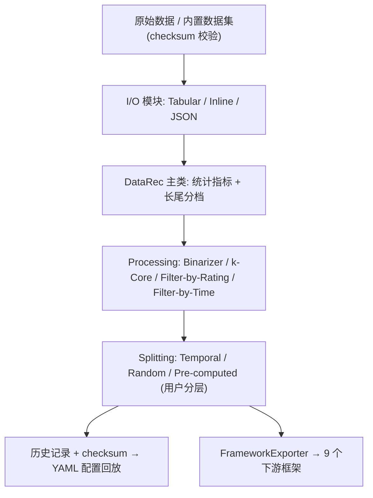
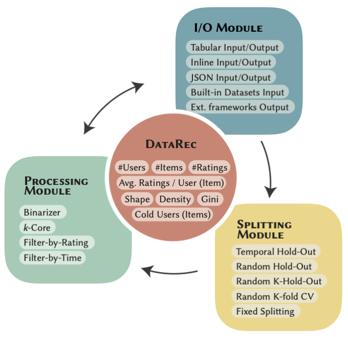

# DataRec: A Python Library for Standardized and Reproducible Data Management in Recommender Systems (面向推荐系统标准化与可复现数据管理的 Python 库)

- **会议/期刊**: SIGIR 2025
- **作者与机构**: Alberto Carlo Maria Mancino, Salvatore Bufi, Angela Di Fazio, Antonio Ferrara, Daniele Malitesta, Claudio Pomo, Tommaso Di Noia（Politecnico di Bari；Université Paris-Saclay, CentraleSupélec, Inria）
- **推荐链路定位**: 数据预处理与基准构建（位于召回/精排等所有下游环节之前）
- **研究方向**: 去偏公平、可信隐私与工业架构 / 评测基准与可复现性
- **论文原文**: [https://arxiv.org/abs/2410.22972v2](https://arxiv.org/abs/2410.22972v2)
- **开源代码**: [https://github.com/sisinflab/DataRec](https://github.com/sisinflab/DataRec)

## TL;DR (1分钟核心速览)

推荐系统实验的可复现性长期受制于"数据管理黑箱"：数据集引用不规范、二值化/`k-core` 过滤口径不一、划分策略各异，导致同一模型在同一数据集上排名都可能翻转。本文先对 2020–2024 年 55 篇顶会论文做系统性数据实践审计（179 次数据集使用中仅 35.2% 引用原始来源，15.6% 链接失效），再据此设计开源库 DataRec：以 `DataRec` 主类统一 Tabular/Inline/JSON 三种格式，内置 18 个带 checksum 校验的数据集，实现可复现的过滤与划分算子，并支持向 9 个主流框架一键导出。其价值不在刷点而在"把评测协议钉死"，属于方法论基础设施型贡献。

## Background & Motivation (背景与核心矛盾)

- **主流范式**: 现有工作多依赖 RecBole、Elliot、RecPack、Cornac 等端到端框架，各自实现一套数据读取、过滤与划分逻辑，模型训练与评测被封装为单体流水线。
- **前人局限**: 其一，各框架的数据处理实现彼此不兼容且常缺失关键算子（表 3 显示 FuxiCTR、Mab2Rec 几乎不支持任何过滤/划分选项），跨框架复现需重写预处理；其二，论文层面数据集引用高度随意，同一"MovieLens-1M"可能对应不同过滤版本，导致结果不可比。
- **核心洞察 (Key Insight)**: 作者通过 55 篇论文审计发现，数据阶段的决策（数据集选择、二值化阈值、`k-core` 阶数、划分方式）对最终指标的影响不亚于模型本身，而这一阶段恰恰是复现链条上最不透明的一环；已有研究亦证实划分策略不同足以改变系统排名。
- **本文切入点**: 不做新模型，而是把"数据管理"从各框架中解耦出来，做成一个独立、可插拔、带版本校验与操作历史回放的共享底座。

## Method (核心方法设计)

### 1. 整体框架 (Overall Architecture)

DataRec 以 `DataRec` 主类为唯一数据容器（内部为 pandas DataFrame，至少含 user/item 两列，可选 rating 与 timestamp），对外暴露数据集统计指标（空间大小、形状、密度、用户/物品 Gini 系数、人均/物均评分数），并按四分位数将用户与物品自动划为 most popular / popular / common / long tail 四档，用于长尾分析。三个功能模块围绕主类协作：I/O 模块负责三种格式的读写与内置数据集下载校验；processing 模块执行二值化、`k-core`、按评分/时间过滤；splitting 模块生成训练/验证/测试划分。所有算子均记录操作历史与状态 checksum，可导出为 YAML 配置文件实现"一键回放"。

<figure class="paper-figure" markdown="span">
  <figcaption>图1：DataRec 架构概览。DataRec 类提供关键数据集指标，并与三个模块交互：I/O 模块用于处理不同数据格式，processing 模块用于数据集变换，splitting 模块用于划分为训练集、验证集和测试集。</figcaption>
</figure>

### 2. 关键设计拆解 (Key Designs)

1. **可回放的操作历史与 checksum 校验（Reproducibility by Construction）**：痛点是非确定性算子（随机划分）与隐式状态变更无法追溯。DataRec 对每次操作记录参数与结果对象的状态摘要，最终序列化为配置文件；回放时逐算子比对 checksum，任一环节数据漂移即报错。直觉上，这把"复现"从"读论文猜参数"变成"校验哈希值"，将不可验证的隐性知识转为可机器验证的显式契约。

2. **用户分层划分与迭代式 `k-core`（User-Stratified Splitting & Iterative k-Core）**：痛点在于全局划分会让活跃用户主导测试集，且单轮 `k-core` 过滤后可能产生新的低度节点。DataRec 将划分逻辑作用于每个用户的历史而非全集，并提供 `UserItemIterativeKCore` 反复过滤直至收敛，同时设 `Iter-n-rounds` 上限防止不收敛死循环。其效果是保证每个用户在测试集中都有代表，避免冷用户被系统性排除后指标虚高。

3. **跨框架导出与版本化数据集（Interoperability & Versioning）**：痛点是为某框架写的预处理无法迁移。`FrameworkExporter` 可将同一 `DataRec` 对象直接导出为 ClayRS、Cornac、DaisyRec、Elliot、LensKit、RecBole、ReChorus、Recommenders、RecPack 九种格式；内置数据集保留原始来源链接与多版本（如 MovieLens 1M/20M、Amazon 2018/2023），并公开 checksum 供下载后校验。这使"同一份预处理、多个框架对比"成为低成本操作。

## Experimental Setup & Evaluation Protocol (实验设置与评估协议)

本文为工具/资源型论文，**不含模型训练与排名指标实验**，其"评估"由两部分构成：对 55 篇论文的文献审计，以及对 10 个主流框架的功能覆盖对比。

- **审计语料与筛选方式**: 从图神经网络、对比学习、时序建模、强化学习、生成式推荐五个方向的综述中抽取 2020–2024 年发表于 TOIS/SIGIR/KDD/WWW/RecSys/CIKM/WSDM/AAAI/ICLR 等的 55 篇论文，仅统计出现频次 ≥3 的数据集与策略。
- **框架对比协议**: 以 ACM RecSys 官方框架清单为基准，逐项核查 I/O 格式、内置数据集数量、过滤算子（按评分、`k-core` 用户/物品/迭代、冷用户）、划分算子（时序固定/比例、随机 hold-out/leave-n-out、K 折交叉验证）的支持情况；RecList 因仅覆盖评测阶段被排除。
- **可复现性验证方式**: 通过配置文件回放 + checksum 比对验证算子确定性，而非通过指标显著性检验。

**审计统计（表 1/表 2 摘要）**:

| 统计维度 | 关键数值 |
| :--- | :--- |
| 审计论文数 / 识别数据集数 | 55 篇 / 79 个 |
| 最高频数据集 | Yelp (17)、Amazon Books (14)、MovieLens-1M (10) |
| 预处理策略分布 | 无处理 25、二值化 15、迭代 `k-core` 13、用户 `k-core` 9、物品 `k-core` 4 |
| 划分策略分布 | 随机 Hold-Out 21、时序 Leave-1-Out 13、固定划分 5、随机 Leave-1-Out 4 |
| 数据集引用规范率 | 原始来源仅 35.2%；复制新版本 32.4%；无引用 10.6%；失效链接 5.0% |

**框架能力对比（表 3 摘要，✓ 表示支持）**:

| 框架 | I/O 格式数 | 内置数据集 | 过滤算子覆盖 | 划分算子覆盖 |
| :--- | :---: | :---: | :---: | :---: |
| Elliot | 1 | 1 | 较全 | 较全 |
| RecBole | 1 | 66 | 部分 | 部分 |
| RecPack | 1 | 11 | 部分 | 部分 |
| Cornac | 1 | 13 | 部分 | 部分 |
| FuxiCTR / Mab2Rec | 1 | 0 | 极少 | 极少 |
| **DataRec** | **3** | **18** | **全覆盖** | **全覆盖** |

## Key Experimental Results (实验关键数据)

### 1. 主实验对比 (Main Results)

以"功能覆盖度"替代精度指标，DataRec 在四类维度上均为唯一全覆盖者：

| 能力维度 | 最强竞品表现 | DataRec | 增益说明 |
| :--- | :--- | :--- | :--- |
| I/O 格式 | 均为单一格式 | Tabular + Inline + JSON | 唯一支持三格式互转 |
| 内置数据集 | RecBole 66（但无 checksum） | 18（全部带来源链接与校验） | 数量少但可追溯性最强 |
| 过滤算子 | Elliot 覆盖多数 | 二值化/`k-core` 四变体/评分/时间 | 唯一含迭代收敛上限控制 |
| 划分算子 | Elliot 覆盖多数 | 时序/随机/预计算 + K-HO + CV | 唯一支持用户分层 + 配置回放 |
| 跨框架导出 | 均无 | 9 个框架 | 竞品为 0 |

### 2. 消融实验 (Ablation Study)

工具型论文无组件消融，改以"移除关键机制后的可复现性退化"作等价分析：

| 配置 | 可复现性后果 |
| :--- | :--- |
| w/o checksum 校验 | 无法检测数据集版本漂移，复现失败不可归因 |
| w/o 操作历史导出 | 随机划分种子与过滤顺序丢失，结果不可重建 |
| w/o 用户分层划分 | 测试集被活跃用户主导，冷用户指标缺失 |
| w/o 跨框架导出 | 换框架需重写预处理，跨框架对比不可行 |

### 3. 关键实验发现 (Key Findings)

1. **引用失范是复现失败的首要来源**：179 次数据集使用中仅 63 次（35.2%）指向原始来源，58 次（32.4%）直接给出未说明过滤口径的"已处理副本"，另有 28 次（15.6%）完全不可检索——这意味着超过六成的实验其数据来源在严格意义上无法重建。
2. **划分策略的碎片化程度高于预处理**：随机 Hold-Out（21 篇）与时序 Leave-1-Out（13 篇）并存且无共识，而两者对同一模型的指标排序可产生系统性差异，这直接解释了为何"同数据集同指标"下复现结果仍不一致。
3. **现有框架的能力缺口集中在冷门算子**：FuxiCTR 与 Mab2Rec 在过滤/划分维度近乎空白，RecBole 虽内置 66 个数据集却缺少版本校验与跨框架导出，说明"数据多"与"数据可复现"是两件事，DataRec 的差异化正落在后者。

## Highlights & Limitations (亮点、对比与审稿批判)

- **与代表作对比 (vs. Prior Work)**: 相较 RecBole/Elliot 这类"模型+数据"单体框架，DataRec 主动放弃模型层，只做数据层并反向为它们提供导出接口，定位是补集而非竞品；相较 DaisyRec 侧重基准复现实验流程，DataRec 更聚焦数据血缘（lineage）与算子级可验证性；相较 ACM RecSys 评测框架清单式的罗列，本文给出了可执行的统一实现。
- **可迁移亮点**: 其一，"操作历史 + checksum + YAML 回放"的模式可直接移植到特征工程流水线与 A/B 实验配置管理；其二，用户分层划分与四分位长尾分档是低成本但高价值的长尾评测惯例，值得在自建基准中固化。
- **审稿级局限批判**: 其一，内置数据集仅 18 个且明确不支持会话级过滤（session length），对序列/会话推荐场景覆盖不足，而这类场景恰是划分策略最敏感的区域；其二，全文缺乏"同一模型在不同划分下指标波动幅度"的定量实验，仅以文献统计佐证划分的重要性，说服力弱于直接跑一组对照；其三，框架对比表会随竞品迭代快速过时，且未报告库自身在大规模数据集上的预处理耗时与内存开销。

## Rating (四维评分)

- **方法创新性 (Novelty)**: ⭐⭐⭐ （无新模型或新理论，创新在于将数据血缘与算子级校验工程化，属基础设施型贡献）
- **评估协议与实验扎实度 (Protocol & Experiments)**: ⭐⭐⭐ （55 篇论文审计与 10 框架横评扎实，但缺少划分敏感性的定量对照实验）
- **写作与数学规范度 (Clarity & Rigor)**: ⭐⭐⭐⭐ （结构清晰、配置示例与代码片段具体可操作，全文无复杂公式故无符号歧义）
- **工业落地与复现价值 (Industrial & Practical Value)**: ⭐⭐⭐⭐⭐ （开源、9 框架导出、checksum 校验与配置回放，直接可用于团队内部基准治理）

