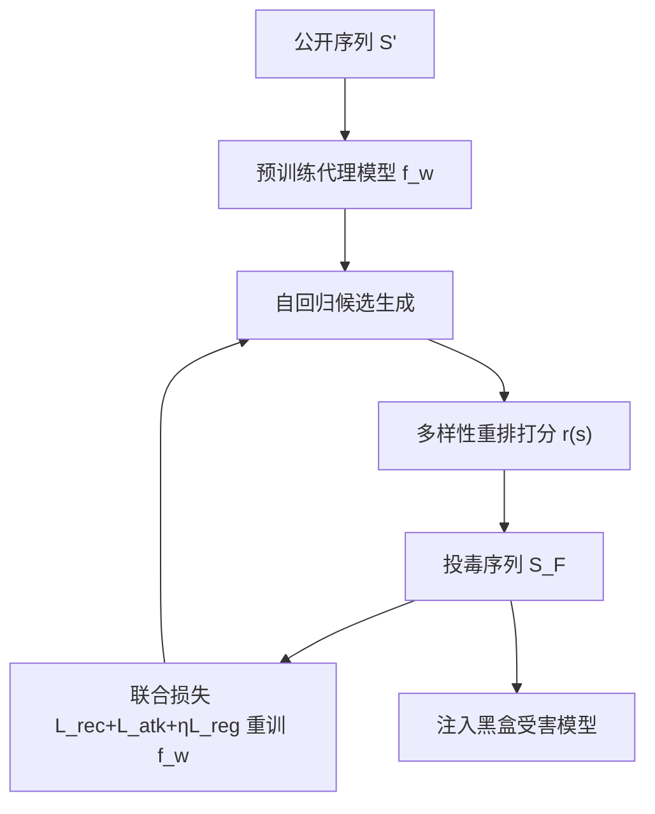

# Diversity-aware Dual-promotion Poisoning Attack on Sequential Recommendation (面向序列推荐的多样性感知双提升投毒攻击)

- **会议/期刊**: SIGIR 2025
- **作者与机构**: Yuchuan Zhao, Tong Chen, Junliang Yu, Hongzhi Yin (The University of Queensland); Kai Zheng (UESTC); Lizhen Cui (Shandong University)
- **推荐链路定位**: 训练数据投毒（作用于召回/排序模型的训练阶段）
- **研究方向**: 去偏公平、可信隐私与工业架构 / 序列推荐
- **论文原文**: [论文原文链接](https://arxiv.org/abs/2504.06586v1)
- **开源代码**: 暂未开源

## TL;DR (1分钟核心速览)

针对序列推荐系统的定向物品推广投毒攻击，现有方法在提升目标物品排名时严重打压用户真实偏好（隐蔽性差），且自回归生成的投毒序列高度重复目标物品（真实性差、共现覆盖窄）。本文从梯度层面证明攻击目标 $\mathcal{L}_{atk}$与推荐目标$\mathcal{L}_{rec}$ 存在方向冲突，提出 MSE 形式的双提升攻击目标（同时拉近目标物品与用户偏好物品）加对比正则，并用多样性感知的束搜索重排生成序列。在 Beauty/Sports/Toys 三数据集、SASRec 与 CL4SRec 两个受害模型上，攻击 HR@10 全面超越 SSL-attack 等 SOTA，且推荐精度损失最小。

## Background & Motivation (背景与核心矛盾)

- **主流范式**: 序列推荐投毒攻击普遍采用双层优化——用公开交互子集 $\mathcal{S}'$训练白盒代理模型$f_w$，外层最大化目标物品$t$在 top-$K$列表中的命中率（如$\mathcal{L}_{atk-list}$全列表 softmax 或$\mathcal{L}_{atk-pair}$ 成对 Wilcoxon 损失），再自回归采样生成投毒序列注入黑盒受害模型。
- **前人局限一（隐蔽性崩塌）**: 成对攻击损失对正物品 $i\in\Gamma_u$的梯度为$\partial\mathcal{L}_{atk-pair}/\partial e_i=\sum_u\sum_i g'(\Delta)e_u$，更新方向为$e_i\leftarrow e_i-\alpha\sum g'(\Delta)e_u$，即把用户偏好物品**推离**用户，与 BPR/BCE 的拉近方向恰好相反，导致推荐精度显著下滑、易被检测。
- **前人局限二（序列同质化）**: 代理模型在双层训练中被目标物品信号主导，自回归采样时 top-$K$ 列表坍缩到目标物品，序列内重复率高，既不像真实用户行为，也错失了目标物品与更多物品建立序列依赖的机会。
- **核心洞察 (Key Insight)**: 图 3 的损失曲线显示，随正物品得分 $\hat{y}_{ui^+}$上升，$\mathcal{L}_{rec}$单调下降而$\mathcal{L}_{atk}$单调上升，二者在特征空间中把$e_{i^+}$ 往相反方向拉，最优点只能停在双方都次优的鞍点——这正是必须用昂贵双层优化而非联合优化的根因。
- **本文切入点**: 把攻击目标从"压过所有人"改为"与偏好物品同向对齐"，使攻击与推荐目标梯度兼容，从而可用单层联合训练替代双层优化。

## Method (核心方法设计)

### 1. 整体框架 (Overall Architecture)

DDSP 分两阶段闭环：先用公开序列 $\mathcal{S}'$预训练代理模型$f_w$；随后交替执行（a）多样性感知自回归生成——对每个伪造用户从随机种子出发，用$f_w$产出候选集，经相关性+多样性重排打分逐项扩展成投毒序列$\mathcal{S}_F$；（b）用$\mathcal{S}'\cup\mathcal{S}_F$以联合损失$\mathcal{L}=\mathcal{L}_{rec}+\mathcal{L}_{atk}+\eta\mathcal{L}_{reg}$重训$f_w$，迭代至收敛后将$\mathcal{S}_F$ 注入黑盒受害模型。整个流程不查询受害模型，规避通信开销。

### 2. 关键设计拆解 (Key Designs)

1. **双提升攻击目标 DPAO（Dual-Promotion Attack Objective）**：痛点是对抗式排序损失把偏好物品推离用户。改为最小化目标物品与用户 top-$K$ 偏好物品的得分均方误差：
$$\mathcal{L}_{atk}=\sum_{u\in\mathcal{U}'\cup\mathcal{U}_F}\sum_{i\in\Gamma_u}(\hat{y}_{ui}-\hat{y}_{ut})^2$$
令 $\Delta=\hat{y}_{ui}-\hat{y}_{ut}$，则$e_i\leftarrow e_i-2\alpha\sum\Delta e_u$、$e_t\leftarrow e_t+2\alpha\sum\Delta e_u$：当$\Delta<0$时$e_i$向$e_u$靠拢，当$\Delta>0$时$e_t$向$e_u$ 靠拢，二者**同向双赢**，不再此消彼长。

2. **对比正则 $\mathcal{L}_{reg}$**：MSE 只缩小$t$与偏好物品的差距，未处理无关物品。以$\Gamma_u$ 为正样本、其余物品为负样本做 InfoNCE：
$$\mathcal{L}_{reg}=-\sum_{i\in\Gamma_u}\log\frac{\exp(e_t^\top e_i/\tau)}{\sum_{k\in\mathcal{I}}\exp(e_t^\top e_k/\tau)}$$
把 $t$拉向偏好簇、推离无关簇，防止无关物品在列表中挤占$t$ 的位置。

3. **多样性感知重排生成**：定义序列级打分 $r(s_{\tilde{u}})=(1-\lambda)\frac{1}{|s_{\tilde{u}}|}\sum_{i\in s_{\tilde{u}}}\hat{y}_{ui}+\lambda f_{div}(s_{\tilde{u}})$，其中$f_{div}$为序列内物品两两$L_2$距离均值。用贪心 MMR（$B=1$）或束搜索（$B>1$）在候选集上逐步扩展，$\lambda$平衡相关性与多样性。多样性提升使$t$与更广物品共现，攻击成功率随之上升。训练采用 BCE 作$\mathcal{L}_{rec}$，$\eta=0.01$、$\tau=0.2$，**免负采样**（BCE 隐式负样本），单层联合优化替代双层。

## Experimental Setup & Evaluation Protocol (实验设置与评估协议)

- **数据集与预处理**: 三个 Amazon 数据集，按 [42] 过滤，剔除交互数少于 5 的用户与物品（`5-core`）：

| 数据集 | #Users | #Items | #Interactions | 特征/场景说明 |
| :--- | :---: | :---: | :---: | :--- |
| Beauty | 22,363 | 12,101 | 198,502 | 美妆品类 |
| Sports | 35,598 | 18,357 | 296,337 | 运动户外 |
| Toys | 19,412 | 11,924 | 167,597 | 玩具游戏 |

- **数据划分与防穿越**: 序列推荐标准 `Leave-One-Out` 式序列切分，每序列末项为测试真值；代理模型仅用 10% 真实交互预训练以模拟黑盒场景。
- **排名评测协议**: 攻击指标以目标物品为相关项，在真实用户推荐列表上计算 HR@10/20 与 NDCG@10/20（全库排序）；推荐指标以末项真值计算同套指标。攻击预算 $|\mathcal{U}_F|/|\mathcal{U}|=1\%$，目标物品从最冷门集合中选取。
- **对比基线与超参**: 启发式 Random、Bandwagon；优化式 GTA、CLeaR、SSL-attack（GAN 序列攻击）。受害模型 SASRec 与 CL4SRec，嵌入维度 $d=64$，序列长度$M=50$，Adam lr=0.001，batch=256，dropout=0.2，实验重复 5 次取均值。

## Key Experimental Results (实验关键数据)

### 1. 主实验对比 (Main Results)

以 SASRec 为受害模型、攻击预算 1% 的代表性结果（Rec 为推荐 HR@10，Atk 为攻击 HR@10）：

| 数据集 | 指标 | Pure | Random | Bandwagon | GTA | CLeaR | SSL-attack | DDSP-B |
| :--- | :--- | :---: | :---: | :---: | :---: | :---: | :---: | :---: |
| Beauty | Rec H@10 | 0.0770 | 0.0730 | 0.0742 | 0.0724 | 0.0727 | 0.0711 | **0.0732** |
| Beauty | Atk H@10 | 0.0001 | 0.0001 | 0.0003 | 0.0047 | 0.0351 | 0.0245 | **0.0429** |
| Sports | Rec H@10 | 0.0368 | 0.0350 | 0.0357 | 0.0342 | 0.0348 | 0.0359 | **0.0355** |
| Sports | Atk H@10 | 0.0003 | 0.0004 | 0.0004 | 0.0087 | 0.0298 | 0.0287 | **0.0594** |
| Toys | Rec H@10 | 0.0833 | 0.0801 | 0.0815 | 0.0817 | 0.0813 | 0.0825 | **0.0817** |
| Toys | Atk H@10 | 0.0002 | 0.0007 | 0.0008 | 0.0113 | 0.0226 | 0.0430 | **0.0466** |

DDSP-B 在 Sports 上攻击 HR@10 较最强基线 CLeaR 提升约 **99%**（0.0594 vs 0.0298），同时推荐 HR@10 仅从 0.0368 降至 0.0355（损失 3.5%），而 CLeaR 损失 5.4%。CL4SRec 受害模型下结论一致（如 Beauty 攻击 0.0317 vs CLeaR 0.0034）。

### 2. 消融实验 (Ablation Study)

SASRec 受害模型，攻击 HR@10（Rec 列为对应推荐 HR@10）：

| 变体 | Beauty Atk | Beauty Rec | Sports Atk | Sports Rec | Toys Atk | Toys Rec |
| :--- | :---: | :---: | :---: | :---: | :---: | :---: |
| w/o CL&DIV | 0.0303 | 0.0738 | 0.0348 | 0.0367 | 0.0406 | 0.0803 |
| w/o DIV | 0.0334 | 0.0724 | 0.0461 | 0.0364 | 0.0410 | 0.0825 |
| DDSP (full) | **0.0404** | 0.0744 | **0.0546** | 0.0363 | **0.0402** | 0.0825 |

### 3. 关键实验发现 (Key Findings)

1. **双提升目标是攻击增益主引擎**：去掉对比正则与多样性（w/o CL&DIV）后 Beauty 攻击 HR@10 从 0.0404 跌至 0.0303（-25%），说明仅靠 MSE 对齐已贡献主要提升；补回对比正则（w/o DIV）回升至 0.0334，验证"拉近偏好簇+推离无关簇"的互补性。
2. **多样性对长序列场景收益最大**：Sports 上 w/o DIV→full 攻击从 0.0461 升至 0.0546（+18%），因该数据集物品共现更稀疏，多样性扩展带来的共现覆盖增益更显著；而 Toys 上二者接近（0.0410 vs 0.0402），提示多样性收益与数据密度相关。
3. **攻击预算与多样性权重存在最优区间**：伪造用户从 1% 增至 3% 时攻击单调上升但推荐精度下滑；$\lambda$过小多样性不足、过大则共现被稀释，中等$\lambda$ 取得攻击-隐蔽性最佳折中；t-SNE 显示 DDSP 使用户同时靠近目标物品与真值物品，而 CLeaR 使用户远离真实偏好。

## Highlights & Limitations (亮点、对比与审稿批判)

- **与代表作对比 (vs. Prior Work)**: 相较 GTA/CLeaR 的"压过所有人"排序损失，DDSP 用 MSE 实现攻击-推荐梯度同向，是首个从梯度冲突角度重构攻击目标的序列投毒工作；相较 SSL-attack 的 GAN 生成，DDSP 用重排显式控制序列多样性，且无需查询受害模型。
- **可迁移亮点**: (1) "将对抗目标改写为与主任务梯度兼容的 MSE 对齐形式"可迁移到其他对抗训练/鲁棒性增强场景；(2) 序列级"相关性+多样性"重排打分可直接用于生成式推荐的多样性解码。
- **审稿级局限批判**: (1) 攻击目标依赖代理模型与受害模型结构相近的假设，跨架构（如代理 SASRec、受害 Mamba）迁移性未验证；(2) 多样性用 $L_2$嵌入距离度量，对冷门物品嵌入质量敏感，且束搜索$B$ 增大带来生成开销，文中未给出复杂度/时延分析。

## Rating (四维评分)

- **方法创新性 (Novelty)**: ⭐⭐⭐⭐ （从梯度冲突理论切入重构攻击目标，MSE 双提升+对比正则的组合有清晰物理直觉）
- **评估协议与实验扎实度 (Protocol & Experiments)**: ⭐⭐⭐⭐ （三数据集×两受害模型×五基线，攻击与推荐双指标并报，消融完整；缺显著性检验与跨架构迁移实验）
- **写作与数学规范度 (Clarity & Rigor)**: ⭐⭐⭐⭐ （梯度推导与损失曲线互证，符号统一；多样性度量的理论依据略薄）
- **工业落地与复现价值 (Industrial & Practical Value)**: ⭐⭐⭐ （免查询黑盒、单层联合训练降低攻击成本，对防御方有直接警示价值；代码未开源，生成开销未量化）

