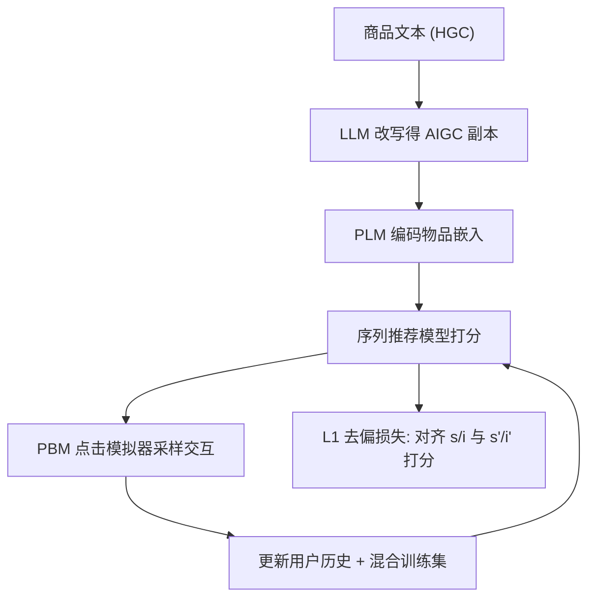
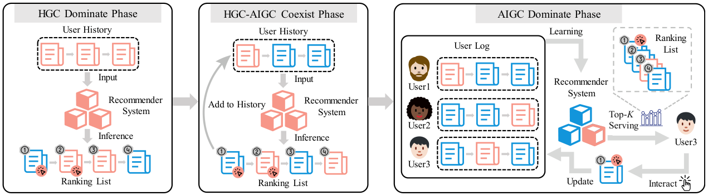

# Exploring the Escalation of Source Bias in User, Data, and Recommender System Feedback Loop (探究用户、数据与推荐系统反馈回路中来源偏见的升级)

- **会议/期刊**: SIGIR 2025
- **作者与机构**: Yuqi Zhou, Sunhao Dai, Liang Pang, Gang Wang, Zhenhua Dong, Jun Xu, Ji-Rong Wen（中国人民大学高瓴人工智能学院、中科院计算所、华为诺亚方舟实验室）
- **推荐链路定位**: 精排（序列推荐打分）
- **研究方向**: 去偏公平与工业架构 / 序列推荐
- **论文原文**: [https://arxiv.org/abs/2405.17998v2](https://arxiv.org/abs/2405.17998v2)
- **开源代码**: [https://github.com/Yuqi-Zhou/Rec_SourceBias](https://github.com/Yuqi-Zhou/Rec_SourceBias)

## TL;DR (1分钟核心速览)

本文针对 LLM 生成内容（AIGC）涌入推荐生态后引发的**来源偏见（Source Bias）**问题：序列推荐模型会系统性地把 AIGC 副本排在语义等价的人类原创内容（HGC）之前。作者构建了含真实点击模拟器的反馈回路环境，证明该偏见在「Top-K 曝光 → 用户交互 → 模型重训」的迭代中被逐步放大，最终导致 AIGC 垄断生态并使推荐性能下降。为此提出基于 L1 损失的黑盒去偏方法，在 Amazon 三域、四种序列模型上把相对 Δ 从 100+ 压至个位数，同时多数场景 NDCG 不降反升。

## Background & Motivation (背景与核心矛盾)

- **主流范式**: 现有 LLM4Rec 研究多关注「如何用 LLM 增强推荐」，而检索侧已有工作（Dai et al., Wang et al.）发现神经检索模型偏好低困惑度的 AIGC 文本，即来源偏见。
- **前人局限**: 其一，已有去偏工作（margin loss 类）只处理静态候选集，未考虑真实推荐系统的**反馈回路**；其二，在回路中 margin loss 会把模型推向另一个极端——HGC 垄断，同样造成生态崩塌。
- **核心洞察 (Key Insight)**: 作者将 AIGC 侵入划分为三阶段——HGC 主导（过去）、HGC-AIGC 共存（现在）、AIGC 主导（未来），并指出偏见会沿「候选集 $\mathcal{I}$→ 用户历史$s$→ 训练集$\mathcal{S}$」逐级污染、自我强化。
- **本文切入点**: 用位置点击模型（PBM）搭建可迭代的仿真反馈回路量化偏见升级，再用「对原文与 LLM 改写副本打分做 L1 对齐」的黑盒约束打断放大链条。

## Method (核心方法设计)

### 1. 整体框架 (Overall Architecture)

模型以商品文本描述经冻结 PLM（BERT/RoBERTa）平均池化得到 768 维物品嵌入，输入 GRU4Rec/SASRec/BERT4Rec/LRURec 做下一物品预测。核心闭环是**反馈回路仿真**：每轮用当前模型对混合候选集 $\mathcal{I}_H \cup \mathcal{I}_G$打分，经 PBM 点击模型$P(E=1|\text{rank}(i)=k)=k^{-\eta}$采样用户交互，将点击物品写回历史序列并按 AIGC 占比$p$ 调整历史混合比例，再用新数据重训模型，迭代 10–20 轮观察 Relative Δ 演化。去偏模块在训练损失中额外约束「原文 vs. 改写副本」的打分一致性。

<figure class="paper-figure" markdown="span">
  <figcaption>图 2：AIGC 融入推荐内容生态过程中出现三个阶段：HGC 主导阶段、HGC-AIGC 共存阶段和 AIGC 主导阶段。(1) HGC 主导阶段是 AIGC 刚涌入推荐系统且仅影响候选列表的过去时期。(2) HGC-AIGC 共存阶段是推荐模型输入𝑠包含越来越多 AIGC 的当前时期。(3) AIGC 主导阶段是 AIGC 影响反馈循环各阶段的未来时期。</figcaption>
</figure>

### 2. 关键设计拆解 (Key Designs)

1. **物品侧去偏损失 $\mathcal{L}_{\text{Debias-I}}$**：痛点是改写副本$i'$相对原文$i$获得了额外打分增益。做法是对每条训练三元组$(s_t, i_{t+1}, i'_{t+1})$ 施加 L1 惩罚：
$$\mathcal{L}_{\text{Debias-I}}=\sum_{s\in\mathcal{S}}\sum_{t=1}^{n-1}\left|f_\theta(s_t,i'_{t+1})-f_\theta(s_t,i_{t+1})\right|$$
直觉上 L1 只惩罚「差值」而非把某一方推高，因此不会像 margin loss 那样制造反向偏见，天然适配动态回路。

2. **历史侧去偏损失 $\mathcal{L}_{\text{Debias-U}}$**：痛点是历史编码器对含 AIGC 的序列$s'$ 整体打分偏高。除同样施加 L1 对齐外，额外最大化序列嵌入的熵以防不同历史坍缩到同一表示：
$$\mathcal{L}_{\text{Debias-U}}=\sum_{s\in\mathcal{S}}\sum_{t=1}^{n-1}\left|f_\theta(s'_t,i_{t+1})-f_\theta(s_t,i_{t+1})\right|+\mathrm{H}(\text{Softmax}(\text{Emb}(s'_t)))+\mathrm{H}(\text{Softmax}(\text{Emb}(s_t)))$$
熵项保证对齐的同时保留排序区分度（图 8 的 t-SNE 验证了嵌入分布更均匀）。

3. **训练目标与推理开销**：总损失 $\mathcal{L}=\mathcal{L}_{\text{ranking}}+\alpha\mathcal{L}_{\text{Debias-I}}+\beta\mathcal{L}_{\text{Debias-U}}$，其中$\mathcal{L}_{\text{ranking}}$ 可为对比或回归损失。方法为**黑盒**：无需判别内容来源，只需一次性用 LLM 改写全语料并预计算副本嵌入；推理阶段零额外开销，工程友好。

## Experimental Setup & Evaluation Protocol (实验设置与评估协议)

- **数据集与预处理**: Amazon 三域，剔除描述少于 20 词的商品，训练集过滤交互数 < 5 的用户与物品，每正样本随机采 4 个负样本。

| 数据集 | #Users | #Items | #Interactions | 特征/场景说明 |
| :--- | :---: | :---: | :---: | :--- |
| Health | 18,036 | 13,972 | 346,355 | 保健品评论文本 |
| Beauty | 11,391 | 11,897 | 198,502 | 美妆评论文本 |
| Sports | 16,639 | 13,089 | 296,337 | 运动品评论文本 |

- **数据划分与防穿越 (Splitting Strategy)**: 按目标商品评论时间排序后 **7:3 比例划分**训练/测试集。
- **排名评测协议 (Ranking Protocol)**: 测试候选集为 $\mathcal{I}_H\cup\mathcal{I}_G$（每条 HGC 配一条 AIGC 副本），采用**混合候选集全排序**；分别计算 HGC 与 AIGC 子集的 NDCG@{3,5}、MAP@{3,5}，用相对差$\text{Relative }\Delta=\frac{\text{Metric}_H-\text{Metric}_G}{(\text{Metric}_H+\text{Metric}_G)/2}\times100\%$度量偏见方向与强度（$\Delta<0$ 表示偏好 AIGC）。
- **对比基线与超参设置**: 基线为四种序列模型 × 两种 PLM（BERT/RoBERTa）共 8 组；AIGC 由 ChatGPT、Llama2、Mistral、Gemini-Pro 生成（temperature 0.2）；嵌入维度 768，batch 128，lr 1e-3，5 epoch，历史长度 10，5 个随机种子取均值。

## Key Experimental Results (实验关键数据)

### 1. 主实验对比 (Main Results)

HGC 主导阶段（BERT 编码器，ChatGPT 改写，Relative Δ 基于 NDCG@5）：

| 模型 | Health NDCG@5 (H / G) | Δ | Beauty NDCG@5 (H / G) | Δ | Sports NDCG@5 (H / G) | Δ |
| :--- | :---: | :---: | :---: | :---: | :---: | :---: |
| GRU4Rec | 41.18 / 48.74 | **-16.80** | 36.88 / 52.41 | **-34.78** | 41.12 / 58.92 | **-35.60** |
| SASRec | 32.74 / 47.60 | **-36.99** | 32.27 / 43.38 | **-29.38** | 34.91 / 52.73 | **-40.68** |
| BERT4Rec | 35.22 / 40.97 | **-15.09** | 30.31 / 43.52 | **-35.81** | 35.54 / 49.12 | **-32.06** |
| LRURec | 42.13 / 40.22 | +5.80 | 39.26 / 46.24 | **-16.35** | 42.31 / 49.40 | **-15.46** |

跨 LLM 泛化（表 3）：SASRec 在 Sports 上对 Llama2 生成内容 Δ 达 **-31.7**、Gemini-Pro 达 **-56.17**；ChatGPT 因与人类行为对齐更好，偏见幅度普遍最小。

反馈回路迭代（表 4，NDCG@3，Iter=1 → Iter=20）：GRU4Rec 在 Beauty 上从 -14.10 恶化至 **-60.18**，SASRec 在 Sports 上从 -44.19 恶化至 **-38.00** 并持续收敛至 AIGC 垄断；即便初始 Δ>0 的 Beauty 域也会在回路中翻转为强 AIGC 偏好。

### 2. 消融实验 (Ablation Study)

Average Absolute Δ（NDCG@5，越低越好）：

| 模型 | 完整 Debias | w/o Debias-U | w/o Debias-I |
| :--- | :---: | :---: | :---: |
| GRU4Rec | **6.45** | 8.07 (+1.62) | 130.00 (+123.55) |
| SASRec | **21.69** | 18.43 (-3.26) | 124.80 (+103.11) |
| BERT4Rec | **8.18** | 8.65 (+0.47) | 25.86 (+17.68) |
| LRURec | **8.97** | 29.72 (+20.75) | 122.30 (+113.33) |

去偏后排序性能（表 5）：GRU4Rec 在 Health/Beauty/Sports 上分别提升 **+4.12 / +3.17 / +4.32** NDCG@3，LRURec 提升 +1.36/+1.72/+0.03，仅 BERT4Rec 小幅下降（-0.54/-0.55/-1.65）。

### 3. 关键实验发现 (Key Findings)

1. **偏见具有跨模型、跨 LLM、跨域的普遍性**：8 组模型-编码器组合在 3 个域上绝大多数 Δ<0，且换用 Llama2/Mistral/Gemini 后偏见幅度更大（如 SASRec-Sports 对 Gemini 达 -56.17），说明这不是单一模型或单一生成器的偶然现象。
2. **反馈回路是偏见的放大器而非稳定器**：PBM 下 10 轮迭代后 |Δ| 单调上升并收敛至 AIGC 主导；换用 LR/NCM/TNCM 三种神经点击模型后放大更剧烈（图 5），证明结论对点击模型选择鲁棒。
3. **L1 对齐优于 margin 类去偏**：移除 $\mathcal{L}_{\text{Debias-I}}$后 Δ 反弹至 100+（LRURec 从 8.97 升至 122.30），说明物品侧对齐是主力；而$\mathcal{L}_{\text{Debias-U}}$的熵项防止历史嵌入坍缩，二者互补。系数$\alpha$ 增大时偏见下降但过大则排序性能受损，需权衡。

## Highlights & Limitations (亮点、对比与审稿批判)

- **与代表作对比 (vs. Prior Work)**: 相比 Dai et al. 与 Wang et al. 仅在静态检索候选集上度量来源偏见，本文首次把偏见放进「曝光-交互-重训」闭环并给出 20 轮演化证据；相比 margin-loss 去偏（会把生态推向 HGC 垄断），L1 对称惩罚在动态回路中保持双向中性。
- **可迁移亮点**: ①「LLM 改写全语料 + 打分一致性约束」的黑盒去偏范式无需来源标签，可直接迁移到多模态 AIGC 或 LLM 改写标题场景；②PBM 驱动的反馈回路仿真沙盒可作为评估任何去偏/公平算法的长期影响测试床。
- **审稿级局限批判**: ①仿真依赖 PBM 等点击模型假设，真实用户对 AIGC 的信任度与感知差异未被建模，回路结论的外部效度存疑；②去偏需一次性 LLM 改写全训练语料，语料规模大时预处理成本与存储开销不可忽视，且 $\alpha,\beta$ 需逐数据集调参。

## Rating (四维评分)

- **方法创新性 (Novelty)**: ⭐⭐⭐⭐ （首次系统刻画 AIGC 来源偏见在推荐反馈回路中的三阶段升级，L1 对称去偏思路简洁且有生态平衡的理论直觉）
- **评估协议与实验扎实度 (Protocol & Experiments)**: ⭐⭐⭐⭐ （三域 × 四模型 × 两 PLM × 四 LLM 生成器 + 四种点击模型交叉验证，Relative Δ 指标设计巧妙，但缺少真实线上 A/B）
- **写作与数学规范度 (Clarity & Rigor)**: ⭐⭐⭐⭐ （三阶段划分清晰、公式紧凑，Algorithm 1 完整给出回路流程；熵项与 L1 项的理论动机阐述略简）
- **工业落地与复现价值 (Industrial & Practical Value)**: ⭐⭐⭐⭐ （推理零额外开销、代码与数据集已开源，但全语料改写的前置成本与超参敏感性限制了即插即用性）

