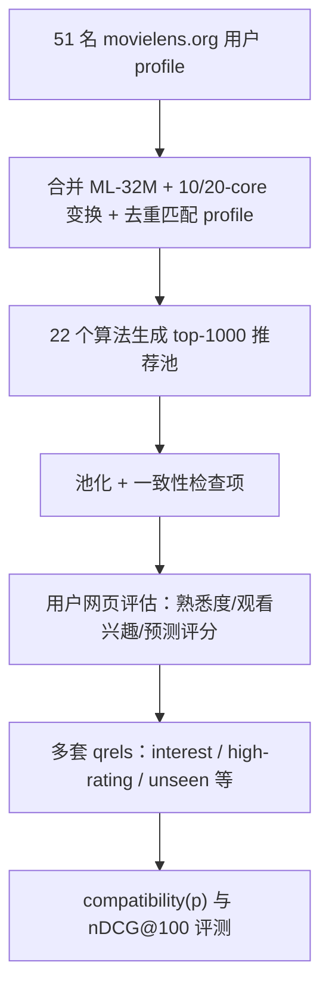

# Extending MovieLens-32M to Provide New Evaluation Objectives (扩展 MovieLens-32M 以提供新的评测目标)

- **会议/期刊**: SIGIR 2025
- **作者与机构**: Mark D. Smucker, Houmaan Chamani（University of Waterloo, 加拿大）
- **推荐链路定位**: 离线评测（召回/排序算法的评测协议层，非模型本身）
- **研究方向**: 去偏公平、可信隐私与工业架构 / 评测基准构建
- **论文原文**: [https://arxiv.org/abs/2504.01863v2](https://arxiv.org/abs/2504.01863v2)
- **开源代码**: [https://github.com/trec-health-misinfo/Compatibility](https://github.com/trec-health-misinfo/Compatibility)（数据集扩展见 [https://uwaterloo.github.io/datasets/ml-32m-extension](https://uwaterloo.github.io/datasets/ml-32m-extension)）

## TL;DR (1分钟核心速览)

本文直指推荐系统离线评测的根本错位：传统 train/test 划分把"预测用户已看过并打高分的电影"当作目标，而真实任务是"帮用户找到愿意看的电影"。作者借用 TREC 信息检索的**池化 (pooling) 评测法**，招募 51 名 movielens.org 真实用户，用 22 个异构算法生成推荐池并由用户本人评估"观看兴趣"，为 ML-32M 构建了 31,236 条偏好型相关性判断。核心发现：在传统 train/test 下 Popular 算法排 22 个 run 的第 11 名，而在池化+兴趣偏好评测下骤降至第 19 名，证明现有评测存在系统性流行度偏置。

## Background & Motivation (背景与核心矛盾)

- **主流范式**: 推荐评测沿用机器学习范式——将用户显式评分随机切分为 train/test，用 test 集评分作为相关性标签，以 nDCG 等 IR 指标衡量 top-n 排序。
- **前人局限**: ① **稀疏性**：test 集标签天然不完整，profile 越小越稀疏，Buckley & Voorhees 已证明标签越不全越难正确排序算法；② **流行度偏置**：热门物品被评分概率更高，因而更易进入 test 集，导致"推热门"被不合理地奖励（Bellogín 等指出）。
- **核心洞察 (Key Insight)**: 评测目标应是"预测用户**想看**的未评分电影"（watchlist 场景），而非"预测已看且高分"。用户本人对推荐结果的偏好判断天然吸收了所有决策因素，无需设计者替用户裁定"热门是否是好推荐"。
- **本文切入点**: 把推荐当作检索任务，用 Cranfield/TREC 池化范式重建测试集，让信息需求者本人做相关性判断。

## Method (核心方法设计)

### 1. 整体框架 (Overall Architecture)

流程为：招募 movielens.org 用户 → 获取其完整评分 profile → 与 ML-32M 合并并做 k-core 变换 → 用 22 个异构算法为每位参与者生成 top-1000 推荐（过滤掉其已评分项）→ 池化合并 → 用户在自建网站上逐条评估（熟悉度、观看兴趣、预测评分）→ 生成多套 qrels。关键工程细节：用 LensKit UserUser-kNN 以相似度 ≥0.85 匹配并**删除**参与者在 ML-32M 中的原始 profile，避免"自己匹配自己"污染推荐；并插入随机一致性检查项验证判断质量。

### 2. 关键设计拆解 (Key Designs)

1. **偏好型 qrels 与 compatibility 度量（替代评分等级）**：传统做法把 1–5 星当 gain 喂给 nDCG，但"3 星"与"5 星"的差值并无序数意义。本文改为**等价类偏好**：interest.qrels 取 0(不感兴趣)…4(极感兴趣)，再把用户自选 top-3 赋 5/6/7，同级内不可比。配合 compatibility 度量（persistence $p=0.98$）衡量排序与理想偏好序的一致性，仅对 qrels 中值$>0$ 的项计分，未判断项与"不感兴趣"同等忽略。直觉：偏好序只保留"谁优于谁"，避免把评分刻度误当效用。
2. **兴趣 × 低熟悉度的复合目标**：推荐系统的经典诉求是"帮用户发现不熟悉但会喜欢的东西"。作者在 interest.qrels 的每个偏好级**内部**按熟悉度升序重排，得到 interest-prefer-less-familiar.qrels——跨级仍以兴趣为主序，级内偏好更陌生的电影。这一目标把"推热门"的捷径彻底堵死。
3. **训练/推理与评测成本**：本文不训练新模型，22 个 run 覆盖 Popular、Bias(damping=5)、ItemKNN/UserKNN 多组参数、FunkSVD/BiasedMF/ImplicitMF、BPR、CDAE、EASE、MultiVAE、NeuMF、ADMMSLIM。评测侧用 trec_eval 算 nDCG@100、compatibility.py 算 compatibility；池化成本为 CAD$9,079.54、平均 20.3 秒/条判断，这是该方法的主要落地瓶颈。

## Experimental Setup & Evaluation Protocol (实验设置与评估协议)

- **数据集与预处理**: 原始 ML-32M 含 32,000,204 条评分 / 200,948 用户 / 87,585 电影；变换后（剔除 adult/TV/无效 TMDB id，电影 10-core、用户 20-core、再电影 10-core）为 31,741,309 条 / 200,727 用户 / 31,272 电影。隐式版（仅 ≥4 分且用户 ≥5 条）为 15,840,681 条 / 198,762 用户 / 30,545 电影。扩展部分新增 51 个 profile 与 31,236 条判断。

| 数据集 | #Users | #Items | #Interactions | 说明 |
| :--- | :---: | :---: | :---: | :--- |
| ML-32M 原始 | 200,948 | 87,585 | 32,000,204 | 显式评分 |
| ML-32M 变换后 | 200,727 | 31,272 | 31,741,309 | 10/20-core 过滤 |
| 隐式子集 | 198,762 | 30,545 | 15,840,681 | ≥4 分，MultiVAE/EASE 口径 |
| 扩展判断 | 51 | — | 31,236 | 池化相关性判断 |

- **数据划分与防穿越**: 传统基线用**分层随机 80/20 划分**（高/低评分各自分层，保证 ≥4.0 的 qrels 可构造）；池化评测则用"全 profile 训练 + 池化判断"的类 Cranfield 设定，推荐时过滤用户全部已评分项，避免穿越。
- **排名评测协议**: 池化侧为**全池排序**（每用户池深 phase1 ≥10、phase2 ≥50，实际平均判断 670.5 条），用 compatibility($p=0.98$)；train/test 侧用 nDCG@100。二者均以 TREC 格式经 trec_eval 计算。
- **对比基线与超参**: 22 个 run（见表 1 原文），Embedding 维度多为 250（BPR 为 2048），KNN 邻域数 1–120 多档；用 Kendall's $\tau$ 衡量 run 排序一致性，参照 Voorhees 的 0.9 阈值。

## Key Experimental Results (实验关键数据)

### 1. 主实验对比 (Main Results)

核心对比是同一批 51 名参与者在两种评测范式下的 run 排名（Kendall's $\tau=0.77$）：

| Run | Train/Test 排名 (nDCG@100, ≥4.0) | 池化排名 (compatibility, interest) | 排名变化 |
| :--- | :---: | :---: | :---: |
| 前四名 run（如 EASE/MultiVAE 类） | 1–4 | 1–4（顺序不变） | 0 |
| Bias (damping=5) | 低于 Popular | **高于 Popular** | 上升 |
| **Popular** | **11 / 22** | **19 / 22** | **↓8（最大跌幅）** |
| 其余 run 平均 | — | — | 平均绝对变化 2.2 |

在 interest-prefer-less-familiar 目标下，Popular 进一步跌至**全部 22 个 run 的末位**。

### 2. 消融实验 (Ablation Study)

本文为评测方法学研究，其"消融"体现为对三个混淆因素的逐一隔离：

| 隔离因素 | 对比设置 | 关键结果 |
| :--- | :--- | :--- |
| 用户群体差异 | 51 参与者 vs. 随机 10K ML-32M 用户（均 train/test） | $\tau=0.79$（≥4.0）/ 0.77（全评分），差异集中在下半区 run |
| 偏好 vs. 评分标签 | interest.qrels vs. high-rating.qrels（均池化） | $\tau=0.96$，可互换；但 vs. 全评分 rating.qrels 仅$\tau=0.67$ |
| 池化 vs. train/test | 同一 51 人、同一 ≥4.0 标签、同一 nDCG | Popular 从第 11 降至第 19，其余 run 平均仅动 2.2 位 |

### 3. 关键实验发现 (Key Findings)

1. **流行度偏置被定量坐实**：在完全控制用户群体与标签类型后，仅改变测试集构建方式（池化 vs. train/test），Popular 就下跌 8 位，是全部 run 中变化最剧烈者；而在"兴趣 + 偏好陌生"目标下它成为最差 run。这说明传统评测对"推热门"的奖励来自标签采集机制而非算法真实效用。
2. **评分标签与兴趣偏好在 ≥4.0 阈值下高度一致（$\tau=0.96$），但混入低分后急剧失配（$\tau=0.67$）**：因此作者明确建议 nDCG 类排序指标**不应**使用全评分 qrels，rating.qrels 只应用于 MAE 等评分预测任务——这与 Breese 等把中性以下评分置零的经典做法一致。
3. **传统 train/test 并未"坏掉"，只是有偏**：前四名 run 的顺序在两种范式下完全不变，说明该范式仍能识别较优算法；问题集中在中等及以下 run 的排序，尤其是依赖流行度的启发式。此外参与者是重度用户（平均评分 1425.1 条 vs. 随机用户 190.9 条，使用时长 7.8 年 vs. 10.5 个月），其评测结论更贴近"老用户"场景。

## Highlights & Limitations (亮点、对比与审稿批判)

- **与代表作对比 (vs. Prior Work)**: 相较 Rossetti 等（100 名学生、4 个算法、池深 5、MovieLens-1M），本文用 22 个 run、池深 50、ML-32M 且招募真实站点用户，规模与生态效度显著提升；相较 Bellogín 等对 train/test 的事后校正方法，本文从**测试集构建源头**消除偏置，更直接；相较 Cañamares & Castells 的随机众包判断，本文保留真实 profile 作为查询上下文，更贴近实际推荐场景。
- **可迁移亮点**: ① "偏好等价类 + compatibility"可替代 nDCG 用于任何有分级偏好的排序评测，规避 gain 刻度假设；② 用一致性检查项（混入用户历史评分项）低成本检测众包/招募评估者的敷衍作答，可直接复用到任何人工评测流程。
- **审稿级局限批判**: ① **池化未闭合**：受 10/20-core 过滤影响，被剔除的电影根本无机会进入池中，未判断项被当作不相关，存在池化偏置；② **样本与成本**：仅 51 名北美成年重度用户，代表性有限，且单条判断 20.3 秒、总花费约 9 千加元，难以规模化复现；③ 多个衍生 qrels（如 prefer-less-familiar）尚未经用户研究验证是否真为用户偏好。

## Rating (四维评分)

- **方法创新性 (Novelty)**: ⭐⭐⭐⭐ （将 TREC 池化范式系统性迁移至推荐评测，思路不新但落地扎实，偏好等价类 + compatibility 的组合有方法论价值）
- **评估协议与实验扎实度 (Protocol & Experiments)**: ⭐⭐⭐⭐⭐ （三因素逐一隔离、Kendall's $\tau$ 量化、一致性检查与防 profile 泄漏处理均严谨，是评测类论文的范本）
- **写作与数学规范度 (Clarity & Rigor)**: ⭐⭐⭐⭐ （qrels 体系用两张表清晰罗列，公式需求低；部分实现细节外推到作者博士论文，正文自洽性略打折）
- **工业落地与复现价值 (Industrial & Practical Value)**: ⭐⭐⭐⭐ （数据集与 compatibility 工具均开源，可直接替换现有离线评测；但人工判断成本高，工业界更可能借鉴其"兴趣优先 + 去流行度"的指标设计而非全量池化）

