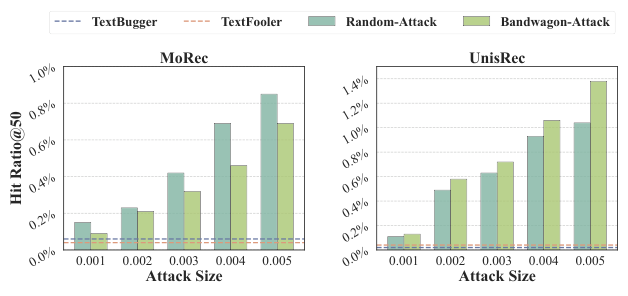
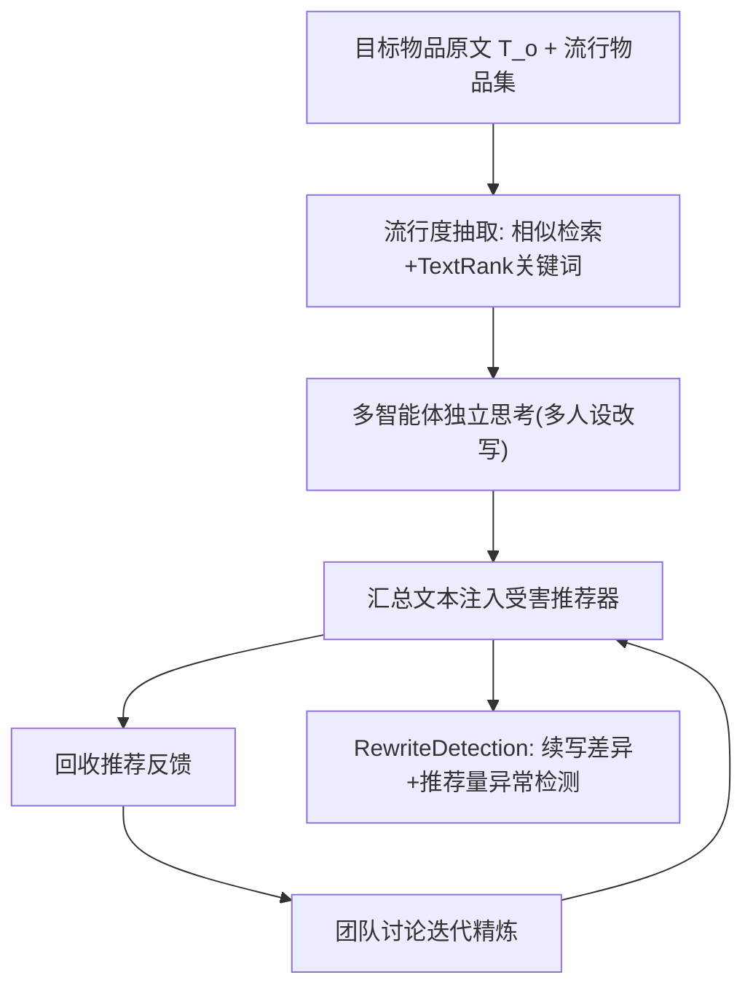

# ID-Free Not Risk-Free: LLM-Powered Agents Unveil Risks in ID-Free Recommender Systems (无ID并非无风险：LLM智能体揭示无ID推荐系统的隐患)

- **会议/期刊**: SIGIR 2025
- **作者与机构**: Zongwei Wang, Min Gao (重庆大学); Junliang Yu, Xinyi Gao, Shazia Sadiq, Hongzhi Yin (昆士兰大学); Quoc Viet Hung Nguyen (格里菲斯大学)
- **推荐链路定位**: 召回（无ID文本表征召回）
- **研究方向**: 去偏公平、可信隐私与工业架构 / 大语言模型推荐
- **论文原文**: [论文原文链接](https://arxiv.org/abs/2409.11690v3)
- **开源代码**: [Gemma-2B 模型仓库](https://huggingface.co/google/gemma-1.1-2b-it)（论文本身未开源攻击/检测代码）

## TL;DR (1分钟核心速览)

无ID推荐器（MoRec/UnisRec/ZESRec/Recformer）依赖LLM文本编码缓解冷启动，但其抗攻击鲁棒性此前无人系统评估。本文先实证：注入攻击需 >0.1% 恶意用户（成本过高），传统文本攻击（TextBugger/TextFooler）Hit@50 不足 0.1%（几乎无效）。据此提出 **TextSimu**——用"流行度关键词抽取 + 多智能体独立思考/团队讨论"的改写式黑盒攻击，仅改目标物品文本即可在 Beauty 上把 Recformer 的 Hit@50 从 0.0588（ATR-2FT）推至 **0.0742**；并配套 **RewriteDetection** 检测器，F1 达 **0.93–0.96**，显著超越微调 LLM 基线。

## Background & Motivation (背景与核心矛盾)

- **主流范式**: 无ID推荐用 LM/LLM 将物品文本编码为表征 $Z_T=f_{LM}(T)$ 替代 ID 查表，使新物品凭语义相似度直接匹配用户，天然缓解冷启动。
- **前人局限**: ① 注入攻击（Random/Bandwagon）虽有效，但需注入超总用户 0.1% 的恶意档案，预算不可行且易被防御；② NLP 迁移来的文本攻击（TextBugger/TextFooler）只做字符/同义词微扰，被推荐编码器"平滑掉"，Hit@50 几乎为 0。
- **核心洞察 (Key Insight)**: NLP 攻击者需"隐蔽微扰"，而推荐场景中物品文本由商家（攻击者）**完全掌控**，可做大幅改写；且流行物品文本天然浓缩了系统偏好的语言风格与用户共性偏好——**模仿流行文本即可被模型青睐**。
- **本文切入点**: 把"文本改写"从微扰升级为"向流行物品语义模拟"，用 LLM 多智能体在仅有推荐反馈的黑盒下迭代精炼恶意文案。

<figure class="paper-figure" markdown="span">
  <figcaption>图2：在Beauty数据集上针对无ID推荐的文本攻击与注入攻击对比。攻击规模表示恶意用户数量与总用户数量之比。</figcaption>
</figure>

## Method (核心方法设计)

### 1. 整体框架 (Overall Architecture)

攻击侧 TextSimu 分三步闭环：先由 Gemma-2B 编码目标物品与流行物品文本、按余弦相似度检索参考集并抽取统一流行关键词；再将"原始文本 + 参考文本 + 关键词"注入带不同人设的多个 LLM 智能体，各自独立改写并汇总；汇总文本投入受害推荐器，用少量用户查询回收推荐反馈，进入团队讨论轮次迭代改写，直至反馈达标或轮数耗尽。防御侧 RewriteDetection 将文本切为 $T_x,T_y$，令 LLM 依$T_x$续写$T_y$ 多次，比对 n-gram 相似度与推荐量差异判定恶意。整体无需任何交互注入，攻击成本近乎为零。

### 2. 关键设计拆解 (Key Designs)

1. **统一流行度抽取（Unified Popularity Extraction）**：单条参考文本无法覆盖流行物品的共性特征。做法是取最相似的 50 个流行物品，构建 token 共现图并用 TextRank 抽关键词，再由 LLM 过滤通用词保留"吸睛词"，拼入提示。直觉：关键词是跨流行物品的高频共现属性，等价于对"系统偏好分布"做了一次无梯度估计，使改写方向对齐全局流行语义而非单点过拟合。

2. **多智能体协作（Independent Thinking + Team Discussion）**：单次 LLM 输出方差大、风格单一。独立阶段给 5 个不同人设智能体各自改写并存入记忆模块，汇总后投测；讨论阶段每轮随机选一个智能体，令其审阅历史改写与上轮推荐反馈，自主决定是否发言并提交修订版。核心是**以推荐反馈为唯一监督信号的黑盒迭代优化**，等价于用 LLM 先验替代梯度做离散文本空间的搜索，人设多样性则扩大候选覆盖面。

3. **训练目标、负采样与推理开销**：攻击侧无显式损失，形式化为双层优化 $\mathcal{T}_M^{*}=\arg\max_{\mathcal{T}_M}\mathcal{R}_{attack}(g(\mathcal{T}_o,\Theta^{*}))$，s.t.$\Theta^{*}=\arg\min_\Theta\mathcal{L}_{rec}(f_{rec}(\mathcal{D},f_{LM}(\mathcal{T})))$；黑盒下内层不可见，故用反馈驱动替代。检测侧打分$S=S_A+\beta S_R$，其中$S_A=\frac{1}{K}\sum_k\sum_{n=n_0}^{N}\frac{|grams(\hat{T}_y^k,n)\cap grams(T_y,n)|}{|grams(T_y,n)|}$度量 LLM 续写一致性，$S_R=\frac{1}{K}\sum_k\frac{|recnum(T_y)-recnum(\hat{T}_y^k)|}{reclistnum}$度量推荐量异常，$S>\epsilon$判恶意。攻击需多轮 LLM 调用与推荐查询，离线成本可控但非实时；检测需$K$次续写，推理开销为$O(K)$ 次 LLM 前向。

## Experimental Setup & Evaluation Protocol (实验设置与评估协议)

- **数据集与预处理**: Amazon 三域，未做 5-core 过滤（原文仅给原始统计）：

| 数据集 | #Users | #Items | #Interactions | 密度 | 场景说明 |
| :--- | :---: | :---: | :---: | :---: | :--- |
| Beauty | 13,952 | 9,247 | 20,663 | 0.016% | 美妆，最稠密 |
| Instrument | 143,843 | 77,031 | 231,093 | 0.002% | 乐器，中等 |
| Office | 640,066 | 202,514 | 567,040 | 0.001% | 办公，最稀疏 |

- **数据划分与防穿越 (Splitting Strategy)**: 按 **7:1:2 比例划分**训练/验证/测试；毒化文本仅注入训练集影响模型训练，测试集保持干净，属标准投毒评估设定。
- **排名评测协议 (Ranking Protocol)**: 攻击效果用 **Hit Ratio@50 与 NDCG@50**（目标物品进入 Top-50 的频率与位次），目标物品取自交互量末 90% 的冷门组（原始推荐机会近零）；检测用 Precision/Recall/F1 二分类，阈值 $\epsilon=0.1$，5 次重复取均值。
- **对比基线与超参设置**: 受害模型 4 个（MoRec/ZESRec/UnisRec/Recformer）；攻击基线 5 个（Copycat/TextBugger/TextFooler/TextRecAttack/ATR-2FT）；默认 GPT-4o mini，人设数 5，关键词 20，检测器用 Gemma-2B。

## Key Experimental Results (实验关键数据)

### 1. 主实验对比 (Main Results)

Hit Ratio@50（NDCG@50 乘 $10^{-3}$，此处仅列 Hit@50，最优加粗）：

| 数据集 | 受害模型 | Copycat | TextBugger | TextFooler | TextRecAttack | ATR-2FT | **TextSimu** | Improv.(vs 次优) |
| :--- | :--- | :---: | :---: | :---: | :---: | :---: | :---: | :---: |
| Beauty | MoRec | 0.0022 | 0.0006 | 0.0004 | 0.0046 | 0.0087 | **0.0281** | +223% |
| Beauty | UnisRec | 0.0046 | 0.0010 | 0.0008 | 0.0103 | 0.0314 | **0.0511** | +62.7% |
| Beauty | Recformer | 0.0064 | 0.0014 | 0.0012 | 0.0294 | 0.0588 | **0.0742** | +26.2% |
| Instrument | UnisRec | 0.0051 | 0.0011 | 0.0015 | 0.0086 | 0.0213 | **0.0512** | +140% |
| Instrument | Recformer | 0.0090 | 0.0012 | 0.0018 | 0.0096 | 0.0345 | **0.0544** | +57.7% |
| Office | UnisRec | 0.0012 | 0.0003 | 0.0005 | 0.0042 | 0.0064 | **0.0101** | +57.8% |
| Office | Recformer | 0.0015 | 0.0009 | 0.0012 | 0.0044 | 0.0076 | **0.0125** | +64.5% |

### 2. 消融与扩展实验 (Ablation & Variants)

| 变体 | Beauty-MoRec | Beauty-Recformer | Instrument-Recformer | 说明 |
| :--- | :---: | :---: | :---: | :--- |
| TextSimu（完整） | 0.0281 | 0.0742 | 0.0544 | 黑盒基线 |
| + Random-Attack | 0.0337 | 0.0989 | 0.0782 | 叠加注入 |
| + Bandwagon-Attack | 0.0313 | 0.0995 | 0.0671 | 叠加注入 |
| TextSimu$_{Gemma}$ | 0.0181 | 0.0643 | 0.0498 | 换小模型生成 |
| TextSimu$_{LLaMa}$ | 0.0258 | 0.0857 | — | 换强模型生成 |

检测对比（F1）：Beauty 上 Gemma-2B 零样本 0.6666、微调 0.8471、ChatGLM 微调 0.8754，**RewriteDetection 0.9312**；Instrument 0.9481、Office 0.9563，均全面领先。

### 3. 关键实验发现 (Key Findings)

1. **攻击效果与模型对文本的依赖度正相关**：Recformer > UnisRec > ZESRec > MoRec 的攻击成功率排序，恰与其文本表征占比一致（Beauty 上 Recformer 0.0742 vs MoRec 0.0281，差 2.6 倍），说明无ID范式越纯粹，文本投毒面越大。
2. **改写式攻击对传统文本攻击是数量级碾压**：TextBugger/TextFooler 全场景 Hit@50 ≤ 0.0018，而 TextSimu 最低也有 0.0088，差距达 5–40 倍，验证"微扰被编码器平滑、大幅语义模拟才穿透"的动机判断。
3. **黑盒已足够、注入可叠加但非必需**：换 Gemma-2B 生成仍达 Recformer 0.0643（仅比 GPT-4o mini 低 13%），说明核心增益来自"模拟流行语义"而非模型规模；叠加 Bandwagon 可再提至 0.0995，但单独 TextSimu 已实现零注入成本下的强攻击。

## Highlights & Limitations (亮点、对比与审稿批判)

- **与代表作对比 (vs. Prior Work)**: 相较 TextRecAttack（贪心词替换、需注入交互）与 ATR-2FT（微调 LLM 改写但无流行度引导、无反馈闭环），TextSimu 首次把"流行物品语义模拟 + 多智能体反馈迭代"引入推荐文本攻击，且完全黑盒、零交互注入；相较注入类 SGLD/GSPAttack，成本从"0.1% 用户"降到"仅改一段文本"。
- **可迁移亮点**: ① "检索流行集→TextRank 抽关键词→注入提示"是一种无需梯度的偏好分布估计，可迁移到冷启动物品的文案增强与生成式推荐的语义 ID 构造；② RewriteDetection 的"分段续写一致性 + 推荐量异常"双信号，可复用于评论刷单与 AIGC 文案审核。
- **审稿级局限批判**: ① 攻击依赖多轮 LLM 调用与推荐查询，单物品攻击的时延/费用未量化，且"少量用户查询"在真实系统可能触发风控；② 检测阈值 $\epsilon=0.1$与$\beta$ 的敏感性、对非 TextSimu 类改写的泛化性均未充分讨论，且检测器本身用 Gemma-2B，存在"用 LLM 检测 LLM"的对抗升级风险。

## Rating (四维评分)

- **方法创新性 (Novelty)**: ⭐⭐⭐⭐ （首次系统揭示无ID推荐文本投毒面，多智能体反馈闭环改写思路新颖，但单点技术多为已有组件的巧妙组合）
- **评估协议与实验扎实度 (Protocol & Experiments)**: ⭐⭐⭐⭐ （三域四模型五基线覆盖充分、5 次重复，但缺 5-core 过滤说明与攻击成本/时延的定量分析）
- **写作与数学规范度 (Clarity & Rigor)**: ⭐⭐⭐⭐ （双层优化与检测打分定义清晰，攻击侧缺形式化收敛/最优性讨论）
- **工业落地与复现价值 (Industrial & Practical Value)**: ⭐⭐⭐⭐ （攻击零注入成本、检测可直接嵌入内容审核链路，但攻击/检测代码未开源，复现依赖商用 LLM）

