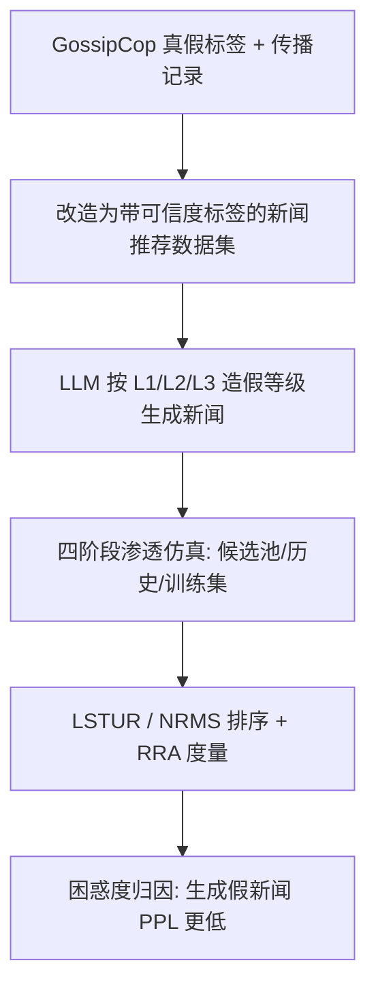

# LLM-Generated Fake News Induces Truth Decay in News Ecosystem: A Case Study on Neural News Recommendation (LLM 生成假新闻诱发新闻生态中的真相衰减：基于神经新闻推荐的案例研究)

- **会议/期刊**: ACM SIGIR 2025 (Full Paper)
- **作者与机构**: Beizhe Hu, Qiang Sheng, Juan Cao, Yang Li, Danding Wang（中科院计算所媒体合成与取证实验室 / 国科大）
- **推荐链路定位**: 精排（新闻候选打分排序）+ 训练数据污染分析
- **研究方向**: 去偏公平、可信隐私与工业架构 / 大语言模型推荐 (LLM4Rec)
- **论文原文**: [https://arxiv.org/abs/2504.20013v2](https://arxiv.org/abs/2504.20013v2)
- **开源代码**: 暂未开源（项目主页 https://beanandrew.github.io/projects/TruthDecay）

## TL;DR (1分钟核心速览)

本文首次把"LLM 生成假新闻"从个体检测问题升级为**生态系统级排序公平问题**：作者改造 GossipCop 构建约 7.5 万条人机混合新闻推荐数据集，按 LLM 介入程度定义 L0–L3 造假等级，并在候选列表、用户历史、训练集三个阶段逐步注入生成新闻。在 LSTUR/NRMS 两个经典模型、20 候选列表的排序协议下，真实新闻相对假新闻的排序优势（RRA）从基线 +7%~+37% 被压缩至接近 0 甚至转负（L2 等级下 RRA 跌至 -0.80%），即所谓 **Truth Decay**。作者进一步用 BERT 困惑度解释：生成假新闻 PPL 更低、被骨干 PLM 更"熟悉"，因而获得排序偏爱。

## Background & Motivation (背景与核心矛盾)

- **主流范式**: 新闻推荐因新闻池高速更新、协同信号稀疏，主流采用**基于内容的神经新闻推荐**（NRMS、LSTUR 等），以预训练语言模型编码新闻、注意力聚合用户历史，再对候选列表打分排序。
- **前人局限**: ① 已有假新闻研究聚焦**个体检测**（人写假新闻或单条 LLM 假新闻的可检测性），未回答"大规模释放后推荐系统会怎样"；② 已有 LLM 文本传播研究（如 RAG 生态中的生成文本支配）未触及**可信度维度**——即生成文本是否会让假新闻在排序中反超真实新闻。
- **核心洞察 (Key Insight)**: 作者发现推荐系统对"人写真实新闻"存在天然防御（真实新闻排序恒高于假新闻），但这一防御建立在**语言模型对真实文本更熟悉（PPL 更低）**的隐性信号上；LLM 生成文本恰恰在流畅度/困惑度上更"讨喜"，于是防御机制被反向利用。
- **本文切入点**: 用可控仿真把生成新闻分别注入候选池、交互历史、训练集，量化每个阶段真实新闻排序优势的衰减，并用困惑度给出机制解释。

## Method (核心方法设计)

### 1. 整体框架 (Overall Architecture)

本文不是提出新推荐模型，而是提出一套**数据构建 + 分阶段渗透仿真 + 机制归因**的研究框架。数据侧：以 GossipCop 的真假标签与 Twitter 传播记录改造出带可信度标签的新闻推荐数据集，再用 gpt-4o-mini 与 Llama-3.1 按 L1/L2/L3 三种造假等级生成约 5.6 万条生成新闻（合计约 7.5 万条新闻）。仿真侧：固定 LSTUR/NRMS 两个骨干，按"生成新闻出现在何处"划分四个阶段（Nowhere → Candidates → History → Training Data），逐级测量真实/假新闻的排序指标与相对优势 RRA。归因侧：用骨干 PLM 的困惑度分布解释排序偏好迁移。

### 2. 关键设计拆解 (Key Designs)

1. **LLM 新闻生成分级分类法 (L0–L3 Taxonomy)**：痛点在于"LLM 生成新闻"缺乏可系统描述的口径。作者按 LLM 介入程度定义四级：L0 纯人写；L1 人类辅助（仅改写措辞、保留内容风格）；L2 部分自动化（改写风格使其"更有说服力"、核心内容不变）；L3 条件自动化（仅给标题与关键句，自由创作）。该分级把"造假强度"变成可控实验变量，使后续能观察"介入越深、危害越大"的单调趋势（L3 的 Truth Decay 最显著）。

2. **相对真实优势 RRA 指标**：常规 MRR/nDCG 无法直接刻画"真假新闻的相对位次"。作者定义
$$\mathrm{RRA}=\frac{\mathrm{Metric}_{\text{real}}-\mathrm{Metric}_{\text{fake}}}{\mathrm{Metric}_{\text{fake}}}\times 100\%$$
其中 Metric 可取 MRR、nDCG@K 或 Ratio@K；计算时把候选列表中属于目标类型的新闻标签置 1、其余置 0。RRA > 0 表示真实新闻占优，< 0 表示假新闻反超。该指标把"生态健康度"压缩为单一可追踪标量，是全文结论的核心度量。

3. **训练目标、负采样与推理效率**：本文沿用骨干模型原生训练目标（NRMS/LSTUR 的点击预测交叉熵），未引入新损失。候选列表构造上采用**受控混合负采样**：列表长度 $K=20$，若目标为真实新闻则含$K/2-1$条真实 +$K/2$条假新闻，反之亦然，保证真假各半的公平对比；历史长度截断为 10，最小历史$H_{\min}=4$。推理为对 20 条候选全排序，开销与常规新闻精排一致，无额外在线成本。

## Experimental Setup & Evaluation Protocol (实验设置与评估协议)

- **数据集与预处理**: 基于 GossipCop 改造，过滤交互数 < 5 的用户，随机抽取 5,000 名用户；每用户最多保留 10 个连续序列实例。

| 数据集 | #Users | #Items(Real/Fake) | #Interactions | 稀疏度/密度 | 特征/场景说明 |
| :--- | :---: | :---: | :---: | :---: | :--- |
| GossipCop-Rec | 5,000 | 18,840 (14,248/4,592) | 46,910 | 极稀疏 | 人写新闻 + 两模型各 28,024 条生成新闻；训练/验证/测试 = 18,761/2,346/2,345 |

- **数据划分与防穿越 (Splitting Strategy)**: **全局时间戳切分**——最近 20% 交互作验证/测试，较早 80% 作训练，避免训练与测试时间重叠。
- **排名评测协议 (Ranking Protocol)**: 受控候选列表排序（$K=20$，真假各半），报告 MRR、nDCG@5/10、Ratio@5/10 及 RRA；非全库 Full-Ranking，但通过真假配额控制保证类型间可比。
- **对比基线与超参设置**: 骨干为 LSTUR（CNN 400 滤波器、窗口 3）与 NRMS（8 头自注意力、每头 8 维），文本编码器 bert-base-uncased（768 维、参数冻结），dropout 0.2，Adam，batch 16，10 epoch + 早停，5 个随机种子重复。

## Key Experimental Results (实验关键数据)

### 1. 主实验对比 (Main Results)

Phase 0（纯人写数据）下真实新闻的排序优势（RRA，正值为真实占优）：

| 模型 | MRR | nDCG@5 | nDCG@10 | Ratio@5 | Ratio@10 |
| :--- | :---: | :---: | :---: | :---: | :---: |
| LSTUR (HF→HR) | 17.15→18.83 | 45.63→54.37 | 43.91→56.09 | 43.37→56.62 | 42.11→57.89 |
| **RRA** | **+9.80%** | **+19.15%** | **+27.74%** | **+30.55%** | **+37.47%** |
| NRMS (HF→HR) | 17.36→18.62 | 46.28→53.72 | 44.84→55.17 | 43.98→56.02 | 43.10→56.90 |
| **RRA** | **+7.26%** | **+16.08%** | **+23.04%** | **+27.38%** | **+32.02%** |

Phase 1（生成新闻进入候选池）下 RRA 相对基线的变化（Ratio@5 口径）：

| 生成器 | 模型 | L1 | L2 | L3 |
| :--- | :--- | :---: | :---: | :---: |
| Llama-3.1 | LSTUR | 13.51% (-17.04%) | **-0.80% (-31.35%)** | 13.70% (-16.85%) |
| Llama-3.1 | NRMS | 9.42% (-17.96%) | **-0.58% (-27.96%)** | 8.88% (-18.50%) |
| gpt-4o-mini | LSTUR | 16.92% (-13.63%) | 10.72% (-19.83%) | 22.99% (-7.56%) |
| gpt-4o-mini | NRMS | 13.58% (-13.80%) | 3.92% (-23.46%) | 26.30% (-1.08%) |

### 2. 消融实验 (Ablation Study)

本文无传统模块消融，等价消融为**渗透阶段/造假等级/LLM 比例**的因子分析：

| 配置 | 关键观测（Ratio@5 口径） | 结论 |
| :--- | :--- | :--- |
| Phase 0（无生成新闻） | RRA +27%~+37% | 真实新闻天然占优 |
| Phase 1 仅候选池注入 | RRA 降 7.6%~31.4% | 单次曝光即削弱优势 |
| Phase 2 历史注入（LLM ratio 0→1） | L2/L3 下 RRA 随比例持续下降 | 历史污染加剧衰减 |
| Phase 3 训练集注入 | L3 下假新闻 Ratio@5 反超真实 | 训练污染最致命 |
| 造假等级 L1→L3 | 衰减幅度单调增大 | 介入越深危害越大 |

### 3. 关键实验发现 (Key Findings)

1. **真实新闻的"天然防御"会被生成新闻迅速瓦解**：Phase 0 中 LSTUR 的 Ratio@5 RRA 高达 +30.55%，仅把生成假新闻放入候选池（Phase 1），Llama-3.1 的 L2 等级即把 RRA 打到 -0.80%，真实新闻彻底失去排序优势。
2. **训练集污染是最危险路径**：Phase 3 中随 LLM ratio 上升，L3 等级下假新闻的 Ratio@5 最终反超真实新闻，说明模型重训练会把"偏爱生成文本"固化进参数，而非仅是一次性曝光偏差。
3. **困惑度是机制钥匙**：人写新闻中真实新闻 PPL 更低（与真实占优一致），而生成假新闻 PPL 低于生成真实新闻，且造假等级越高 PPL 越低——这解释了为何 L3 的 Truth Decay 最严重：骨干 PLM 对"更自由生成"的文本更熟悉，从而给出更高分。

## Highlights & Limitations (亮点、对比与审稿批判)

- **与代表作对比 (vs. Prior Work)**: 相比 Wang et al. (2022/2024b) 的"可信度感知推荐"（在模型内加真假分类器），本文不设计新模型而是**诊断生态级失效**；相比 Dai et al. (2024) 发现"信息系统偏爱 LLM 文本"，本文把偏爱从"性能现象"推进到"可信度后果"；相比 Chen et al. (2024) 的 RAG 生态支配研究，本文聚焦新闻推荐这一高社会风险场景。
- **可迁移亮点**: ① RRA 这一"类型间相对优势"指标可直接迁移到任何双边公平/可信度审计场景（如流行度去偏、创作者公平）；② "分阶段渗透 + 分级生成"的仿真范式可复用到电商虚假评论、短视频低质内容治理。
- **审稿级局限批判**: ① 仅覆盖 LSTUR/NRMS 两个 2019 年经典模型，未测 LLM-based 生成式推荐，结论外推性受限；② 候选列表固定 $K=20$ 且真假各半，与真实工业全库排序分布差异较大，RRA 的绝对量级可能被高估；③ 未验证对人类真实观看行为的影响，仿真到现实的链路仍缺一环。

## Rating (四维评分)

- **方法创新性 (Novelty)**: ⭐⭐⭐⭐ （不提出新模型，但"Truth Decay"问题定义、L0–L3 分级与 RRA 指标构成有价值的新研究范式）
- **评估协议与实验扎实度 (Protocol & Experiments)**: ⭐⭐⭐⭐ （四阶段因子仿真 + 5 种子 + 人工标注校验标签，但候选列表受控构造偏离真实分布）
- **写作与数学规范度 (Clarity & Rigor)**: ⭐⭐⭐⭐ （RRA 定义简洁、阶段划分清晰，机制解释以相关性为主、缺因果验证）
- **工业落地与复现价值 (Industrial & Practical Value)**: ⭐⭐⭐⭐ （数据集与仿真流程对平台可信治理有直接警示价值，但代码未开源、结论需线上验证）

