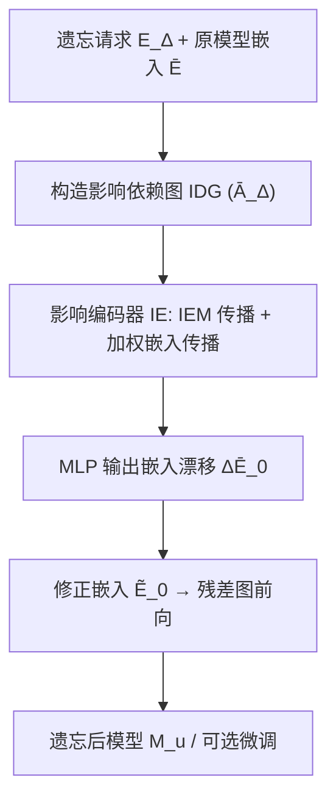

# Pre-training for Recommendation Unlearning (面向推荐系统遗忘的预训练范式)

- **会议/期刊**: SIGIR 2025 (Oral)
- **作者与机构**: Guoxuan Chen, Lianghao Xia, Chao Huang (The University of Hong Kong)
- **推荐链路定位**: 召回（图协同过滤模型的后处理遗忘）
- **研究方向**: 去偏公平、可信隐私与工业架构 / 图神经网络与知识图谱推荐
- **论文原文**: [论文原文链接](https://arxiv.org/abs/2505.22649v2)
- **开源代码**: [开源代码仓库链接](https://github.com/HKUDS/UnlearnRec)

## TL;DR (1分钟核心速览)

GNN 推荐模型面临 GDPR 等法规的"被遗忘权"要求，需删除特定交互而不重训。现有分区法破坏图拓扑、影响函数法在自监督 GNN 上假设失效。本文提出 UnlearnRec：预训练一个影响编码器（IE），将遗忘请求构造为影响依赖图，直接预测嵌入漂移 $\Delta\bar{\mathbf{E}}_0$，配合少量微调即可完成遗忘。在 3 数据集 × 3 骨干的 Full-Ranking 评测下，MI-NG 普遍 >1（如 ML-1M+SGL 达 9.37），精度逼近重训，且遗忘耗时较重训加速 10x 以上（0.31s vs 1208s）。

## Background & Motivation (背景与核心矛盾)

- **主流范式**: 以 LightGCN/SGL/SimGCL 为代表的 GNN 协同过滤通过多层邻域聚合建模交互图，自监督对比学习（SSL）进一步成为 SOTA 标配。
- **前人局限**: ① 分区法（GraphEraser/RecEraser）切图破坏拓扑，精度下降且跨分片请求耗时剧增；② 影响函数法（GIF/CEU）依赖二阶梯度与数学近似假设，在 SSL 的随机视图/随机结构下梯度估计失真，且显存开销巨大。
- **核心洞察 (Key Insight)**: 从 BPR 梯度可推出，遗忘一条正边等价于对用户嵌入施加一个沿正物品嵌入方向的补偿梯度，即 $\bar{\mathbf{e}}_i^{(u)}\approx\bar{\mathbf{e}}_i^{(t)}-\tilde{c}_{i,j^+}\bar{\mathbf{e}}_{j^+}^{(t)}$，多条请求叠加后恰为"遗忘边邻接矩阵"对嵌入的线性滤波。
- **本文切入点**: 把遗忘视为"给定请求图 $\bar{\mathbf{A}}_\Delta$ 预测嵌入漂移"的可学习映射，用预训练编码器替代手工影响函数。

## Method (核心方法设计)

### 1. 整体框架 (Overall Architecture)

模型分两阶段：预训练阶段随机采样模拟遗忘集 $\mathcal{E}_\Delta^{(s)}$构造影响依赖图（IDG），训练影响编码器 IE 输出修正后的 0 层嵌入$\tilde{\mathbf{E}}_0$，再喂入原推荐模型$\mathcal{M}$前向；微调阶段真实请求到达后，仅更新 IE 中 MLP 与$\mathbf{E}_0$少量参数。推理时直接以$\tilde{\mathbf{E}}_0$与残差图$\bar{\mathbf{A}}_r$重建遗忘后模型$\mathcal{M}_u$。

### 2. 关键设计拆解 (Key Designs)

1. **影响依赖矩阵 IDM 与图传播**：由 Eq.13-14 的梯度补偿推导，遗忘影响可写成 $\bar{\mathbf{E}}^{(u)}\approx\bar{\mathbf{E}}^{(t)}-(\tilde{\mathbf{C}}\odot\bar{\mathbf{A}}_\Delta)\cdot\bar{\mathbf{E}}^{(t)}$，其中$\bar{\mathbf{A}}_\Delta$即遗忘边构成的对称邻接矩阵。IE 在其上做$L_u$层传播得到可训练影响估计矩阵$\bar{\mathbf{H}}=\sum_{l=0}^{L_u-1}\mathbf{H}_l$，$\mathbf{H}_l=\mathbf{D}_\Delta^{-\frac{1}{2}}\bar{\mathbf{A}}_\Delta\mathbf{D}_\Delta^{-\frac{1}{2}}\mathbf{H}_{l-1}$，从而把多跳依赖注入影响向量；同时对固定嵌入做带可学习权重$\mathbf{W}_\eta$的同图传播得$\bar{\mathbf{E}}_w$。直觉：IDG 充当低通滤波器，把"哪些节点被这条遗忘边波及"结构化地编码进来。

2. **漂移合成与多任务预训练损失**：最终修正嵌入 $\tilde{\mathbf{E}}_0=\Delta\bar{\mathbf{E}}_0+\mathbf{E}_0$，$\Delta\bar{\mathbf{E}}_0=\mathrm{MLP}(-\bar{\mathbf{E}}_w+\bar{\mathbf{H}})$。预训练总损失$\mathcal{L}=\mathcal{L}_M+\lambda_u\mathcal{L}_u+\lambda_p\mathcal{L}_p+\lambda_c\mathcal{L}_c$：$\mathcal{L}_M$用原模型完整损失（含 SSL 随机结构）保证分布一致；$\mathcal{L}_u=\sum-\log\sigma(-\tilde{\mathbf{e}}_{i_\Delta}^\top\tilde{\mathbf{e}}_{j_\Delta})$压低遗忘边得分；$\mathcal{L}_p$用 InfoNCE 形式分布向量$\Psi(\cdot)$的$L_2$对齐保留剩余边预测能力；$\mathcal{L}_c$对 IDG 做 Dropout 后对比$\mathbf{H}_l$与$\mathbf{H}'_l$ 以泛化影响估计。

3. **训练目标、负采样与推理效率**：预训练仅 $\mathbf{H}_0,\mathbf{W}_\eta$可训练（初始化为 0 附近），微调仅 MLP 与$\mathbf{E}_0$；负样本沿用 BPR 均匀采样，遗忘边在$\mathcal{L}_M$ 中转为负标签。推理时 Ours(0) 无需微调，ML-1M 上仅 0.312s（重训 1208s），微调 1 epoch 为 7.03s，仍远快于 GIF/CEU 之外的基线。

## Experimental Setup & Evaluation Protocol (实验设置与评估协议)

- **数据集与预处理**: 三个公开数据集，20% 交互作测试集，其余训练：

| 数据集 | #Users | #Items | #Interactions | 稀疏度/密度 | 特征/场景说明 |
| :--- | :---: | :---: | :---: | :---: | :--- |
| Gowalla | 25,557 | 19,747 | 294,983 | 5.85×10⁻⁴ | 地理位置签到 |
| Yelp2018 | 31,668 | 38,048 | 1,561,406 | 1.30×10⁻³ | 本地商户评分 |
| Movielens-1M | 6,940 | 3,706 | 1,000,209 | 3.89×10⁻² | 电影评分（稠密） |

- **数据划分与防穿越 (Splitting Strategy)**: 比例划分（80% 训练 / 20% 测试），遗忘请求从训练边中采样，测试集不参与遗忘。
- **排名评测协议 (Ranking Protocol)**: 无偏 `Full-Ranking`（全库未交互物品排序），指标 Recall@20 / NDCG@20；遗忘效果用成员推理 MI-BF、MI-NG（均需 >1，越大越好），并构造对抗边攻击验证。
- **对比基线与超参设置**: 基线含 Retrain（真值）、RecEraser、GraphEraser、CEU、GIF；骨干为 GCN(LightGCN)、SGL、SimGCL；嵌入维度 $d=128$，GNN 3 层，IE 传播 3 层，MLP 2 层，遗忘比例$\rho\in\{5,15,20\}\%$。

## Key Experimental Results (实验关键数据)

### 1. 主实验对比 (Main Results)

以 SimGCL 骨干为例（完整表覆盖 3 骨干 × 3 数据集）：

| 数据集 | 指标 | Retrain | RecEraser | GraphEraser | CEU | GIF | **Ours** |
| :--- | :--- | :---: | :---: | :---: | :---: | :---: | :---: |
| ML-1M | Recall | 0.2336 | 0.2106 | 0.1995 | 0.2239 | 0.2117 | **0.2336** |
| ML-1M | NDCG | 0.3325 | 0.2978 | 0.2752 | 0.3217 | 0.3067 | **0.3323** |
| ML-1M | MI-BF | 6.2314 | 1.8863 | 1.9054 | 1.8883 | 1.5980 | **3.1981** |
| ML-1M | MI-NG | 3.9845 | 1.2572 | 1.2202 | 1.8018 | 1.6629 | **2.3575** |
| Gowalla | Recall | 0.2605 | 0.2367 | 0.2238 | 0.2516 | 0.2486 | **0.2540** |
| Gowalla | MI-NG | 7.7154 | 0.8916 | 0.6511 | 0.5644 | 0.5883 | **1.8075** |
| Yelp | Recall | 0.0648 | 0.0614 | 0.0610 | 0.0633 | 0.0630 | **0.0640** |
| Yelp | MI-NG | 5.8891 | 0.6777 | 0.6873 | 0.7977 | 0.8539 | **2.4956** |

注：SGL 骨干下 Ours 的 MI-NG 在 ML-1M 达 9.3661（Retrain 11.344），Gowalla 上 MI-BF 为 2.6285 略低于 Retrain 8.7485，但显著优于所有基线。

### 2. 消融实验 (Ablation Study)

SimGCL 骨干：

| 配置 | ML-1M Recall | ML-1M NDCG | ML-1M MI-BF | ML-1M MI-NG | Gowalla Recall | Gowalla MI-NG |
| :--- | :---: | :---: | :---: | :---: | :---: | :---: |
| w/o $\mathcal{L}_u$ | 0.2338 | 0.3331 | 1.5347 | 0.5948 | 0.2543 | 0.5639 |
| w/o $\mathcal{L}_p$ | 0.1863 | 0.2682 | 4.8245 | 3.7239 | 0.1711 | 3.3367 |
| w/o $\mathcal{L}_c$ | 0.2300 | 0.3262 | 3.0013 | 2.1789 | 0.2507 | 1.6625 |
| w/o FineTune | 0.2211 | 0.3188 | 2.2226 | 1.6998 | 0.2398 | 1.3047 |
| **Ours** | **0.2336** | **0.3323** | **3.1981** | **2.3575** | **0.2540** | **1.8075** |

### 3. 关键实验发现 (Key Findings)

1. **$\mathcal{L}_u$是遗忘有效性的命门**：移除后 MI-NG 从 2.36 暴跌至 0.59（<1），说明仅靠$\mathcal{L}_M$ 中的 BPR 负标签化不足以让遗忘边低于负样本，必须显式压低得分。
2. **$\mathcal{L}_p$是精度-遗忘的平衡阀**：移除后 MI-NG 反升至 3.72，但 Recall 从 0.2336 崩至 0.1863（低于所有基线），证明保留损失不可省；$\mathcal{L}_c$ 影响温和，主要起平滑正则作用。
3. **免微调已可用，微调进一步增益**：w/o FineTune 仍保持 MI-NG=1.70、Recall=0.2211，说明预训练 IE 已学到可迁移的漂移先验；微调 1 epoch 即恢复至接近重训水平，且遗忘比例从 0.1% 增至 2% 时 MI-NG 始终 >1，鲁棒性良好。

## Highlights & Limitations (亮点、对比与审稿批判)

- **与代表作对比 (vs. Prior Work)**: 相较 GraphEraser/RecEraser 的分片重训，本文不切图、不破坏拓扑，且请求跨多分片时无额外开销；相较 GIF/CEU 的解析影响函数，本文用可学习 IE 规避了 SSL 随机结构导致的梯度估计失真，显存也从二阶梯度需求降至与重训同级。
- **可迁移亮点**: ① "预训练漂移预测器 + 少量微调"的两阶段范式可迁移到序列模型、多模态推荐的遗忘场景；② 用 IDG 低通滤波编码请求间相互依赖的思路，可复用于批量删除/批量负反馈抑制。
- **审稿级局限批判**: ① 预训练需针对每个骨干模型单独进行（$\mathcal{L}_M$依赖具体模型损失），"model-agnostic" 更多指架构无关而非免预训练，换模型需重跑预训练；② 遗忘效果依赖模拟请求分布$\rho$ 与真实请求的一致性，若真实请求高度集中（如整类目删除），IDG 稀疏性可能使估计偏差增大，论文未做此类分布偏移实验。

## Rating (四维评分)

- **方法创新性 (Novelty)**: ⭐⭐⭐⭐ （首次将遗忘建模为"请求图→嵌入漂移"的可学习预训练映射，梯度补偿推导给出清晰物理直觉）
- **评估协议与实验扎实度 (Protocol & Experiments)**: ⭐⭐⭐⭐ （3 数据集 × 3 骨干 × Full-Ranking + 对抗攻击 + MI 双指标 + 效率/显存/比例扫描，消融完整；缺真实请求分布偏移验证）
- **写作与数学规范度 (Clarity & Rigor)**: ⭐⭐⭐⭐ （Eq.7-14 推导链条连贯，IDM/IDG 定义清晰；部分符号如 $\tilde{c}$与$\mathbf{W}_\eta$ 的维度说明略简）
- **工业落地与复现价值 (Industrial & Practical Value)**: ⭐⭐⭐⭐⭐ （开源完整，遗忘耗时 0.31s 量级、显存与重训同级，直接契合 GDPR 合规删除的线上需求）

