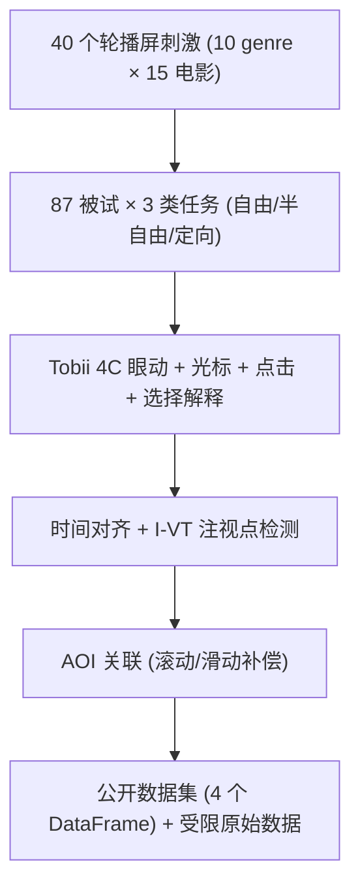

# RecGaze: The First Eye Tracking and User Interaction Dataset for Carousel Interfaces (首个面向轮播界面的眼动追踪与用户交互数据集)

- **会议/期刊**: SIGIR 2025 (Resource & Reproducibility Track)
- **作者与机构**: Santiago de Leon-Martinez (Brno Univ. of Technology / KInIT), Jingwei Kang & Maarten de Rijke (Univ. of Amsterdam), Robert Moro & Maria Bielikova (KInIT), Branislav Kveton (Adobe Research), Harrie Oosterhuis (Radboud Univ.)
- **推荐链路定位**: 重排 / 界面呈现层（位置偏置与曝光建模）
- **研究方向**: 去偏公平与工业架构 / 多任务学习与列表级重排
- **论文原文**: [论文原文链接](https://arxiv.org/abs/2504.20792v1)
- **开源代码**: [开源代码仓库链接](https://github.com/santideleon/RecGaze_Dataset)

## TL;DR (1分钟核心速览)

轮播（carousel）界面在 Netflix/Spotify 等工业系统中被广泛使用，但学界对其浏览行为几乎无实证数据，且**此前不存在任何带眼动信号的推荐数据集**。本文发布 RecGaze：87 名被试、40 个轮播屏（30 自由浏览 + 5 半自由 + 5 定向搜索）、共 3,477 次交互，同步记录 90Hz 注视/注视点序列、光标轨迹、点击与选择理由。基于该数据首次给出轮播注视热图，证实了类似 2D 列表的 **F 型/黄金三角浏览模式**与强烈的首屏位置偏置，为轮播点击模型与位置去偏提供了"真值"级监督信号。

## Background & Motivation (背景与核心矛盾)

- **主流范式**: 推荐结果呈现长期以单列 1D 列表为主，其浏览行为（自上而下级联点击）已被点击数据与眼动实验双重确认，并催生了 cascade click model；2D 网格则被证实存在 F 型/黄金三角与"中部偏置、行跳跃"等更复杂模式。
- **前人局限**: 轮播界面比 1D/2D 列表多出"主题维度 + 横向滑动"两层结构，已有单列表结论**无法直接外推**；更关键的是，轮播相关公开文献不足 30 篇，唯一的多列表点击数据集仅 380 次交互且无主题标签、无眼动。
- **核心洞察 (Key Insight)**: 眼动是点击之前唯一的"曝光真值"——它能直接观测用户是否看到某物品、注视多久、在何处放弃，从而把位置偏置从"隐变量"变为"可观测量"。
- **本文切入点**: 以受控实验构建首个带眼动的轮播交互数据集，并用聚合热图给出浏览模式的初步实证，为 gaze-based recommender 与轮播点击模型奠基。

## Method (核心方法设计)

### 1. 整体框架 (Overall Architecture)

本文属数据集/资源型工作，其"方法"即**实验设计与数据管线**：以 Netflix 首页为原型自建 40 个轮播屏（每屏 10 个 genre 轮播 × 每轮播 15 部电影、一次展示 5 部、可滑动 2 次），被试在 Tobii 4C（90Hz，误差 <1°）与 27 寸 1920×1080 显示器上完成三类任务；Eye Square testplayer 采集注视/注视点/点击/滚动/光标，Chrome 侧采集 DOM 元素坐标，Blickshift 做可视化分析；随后经时间对齐、I-VT 注视点检测与 AOI 关联，输出公开（预处理）与受限（原始）两套数据。

### 2. 关键设计拆解 (Key Designs)

1. **滑动感知的 AOI 关联（本文最核心的工程增量）**：轮播是"移动刺激"，传统固定刺激 AOI 方案失效。作者将整页 DOM 元素坐标拼成一张超长静态刺激图，纵向滚动用 scroll 偏移校正 $(x,y)$，横向滑动则用 swipe 按钮点击事件切换至第 2/3 组同构页面副本，从而实现光标与点击的**精确 AOI 归属**；对注视点再提供"矩形边界"与"最近 AOI（≤60px）"两种归属策略，后者基于 1° 误差与 76cm 最大视距反推的像素容差。
2. **刺激材料的流行度平衡分配**：为避免某屏某 genre 系统性更受欢迎，按 IMDB 票数排序、剔除 2000 年前与 Top-150 超热影片后，将每个 genre 的前 40 部电影**随机轮转填充**到 40 个屏的同一位置槽，使跨屏比较公平；genre 顺序在 30 个自由浏览屏中额外约束为"每个 genre 在 3 个首屏位置与 10 个纵向位置出现次数均等"，直接服务于位置偏置的可辨识性。
3. **数据质量与缺失审计**：逐被试逐屏人工核查注视扫描路径；仅 0.1% 屏完全无反馈，光标缺失 1.6%、注视缺失 0.33%（缺失率约 2.9%）、注视点缺失 1.8%、最终选择缺失 0.1%，定向搜索失败 1.6% 并单独标注——这种粒度的缺失披露在推荐数据集中相当罕见。

## Experimental Setup & Evaluation Protocol (实验设置与评估协议)

- **数据集规模与构成**:

| 任务类型 | #Users | #Screens | #Interactions | #Selections | 平均屏时长 |
| :--- | :---: | :---: | :---: | :---: | :---: |
| 自由浏览 Free-browsing | 87 | 30 | 2,607 | 2,432 | 56.99s |
| 半自由 Semi-free | 87 | 5 | 435 | 383 | 43.85s |
| 定向搜索 Direct Search | 87 | 5 | 435 | 424 | 11.57s |
| **合计** | **87** | **40** | **3,477** | **3,239** | **49.67s** |

- **被试画像**: 男 47 / 女 39；年龄集中于 20–29（50 人）与 30–39（29 人）；68 人有 Netflix 类使用经验；Bratislava 61 人、Amsterdam 26 人，两地硬件软件完全一致（仅光照不同）。
- **数据划分与防穿越**: 本文**不涉及训练/测试划分**，属资源贡献；但通过"半数被试先做自由浏览、半数先做半自由+定向搜索"的顺序平衡来控制疲劳效应，并对超时被试（多数屏 >2min）在数据中显式标记。
- **评测协议**: 无 ranking 指标。评估以**聚合注视热图（按时长加权）**、选择理由频次统计与问卷 Likert 分布为主；公开集提供 4 个 CSV DataFrame（用户特征、物品特征、汇总反馈、纯点击反馈），受限集提供 90Hz 原始注视与屏幕录像（25fps .avi）。
- **可对接性**: 电影 ID 采用 TMDB，可与 MovieLens 关联，缓解 3,477 次交互规模偏小的问题。

## Key Experimental Results (实验关键数据)

### 1. 主实验对比 (Main Results)

本文无 SOTA 对比表，其"主结果"为**与唯一同类多列表点击数据集的规模对比**及浏览行为实证：

| 对比对象 | 界面类型 | #Interactions | 主题标签 | 眼动 | 光标 | 选择解释 |
| :--- | :--- | :---: | :---: | :---: | :---: | :---: |
| Jannach et al. [18] | 多列表（不可滑动） | 380 | ✗ | ✗ | ✗ | ✗ |
| Bendada et al. [3] | 轮播（仿真） | 974,960 emb. | ✓ | ✗ | ✗ | ✗ |
| **RecGaze (本文)** | **轮播（可滑动）** | **3,477** | **✓** | **✓** | **✓** | **✓** |

### 2. 消融/分析实验 (Behavioral Analysis)

| 分析维度 | 关键观测 | 数值 |
| :--- | :--- | :--- |
| 聚合注视热图 | 强自上而下 + 首屏左→右，支持 F 型/黄金三角 | 图 4 |
| 第 2/3 组滑动页 | 最右侧电影注视反升，偏离 F 型 | 图 4 |
| 选择理由（多选） | 海报是最主要因素 | >50% 选择 |
| 轮播数量感知 | 被 10 个 genre 淹没 | 27.6% (n=24) |
| 每轮播物品数 | 认为 15 部足够 | 49.4% (n=43)，33.3% 想要 +25 |
| 主题类型偏好 | genre 最有用，其次个性化与 item-based；exclusive 最无用 | 近半数首选 genre |
| 首页定制意愿 | 愿意自定义首页 | 70.1% (n=61) |

### 3. 关键实验发现 (Key Findings)

1. **轮播确实继承 2D 列表的 F 型偏置，但滑动会破坏它**：热图显示首屏呈清晰的自上而下、自左向右衰减，与 Zhao et al. 的黄金三角一致；然而第 2、3 组滑动页上最右侧物品注视异常升高，作者推测与滑动操作的手眼协同或光标锚定有关——这意味着**轮播的位置偏置不是单调衰减，而是"分段重置"**，直接用 NDCG2D 类单调位置折扣建模会失配。
2. **视觉刺激（海报）压过文本元信息**：超过一半的选择被归因于海报，远高于详情、已有观看意愿等选项，说明轮播场景下 item 的视觉表征是点击的主导因子，多模态推荐中视觉分支的权重应显著上调。
3. **用户对"轮播数量"的耐受度远低于对"轮播内物品数"**：仅 27.6% 被 10 个 genre 淹没但 49.4% 认为 15 部足够、33.3% 还想要更多，且 70.1% 愿意自定义首页——这为"少主题、深列表 + 可配置首页"的界面设计提供了直接的用户侧证据。

## Highlights & Limitations (亮点、对比与审稿批判)

- **与代表作对比 (vs. Prior Work)**: 相较 Jannach et al. [18] 的 380 次多列表交互，本文交互量提升 9 倍以上并首次引入可滑动轮播、主题标签与眼动；相较 Rahdari et al. [29] 提出的 carousel click model（纯假设驱动、无眼动校验），本文提供了可用于**参数估计与假设证伪**的观测数据；相较 Bendada et al. [3] 的 Deezer 仿真数据，本文是真实人类点击而非模拟概率。
- **可迁移亮点**: (i) "静态超页 + 滚动/滑动偏移补偿"的 AOI 关联方案可直接复用于任何动态信息流（feed、瀑布流）的眼动或曝光日志对齐；(ii) 流行度轮转填充 + 位置均衡约束的刺激构造法，是构建低偏置用户实验的标准范式。
- **审稿级局限批判**: (i) 规模仍是硬伤——3,477 次交互难以单独训练推荐模型，且仅限电影单一域，跨域泛化未知；(ii) 眼动误差在物品边界与 genre 文本→海报的跳视处易造成 AOI 误归属，而作者仅报告"两种归属策略差异很小"却未给出定量一致性指标；(iii) 被试偏向高社会经济与高学历群体，且两地光照不一致，可能系统性影响注视精度。

## Rating (四维评分)

- **方法创新性 (Novelty)**: ⭐⭐⭐⭐ （首个轮播眼动推荐数据集，滑动感知 AOI 关联是扎实的工程增量，但理论层面以验证既有 F 型假设为主）
- **评估协议与实验扎实度 (Protocol & Experiments)**: ⭐⭐⭐⭐ （刺激构造的位置/流行度均衡设计严谨、缺失率逐项披露，但无监督学习任务评测、规模偏小）
- **写作与数学规范度 (Clarity & Rigor)**: ⭐⭐⭐⭐ （数据字典与预处理流程交代清晰，几乎无公式；对"第 2/3 页右侧注视升高"仅给假设未给检验）
- **工业落地与复现价值 (Industrial & Practical Value)**: ⭐⭐⭐⭐⭐ （公开预处理集 + 受限原始集 + 完整刺激与屏布局，可直接支撑轮播位置去偏、点击模型与 gaze-based 推荐研究）

