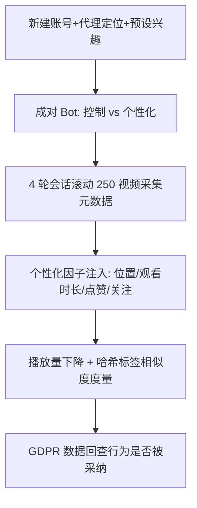

# Revisiting Algorithmic Audits of TikTok: Poor Reproducibility and Short-term Validity of Findings (重访 TikTok 算法审计：可复现性差与结论的短期有效性)

- **会议/期刊**: ACM SIGIR 2025
- **作者与机构**: Matej Mosnar, Adam Skurla, Branislav Pecher 等（Kempelen Institute of Intelligent Technologies, 斯洛伐克）
- **推荐链路定位**: 平台级推荐系统审计（黑盒外部审计，非模型内部链路）
- **研究方向**: 去偏公平与可信审计 / 强化学习与动态探索（探索-利用视角）
- **论文原文**: [https://arxiv.org/abs/2504.18140v1](https://arxiv.org/abs/2504.18140v1)
- **开源代码**: [https://github.com/kinit-sk/tiktok-algorithmic-audit-reproducibility](https://github.com/kinit-sk/tiktok-algorithmic-audit-reproducibility)

## TL;DR (1分钟核心速览)

本文针对"社交媒体推荐算法审计结论是否可复现、是否长期有效"这一被忽视的核心痛点，系统复现了 Boeker & Urman [4]、Vombatkere et al. [28] 的 TikTok "For You" 页 sockpuppeting 审计（耗时约 9 人月、5 个月），并扩展至 4 个国家、16 个审计场景。结果发现：平台内容与 HTML 结构演化、机器人封禁、显式行为在 Web 端不被记录等因素使复现极为困难；且 3 年后结论发生反转——**观看（watch）取代关注（follow）成为最强个性化因子**，仅靠隐式观看即可将用户推向小众内容。结论高度依赖度量严格度，凸显一次性审计的短期有效性缺陷。

## Background & Motivation (背景与核心矛盾)

- **主流范式**: 监管（DSA 第 37 条）与学界呼吁对算法策展内容做系统审计，主流手段是 sockpuppeting——用自动化 bot 模拟用户行为，观察 For You 信息流如何随位置、观看时长、点赞、关注等个性化因子漂移。
- **前人局限**: ① 参考研究 [4,28] 的代码/数据几乎不可得（[28] 仓库链接失效，[4] 代码缺数据库 schema），方法描述缺失关键细节（观看时长、用户属性），且存在"对不感兴趣内容反馈更强"的方法论缺陷；② 平台侧内容与 HTML 结构持续演化、直播/广告占比激增（约 1/20 直播、1/4 广告）、反 bot 封禁加剧，使一次性审计难以复现。
- **核心洞察 (Key Insight)**: 审计结论不是算法的静态属性，而是"算法状态 × 内容状态 × 度量选择"的联合函数；仅改变哈希标签相似度的严格程度，就能得出完全相反的个性化强弱结论。
- **本文切入点**: 以"复现 + 扩展 + 纵向对比"三位一体重跑审计，并首次用 GDPR 数据回查 bot 行为是否真正被推荐器采纳，从而把"可复现性"本身作为研究对象量化。

## Method (核心方法设计)

### 1. 整体框架 (Overall Architecture)

审计以"控制用户 vs 个性化用户"成对 bot 并行运行为骨架：每个 bot 注册全新账号（随机姓名/邮箱/生日 + 预设位置），经代理服务器定位，用 `nodriver` 驱动无头 Chrome 登录 TikTok Web 端，滚动浏览 250 条 For You 视频，逐条采集标题、描述、话题标签、播放量、点赞/评论数等元数据。每个场景含 4 次会话（间隔约 1 天，复用 cookie 保留历史），使推荐器有时间沉淀个性化。个性化因子通过修改 bot 行为注入（改位置、拉长特定视频观看时长、点赞、关注），控制用户执行默认行为。最后用播放量下降幅度与哈希标签相似度两类启发式指标量化个性化强度，并用 GDPR 请求数据做审计后完整性校验。

### 2. 关键设计拆解 (Key Designs)

1. **成对控制-个性化审计与噪声基线（S0）**：痛点在于无法区分"个性化效应"与"推荐器固有随机性"。本文让控制与个性化 bot 执行完全相同的默认行为，测得二者信息流平均 Jaccard 相似度仅 **10%**（参考研究为 35%），单用户自身前后相似度约 20%，从而把 10% 作为噪声下界；任何显著低于该值的场景才判定为真实个性化。这一基线设计使"探索性漂移"与"个性化收敛"得以分离。

2. **多严格度哈希标签相似度度量**：痛点在于单一度量会系统性偏置结论。本文定义两级度量——严格 Jaccard 指数 $J(A,B)=\frac{|H_A \cap H_B|}{|H_A \cup H_B|}$，以及宽松"基础匹配"（至少一个标签相同或互为子串即记 100% 相似），并剔除 `fyp`、`foryoupage` 等泛化标签。同一位置场景下，严格度量显示控制组间相似度 25–38%、个性化组低一个数量级；宽松度量下各组相似度普遍升至 65–90%，个性化差异被大幅稀释——直接证明度量选择可翻转结论。

3. **GDPR 审计后完整性校验与训练/推理开销**：本文无模型训练，核心"开销"是审计成本——5 个月约 9 人月，16 个场景（S0–S16），部分场景重复 2 次验证随机性（重复间无显著差异）。GDPR 回查发现观看历史几乎完全匹配，但**点赞与关注在多数账号的 GDPR 数据中缺失**，说明 Web 端显式行为可能根本未被推荐器采纳，构成对"显式因子强于隐式"这一旧结论的系统性质疑。

## Experimental Setup & Evaluation Protocol (实验设置与评估协议)

- **数据集与预处理**: 本文为自采集审计数据（2025 年 1–2 月），非标准推荐数据集。场景配置如下：

| 场景组 | 场景 ID | 个性化注入 | 观看时长(控制\|个性化) | 重复次数 |
| :--- | :---: | :--- | :---: | :---: |
| 噪声基线 | S0 | 无（美国） | 100% \| N/A | 1 |
| 位置 | S1–S4 | 德国/法国/罗马尼亚/乌克兰 | 100% \| 100% | 1 |
| 观看(随机) | S5–S8 | 随机 25 条拉长 | 25%\|50/75/100%，100%\|200% | 1 |
| 观看(兴趣) | S9–S11 | 预设哈希标签 | 25%\|50%，100%\|200/400% | 1/2/2 |
| 点赞 | S12–S14 | 随机/兴趣/头部创作者 | 100% \| 100% | 1/2/2 |
| 关注 | S15–S16 | 随机 5/10 位创作者 | 100% \| 100% | 1 |

- **数据划分与防穿越 (Splitting Strategy)**: 无监督划分；采用**时间纵向对比**（2025 年审计 vs. 2022 年参考研究）作为"防穿越"手段，并以场景内 4 轮会话的前 125 / 后 125 条视频做前后对比。
- **排名评测协议 (Ranking Protocol)**: 非传统 Full-Ranking/Sampled Ranking，而是**信息流级启发式度量**——① 视频播放量前后变化百分比（下降越多=个性化越强）；② 哈希标签 Jaccard / 基础匹配相似度（控制-个性化、控制-控制、个性化-个性化三视角）。
- **对比基线与超参设置**: 基线为参考研究 [4,28,16] 的原始结论；关键"超参"为观看时长比例（50%/75%/100%/200%/400%）、每轮交互视频数（10/25 条）、关注创作者数（5/10）。未做显著性检验，以场景重复 2 次的稳定性替代。

## Key Experimental Results (实验关键数据)

### 1. 主实验对比 (Main Results)

播放量前后变化（后 125 条 vs. 前 125 条，负值越大个性化越强）：

| 行为类型 | 控制用户 | 个性化用户 | 参考研究结论 | 本文结论 |
| :--- | :---: | :---: | :--- | :--- |
| 随机显式(点赞) | −18.30% | **−67.15%** | 显式最强 | 随机点赞探索性强 |
| 预设显式(兴趣点赞) | −66.15% | −63.80% | 显式最强 | 与对照持平 |
| 随机隐式(观看) | −37.60% | −2.11% | 观看≈点赞 | 度量受泛化标签干扰 |
| 预设隐式(兴趣观看) | −64.35% | **−69.73%** | 观看弱于关注 | **观看最强** |

哈希标签基础匹配相似度前后变化（C=控制，P=个性化）：

| 行为 | C vs. P | C vs. C | P vs. P |
| :--- | :---: | :---: | :---: |
| 关注 | +1.50% | +0.05% | **−2.25%** |
| 随机点赞 | +9.06% | −0.33% | −0.00% |
| 预设点赞 | +0.04% | +0.04% | −0.86% |
| 随机观看 | **−2.06%** | +0.06% | −1.58% |
| 预设观看 | **−1.35%** | +0.40% | −0.28% |

### 2. 消融实验 (Ablation Study)

以"观看时长比例"作为核心因子的消融（预设兴趣场景 S9–S11，指标为含预设标签视频占比）：

| 观看时长 | 50% | 100% | 200% | 400% |
| :--- | :---: | :---: | :---: | :---: |
| 个性化强度 | 弱（无明显提升） | 中等 | 略高于 100% | **显著跃升** |

度量严格度消融（位置场景）：

| 度量 | 控制组间相似度 | 个性化组相似度 | 结论方向 |
| :--- | :---: | :---: | :--- |
| 严格 Jaccard | 25–38% | 低一个数量级 | 位置效应极强 |
| 宽松基础匹配 | 80–90% | 约 65% | 位置效应被稀释 |

### 3. 关键实验发现 (Key Findings)

1. **隐式观看反超显式关注成为最强个性化信号**：预设兴趣观看场景下个性化用户播放量下降 −69.73%（对照 −64.35%），且 P vs. P 相似度持续下降；而关注场景 P vs. P 仅 −2.25%。这意味着用户**无需任何主动操作、仅在某类视频上多停留**即可被推入小众/极端内容，平台引导风险比旧结论更隐蔽。
2. **显式行为呈"先探索后利用"的双阶段特征**：点赞场景中含预设兴趣标签的视频占比在前约 1000 条视频内持续下降（强探索），之后急剧上升并反超观看场景（强利用）；而观看场景占比全程稳定上升。这解释了为何短窗口审计会低估显式行为、长窗口审计又会高估。
3. **结论对度量与方法论极度敏感，且显式行为可能未被采纳**：仅切换 Jaccard→基础匹配，位置效应从"极强"变为"温和"；GDPR 回查显示多数账号的点赞/关注未出现在平台记录中，Web 端显式行为可能被推荐器忽略，直接动摇"显式>隐式"的旧结论根基。

## Highlights & Limitations (亮点、对比与审稿批判)

- **与代表作对比 (vs. Prior Work)**: 相较 Boeker & Urman [4]（首次系统比较个性化因子、结论"关注最强"）与 Vombatkere et al. [28]（结合捐赠数据、报告 30–50% 个性化比例），本文本质区别在于**把"可复现性"从附属说明提升为第一研究对象**，并用 GDPR 数据首次实证"审计动作未必被算法采纳"这一元层面问题；相较 Mousavi et al. [16] 对解释忠实度的分析，本文进一步指出解释与度量本身即可制造结论。
- **可迁移亮点**: ① "成对控制-个性化 + 噪声基线"设计可迁移至任何黑盒推荐系统的外部评测；② 多严格度度量并行报告 + GDPR 行为回查，可作为可信审计的标准报告范式。
- **审稿级局限批判**: ① 完全依赖哈希标签启发式，未做人工标注，泛化标签与通用兴趣集可能系统性偏置结论，作者亦自承此为最大局限；② 部分场景因 bot 被标记/封禁导致采集视频数不足，且未提供统计显著性检验，仅以 2 次重复的定性一致性支撑稳健性。

## Rating (四维评分)

- **方法创新性 (Novelty)**: ⭐⭐⭐⭐ （不以新模型取胜，而以"复现即研究"的元方法论与 GDPR 回查视角开辟审计可信度新维度）
- **评估协议与实验扎实度 (Protocol & Experiments)**: ⭐⭐⭐ （16 场景 + 4 国扩展 + 重复验证较扎实，但纯启发式度量、无显著性检验、部分场景数据不完整）
- **写作与数学规范度 (Clarity & Rigor)**: ⭐⭐⭐⭐ （RQ 驱动结构清晰、场景表完备，公式极少但度量定义明确，局限自陈坦诚）
- **工业落地与复现价值 (Industrial & Practical Value)**: ⭐⭐⭐⭐⭐ （代码与数据全开源，直接服务 DSA 合规审计与监管实践，对平台治理与研究者均高价值）

