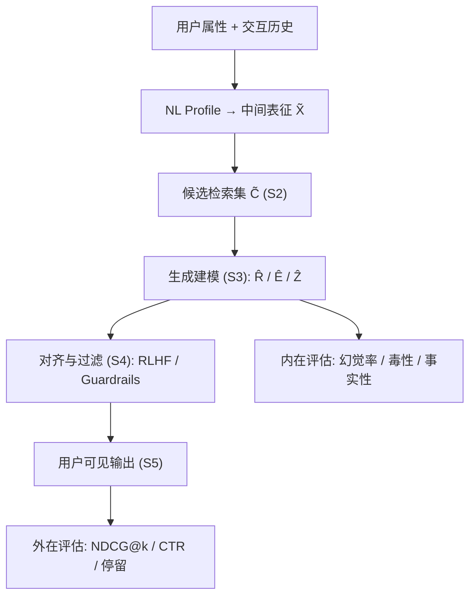
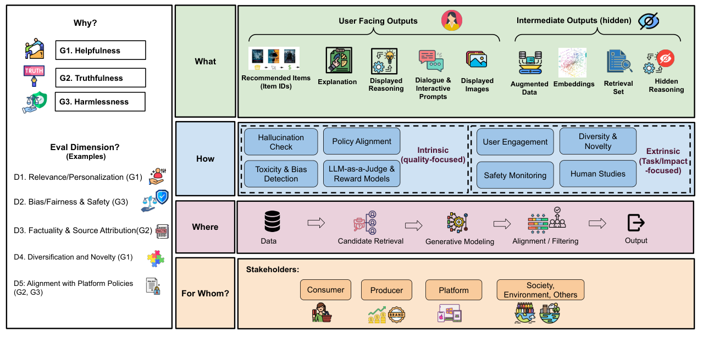

# Toward Holistic Evaluation of Recommender Systems Powered by Generative Models (面向生成式推荐系统的整体性评估)

- **会议/期刊**: SIGIR 2025 (Perspective / Vision Track)
- **作者与机构**: Yashar Deldjoo (Politecnico di Bari)、Nikhil Mehta (Duke)、Maheswaran Sathiamoorthy (Bespoke Labs)、Shuai Zhang (ETH Zurich)、Pablo Castells (UAM)、Julian McAuley (UCSD)
- **推荐链路定位**: 端到端生成式（覆盖 S1 数据 → S5 用户反馈全链路）
- **研究方向**: 去偏公平、可信隐私与工业架构 / 生成式推荐
- **论文原文**: [https://arxiv.org/abs/2504.06667v2](https://arxiv.org/abs/2504.06667v2)
- **开源代码**: 暂未开源

## TL;DR (1分钟核心速览)

生成式推荐（Gen-RecSys）输出开放式文本/多模态内容，传统 NDCG/Recall 无法度量幻觉、偏见放大与政策违规。本文是一篇立场/框架论文：先将评估挑战二分为「被放大的旧问题」（偏见、隐私、成本、基准稀缺）与「全新风险」（编造不存在的物品、多轮自相矛盾、说服性操纵、CoT 矛盾），再借鉴 HELM 提出 **WH-六问（What/Why/How/Which/Where/For Whom）+ 三维目标（Helpfulness/Truthfulness/Harmlessness）+ D1–D5 维度** 的整体评估框架，并用旅行推荐三场景（London/Copenhagen/Berlin）演示同一 Query 下"有用但失真""真实但超预算""合规但含偏见措辞"的差异化判定。**本文无定量实验与基准对比**，其贡献是评估协议与度量映射表。

## Background & Motivation (背景与核心矛盾)

- **主流范式**: 数十年 RS 评估建立在留出集 + 隐式反馈（点击/购买）之上，用 NDCG@k、Precision@k、RMSE 衡量对**封闭目录内已知物品**的召回与排序能力，隐含"用户-物品分布稳定、Ground Truth 唯一"的假设。
- **前人局限**: ① Gen-RecSys 可直接生成物品 ID 或经 RAG 检索后由 LLM 组织回答，输出空间从 top-k 列表扩张为文本/图像/多轮对话，**"正确"不再唯一**，BLEU/ROUGE 依赖参考文本而推荐场景常无金标准；② 生成模型会**编造目录外物品**（如虚构 "PalmSky Beach Resort"），传统指标对此完全失明；③ RAG 多阶段管线存在**级联误差**，检索阶段的遗漏会不可逆地污染最终输出。
- **核心洞察 (Key Insight)**: 生成式输出把评估目标从单一 Accuracy 拆成 **Helpfulness / Truthfulness / Harmlessness 三角**，且风险可分为"被生成式放大的旧问题"与"生成式独有的新问题"两类——前者（偏见、隐私）在经典 RS 中已有研究但被文本生成显著加剧（如合成数据再训练导致偏见自我强化），后者（幻觉、CoT 矛盾、说服性操纵）在经典范式中根本不存在。
- **本文切入点**: 不做新模型，而是把 HELM 的多场景-多度量思想迁移到推荐域，给出一套可操作的评估检查清单与度量-维度映射表。

## Method (核心方法设计)

### 1. 整体框架 (Overall Architecture)

框架以"输出对象"为轴心组织评估：系统先由用户属性与交互构建自然语言画像，得到中间用户表征 $\tilde{\boldsymbol{X}}$，再经候选检索集$\tilde{\boldsymbol{C}}$进入生成模块，最终产出三类**用户可见输出**——推荐物品集$\hat{\boldsymbol{R}}$、解释文本$\hat{\boldsymbol{E}}$、可选展示的推理链$\hat{\boldsymbol{Z}}$；同时保留两类**中间输出**（用户嵌入$\tilde{\boldsymbol{X}}$、候选集$\tilde{\boldsymbol{C}}$）用于管线级诊断。评估时对$\hat{\boldsymbol{R}}$走**外在（Extrinsic）**路线（NDCG、CTR、停留时长），对$\hat{\boldsymbol{E}}/\hat{\boldsymbol{Z}}$ 走**内在（Intrinsic）**路线（幻觉率、毒性分类器、LLM-as-a-Judge），二者在 S1–S5 五个管线阶段上分别落地。

<figure class="paper-figure" markdown="span">
  <figcaption>图1：Gen-RecSys 的整体评估框架，将核心目标（有用性、真实性和无害性）与具体评估维度（如相关性、公平性和事实性）联系起来，并结合我们提出的 WH 问题框架所驱动的各种因素。</figcaption>
</figure>

### 2. 关键设计拆解 (Key Designs)

1. **WH-六问评估协议（把"评什么"形式化）**：痛点是生成式输出维度爆炸导致评估报告不可比。作者要求每项评估显式回答 What（评哪个输出：$\hat{\boldsymbol{R}}$/$\hat{\boldsymbol{E}}$/$\hat{\boldsymbol{Z}}$/$\tilde{\boldsymbol{X}}$/$\tilde{\boldsymbol{C}}$）、Why（Helpfulness/Truthfulness/Harmlessness 三目标）、How（Human / 自动度量 / LLM-as-a-Judge）、Which（D1–D5 维度）、Where（S1–S5 阶段）、For Whom（消费者/生产者/平台/社会）。其价值在于把"评估设计"变成可审计的六元组，避免只报 NDCG 就宣称系统可用。

2. **挑战二分法与度量-维度映射**：将风险分为 Exacerbated（准确性定义模糊化、多样性/覆盖被生成偏见左右、偏见放大、隐私泄露、基准稀缺、成本效率）与 New（幻觉/目录外物品、无参考数据、多轮遗忘与自相矛盾、说服与用户影响、微调后行为漂移、CoT 矛盾、多智能体级联）。每条挑战绑定具体度量：幻觉率对应 D3，ToxiGen/HateXplain 对应 D2，ILD/EPD 对应 D4，策略合规检查对应 D5。这一映射使"该用哪个指标"不再靠拍脑袋。

3. **LLM-as-a-Judge 的双刃剑与自增强偏差**：作者明确指出若生成与评判使用同一模型家族，评估会被**自我强化偏差**污染；且时尚、旅行等垂域需要通用 LLM 缺乏的专门知识。缓解路径是引入外部知识源或参考核查（grounded factuality），并对多智能体系统按角色分别设指标（检索智能体用 NDCG、生成智能体用 GPTScore、策略智能体用毒性检测）。

## Experimental Setup & Evaluation Protocol (实验设置与评估协议)

- **数据集与预处理**: **本文为立场/框架论文，未使用任何数据集，无统计表、无过滤方式、无训练负采样。**
- **数据划分与防穿越**: 不适用（无模型训练）。
- **排名评测协议**: 不适用；但论文对"应采用的协议"给出规范建议——物品集 $\hat{\boldsymbol{R}}$仍可用 Full-Ranking 类指标，文本输出$\hat{\boldsymbol{E}}$ 必须补充无参考度量（GPTScore/BARTScore）与幻觉率。
- **对比基线与超参设置**: 无基线对比、无 Embedding 维度、无显著性检验；论证方式为**文献综述式论证（literature-based arguments）**，作者在 §1 末尾明确声明"solely through rigorous literature-based arguments"。

## Key Experimental Results (实验关键数据)

### 1. 主实验对比 (Main Results)

**不存在定量主实验表。** 论文的"结果"是 Table 4 的三场景定性对照，可视为其评估框架的最小可行演示：

| 场景 | 输出内容 | Helpfulness | Truthfulness | Harmlessness | 触发的评估手段 |
| :--- | :--- | :---: | :---: | :---: | :--- |
| (A) London | 仅物品，$300 | ✓ 符合预算 | N/A（无解释文本） | ✓ 无毒性 | 外在检查、基础排序 |
| (B) Copenhagen | 物品+解释，$800 | ✗ 超$500 预算 | ✓ 可持续/交通描述属实 | ✓ 无偏见措辞 | 外在+内在、NDCG+事实性 |
| (C) Berlin | 物品+解释，$450 | ✓ 符合预算 | ✓ 费用估计合理 | ✗ "third-world cities" 含贬义 | 内在毒性检测、ToxiGen、政策合规 |

### 2. 消融实验 (Ablation Study)

**不存在消融实验。** 论文以 Table 1（传统 vs 生成式评估目标四维对照：目标与输出、个性化与交互、度量与风险、数据依赖）与 Table 2（挑战二分表）、Table 5（度量-维度映射表）替代消融，属于概念性拆解而非组件级验证。

### 3. 关键实验发现 (Key Findings)

- **单一指标必然失效**：场景 (B) 中 NDCG 类外在指标无法察觉"推荐了超预算目的地"，而场景 (C) 中物品完全合规、费用估计也准确，唯一失败点是解释文本里的一句贬义比较——说明**物品级指标与文本级指标必须解耦评估**，任一单独使用都会漏判。
- **"无解释"不等于"无风险"**：场景 (A) 因未生成解释文本，Truthfulness 维度直接退化为 N/A，这暴露了当前多数 Gen-RecSys 论文只报物品指标时的评估盲区——不生成文本并不代表系统可信，而是**可信性不可测**。
- **风险来源与管线阶段强相关**：检索阶段（S2）的遗漏会级联为生成阶段（S3）的幻觉，因此作者主张把幻觉率归因到 $\tilde{\boldsymbol{C}}$ 的召回覆盖而非仅归咎于 LLM，这为工业界定位 RAG 推荐故障提供了分层诊断思路。

## Highlights & Limitations (亮点、对比与审稿批判)

- **与代表作对比 (vs. Prior Work)**: 相较 HELM（面向通用 LLM 的多场景多度量评估），本文将场景轴替换为推荐特有的 S1–S5 管线阶段与 $\hat{\boldsymbol{R}}/\hat{\boldsymbol{E}}/\hat{\boldsymbol{Z}}$ 输出分类；相较 TIGER 等生成式检索工作只报 Recall/NDCG，本文指出这类报告**系统性缺失**事实性与安全性维度；相较传统公平性研究（如 BPR 去偏、曝光去偏），本文强调偏见在生成文本中会以**文化刻板措辞**形式出现，审计对象须从物品列表扩展到叙述文本。
- **可迁移亮点**: ① WH-六问可直接改造为团队内部的"评估设计 Checklist"，在写实验章节前强制填写，能有效防止只报 NDCG；② 把幻觉率归因到检索候选集 $\tilde{\boldsymbol{C}}$ 的覆盖率，这一分层归因法可迁移到任何 RAG 推荐管线的故障定位。
- **审稿级局限批判**: ① **零实证**——框架未在任何真实 Gen-RecSys 上落地验证，D1–D5 的度量组合是否可计算、成本多高、维度间冲突（如多样性↑ vs 事实性↓）如何权衡均未讨论；② **LLM-as-a-Judge 的可靠性被点到即止**，未给出评判者与被评者同族时的偏差量化方案，而这恰是工业落地最痛的一环；③ 未讨论多轮对话中"用户满意度"的可测代理指标，For Whom 中的"社会"维度也停留在口号层面。

## Rating (四维评分)

- **方法创新性 (Novelty)**: ⭐⭐⭐ （挑战二分法与 WH-六问是有用的组织工具，但本质是 HELM 的领域适配，无新算法或理论支撑）
- **评估协议与实验扎实度 (Protocol & Experiments)**: ⭐⭐ （无数据集、无基线、无消融、无显著性检验，仅三例定性场景演示，实证强度显著低于 SIGIR 常规研究论文）
- **写作与数学规范度 (Clarity & Rigor)**: ⭐⭐⭐⭐ （Table 1/2/5 三张对照表组织清晰，输出符号 $\hat{\boldsymbol{R}}/\hat{\boldsymbol{E}}/\hat{\boldsymbol{Z}}/\tilde{\boldsymbol{X}}/\tilde{\boldsymbol{C}}$ 定义明确，但全文无公式推导）
- **工业落地与复现价值 (Industrial & Practical Value)**: ⭐⭐⭐ （Checklist 与度量映射表可直接用于团队评估规范制定，但无开源代码、无参考实现，落地需自行补齐全部度量工具链）

