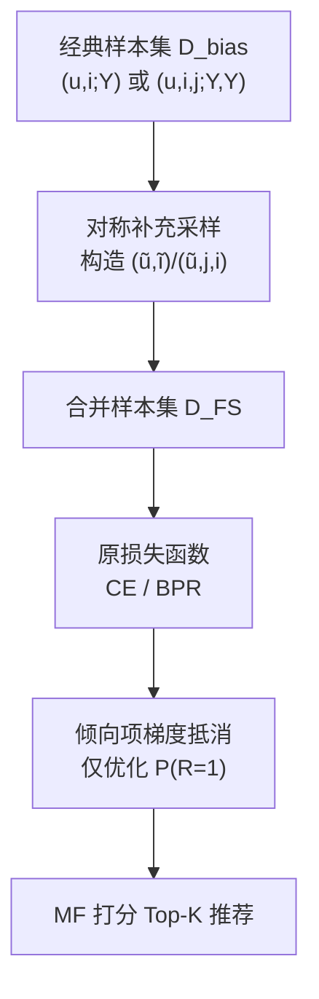

# Unbiased Collaborative Filtering with Fair Sampling (基于公平采样的无偏协同过滤)

- **会议/期刊**: SIGIR 2025 (5 pages, short paper)
- **作者与机构**: Jiahao Liu, Peng Zhang, Tun Lu, Li Shang, Ning Gu (复旦大学); Dongsheng Li (微软亚洲研究院); Hansu Gu (Independent)
- **推荐链路定位**: 召回 (协同过滤表征学习)
- **研究方向**: 去偏公平与工业架构 / 协同过滤
- **论文原文**: [https://arxiv.org/abs/2502.13840v2](https://arxiv.org/abs/2502.13840v2)
- **开源代码**: [https://github.com/jhliu0807/Fair-Sampling](https://github.com/jhliu0807/Fair-Sampling)

## TL;DR (1分钟核心速览)

本文指出经典 point-wise/pair-wise 损失在优化 $P(Y_{u,i}=1)$时，把倾向因子$\theta_u\theta_i$一并写进了模型输出，导致流行物品被误读为高偏好。作者提出公平采样 FS：为每个原始样本构造"用户/物品互换角色"的对称补充样本，使$\Delta\ln\theta$ 项在梯度层面严格抵消，从而**无需估计倾向分**即可完全消除流行度偏置。在 Kindle/Gowalla/Yelp 三个数据集、等概率采样构造的无偏测试集上，FS-Pair 相对 CPR 在 Recall@20 上提升约 9%–17%，ARP 下降 38%–47%。

## Background & Motivation (背景与核心矛盾)

- **主流范式**: 以 IPS 为代表的无偏学习通过样本加权（Rel-MF、UBPR、UPL、CPR 等）修正流行度偏置，核心是估计倾向分 $P(O_{u,i}=1|R_{u,i}=1)$ 后做逆概率加权。
- **前人局限**: 其一，倾向分依赖"仅由物品流行度决定"等过度简化假设，估计方差大；其二，裁剪等方差缩减手段会破坏无偏性，估计不准即残留偏置。
- **核心洞察 (Key Insight)**: 在两步交互假设 $Y=O\odot R$下，$P(Y_{u,i}=1)=\theta_u\theta_i P(R_{u,i}=1)^{\alpha+1}$。经典损失直接拟合$Y$，其梯度中混入了$\Delta\ln\theta_u+\Delta\ln\theta_i$项；而理想损失只优化$\Delta\ln P(R_{u,i}=1)$。偏置的根源是**倾向因子被错误优化**，而非样本权重不足。
- **本文切入点**: 既然偏置来自"流行物品更常被选为正样本"，那就让每个用户/物品以等概率同时出现在正、负两侧，使倾向项在求和时自动归零。

## Method (核心方法设计)

### 1. 整体框架 (Overall Architecture)

FS 是一个**采样层面的插件式优化方法**，不改变骨干模型（MF）与损失函数形式，只改变训练样本集合的构造方式。对经典损失样本集中的每个样本，构造一个"角色互换"的补充样本（正样本的用户/物品被换到负样本位置，反之亦然），将原始样本与补充样本合并后统一计算原损失。由于补充样本对倾向因子的梯度贡献与原始样本严格相反，训练过程不再优化 $\theta_u,\theta_i$，仅保留与偏好相关的$P(R_{u,i}=1)$。方法分为面向 point-wise 的 FS-Point 与面向 pair-wise 的 FS-Pair 两个变体，训练与推理均沿用标准 MF 流程，无额外推断开销。

### 2. 关键设计拆解 (Key Designs)

1. **FS-Point：point-wise 损失的四元对称采样**：经典交叉熵样本 $(u,i;Y_{u,i})$只让流行物品反复充当正例。FS 为其补充三个样本$(\tilde{u},\tilde{i};Y_{\tilde{u},\tilde{i}})$、$(\tilde{u},i;Y_{\tilde{u},i})$、$(u,\tilde{i};Y_{u,\tilde{i}})$，满足$Y_{\tilde{u},\tilde{i}}=Y_{u,i}$、$Y_{\tilde{u},i}=Y_{u,\tilde{i}}=1-Y_{u,i}$。以$Y_{u,i}=1$ 为例，四个样本对倾向对数的梯度之和为
$$\left(\Delta\ln\theta_u+\Delta\ln\theta_i\right)+\left(\Delta\ln\theta_{\tilde{u}}+\Delta\ln\theta_{\tilde{i}}\right)-\left(\Delta\ln\theta_{\tilde{u}}+\Delta\ln\theta_i\right)-\left(\Delta\ln\theta_u+\Delta\ln\theta_{\tilde{i}}\right)=0$$
即 $\theta$项精确抵消，模型只能沿$\Delta\ln P(R_{u,i}=1)$ 方向更新，物理直觉是"正负角色对称化"消除了流行度的系统性放大。

2. **FS-Pair：pair-wise 损失的角色互换采样**：BPR 样本 $(u,i,j;Y_{u,i}=1,Y_{u,j}=0)$会放大$\ln(\theta_i/\theta_j)$，使热门$i$相对冷门$j$获得虚高 margin。FS 补充互换样本$(\tilde{u},j,i;Y_{\tilde{u},j}=1,Y_{\tilde{u},i}=0)$，其梯度放大$\ln(\theta_j/\theta_i)$，二者相加得
$$\Delta\ln\frac{\theta_i}{\theta_j}+\Delta\ln\frac{\theta_j}{\theta_i}=0$$
从而 pair-wise 损失同样只优化偏好比值 $P(R_{u,i}=1)/P(R_{u,j}=1)$。相比 UBPR/CPR 需要倾向分估计或跨对构造，FS-Pair 仅需一次物品角色互换，实现极轻。

3. **训练目标、负采样与推理效率**：总损失即原损失在扩充样本集上的求和，$\mathcal{L}^{\text{point}}_{\text{FS}}=\sum_{(u,i)\in\mathcal{D}^{\text{point}}_{\text{FS}}}\left[Y_{u,i}\delta^+(u,i)+(1-Y_{u,i})\delta^-(u,i)\right]$，pair-wise 同理。负样本由补充采样规则隐式确定（无需 Uniform/In-batch 负采样调参），且**完全免倾向分估计**，规避了 IPS 的方差与裁剪偏差问题。推理阶段与标准 MF 完全一致，无额外开销。

## Experimental Setup & Evaluation Protocol (实验设置与评估协议)

- **数据集与预处理**: 仅保留评分 $\geq 4$ 的交互，且用户与物品均至少 20 条交互（20-core 过滤）。

| 数据集 | #Users | #Items | 过滤/特征说明 |
| :--- | :---: | :---: | :--- |
| Amazon Kindle | 未在正文给出 | 未在正文给出 | 图书评论，评分 $\geq 4$，20-core |
| Gowalla | 未在正文给出 | 未在正文给出 | LBS 签到日志，20-core |
| Yelp | 未在正文给出 | 未在正文给出 | 本地生活评论，20-core |

- **数据划分与防穿越 (Splitting Strategy)**: 采用**无偏测试集构造**——从全量数据中以每个物品等概率采样生成验证集与测试集，剩余数据作训练集，比例 7:1:2。该协议刻意剥离了物品流行度对测试分布的影响，与 FS 的去偏目标对齐。
- **排名评测协议 (Ranking Protocol)**: 报告 Recall@20、NDCG@20 与 ARP@20（Average Recommendation Popularity，越低表示偏置越小），未采用负采样排序，评测覆盖全候选物品。
- **对比基线与超参设置**: 所有方法统一以 MF 为骨干、共享超参搜索空间；point-wise 组用交叉熵，pair-wise 组用 BPR。基线含 IPS 类（WMF、Rel-MF、DU、BPR、UBPR、CPR）与因果类（ExpoMF、CauseE、PD、DICE）。

## Key Experimental Results (实验关键数据)

### 1. 主实验对比 (Main Results)

| 类别 | 模型 | Kindle Recall | Kindle NDCG | Kindle ARP | Gowalla Recall | Gowalla NDCG | Gowalla ARP | Yelp Recall | Yelp NDCG | Yelp ARP |
| :--- | :--- | :---: | :---: | :---: | :---: | :---: | :---: | :---: | :---: | :---: |
| Point | WMF | 0.1095 | 0.0979 | 1896 | 0.1052 | 0.0924 | 3995 | 0.0398 | 0.0297 | 4231 |
| Point | Rel-MF | 0.1192 | 0.1088 | 1660 | 0.1116 | 0.0975 | 3800 | 0.0471 | 0.0359 | 3651 |
| Point | DU | 0.1264 | 0.1141 | 1497 | 0.1168 | 0.1018 | 3356 | 0.0504 | 0.0382 | 3286 |
| Point | CauseE | 0.1336 | 0.1233 | 1447 | 0.1179 | 0.1005 | 3159 | 0.0528 | 0.0408 | 3025 |
| Point | **FS-Point** | **0.1413** | **0.1263** | **1175** | **0.1217** | **0.1067** | **2261** | **0.0554** | **0.0437** | **2420** |
| Pair | BPR | 0.1431 | 0.1169 | 1572 | 0.1179 | 0.0943 | 3703 | 0.0527 | 0.0388 | 3939 |
| Pair | UBPR | 0.1414 | 0.1196 | 1156 | 0.1125 | 0.0936 | 2447 | 0.0600 | 0.0452 | 2489 |
| Pair | CPR | 0.1516 | 0.1275 | 1406 | 0.1240 | 0.1023 | 2509 | 0.0634 | 0.0478 | 2901 |
| Pair | DICE | 0.1454 | 0.1195 | 1303 | 0.1160 | 0.0966 | 2302 | 0.0599 | 0.0455 | 2459 |
| Pair | **FS-Pair** | **0.1652** | **0.1384** | **865** | **0.1294** | **0.1052** | **1140** | **0.0741** | **0.0552** | **1534** |

以最强基线 CPR 为参照，FS-Pair 在 Kindle 上 Recall 提升 **8.97%**、NDCG 提升 **8.55%**、ARP 下降 **38.48%**；Gowalla 上 Recall 提升 **4.35%**、ARP 下降 **54.56%**；Yelp 上 Recall 提升 **16.88%**、ARP 下降 **47.12%**。FS-Point 相对 CauseE 在 Kindle 上 Recall 提升 **5.76%**、ARP 下降 **18.80%**。

### 2. 消融实验 (Ablation Study)

原文为 5 页短文，未提供逐组件消融表；其"消融"以**理论抵消证明 + 变体对照**形式呈现：

| 配置 | 倾向项梯度 | 是否需估计倾向分 | 表现 |
| :--- | :---: | :---: | :--- |
| 经典 CE / BPR | $\Delta\ln\theta_u+\Delta\ln\theta_i \neq 0$ | 否 | 偏置高、ARP 大 |
| IPS 类（Rel-MF/UBPR/CPR） | 加权后近似抵消 | 是 | 受估计误差与裁剪影响 |
| FS-Point / FS-Pair | 严格为 0（式 17/21） | 否 | Recall/NDCG 最优、ARP 最低 |

### 3. 关键实验发现 (Key Findings)

1. **去偏与精度并非权衡**：FS-Pair 在三个数据集上同时取得最高 Recall/NDCG 与最低 ARP（如 Yelp ARP 从 CPR 的 2901 降至 1534），说明在无偏测试集上，消除倾向项后模型对长尾物品的排序能力被真实释放，而非以精度换多样性。
2. **pair-wise 变体收益显著大于 point-wise**：FS-Pair 相对 CPR 的 Recall 提升（4.35%–16.88%）普遍高于 FS-Point 相对 CauseE 的提升（3.2%–5.8%），印证 BPR 中 $\ln(\theta_i/\theta_j)$ 的比值偏置比 point-wise 的加性偏置更严重，对称采样抵消的边际收益更大。
3. **免估计带来稳定性优势**：IPS 类方法在 Gowalla 上 ARP 波动明显（UBPR 2447 vs. CPR 2509），而 FS 仅依赖采样规则、无倾向分超参，跨数据集表现更一致，验证了"估计误差是 IPS 残留偏置主因"的论断。

## Highlights & Limitations (亮点、对比与审稿批判)

- **与代表作对比 (vs. Prior Work)**: 与 Rel-MF/UBPR 相比，FS 不做逆概率加权、不需倾向分模型，从"加权修正"转为"采样对称化"；与 CPR 相比，CPR 依赖跨对构造与排序无偏性重定义，FS-Pair 仅需一次物品角色互换，实现更轻且理论抵消更彻底；与 DICE/PD 等因果方法相比，FS 不引入额外的因果图或表示解耦模块，可直接挂载于任意 point-wise/pair-wise 损失。
- **可迁移亮点**: ①"正负角色对称采样使倾向项梯度归零"的思路可迁移到序列推荐、图推荐的负采样设计；②在工业召回中可作为训练期插件，零推理开销地缓解热门物品霸屏。
- **审稿级局限批判**: ①完全忽略流行度，而流行度常与质量正相关，可能损害推荐质量上限，作者亦承认需靠调节采样比例折中；②实验仅在 MF 骨干与三个中等规模数据集上验证，未在 GNN/序列模型或大规模工业流量上检验，且无线上 A/B 与显著性检验；③无偏测试集由等概率采样人工构造，与真实曝光分布存在 gap，离线收益未必等价于线上收益。

## Rating (四维评分)

- **方法创新性 (Novelty)**: ⭐⭐⭐⭐ （从梯度层面定位偏置根源并给出严格抵消证明，"免估计去偏"视角简洁而有理论支撑）
- **评估协议与实验扎实度 (Protocol & Experiments)**: ⭐⭐⭐ （无偏测试集构造合理、基线覆盖 IPS 与因果两类，但缺消融表、数据集统计与显著性检验）
- **写作与数学规范度 (Clarity & Rigor)**: ⭐⭐⭐⭐ （式 17/21 的抵消推导清晰严谨，符号统一，5 页篇幅内论证完整）
- **工业落地与复现价值 (Industrial & Practical Value)**: ⭐⭐⭐⭐ （插件式改造、零推理开销、代码已开源，工程落地门槛极低）

