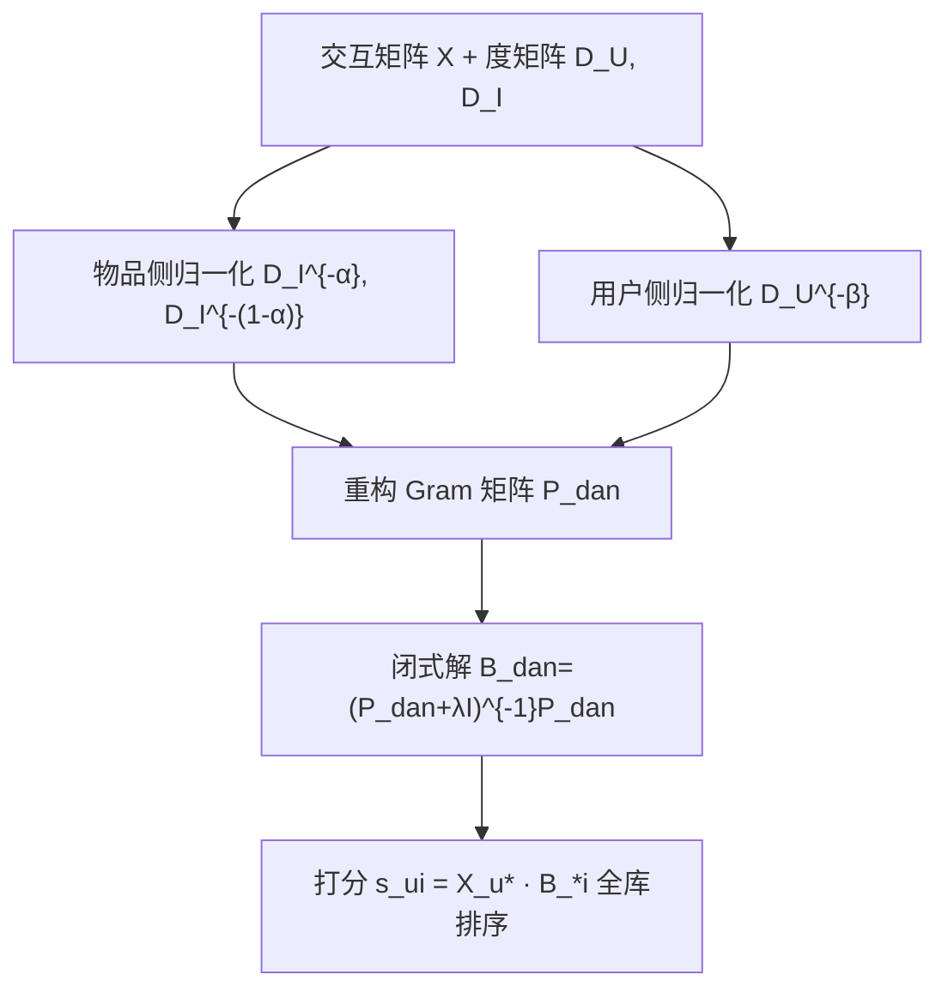

# Why is Normalization Necessary for Linear Recommenders? (线性推荐器为何需要归一化？)

- **会议/期刊**: SIGIR 2025
- **作者与机构**: Seongmin Park, Mincheol Yoon, Hye-young Kim, Jongwuk Lee（成均馆大学）
- **推荐链路定位**: 召回（item-to-item 线性自编码器打分）
- **研究方向**: 去偏公平与工业架构 / 协同过滤
- **论文原文**: [论文原文链接](https://arxiv.org/abs/2504.05805v2)
- **开源代码**: [开源代码仓库链接](https://github.com/psm1206/DAN)

## TL;DR (1分钟核心速览)

线性自编码器（LAE）虽推理快、性能强，却受**流行度偏差**与**邻域偏差**双重困扰。本文首次从理论上证明：对交互矩阵的归一化直接改写 Gram 矩阵 $\mathbf{P}=\mathbf{X}^\top\mathbf{X}$的行/列权重，从而定量控制两类偏差；据此提出仅含两个标量$\alpha,\beta$的**数据自适应归一化 DAN**，按物品 Gini 指数与加权同质性比$H_w$ 调节。在 6 个基准、强/弱泛化两种全库排序协议下，DAN 挂载 LAE/EASE/RLAE 一致提升，长尾 NDCG@20 最高 +128.57%，无偏评估最高 +12.36%，训练开销仅增约 5%。

## Background & Motivation (背景与核心矛盾)

- **主流范式**: LAE 学习 item-to-item 权重矩阵 $\mathbf{B}$，以闭式解$\hat{\mathbf{B}}=(\mathbf{P}+\lambda\mathbf{I})^{-1}\mathbf{P}$重建$\mathbf{X}\cdot\mathbf{B}$，代表工作 EASE、DLAE/EDLAE、RLAE/RDLAE 在 ML-20M 等大规模数据上媲美甚至超越 GNN。
- **前人局限**: (C1) 流行度偏差——$\mathbf{P}$只反映原始共现频次，热门物品权重被过度放大；(C2) 邻域偏差——$\mathbf{P}$ 仅含直接共现，模型过度拟合少数高活跃用户构成的局部关系，丢失全局主成分协同信号。
- **核心洞察 (Key Insight)**: 现有 RW 归一化只惩罚源物品流行度、Sym 归一化对源/目标物品施加**相同**权重，二者均使用**固定权重**，无法适配数据集特性（图 1 显示归一化后长尾 NDCG 提升数个数量级，图 2 显示高同质性数据集收益更大）。
- **本文切入点**: 将归一化抽象为三个对角权重矩阵 $\mathbf{W}_U,\mathbf{W}_I^{(1)},\mathbf{W}_I^{(2)}$的广义目标，再用数据统计量（Gini、$H_w$）自适应设定指数$\alpha,\beta$。

## Method (核心方法设计)

### 1. 整体框架 (Overall Architecture)

DAN 不引入任何可学习参数，只在 LAE 的闭式解前对 $\mathbf{X}$做两侧加权：物品侧用$\alpha$同时控制源/目标物品的度归一化强度，用户侧用$\beta$控制活跃用户的影响，最终把原始 Gram 矩阵替换为$\tilde{\mathbf{P}}_{dan}$后走原有闭式求解与打分流程。超参$\alpha,\beta$由数据集的两个统计量（物品分布偏度 Gini、加权同质性比$H_w$）给出调参先验，训练仅需一次矩阵求逆，推理与原生 LAE 完全一致。

### 2. 关键设计拆解 (Key Designs)

1. **广义归一化目标与闭式解**：把 RW/Sym 统一为 $\min_{\mathbf{B}}\|\mathbf{W}_U(\mathbf{X}\mathbf{W}_I^{(1)}-\mathbf{X}\mathbf{W}_I^{(1)}\mathbf{B})\|_F^2+\lambda\|\mathbf{W}_I^{(2)}\mathbf{B}\|_F^2$，解得$\hat{\mathbf{B}}_{gen}=(\tilde{\mathbf{P}}_{gen}+\lambda\mathbf{I})^{-1}\tilde{\mathbf{P}}_{gen}$，其中$\tilde{\mathbf{P}}_{gen}=(\mathbf{W}_I^{(2)})^{-2}\mathbf{W}_I^{(1)}\mathbf{X}^\top\mathbf{W}_U^2\mathbf{X}\mathbf{W}_I^{(1)}$。关键发现：单个$\mathbf{W}_I^{(1)}$无法区分源/目标物品，必须引入$\mathbf{W}_I^{(2)}$ 才能解耦两侧流行度惩罚——这正是 RW（仅源）与 Sym（源=目标）失效的根源。

2. **物品自适应归一化（$\alpha$）**：取$\mathbf{W}_I^{(1)}=\mathbf{D}_I^{-\alpha}$、$\mathbf{W}_I^{(2)}=\mathbf{D}_I^{1/2-\alpha}$，得$\tilde{\mathbf{P}}_{dan}=\mathbf{D}_I^{-(1-\alpha)}\mathbf{X}^\top\mathbf{D}_U^{-\beta}\mathbf{X}\mathbf{D}_I^{-\alpha}$。定理 4.1 证明$\hat{\mathbf{B}}=\mathbf{D}_I^{\alpha}\hat{\mathbf{B}}_{DLAE}\mathbf{D}_I^{-\alpha}$，即 DAN 等价于对 DLAE 解做相似变换：右乘$\mathbf{D}_I^{-\alpha}$惩罚**目标**物品流行度（$\alpha$越大长尾越受益），左乘$\mathbf{D}_I^{\alpha}$补偿**源**物品；同时相似变换保持特征值不变，故邻域偏差不受$\alpha$ 影响，且天然继承 DLAE 的去噪效果（免去 dropout 调参）。

3. **用户自适应归一化（$\beta$）与训练目标**：对$\tilde{\mathbf{P}}_{user}=\mathbf{X}^\top\mathbf{D}_U^{-\beta}\mathbf{X}$做特征分解，高特征值对应全局低频信号、低特征值对应活跃用户主导的局部高频噪声。定理 4.2 结合 Rayleigh 商单调性证明：$\beta$增大使$\mathbf{B}$全部特征值$\gamma_i=\mu_i/(\mu_i+\lambda)$ 严格下降，即抑制高频、保留低频。总损失即式 (16)，无负采样（闭式解），推理为一次稀疏-稠密乘加，复杂度与 LAE 同阶。

## Experimental Setup & Evaluation Protocol (实验设置与评估协议)

- **数据集与预处理**:

| 数据集 | #Users | #Items | #Interactions | 密度 | Gini$_i$/$H_w$ |
| :--- | :---: | :---: | :---: | :---: | :---: |
| ML-20M | 136,677 | 20,108 | 10.0M | 0.36% | 0.90 / 0.109 |
| Netflix | 463,435 | 17,769 | 56.9M | 0.69% | 0.86 / 0.127 |
| MSD | 571,355 | 41,140 | 33.6M | 0.36% | 0.56 / 0.123 |
| Gowalla | 29,858 | 40,981 | 1.03M | 0.08% | 0.44 / 0.085 |
| Yelp2018 | 31,668 | 38,048 | 1.56M | 0.13% | 0.51 / 0.044 |
| Amazon-book | 52,643 | 91,599 | 2.98M | 0.06% | 0.46 / 0.059 |

  ML-20M/Netflix 用 `5-core`，MSD 保留 ≥20 首歌用户与 ≥200 人收听歌曲，其余三集用 `10-core`。

- **数据划分与防穿越**: 双协议——**强泛化**按用户侧 8:1:1 划分，验证/测试用户仅见其 80% 交互、预测剩余 20%（严格冷用户）；**弱泛化**按全矩阵 8:2 划分，仅评估训练期已见用户。
- **排名评测协议**: 无偏 `Full-Ranking`（全库未交互物品排序），指标 Recall@20 / NDCG@20，并分 AOA（全体）、Tail（后 80% 冷门）、Unbiased（$\gamma=2$ 逆倾向加权）三种口径。
- **对比基线与超参**: 非线性 MultVAE/LightGCN/XSimGCL，线性 GF-CF/BSPM/Turbo-CF/SVD-AE/SGFCF，LAE 系 EASE/RLAE/DLAE/EDLAE/RDLAE；$\lambda\in[10,1000]$（DAN 为$[10^{-3},50]$），$\alpha\in[0,0.5]$、$\beta\in[0,1]$ 步长 0.1；线性模型确定性单次运行，非线性取 5 种子均值。

## Key Experimental Results (实验关键数据)

### 1. 主实验对比 (Main Results)

强泛化、NDCG@20（节选代表性基线，完整见原文表 2–3）：

| 数据集 | 指标 | RLAE | RDLAE | BSPM | RLAE$_{DAN}$ | Improv. |
| :--- | :---: | :---: | :---: | :---: | :---: | :---: |
| ML-20M | AOA | 0.3402 | 0.3422 | 0.3183 | **0.3432** | +0.29% |
| ML-20M | Tail | 0.0069 | 0.0062 | 0.0060 | **0.0127** | +84.06% |
| ML-20M | Unbiased | 0.0487 | 0.0489 | 0.0463 | **0.0501** | +2.45% |
| Netflix | Tail | 0.0377 | 0.0344 | 0.0227 | **0.0400** | +6.10% |
| MSD | AOA | 0.3261 | 0.3265 | 0.2616 | **0.3265** | 持平 |
| MSD | Tail | 0.1767 | 0.1784 | 0.1583 | **0.1864** | +4.48% |
| Gowalla | AOA | 0.1873 | 0.1900 | 0.1757 | **0.1919** | +1.00% |
| Yelp2018 | Tail | 0.0060 | 0.0077 | 0.0129 | **0.0169** | +119.5% |
| Amazon-book | AOA | 0.1804 | 0.1834 | 0.1569 | **0.1836** | +0.11% |
| Amazon-book | Tail | 0.0672 | 0.0670 | 0.0819 | **0.0820** | +22.0% |

弱泛化下 RLAE$_{DAN}$ 在 Gowalla/Yelp2018/Amazon-book 的 NDCG@20 为 0.1605/0.0587/0.0630，Amazon-book 超 BSPM 3.45%、超 XSimGCL 达 50%。

### 2. 消融实验 (Ablation Study)

LAE 骨干、NDCG@20（表 5）：

| 归一化方案 | ML-20M AOA | ML-20M Tail | Yelp2018 AOA | Yelp2018 Tail |
| :--- | :---: | :---: | :---: | :---: |
| W/O Norm | 0.3228 | 0.0001 | 0.0954 | 0.0039 |
| RW Norm | 0.3358 | 0.0088 | 0.0840 | 0.0044 |
| Sym Norm | 0.3321 | 0.0184 | 0.0922 | 0.0217 |
| User Norm only | 0.3390 | 0.0001 | 0.0966 | 0.0115 |
| Item Norm only | 0.3341 | 0.0140 | 0.0965 | 0.0249 |
| **DAN** | **0.3414** | **0.0128** | **0.1002** | **0.0175** |

### 3. 关键实验发现 (Key Findings)

1. **固定权重归一化会"翻车"，自适应不会**：RW/Sym 在 ML-20M 上均优于无归一化，但在 Yelp2018 上 AOA 反而从 0.0954 跌至 0.0840/0.0922；DAN 在全部 6 个数据集上 AOA 均为最优，证明按 Gini 调 $\alpha$、按$H_w$调$\beta$ 的必要性。
2. **$\alpha$管长尾、$\beta$管全局，二者正交可调**：Item Norm 单独带来 ML-20M/Yelp2018 长尾 +13,900%/+538%，而 User Norm 单独在 ML-20M 只涨头部 5.02%、在 Yelp2018 只涨长尾 195%，说明$\alpha$与$\beta$ 分别对应两类偏差，与定理 4.1/4.2 的"特征值不变 vs. 特征值单调下降"结论吻合。
3. **高同质性数据集收益更大、开销可忽略**：高同质性组（ML-20M/Netflix/MSD）LAE$_{DAN}$的 AOA NDCG 平均 +9.36%，低同质性组 +6.86%；效率上 LAE$_{DAN}$ 训练时间仅增 4.26%–5.30%，且总耗时比 XSimGCL 快 608%、比 BSPM 快 198%，仅 3 个超参。

## Highlights & Limitations (亮点、对比与审稿批判)

- **与代表作对比 (vs. Prior Work)**: 相比 RLAE 通过修改 $\mathbf{B}$的对角约束**间接**调节物品权重，DAN 直接对输入矩阵$\mathbf{X}$加权，机制更透明且可解释为相似变换；相比 Steck 的列归一化启发式（仅惩罚目标物品），DAN 用$\alpha$ 解耦源/目标两侧；相比 SGFCF 的图滤波去噪，DAN 显式区分用户侧与物品侧偏差来源。
- **可迁移亮点**: (i) "相似变换保特征值、度加权改特征值"这一分析框架可直接用于诊断其他线性/图推荐器的归一化设计；(ii) 用 Gini 与加权同质性比 $H_w$ 作为超参先验，可迁移到 GCN 类模型的层归一化调参，免去网格搜索。
- **审稿级局限批判**: (i) $\alpha,\beta$仍依赖离线网格搜索确定最优值，论文只给出"高 Gini 调低$\alpha$、高$H_w$调高$\beta$"的定性建议，缺乏从统计量到超参的显式映射公式；(ii) 全部实验限于静态隐式反馈与 item-item 线性结构，未验证在序列/会话场景之外的神经骨干（如 LightGCN 中间层）上的实际收益，作者亦将神经模型扩展列为未来工作。

## Rating (四维评分)

- **方法创新性 (Novelty)**: ⭐⭐⭐⭐ （以相似变换与 Rayleigh 商严格刻画归一化对两类偏差的作用，理论贡献大于模型贡献，但 DAN 本身仅是度加权的参数化）
- **评估协议与实验扎实度 (Protocol & Experiments)**: ⭐⭐⭐⭐⭐ （6 数据集 × 强/弱泛化 × AOA/Tail/Unbiased 三口径全库排序，14 个基线 + 会话推荐附录验证，消融与效率分析完整）
- **写作与数学规范度 (Clarity & Rigor)**: ⭐⭐⭐⭐ （定理-引理-实验三段式论证清晰，闭式解推导简洁；$H_w$的定义稍显 ad-hoc，$\delta=1.5$ 缺乏敏感性分析）
- **工业落地与复现价值 (Industrial & Practical Value)**: ⭐⭐⭐⭐⭐ （代码开源、零额外推理开销、仅 3 个超参、训练仅增 5%，对大规模召回场景极具吸引力）

