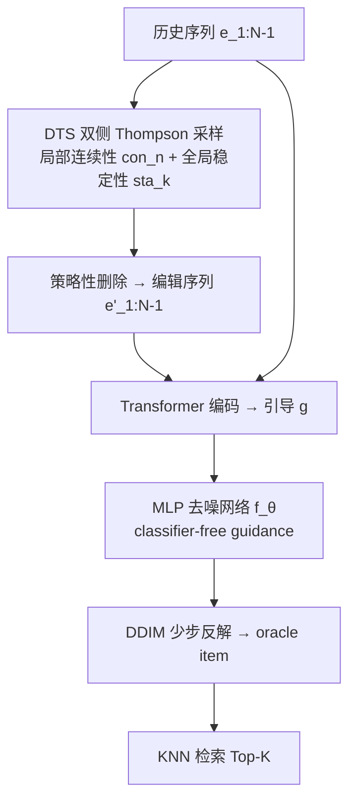
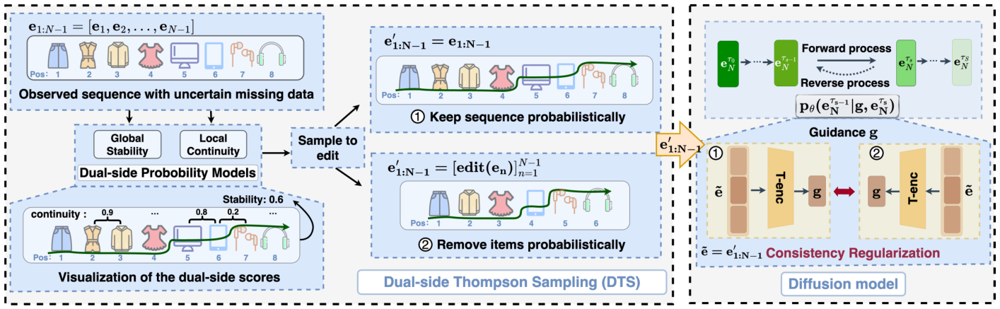

# Addressing Missing Data Issue for Diffusion-based Recommendation (面向扩散式推荐的缺失数据问题)

- **会议/期刊**: SIGIR 2025
- **作者与机构**: Wenyu Mao, Zhengyi Yang, Jiancan Wu, Haozhe Liu, Yancheng Yuan, Xiang Wang, Xiangnan He（中国科学技术大学、香港理工大学）
- **推荐链路定位**: 端到端生成式（序列推荐 Next-Item 生成）
- **研究方向**: 生成式推荐与离散语义ID / 序列与会话推荐
- **论文原文**: [https://arxiv.org/abs/2505.12283v1](https://arxiv.org/abs/2505.12283v1)
- **开源代码**: [https://github.com/maowenyu-11/TDM](https://github.com/maowenyu-11/TDM)

## TL;DR (1分钟核心速览)

扩散式序列推荐把历史交互序列编码为引导信号 $g$ 去噪生成 oracle item，但真实序列天然存在**发生位置与内容均不可知**的缺失，引导信号不可靠。本文不去"补全"（补全会引入额外错误），而是反向**主动模拟更多缺失**：用双侧 Thompson 采样（局部 item 连续性 + 全局序列稳定性）删除偏好保持性弱的物品，得到编辑序列作为扰动引导，通过一致性正则化让模型对缺失不敏感，从而外推抵抗真实缺失。在 YooChoose/KuaiRec/Zhihu 上以 HR@20/NDCG@20 全库排序评测，相对最优基线分别提升 9.85%/26.95%、5.84%/13.84%、14.72%/10.23%。

## Background & Motivation (背景与核心矛盾)

- **主流范式**: DreamRec、DiffuRec 等以扩散模型在历史序列条件引导下逐步去噪生成下一物品，取代"从采样负例中分类"的判别式范式。
- **前人局限**: ① 补全式方法（PDRec 生成补充物品、SSDRec 插入操作、STEAM）把缺失当作可复原的确定量，但完整序列不可见、缺失位置与内容双重不确定，补全反而**扭曲用户偏好**；② 生成式方法默认观测序列是可信引导，缺失导致引导信号偏移，直接生成次优 oracle item。
- **核心洞察 (Key Insight)**: 若模型能对"模拟出来的缺失"保持输出稳定（一致性），则对"真实缺失"也应具备外推鲁棒性——即 $\|\bar{g}-\hat{g}\|$方向上的扰动可由$\|\hat{g}-\tilde{g}\|$ 方向上的扰动来界定。
- **本文切入点**: 用偏好保持的**策略性删除**替代不可靠的补全，把"缺失"变成一种可控的数据增广算子。

## Method (核心方法设计)

### 1. 整体框架 (Overall Architecture)

输入历史序列 $\mathbf{e}_{1:N-1}$，先经 DTS 模块按概率决定"是否编辑该序列"与"删除哪些物品"，得到编辑序列$\mathbf{e}'_{1:N-1}$；再由 Transformer 编码器编码为引导$g$，与加噪的下一物品$\mathbf{e}^0_N$一同送入 MLP 去噪网络预测$\hat{\mathbf{e}}^0_N$。训练采用 classifier-free guidance（以概率$\rho$把$g$替换为 dummy token$\Phi$），推理时用 DDIM 少步反解并做条件/无条件线性组合，最后在候选集中做 KNN 检索返回 Top-K。

<figure class="paper-figure" markdown="span">
  <figcaption>图2：TDM框架概览，该框架在引导信号中利用DTS模拟额外缺失数据，实现扩散模型的一致性正则化，并通过外推来解决现有缺失数据。</figcaption>
</figure>

### 2. 关键设计拆解 (Key Designs)

1. **双侧 Thompson 采样 DTS（偏好保持的缺失模拟）**：痛点是随机删除会破坏偏好演化轨迹。局部侧用相邻物品余弦相似度的 softmax 定义连续性 $con_n=\frac{\exp(\mathrm{sim}(\mathbf{e}_n,\mathbf{e}_{n+1}))}{\sum_{n'}\exp(\mathrm{sim}(\mathbf{e}_{n'},\mathbf{e}_{n'+1}))}$，刻画偏好漂移；全局侧以连续性分布的熵$h=-\sum_n con_n\log con_n$经 batch 内 softmax 归一化为稳定性$sta_k$。二者分别参数化为概率模型$L(con_n,p_n)$、$G(sta_k,p_k)$，采样得$\hat{p}_n,\hat{p}_k$，并以阈值判定：$1-\hat{p}_k<\lambda_1$才编辑该序列，$1-\hat{p}_n<\lambda_2$才把$\mathbf{e}_n$替换为$\Phi$（末位$\hat{p}_{N-1}=0$ 强制保留）。直觉：**高连续性物品处于高稳定序列中，删掉它对偏好曲线几乎无损**，因此模拟出的缺失与真实缺失"同分布"。

2. **一致性正则化与外推的理论闭环**：对去噪函数在 $\hat{g}$处做 Taylor 展开，可得$\|f_\theta(\mathbf{e}^{\tau_s}_N,\bar{g},\tau_s)-f_\theta(\mathbf{e}^{\tau_s}_N,\hat{g},\tau_s)\|\le C\|f_\theta(\mathbf{e}^{\tau_s}_N,\hat{g},\tau_s)-f_\theta(\mathbf{e}^{\tau_s}_N,\tilde{g},\tau_s)\|$，系数由$(\bar{g}-\hat{g})^\top\nabla_g f$与$(\tilde{g}-\hat{g})^\top\nabla_g f$之比决定；当模拟机制与真实缺失机制对齐时该比值趋近 1，$C$有界。再由平方和不等式$\|f(\hat{g})-f(\tilde{g})\|_2^2\le 2(\|f(\hat{g})-\mathbf{e}^0_N\|_2^2+\|f(\tilde{g})-\mathbf{e}^0_N\|_2^2)$，把一致性目标**归约为两侧重构损失**，无需额外损失项即可实现。

3. **训练目标、负采样与推理效率**：损失为 $\mathcal{L}=\sum_{s=1}^{S}\frac{1}{2d\sigma^2_{\tau_s}(1-\alpha_{\tau_s})}\mathbb{E}\|\hat{\mathbf{e}}^0_N-\mathbf{e}^0_N\|_2^2$，直接回归去噪后的物品嵌入而非噪声；**免负采样**（生成式范式天然规避 BPR/InfoNCE 采样偏差）。DDIM 将反解步数从$T\in\{500,1000,2000\}$压缩到$\tau_S\in\{5,10,20\}$，YooChoose 推理从 DreamRec 的 21m32s 降至 13s。

## Experimental Setup & Evaluation Protocol (实验设置与评估协议)

- **数据集与预处理**: 过滤交互数 <5 的物品与长度 <3 的序列（缓解冷启动），序列截断/填充至长度 10：

| 数据集 | #Users(序列) | #Items | #Interactions | 特征/场景说明 |
| :--- | :---: | :---: | :---: | :--- |
| YooChoose | 128,468 | 9,514 | 539,436 | 电商点击流 |
| KuaiRec | 92,090 | 7,261 | 737,163 | 短视频 |
| Zhihu | 11,714 | 4,838 | 77,712 | 问答社区 |
| Steam | 281,428 | 13,044 | 3,485,022 | 游戏平台（大规模） |
| Beauty / Toys | 22,363 / 19,412 | 12,101 / 11,924 | 198,502 / 167,597 | Amazon 跨域 |

- **数据划分与防穿越**: 按时间排序后 **8:1:1 比例划分**，保证后续交互不泄漏进训练集。
- **排名评测协议**: **Full-Ranking 全库未交互物品排序**（非采样排序），指标 HR@20 与 NDCG@20，报告 5 次运行均值 ± 标准差。
- **对比基线与超参设置**: 传统序列模型（GRU4Rec/Caser/SASRec/Bert4Rec/CL4SRec/IPS/AdaRanker）、生成式（DiffRec/DiffRIS/DreamRec）、补全式（DiffuASR/CaDiRec/PDRec/STEAM/SSDRec）；嵌入维度 $d=64$，学习率$\{0.01,\dots,5\times10^{-5}\}$，guidance 强度$w\in[0,10]$，$\lambda_1,\lambda_2\in[0,1]$，$\rho=0.1$。

## Key Experimental Results (实验关键数据)

### 1. 主实验对比 (Main Results)

| 方法 | YooChoose HR | YooChoose NDCG | KuaiRec HR | KuaiRec NDCG | Zhihu HR | Zhihu NDCG |
| :--- | :---: | :---: | :---: | :---: | :---: | :---: |
| SASRec | 3.68 | 1.63 | 3.92 | 1.53 | 1.62 | 0.60 |
| Bert4Rec | 4.96 | 2.05 | 3.77 | 1.73 | 2.01 | 0.72 |
| CL4SRec | 4.45 | 1.86 | 4.25 | 2.01 | 2.03 | 0.74 |
| STEAM | 4.69 | 1.76 | 4.98 | 2.90 | 1.75 | 0.69 |
| SSDRec | 4.52 | 1.95 | 4.19 | 3.28 | 2.03 | 0.72 |
| PDRec | 6.22 | 3.17 | 4.42 | 3.55 | 2.10 | 0.74 |
| DreamRec | 4.78 | 2.23 | 5.16 | 4.11 | 2.26 | 0.79 |
| **TDM** | **6.90** | **4.34** | **5.48** | **4.77** | **2.65** | **0.88** |
| Improv. | +9.85% | +26.95% | +5.84% | +13.84% | +14.72% | +10.23% |

在 Steam/Toys/Beauty 上 TDM 亦全面最优（Steam HR 16.19 / NDCG 7.52，相对最优基线 +2.53% / +8.38%）。

### 2. 消融实验 (Ablation Study)

| 变体 | YooChoose HR | YooChoose NDCG | KuaiRec HR | KuaiRec NDCG | Zhihu HR | Zhihu NDCG |
| :--- | :---: | :---: | :---: | :---: | :---: | :---: |
| Base（不模拟缺失） | 4.78 | 2.23 | 5.16 | 4.11 | 2.26 | 0.79 |
| w/o GL（双侧均随机） | 6.24 | 3.91 | 5.37 | 4.19 | 2.30 | 0.80 |
| w/o L（局部随机） | 6.41 | 4.26 | 5.44 | 4.63 | 2.34 | 0.86 |
| w/o G（全局随机） | 6.48 | 4.29 | 5.43 | 4.64 | 2.44 | 0.81 |
| w/ P（流行度代理） | 6.28 | 4.18 | 5.46 | 4.57 | 2.38 | 0.80 |
| w/ S（序列长度代理） | 6.27 | 4.30 | 5.46 | 4.54 | 2.30 | 0.83 |
| **TDM** | **6.90** | **4.34** | **5.48** | **4.77** | **2.65** | **0.88** |

### 3. 关键实验发现 (Key Findings)

1. **"模拟缺失"本身即是主要增益来源**：即使最朴素的 `w/o GL`（完全随机删除）也把 YooChoose NDCG 从 2.23 拉到 3.91（+75%），说明扩散推荐对引导扰动的一致性正则化收益极大；而 DTS 在此之上再提至 4.34，证明**删除哪些物品**的偏好保持性设计是第二层关键增量。
2. **局部与全局两侧互补、缺一不可**：单独去掉任一侧（`w/o L` 4.26 / `w/o G` 4.29）均低于完整 TDM（4.34），且 `w/o G` 在 Zhihu 的 HR 掉到 2.44，说明全局稳定性在短序列、高波动场景下对抑制过度删除尤为重要。
3. **DTS 是可插拔的通用鲁棒算子**：迁移到 GRU4Rec/SASRec/CL4SRec/Caser/AdaRanker/DiffuASR 上近乎全面提升（如 CL4SRec 在 KuaiRec NDCG +10.67%，DiffuASR 在 KuaiRec NDCG +17.09%），且在 DreamRec 上增益最大（YooChoose NDCG +48.62%），印证扩散模型是 DTS 一致性正则化的最佳载体；合成 10%/20%/30% 缺失率下 TDM 的衰减斜率也明显小于 PDRec 与 DreamRec。

## Highlights & Limitations (亮点、对比与审稿批判)

- **与代表作对比 (vs. Prior Work)**: 与 PDRec/SSDRec/STEAM 的"补全/插入"路线本质对立——后者假设缺失可复原并引入伪标签误差，本文承认缺失不可知、转而做**分布层面的鲁棒化**；与 DreamRec 的差异仅在于引导信号是否经过 DTS 编辑，但正是这一"数据侧"改动带来 YooChoose NDCG 近一倍的提升，说明生成式推荐的瓶颈可能更多在条件质量而非生成器容量。
- **可迁移亮点**: ① "连续性 + 熵稳定性"双概率模型可作为任意序列模型（不限于扩散）的**偏好保持型序列增广**算子，成本仅为余弦相似度与熵计算；② 用平方和不等式把一致性目标归约为重构损失，避免额外超参，这一技巧可复用到其他条件生成推荐。
- **审稿级局限批判**: ① 缺失模拟机制仅由"连续性/稳定性"两个手工统计量刻画，对跨品类跳跃、突发兴趣漂移等复杂模式可能失效（作者亦自认）；② 阈值 $\lambda_1,\lambda_2$ 需逐数据集调优，图 3/4 显示过度或不足删除均导致次优，且实验仅在序列长度 10 的设定下验证，长序列下的删除比例控制与开销未充分讨论。

## Rating (四维评分)

- **方法创新性 (Novelty)**: ⭐⭐⭐⭐ （"以模拟缺失对抗真实缺失"的反直觉视角 + Thompson 采样双概率模型，配 Taylor 展开的外推界证明，理论闭环完整）
- **评估协议与实验扎实度 (Protocol & Experiments)**: ⭐⭐⭐⭐ （6 数据集、Full-Ranking 全库排序、5 次运行带方差、8 组消融变体 + 缺失率/序列长度鲁棒性 + 跨模型泛化，覆盖充分）
- **写作与数学规范度 (Clarity & Rigor)**: ⭐⭐⭐⭐ （DTS 定义与式 (6)–(11) 清晰，外推证明中"两内积近似相等"的假设略强、未给经验验证，属小瑕疵）
- **工业落地与复现价值 (Industrial & Practical Value)**: ⭐⭐⭐⭐⭐ （代码开源；DTS 开销可忽略，DDIM 使推理从 21m32s 降至 13s，训练时间与 SASRec 同量级，工程部署友好）

