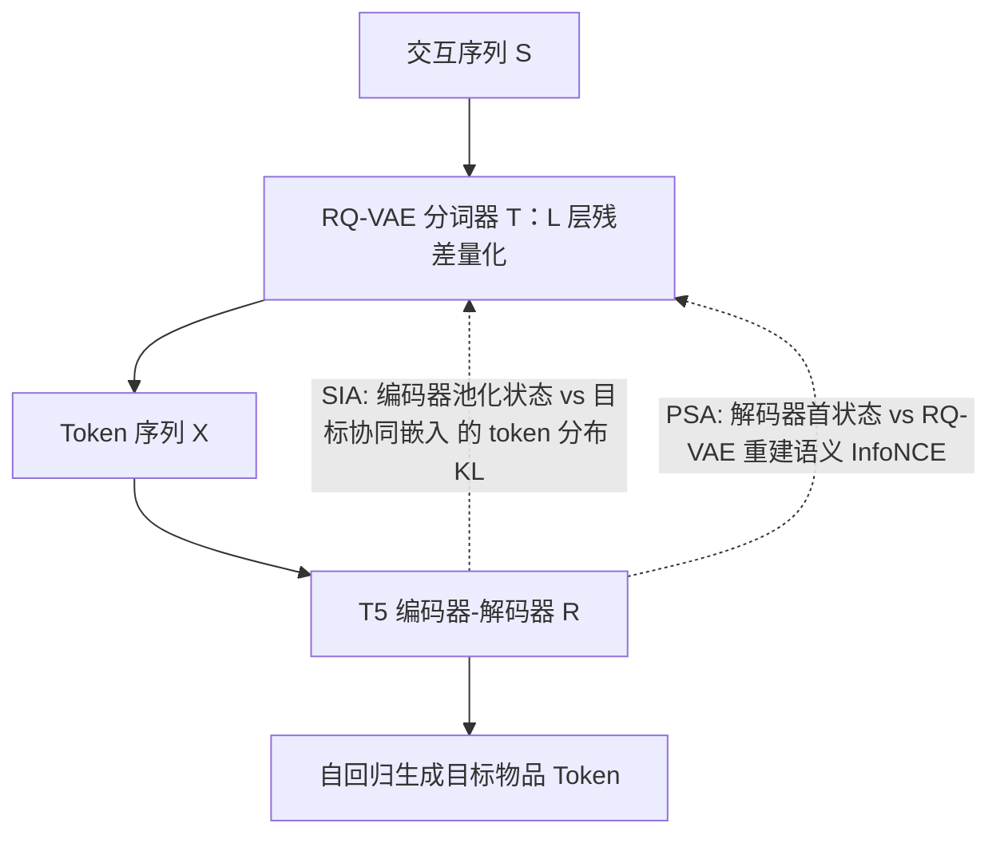
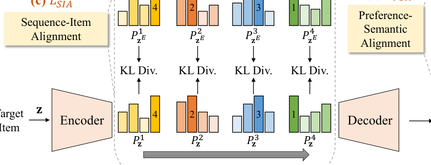

# Generative Recommender with End-to-End Learnable Item Tokenization (端到端可学习物品分词的生成式推荐)

- **会议/期刊**: SIGIR 2025 (Research Track)
- **作者与机构**: Enze Liu, Bowen Zheng, Cheng Ling, Lantao Hu, Han Li, Wayne Xin Zhao（中国人民大学高瓴人工智能学院 & 快手科技）
- **推荐链路定位**: 端到端生成式（Next-Item 生成式检索）
- **研究方向**: 生成式推荐与离散语义 ID / 序列推荐
- **论文原文**: [https://arxiv.org/abs/2409.05546v3](https://arxiv.org/abs/2409.05546v3)
- **开源代码**: [https://github.com/RUCAIBox/ETEGRec](https://github.com/RUCAIBox/ETEGRec)

## TL;DR (1分钟核心速览)

现有生成式推荐（TIGER / LETTER）把物品分词当作**离线预处理**，分词器与推荐器完全解耦：分词器不知道推荐目标，推荐器也无法反向精炼分词器中的协同先验。ETEGRec 用双编码器-解码器把 RQ-VAE 分词器与 T5 推荐器装进同一框架，设计**序列-物品对齐（SIA，KL 散度）**与**偏好-语义对齐（PSA，InfoNCE）**两条损失互相牵引，并以交替优化保证稳定训练。在 Amazon 2023 三个子集、`Leave-One-Out` + `Full-Ranking` 协议下，Recall@10 相对最强基线 LETTER 提升 3.5%–5.1%，NDCG@10 提升 4.7%–6.7%。

## Background & Motivation (背景与核心矛盾)

- **主流范式**: 生成式推荐将 Next-Item 预测改写为 token 序列到序列生成，主流做法是 RQ-VAE 把物品量化成 $L$ 层语义 ID（TIGER 用文本嵌入、LETTER 用协同+文本嵌入），再喂给 T5 式编码器-解码器自回归生成。
- **前人局限一**: 分词器在预处理阶段训练完即冻结，其优化目标（重建误差 + 码本对齐）与推荐目标（下一物品似然）毫无关联，产出的 ID 对推荐任务而言是"次优匹配"。
- **前人局限二**: 推荐器只能被动接受固定 token 序列，无法把自身学到的用户偏好反向注入分词器；同时固定 token 序列模式单一，易过拟合。
- **核心洞察 (Key Insight)**: 分词器本质上是一个"把任意嵌入映射到层级 token 分布"的函数，因此**过去序列的编码器状态与目标物品的协同嵌入，若语义相关，就应当被分词器映射到相似的 token 分布**——这为两个模块提供了天然的对齐监督信号。
- **本文切入点**: 把分词器视为可训练组件，用两条对齐损失从"序列↔物品"和"偏好↔语义"两个视角耦合二者，再用交替优化解耦梯度冲突。

## Method (核心方法设计)

### 1. 整体框架 (Overall Architecture)

输入为用户物品级交互序列 $S=[i_1,\dots,i_t]$，先经 RQ-VAE 分词器$\mathcal{T}$展平为 token 序列$X$；T5 式推荐器$\mathcal{R}$的编码器建模$X$得到$H_E$，解码器以 `[BOS]` 起始自回归生成目标物品的$L$个 token。训练时，分词器与推荐器通过 SIA（编码器池化状态$\to$分词器$\to$与目标物品协同嵌入的 token 分布做对称 KL）和 PSA（解码器首隐状态$\leftrightarrow$RQ-VAE 重建语义嵌入做 InfoNCE）双向对齐，并按"1 轮分词器 +$C-1$ 轮推荐器"的周期交替更新，分词器收敛后永久冻结、推荐器训至收敛。推理阶段 token 可预先缓存，开销与 TIGER 完全一致。

<figure class="paper-figure" markdown="span">
  <figcaption>图1：ETEGRec的整体框架。ETEGRec由物品分词器和生成式推荐器两个主要组件构成。序列-物品对齐（SIA）与偏好-语义对齐（PSA）从两个不同视角实现对齐，以相互增强。</figcaption>
</figure>

### 2. 关键设计拆解 (Key Designs)

1. **序列-物品对齐 SIA（让分词器"看见"推荐目标）**：痛点在于分词器冻结后编码器可能被解码器"绕过"（decoder 很少使用 encoder 信息）。做法是把编码器隐状态均值池化并 MLP 变换为 $\boldsymbol{z}_E$，与目标物品协同嵌入$\boldsymbol{z}$一同送入分词器，在第$l$层得到 token 分布$P^l_{\boldsymbol{z}}$与$P^l_{\boldsymbol{z}_E}$，最小化对称 KL：
$$\mathcal{L}_{\text{SIA}}=-\sum_{l=1}^{L}\left[D_{\mathrm{KL}}\left(P^l_{\boldsymbol{z}}\,\|\,P^l_{\boldsymbol{z}_E}\right)+D_{\mathrm{KL}}\left(P^l_{\boldsymbol{z}_E}\,\|\,P^l_{\boldsymbol{z}}\right)\right]$$
直觉：过去序列状态若真能预测未来物品，就应在码本空间落到同一"语义格"，这既对齐了两模块，又反向强化了编码器的表征能力。

2. **偏好-语义对齐 PSA（把分词器拉进推荐损失）**：推荐损失 $\mathcal{L}_{\text{REC}}$只监督 token 标签，分词器不参与。PSA 取解码器首个隐状态$\boldsymbol{h}_D$（序列偏好）与 RQ-VAE **重建**语义嵌入$\tilde{\boldsymbol{z}}$（含分词器参数）做批内负样本 InfoNCE：
$$\mathcal{L}_{\text{PSA}}=-\left[\log\frac{\exp(s(\tilde{\boldsymbol{z}},\boldsymbol{h}_D)/\tau)}{\sum_{\hat{\boldsymbol{h}}\in\mathcal{B}}\exp(s(\tilde{\boldsymbol{z}},\hat{\boldsymbol{h}})/\tau)}+\log\frac{\exp(s(\boldsymbol{h}_D,\tilde{\boldsymbol{z}})/\tau)}{\sum_{\hat{\boldsymbol{z}}\in\mathcal{B}}\exp(s(\boldsymbol{h}_D,\hat{\boldsymbol{z}})/\tau)}\right]$$
关键在用的是 $\tilde{\boldsymbol{z}}$而非原始$\boldsymbol{z}$——梯度因此能穿透 RQ-VAE 解码器回传到分词器，实现"推荐信号精炼语义码本"。

3. **交替优化与总损失**：直接联合优化会因分词器高频更新导致 token 漂移、推荐器训练震荡（消融中 `w/o AT` 掉点最严重）。故分词器侧优化 $\mathcal{L}_{\text{IT}}=\mathcal{L}_{\text{SQ}}+\mu\mathcal{L}_{\text{SIA}}+\lambda\mathcal{L}_{\text{PSA}}$（冻结推荐器），推荐器侧优化$\mathcal{L}_{\text{GR}}=\mathcal{L}_{\text{REC}}+\mu\mathcal{L}_{\text{SIA}}+\lambda\mathcal{L}_{\text{PSA}}$（冻结分词器）。负采样采用批内负样本（InfoNCE），生成阶段 beam size 统一为 20，无额外在线开销。

## Experimental Setup & Evaluation Protocol (实验设置与评估协议)

- **数据集与预处理**: Amazon 2023 三个子集，`5-core` 过滤，序列最大长度 50：

| 数据集 | #Users | #Items | #Interactions | 稀疏度 | 场景说明 |
| :--- | :---: | :---: | :---: | :---: | :--- |
| Instrument | 57,439 | 24,587 | 511,836 | 99.964% | 乐器 |
| Scientific | 50,985 | 25,848 | 412,947 | 99.969% | 工业科学品 |
| Game | 94,762 | 25,612 | 814,586 | 99.966% | 电子游戏 |

- **数据划分与防穿越**: `Leave-One-Out`——每用户最后一条交互为测试、倒数第二条为验证、其余为训练。
- **排名评测协议**: 无偏 `Full-Ranking`（全物品库排序），指标 Recall@{5,10} 与 NDCG@{5,10}；生成式基线 beam size 统一 20。
- **对比基线与超参**: 传统序列模型 Caser/GRU4Rec/HGN/SASRec/BERT4Rec/FMLP-Rec/FDSA/S3Rec；生成式 SID/CID/TIGER/TIGER-SAS/LETTER。物品嵌入维度统一 128（SID/CID 保留默认 768）；RQ-VAE 为 3 层 MLP、$L=3$码本、每本$K=256$、码字维度 128；T5 为 6 层编解码、隐层 128、FFN 512、4 头；显著性用配对 t 检验$p<0.01$。

## Key Experimental Results (实验关键数据)

### 1. 主实验对比 (Main Results)

| Model | Instrument R@10 | Instrument N@10 | Scientific R@10 | Scientific N@10 | Game R@10 | Game N@10 |
| :--- | :---: | :---: | :---: | :---: | :---: | :---: |
| SASRec | 0.0530 | 0.0277 | 0.0406 | 0.0195 | 0.0821 | 0.0426 |
| FDSA | 0.0557 | 0.0295 | 0.0391 | 0.0216 | 0.0857 | 0.0453 |
| S3Rec | 0.0538 | 0.0282 | 0.0410 | 0.0218 | 0.0823 | 0.0444 |
| CID | 0.0507 | 0.0285 | 0.0300 | 0.0158 | 0.0748 | 0.0424 |
| TIGER | 0.0574 | 0.0308 | 0.0431 | 0.0231 | 0.0895 | 0.0471 |
| TIGER-SAS | 0.0576 | 0.0306 | 0.0435 | 0.0227 | 0.0891 | 0.0469 |
| LETTER | 0.0581 | 0.0310 | 0.0433 | 0.0230 | 0.0901 | 0.0475 |
| **ETEGRec** | **0.0624** | **0.0331** | **0.0455** | **0.0241** | **0.0947** | **0.0507** |
| Improv. vs LETTER | +7.4% | +6.8% | +5.1% | +4.8% | +5.1% | +6.7% |

### 2. 消融实验 (Ablation Study)

| 变体 | Instrument R@10 | Scientific R@10 | Game R@10 | Game N@10 |
| :--- | :---: | :---: | :---: | :---: |
| ETEGRec 完整 | **0.0624** | **0.0455** | **0.0947** | **0.0507** |
| w/o $\mathcal{L}_{\text{SIA}}$ | 0.0614 | 0.0446 | 0.0917 | 0.0491 |
| w/o $\mathcal{L}_{\text{PSA}}$ | 0.0609 | 0.0422 | 0.0933 | 0.0499 |
| w/o SIA & PSA | 0.0601 | 0.0422 | 0.0894 | 0.0478 |
| w/o AT（去交替优化） | 0.0529 | 0.0375 | 0.0810 | 0.0428 |
| w/o ETE（冻结 token 重训） | 0.0600 | 0.0431 | 0.0899 | 0.0475 |

### 3. 关键实验发现 (Key Findings)

- **交替优化是命门而非锦上添花**：`w/o AT` 在 Game 上 R@10 从 0.0947 暴跌至 0.0810（-14.5%），甚至低于 LETTER，说明分词器高频更新造成的 token 漂移会直接摧毁推荐器训练；而两条对齐损失各自贡献 1–3 个千分点，叠加后增益超线性。
- **收益不只来自"更好的 ID"**：`w/o ETE` 用 ETEGRec 产出的最终 token 重新独立训练推荐器，仍比完整模型低 0.0024–0.0048（Game R@10 0.0899 vs 0.0947），证明端到端过程中分词器携带的协同先验被推荐器持续吸收，而非仅靠一次性更优码本。
- **PSA 在稀疏数据上更关键**：Scientific 上移除 PSA 掉点（0.0455→0.0422，-7.3%）明显大于移除 SIA（-2.0%），与 t-SNE 可视化一致——偏好点紧密环绕对应语义点，说明对比对齐在交互稀疏时承担了主要的语义锚定作用；同时 ETEGRec 在未见用户上仍优于 TIGER/LETTER，泛化性成立。

## Highlights & Limitations (亮点、对比与审稿批判)

- **与代表作对比**: TIGER 用文本嵌入 + 冻结 RQ-VAE，LETTER 虽引入协同信号与码本多样性正则，但仍是"先分词后推荐"的两阶段；ETEGRec 的本质差异是把分词器变成推荐图的**可微一环**，且用 SIA 解决了 encoder-decoder 架构中编码器被绕过的经典病灶，这是 LETTER 完全未触及的。
- **可迁移亮点**: (1) "把上游离散化模块的输出分布作为对齐锚点做对称 KL"可迁移到任何"量化 + 下游任务"的级联结构（如向量召回量化、多模态离散码本）；(2) 用重建嵌入 $\tilde{\boldsymbol{z}}$ 而非原始嵌入构造对比损失，是让梯度穿透不可微量化层的轻量技巧。
- **审稿级局限批判**: (1) 交替优化引入周期 $C$、$\mu$、$\lambda$三组敏感超参，论文显示$\mu$ 最优值在 3e-4 与 1e-3 间随数据集漂移，工业场景调参成本不低；(2) 仅在三个 Amazon 子集、单一 RQ-VAE + T5 组合上验证，未给出更大参数量或非 VQ 分词器（如聚类树）下的 scaling 证据，且未报告训练总时长与显存开销的定量对比。

## Rating (四维评分)

- **方法创新性 (Novelty)**: ⭐⭐⭐⭐ （首次将分词器与生成式推荐器真正端到端耦合，SIA 的"分布级对齐"视角新颖且有编码器退化问题的机理解释）
- **评估协议与实验扎实度 (Protocol & Experiments)**: ⭐⭐⭐⭐ （Full-Ranking 无偏评测 + 配对 t 检验 + 未见用户泛化 + t-SNE 与超参分析齐全，但数据集仅限 Amazon 域）
- **写作与数学规范度 (Clarity & Rigor)**: ⭐⭐⭐⭐ （双损失与交替优化的动机链条清晰，复杂度分析给出与 TIGER 同阶的结论，符号略密但自洽）
- **工业落地与复现价值 (Industrial & Practical Value)**: ⭐⭐⭐⭐ （推理可缓存 token、开销与 TIGER 持平，代码已开源；但交替训练流程对工程管线改造要求较高）

