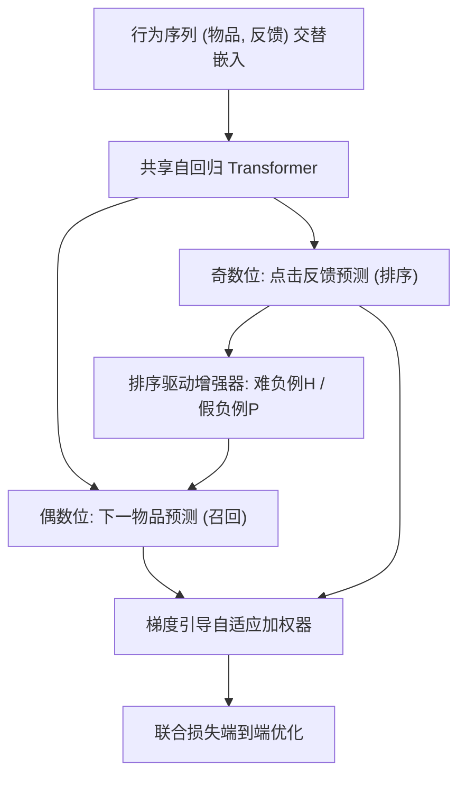
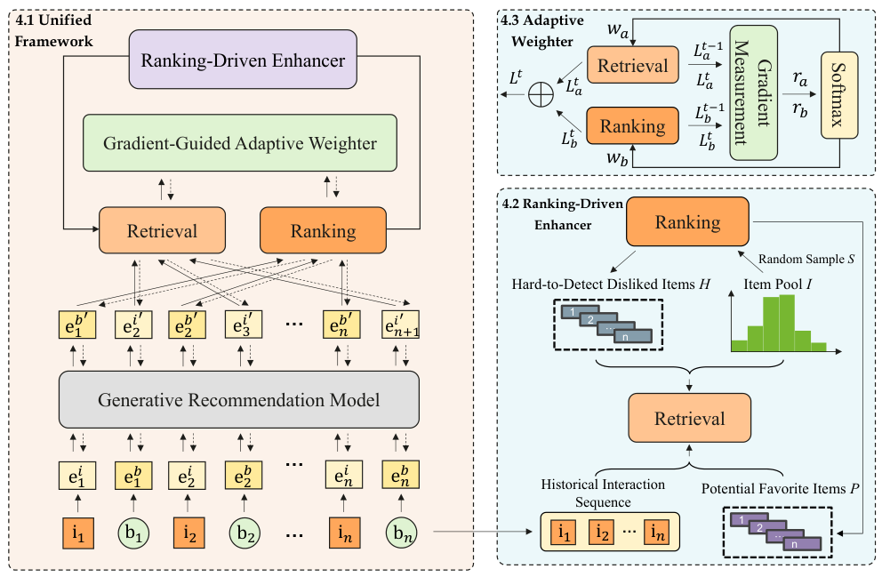

# Killing Two Birds with One Stone: Unifying Retrieval and Ranking with a Single Generative Recommendation Model (一石二鸟：用单一生成式推荐模型统一召回与排序)

- **会议/期刊**: SIGIR 2025
- **作者与机构**: Luankang Zhang, Hao Wang, Defu Lian, Enhong Chen 等（中国科学技术大学、华为诺亚方舟实验室、北京邮电大学）
- **推荐链路定位**: 召回 + 精排（端到端统一生成式）
- **研究方向**: 生成式推荐 / 多任务学习与列表级重排
- **论文原文**: [https://arxiv.org/abs/2504.16454v1](https://arxiv.org/abs/2504.16454v1)
- **开源代码**: 暂未开源

## TL;DR (1分钟核心速览)

传统多阶段推荐中召回与排序分模型训练，阶段间信息损失与样本选择偏差严重；已有生成式方法（HSTU、HLLM）仍按阶段独立训练，级联框架（RankFlow、CoRR）在生成模型上甚至负增益。UniGRF 把两阶段统一为同一自回归 Transformer 的**位置级序列生成**：偶数位输出下一物品（召回，Sampled Softmax），奇数位输出点击反馈（排序，BCE），并叠加排序驱动增强器（挖掘难负例/纠正假负例）与梯度引导自适应加权器（对齐两阶段收敛速度）。在 ML-1M/ML-20M/Amazon-Books 上采用 Leave-One-Out + 全库排序协议，召回 NDCG@10 最高提升约 2.8%，排序 AUC 最高提升约 4.5%（Books 0.7340→0.7672）。

## Background & Motivation (背景与核心矛盾)

- **主流范式**: 工业界采用「召回粗筛 → 排序精排」级联架构；生成式推荐（HSTU、Llama 骨干）已证明自回归范式可同时承载两类任务，但**仍为每阶段单独训练一个模型**。
- **前人局限**: ① 分阶段独立训练导致阶段间信息损失与数据选择偏差，级联框架 RankFlow/CoRR 依赖 KL 蒸馏或全局损失，在生成模型上实测反而掉点（RankFlow-HSTU AUC 仅 0.6340）；② 即便强行合并为单模型，两阶段损失量级与收敛速度差异巨大——召回需上百 epoch 收敛，排序在数十 epoch 后即开始退化（原文 Fig.3(a)），简单损失相加会让模型偏向召回、排序崩塌。
- **核心洞察 (Key Insight)**: 召回与排序本质互依——召回筛出的候选期望被排序打高分，排序的精确偏好又能反哺召回的样本质量；LLM 多任务统一的成功说明「一个生成模型 + 位置区分输出」可天然消除阶段间信息壁垒。
- **本文切入点**: 用输出位置区分任务（偶数位召回、奇数位排序）实现零额外开销的参数全共享，再用增强器与加权器解决「协同」与「同步」两大难题。

## Method (核心方法设计)

### 1. 整体框架 (Overall Architecture)

输入用户行为序列 $X_u=\{i_1,b_1,\dots,i_n,b_n\}$（物品与点击反馈交替），经嵌入后送入任意自回归 Transformer（HSTU/Llama 均可插拔），输出序列按位置解耦：$e'_{b_k}$经小网络$f_\phi$得点击分（排序），$e'_{i_{k+1}}$与全库物品内积做召回。训练时排序驱动增强器利用排序分重构负样本集（难负例$\mathcal{H}$注入、假负例$\mathcal{P}$ 翻正），梯度引导加权器按两阶段损失下降速率动态调权，最终端到端联合优化；推理时同一模型先全库检索候选、再对候选打分排序，时间与空间复杂度较双模型减半。

<figure class="paper-figure" markdown="span">
  <figcaption>图1：UniGRF 概览。该框架将检索与排序统一到一个生成式推荐模型中，并采用排序驱动的增强器和梯度引导的自适应加权器，以实现高效协作与同步优化。</figcaption>
</figure>

### 2. 关键设计拆解 (Key Designs)

1. **位置级统一生成（Unified Position-wise Generation）**：痛点在于双模型训练的信息损失。本文将两任务编码进同一输出序列的不同位置，召回用 Sampled Softmax 拉近预测向量与真实下一物品、推远随机负样本 $\mathcal{S}$：$\mathcal{L}_{retrieval}=-\sum_{u}\sum_{k}\log\frac{\exp(\mathrm{sim}(e'_{i_k},e_{i_k}))}{\exp(\mathrm{sim}(e'_{i_k},e_{i_k}))+\sum_{j\in\mathcal{S}}\exp(\mathrm{sim}(e'_{i_k},e_j))}$；排序对$e'_{b_k}$施加 BCE：$\mathcal{L}_{ranking}=\sum_u\sum_k \mathrm{BCE}(\sigma(f_\phi(e'_{b_k})),b_k)$。由于召回从全库采样负例，模型学到真实数据分布，天然缓解排序阶段的样本偏差；全共享参数使两阶段互为正则。

2. **排序驱动增强器（Ranking-Driven Enhancer）**：随机负采样过于易分且可能误采用户真正喜欢的物品。本文用排序分定义相对分数 $score=score_{retrieval}\cdot(\frac{score_{retrieval}}{score_{ranking}}-1)$，取 Top-$m$作为「召回高分但排序低分」的难负例$\mathcal{H}$注入负样本集；反之排序分$>\alpha$的样本判为潜在正例$\mathcal{P}$ 并翻正标签。直觉是：排序阶段对用户意图刻画更精细，用它清洗召回的监督信号，形成「排序教召回、召回反哺排序」的双向增强环，且打分函数为线性复杂度，额外开销可忽略。

3. **梯度引导自适应加权器（Gradient-Guided Adaptive Weighter）**：以相邻步损失比值 $r_a=\mathcal{L}^t_{retrieval}/\mathcal{L}^{t-1}_{retrieval}$、$r_b=\mathcal{L}^t_{ranking}/\mathcal{L}^{t-1}_{ranking}$度量收敛速度（$r$越大收敛越慢），经温度$T$的 Softmax 分配权重$w_a=\lambda_a\frac{\exp(r_a/T)}{\exp(r_a/T)+\exp(r_b/T)}$（$w_b$对称），总损失$\mathcal{L}^t=w_a\mathcal{L}^t_{retrieval}+w_b\mathcal{L}^t_{ranking}$。慢收敛任务自动获得更大权重，从而把「召回跑得快、排序早退化」的异步优化拉回同步轨道。

## Experimental Setup & Evaluation Protocol (实验设置与评估协议)

- **数据集与预处理**: 按时间排序构造序列，过滤交互数 $<3$的序列；评分$>3$ 置为 1（喜欢），否则 0。

| 数据集 | #Users | #Items | #Interactions | 平均序列长 | 特征/场景说明 |
| :--- | :---: | :---: | :---: | :---: | :--- |
| MovieLens-1M | 6,040 | 3,706 | 1,000,209 | 165.6 | 电影评分，稠密 |
| MovieLens-20M | 138,493 | 26,744 | 20,000,263 | 144.4 | 大规模电影评分 |
| Amazon-Books | 694,897 | 686,623 | 10,053,086 | 14.5 | 图书评论，极稀疏 |

- **数据划分与防穿越 (Splitting Strategy)**: `Leave-One-Out`——最后一条交互为测试集、倒数第二条为验证集、其余为训练集。
- **排名评测协议 (Ranking Protocol)**: 召回采用无偏 `Full-Ranking`（全物品集为候选，避免采样偏差），指标 NDCG@{10,50}、HR@{10,50}、MRR；排序用 AUC。负采样：ML-1M 每正样本 128 个、ML-20M/Books 256 个。
- **对比基线与超参设置**: 召回基线 BPR-MF/GRU4Rec/NARM/SASRec/Llama/HSTU 及级联 RankFlow-HSTU、CoRR-HSTU；排序基线 DCN/DIN/GDCN。学习率统一 $1e-3$，Transformer 层数 ML-1M 为 2、其余为 4，8 卡分布式训练，显著性$p<0.05$。

## Key Experimental Results (实验关键数据)

### 1. 主实验对比 (Main Results)

召回（节选，NG=NDCG）：

| 模型 | ML-1M NG@10 | ML-1M HR@10 | ML-20M NG@10 | ML-20M HR@10 | Books NG@10 | Books HR@10 |
| :--- | :---: | :---: | :---: | :---: | :---: | :---: |
| SASRec | 0.1594 | 0.2899 | 0.1692 | 0.3016 | 0.0229 | 0.0408 |
| Llama | 0.1746 | 0.3110 | 0.1880 | 0.3268 | 0.0338 | 0.0603 |
| HSTU | 0.1708 | 0.3132 | 0.1814 | 0.3056 | 0.0337 | 0.0613 |
| CoRR-HSTU | 0.1468 | 0.2081 | 0.1629 | 0.2796 | 0.0352 | 0.0612 |
| UniGRF-Llama | **0.1765** | **0.3219** | **0.1891** | **0.3270** | 0.0351 | 0.0624 |
| UniGRF-HSTU | 0.1756 | 0.3140 | 0.1816 | 0.3178 | **0.0354** | **0.0638** |
| Improv.% (vs 最强基线) | +1.1% | +2.8% | +0.6% | +0.1% | +0.6% | +4.1% |

排序（AUC）：

| 模型 | ML-1M | ML-20M | Books |
| :--- | :---: | :---: | :---: |
| DCN | 0.7176 | 0.7098 | 0.7042 |
| DIN | 0.7329 | 0.7274 | 0.7159 |
| GDCN | 0.7364 | 0.7089 | 0.7061 |
| HSTU | 0.7621 | 0.7807 | 0.7340 |
| CoRR-HSTU | 0.7497 | 0.7492 | 0.7357 |
| UniGRF-Llama | **0.7932** | 0.7776 | 0.7559 |
| UniGRF-HSTU | 0.7832 | **0.7941** | **0.7672** |
| Improv.% (vs 最强基线) | +4.1% | +1.7% | +4.5% |

### 2. 消融实验 (Ablation Study)

MovieLens-1M，骨干统一为 HSTU：

| 变体 | AUC | NG@10 | HR@10 | MRR |
| :--- | :---: | :---: | :---: | :---: |
| HSTU（独立训练） | 0.7621 | 0.1708 | 0.3132 | 0.1431 |
| w/o Enhancer | 0.7815 | 0.1717 | 0.3117 | 0.1446 |
| w/o Weighter | 0.7582 | 0.1734 | 0.3199 | 0.1441 |
| w/o Both | 0.7293 | 0.1681 | 0.3113 | 0.1392 |
| HSTU-FT-a（召回→排序微调） | 0.7752 | - | - | - |
| HSTU-FT-b（排序→召回微调） | - | 0.1727 | 0.3182 | 0.1436 |
| UniGRF-HSTU | **0.7832** | **0.1756** | **0.3140** | **0.1484** |

### 3. 关键实验发现 (Key Findings)

1. **「只统一不协同」会负增益**：w/o Both 的 AUC 仅 0.7293，低于独立训练的 HSTU（0.7621），证明单纯合并两阶段损失反而互相拖累；而补上增强器或加权器任一模块即可反超基线，说明协同机制与同步优化缺一不可。
2. **排序阶段受益远大于召回**：UniGRF-HSTU 在 Books 上 AUC 提升 4.5%（0.7340→0.7672），而召回 NG@10 仅 +0.6%；原因是排序任务本身信息量少、独立训练欠拟合，而召回经全库负采样已较强，跨阶段迁移对弱任务边际收益更高——这对直接影响最终曝光的排序环节尤为关键。
3. **难负例数量 $m$存在数据集相关的甜点**：ML-20M 上$m$从 0 增至 20 时两阶段性能单调上升；ML-1M 上$m\approx5$ 最优，过大则因难负例重复出现、样本多样性下降而过拟合。此外层数从 2 扩至 32 时损失与 AUC/HR@10 同步改善，验证统一框架仍遵循 scaling law。

## Highlights & Limitations (亮点、对比与审稿批判)

- **与代表作对比 (vs. Prior Work)**: 与 HSTU/HLLM 的本质区别是「单模型双任务」而非「双模型单任务」，参数全共享且复杂度减半；与 RankFlow/CoRR 的区别在于不依赖 KL 蒸馏或分阶段预训练，而是用排序分直接重构召回的监督样本，实测在生成骨干上级联框架失效而 UniGRF 稳定增益。
- **可迁移亮点**: ① 「位置区分任务」的输出解耦技巧可零成本迁移到多目标生成式推荐（如曝光/点击/转化多任务）；② 用高精度阶段分数反向清洗低精度阶段负样本的「增强环」思路，可推广到粗排-精排或召回-粗排的任意相邻阶段。
- **审稿级局限批判**: ① 召回提升幅度有限（ML-20M NG@10 仅 +0.6%），且未报告推理延迟与全库检索的 ANN 索引开销，工业可用性论证不足；② 增强器阈值 $\alpha$与难负例数$m$对数据集规模敏感（小数据$m=5$ 即过拟合），缺少自适应设定；③ 仅在公开中小规模数据集验证，未涉及 prerank/rerank 等更多阶段与线上 A/B。

## Rating (四维评分)

- **方法创新性 (Novelty)**: ⭐⭐⭐⭐ （首个在生成式推荐中统一召回排序的框架，位置解耦 + 增强环 + 梯度加权三件套设计自洽，但单点技术多为已有思想的组合迁移）
- **评估协议与实验扎实度 (Protocol & Experiments)**: ⭐⭐⭐⭐ （Leave-One-Out + 全库排序协议规范，三数据集 + 双骨干 + 消融/微调对照/scaling 分析完整，但召回增益偏小且缺显著性区间报告）
- **写作与数学规范度 (Clarity & Rigor)**: ⭐⭐⭐⭐ （公式简洁、模块动机与失效现象对应清晰，但相对分数公式的物理含义与 $\alpha$ 选取缺少推导）
- **工业落地与复现价值 (Industrial & Practical Value)**: ⭐⭐⭐⭐ （模型无关、即插即用、复杂度减半，工程价值高；但暂未开源，且缺延迟与线上验证）

