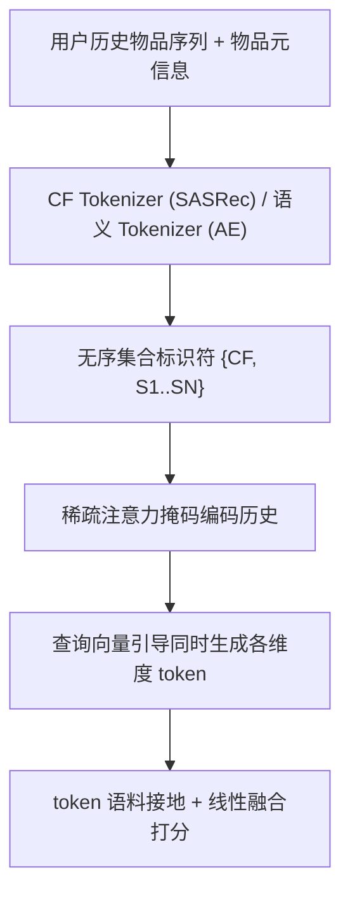
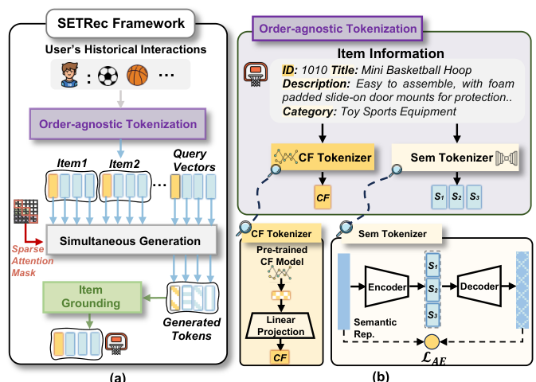

# Order-agnostic Identifier for Large Language Model-based Generative Recommendation (面向大模型生成式推荐的无序标识符)

- **会议/期刊**: SIGIR 2025
- **作者与机构**: Xinyu Lin, Haihan Shi, Wenjie Wang, Fuli Feng, Qifan Wang, See-Kiong Ng, Tat-Seng Chua（NUS / USTC / Meta AI）
- **推荐链路定位**: 端到端生成式（生成式召回）
- **研究方向**: 生成式推荐与离散语义ID / 大语言模型推荐
- **论文原文**: [https://arxiv.org/abs/2502.10833v2](https://arxiv.org/abs/2502.10833v2)
- **开源代码**: [https://github.com/Linxyhaha/SETRec](https://github.com/Linxyhaha/SETRec)

## TL;DR (1分钟核心速览)

LLM 生成式推荐中，物品标识符设计存在两难：token 序列标识符（TIGER/LETTER）受束搜索局部最优与逐 token 串行生成拖累，单 token 标识符（E4SRec）又丢失 CF 或语义信息。本文提出**无序集合标识符**范式：每个物品由 1 个 CF token + $N$ 个语义 token 组成的无序集合表示，配合稀疏注意力掩码与查询向量引导实现**一次前向同时生成全部 token**。在 4 个数据集、T5 与 Qwen(1.5B–7B) 上，全库排序 Recall@10 相对最优基线提升约 40%–60%，推理提速 8–18 倍。

## Background & Motivation (背景与核心矛盾)

- **主流范式**: LLM 生成式推荐将用户历史转为标识符序列，自回归生成下一物品标识符；标识符分两支——离散 token 序列（RQ-VAE 码本、层级聚类）与单 token 连续嵌入（ID 或语义）。
- **前人局限**: ① token 序列标识符存在**束搜索局部最优**：目标物品首 token 概率低，早期即被剪枝（图 1），且逐 token 串行调用 LLM 推理开销不可接受；② 单 token 标识符中，ID 嵌入依赖充分交互、长尾失效，语义嵌入则完全丢失 CF 协同信号。
- **核心洞察 (Key Insight)**: 多维度信息（CF 与语义）之间**本无先后依赖**（如"价格"与"类别"），强行排成有序序列既引入虚假依赖又制造局部最优；若去掉 token 间依赖，则可并行生成。
- **本文切入点**: 将物品表示为**无序 token 集合**，用稀疏掩码切断物品内 token 可见性，用可学习查询向量区分维度，实现"集合级"同时生成与可扩展的语料库接地。

## Method (核心方法设计)

### 1. 整体框架 (Overall Architecture)

SETRec 分两段：**离线分词**阶段用预训练 SASRec 产出 CF 嵌入、用统一自编码器（AE）将 SentenceT5 语义表示编码为 $N$个无序语义嵌入，拼成集合标识符$\tilde{i}=\{\boldsymbol{z}_{\text{CF}},\boldsymbol{z}_{S_1},\dots,\boldsymbol{z}_{S_N}\}$，并汇总各维度 token 语料$\mathcal{Z}_k$作为接地头；**在线生成**阶段将用户历史展平为标识符序列，经稀疏注意力掩码编码后，由$N+1$ 个可学习查询向量引导 LLM 一次前向同时输出各维度 token，再分别与对应语料做内积并线性融合打分排序。

<figure class="paper-figure" markdown="span">
  <figcaption>图 4：(a) 展示 SETRec 框架，包括顺序无关的物品 token 化和同时物品生成。标识符内与查询向量内的依赖通过稀疏注意力掩码消除（详见 图 5）。(b) 展示通过 CF 和语义 tokenizer 进行的顺序无关物品 token 化。</figcaption>
</figure>

### 2. 关键设计拆解 (Key Designs)

1. **无序集合分词（CF + 多语义 token）**：单语义嵌入压缩多维语义易致嵌入坍缩，故用统一 AE 编码为 $N$个语义 token，仅增加约$1/N$参数并避免多编码器训练不稳；训练目标为重构损失$\mathcal{L}_{AE}=\|\boldsymbol{s}-\hat{\boldsymbol{s}}\|_2^2$。CF token 由 SASRec 嵌入经线性投影对齐 LLM 隐维，保证热物品精度；语义 token 保证冷启动物品的泛化。

2. **查询引导同时生成 + 稀疏注意力掩码**：为让 LLM 区分维度并一次生成，为每个维度 $k$配可学习查询向量$\boldsymbol{q}_k$，输出$\hat{\boldsymbol{z}}_k=\text{LLM\_Layers}(\boldsymbol{x},\boldsymbol{q}_k)$；历史编码时用稀疏掩码令同一物品内 token 互不可见、仅可见前序物品全部 token，从而消除虚假顺序依赖。该扁平化输入将批量生成复杂度从$M^3L^2d$降至$M^2L^2d$（$M$为维度数、$L$ 为历史长度），这是 8–18 倍加速的来源。

3. **训练目标、接地与推理**：生成损失为维度内对比式 softmax
$\mathcal{L}_{Gen}=-\frac{1}{|\mathcal{D}|}\sum_{\mathcal{D}}\sum_{k\in\mathcal{F}}\frac{\exp(\text{sim}(\hat{\boldsymbol{z}}_k,\boldsymbol{z}_k))}{\sum_{\boldsymbol{z}\in\mathcal{Z}_k}\exp(\text{sim}(\hat{\boldsymbol{z}}_k,\boldsymbol{z}))}$，
总损失 $\mathcal{L}=\mathcal{L}_{Gen}+\alpha\mathcal{L}_{AE}$。由于各维度 token 组合数$\prod_k|\mathcal{Z}_k|\gg|\mathcal{I}|$，采用**语料库接地**而非组合枚举：$s_k=W_k\hat{\boldsymbol{z}}_k$，$s=(1-\beta)s_{\text{CF}}+\beta\sum_{k\neq\text{CF}}s_k$。接地头直接取自 token 语料，新物品只需分词即可扩展，天然支持冷启动；推理仅一次 LLM 前向，无自回归解码。

## Experimental Setup & Evaluation Protocol (实验设置与评估协议)

- **数据集与预处理**: 三个 Amazon 类目（Toys/Beauty/Sports）+ Steam，均含标题、描述、类别等文本元信息；按时间戳排序后 **8:1:1 比例划分**；训练集出现过的物品记为 warm，否则为 cold。

| 数据集 | 领域 | 划分方式 | 特征/场景说明 |
| :--- | :---: | :---: | :--- |
| Toys | 电商玩具 | 8:1:1 时间序 | 标题/描述/类别/品牌 |
| Beauty | 美妆 | 8:1:1 时间序 | 同上 |
| Sports | 运动户外 | 8:1:1 时间序 | 同上 |
| Steam | 视频游戏 | 8:1:1 时间序 | 丰富文本语义 |

- **排名评测协议**: **Full-Ranking 全库排序**（对全部物品打分），指标 Recall@{5,10}、NDCG@{5,10}，并分 All / Warm / Cold 三种物品集合分别汇报；显著性用单样本 t 检验（$p<0.01$）。
- **对比基线与超参**: 单 token 类 DreamRec、E4SRec；token 序列类 BIGRec、IDGenRec、CID、SemID、TIGER、LETTER。骨干为 T5-small（全参微调）与 Qwen2.5-1.5B/3B/7B（LoRA）；AE 隐层 512/256/128 + ReLU；$N\in\{1..6\}$、$\alpha\in\{0.1..0.9\}$、$\beta\in\{0..1\}$ 网格搜索。

## Key Experimental Results (实验关键数据)

### 1. 主实验对比 (Main Results)

T5 骨干，All 设置（节选核心指标，括号内为相对次优基线提升）：

| 数据集 | 方法 | R@5 | R@10 | N@10 | 推理耗时(s) |
| :--- | :--- | :---: | :---: | :---: | :---: |
| Toys | LETTER | 0.0081 | 0.0117 | 0.0077 | 448 |
| Toys | TIGER | 0.0064 | 0.0106 | 0.0076 | 448 |
| Toys | E4SRec | 0.0061 | 0.0098 | 0.0064 | 55 |
| Toys | **SETRec** | **0.0110** | **0.0189** | **0.0118** | **60** |
| | *Improv.* | *+35.8%* | *+61.5%* | *+53.2%* | — |
| Beauty | LETTER | 0.0071 | 0.0103 | 0.0070 | 430 |
| Beauty | **SETRec** | **0.0106** | **0.0161** | **0.0103** | **126** |
| | *Improv.* | *+49.3%* | *+56.3%* | *+47.1%* | — |
| Sports | SemID | 0.0094 | 0.0167 | 0.0114 | 2367 |
| Sports | **SETRec** | **0.0114** | **0.0185** | **0.0126** | **136** |
| | *Improv.* | *+21.3%* | *+10.8%* | *+10.5%* | — |
| Steam | TIGER | 0.0202 | 0.0348 | 0.0287 | 1747 |
| Steam | **SETRec** | **0.0216** | **0.0383** | **0.0308** | **347** |
| | *Improv.* | *+6.9%* | *+10.1%* | *+7.3%* | — |

Qwen-1.5B 上 SETRec 在 Toys 全库 R@10 达 0.0188（次优 TIGER 0.0117），冷启动物品 R@10 达 0.0883（次优 TIGER 0.0715），推理较 token 序列方法平均提速约 20 倍。

### 2. 消融实验 (Ablation Study)

Toys 数据集，T5 骨干，Recall@10：

| 变体 | All | Warm | Cold |
| :--- | :---: | :---: | :---: |
| SETRec 完整 | **0.0189** | **0.0236** | **0.0812** |
| w/o Sem（去语义 token） | 显著下降 | 下降 | 大幅下降 |
| w/o CF（去 CF token） | 下降 | 下降 | 下降（T5） |
| w/o Query（随机冻结查询向量） | 下降 | 下降 | 下降 |
| w/o SA（改回原始注意力掩码） | 下降 | 下降 | 下降 |

### 3. 关键实验发现 (Key Findings)

1. **语义 token 是冷启动主力**：去掉语义 token 后冷启动物品 Recall@10 跌幅最大，且 w/o Sem 比 w/o CF 更伤，说明多语义 token 承载了区分物品的关键多维信息；而 Qwen 上 w/o CF 反而在冷启动物品上略有增益，暗示大模型参数内已含更强语义先验、CF 贡献被稀释。
2. **稀疏掩码与查询向量缺一不可**：w/o SA 与 w/o Query 均造成全场景下降，验证"去 token 依赖"与"维度区分引导"是同时生成可行的两个必要条件；同时稀疏掩码把复杂度从 $M^3L^2d$降到$M^2L^2d$，是效率收益的直接来源。
3. **稀疏物品收益更大、冷启动随规模扩展**：按流行度分桶 G1→G4，SETRec 相对 E4SRec/LETTER 的提升在 G2–G4 更显著；Qwen 从 1.5B→7B，冷启动物品 R@10 由 0.0883 升至 0.1016，而热物品基本持平（0.0236→0.0239），说明模型扩容主要增强语义理解而非 CF 建模。

## Highlights & Limitations (亮点、对比与审稿批判)

- **与代表作对比 (vs. Prior Work)**: 相比 TIGER/LETTER 的 RQ-VAE 有序码本，本文彻底放弃 token 顺序与自回归解码，把"多维度信息"从序列结构转为集合结构；相比 E4SRec 的单嵌入接地，本文保留多 token 表达力且接地头可扩展至新物品；与同期集合标识符工作（如 LC-Rec 类）相比，本文真正切断了 token 依赖并实现单次前向同时生成。
- **可迁移亮点**: ① "稀疏掩码 + 可学习查询向量"可迁移到任何需要多字段并行解码的生成式检索/多任务生成场景；② 用语料库作接地头替代组合枚举，是解决"组合爆炸 vs 有效物品"矛盾的通用技巧。
- **审稿级局限批判**: ① 语义 token 为连续嵌入而非离散码，无法直接复用 LLM 原生词表，需额外 AE 与投影层，跨模型迁移成本高；② 接地依赖各维度语料库内积，物品规模极大时接地头存储与打分开销线性增长，论文未给出千万级物品的实测；③ 冷启动物品指标绝对值偏高源于冷物品数量少，跨数据集可比性需谨慎解读。

## Rating (四维评分)

- **方法创新性 (Novelty)**: ⭐⭐⭐⭐ （"无序集合标识符"范式直击束搜索局部最优与串行低效两大痛点，原则提炼清晰，但组件本身多为已有模块的组合创新）
- **评估协议与实验扎实度 (Protocol & Experiments)**: ⭐⭐⭐⭐ （4 数据集 × 2 架构 × 3 规模，Full-Ranking + warm/cold/流行度分桶 + 效率与显著性检验齐全，唯缺线上 A/B 与超大规模物品验证）
- **写作与数学规范度 (Clarity & Rigor)**: ⭐⭐⭐⭐ （两条设计原则贯穿全文，复杂度分析给出 $M^3L^2d\to M^2L^2d$ 的明确推导，符号统一；部分公式排版略密）
- **工业落地与复现价值 (Industrial & Practical Value)**: ⭐⭐⭐⭐⭐ （代码开源，单次前向带来 8–20 倍推理加速，接地头可增量扩展新物品，对生成式召回线上部署极具吸引力）

