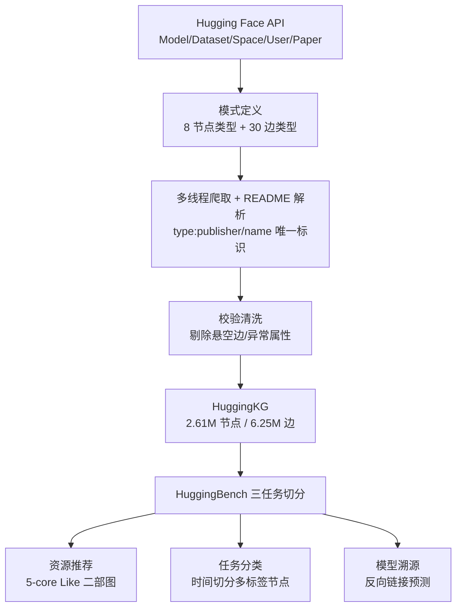

# Benchmarking Recommendation, Classification, and Tracing Based on Hugging Face Knowledge Graph (基于 Hugging Face 知识图谱的推荐、分类与溯源基准评测)

- **会议/期刊**: SIGIR 2025
- **作者与机构**: Qiaosheng Chen, Kaijia Huang, Xiao Zhou, Weiqing Luo, Yuanning Cui, Gong Cheng（南京大学计算机软件新技术国家重点实验室）
- **推荐链路定位**: 召回（资源推荐）+ 图谱侧节点分类与链接预测
- **研究方向**: 图神经网络与知识图谱推荐 / 冷启动与长尾推荐
- **论文原文**: [https://arxiv.org/abs/2505.17507v1](https://arxiv.org/abs/2505.17507v1)
- **开源代码**: [https://github.com/nju-websoft/HuggingBench](https://github.com/nju-websoft/HuggingBench)

## TL;DR (1分钟核心速览)

Hugging Face 等开源模型/数据集平台仅靠关键词检索与扁平元数据，无法利用模型演化（Finetune/Adapter/Merge/Quantize）、任务依赖与用户协作等结构化语义。本文构建首个大规模 ML 资源知识图谱 HuggingKG（261 万节点、624 万三元组、8 类节点、30 类边），并派生三任务基准 HuggingBench：跨类型资源推荐、多标签任务分类、模型血缘溯源。在 5-core 过滤 + 60/20/20 划分 + Full-Ranking 协议下，KGCL 在 Homo 子图上取得最优 Recall@5=0.1054，但 KGIN 近乎失效（0.0061），揭示领域稀疏 KG 与传统稠密 KG 基准的根本分布差异。

## Background & Motivation (背景与核心矛盾)

- **主流范式**: 开源资源平台（Hugging Face、GitHub）以关键词搜索 + 简单元数据标签为主，推荐系统侧则依赖用户-物品二部图协同过滤或引入 Wikidata 等通用大图谱做 KG 增强。
- **前人局限**: ① DEKR、MLTaskKG 等 ML 资源 KG 仅编码静态属性与少量关系（1.7 万–15.9 万节点），缺失模型间演化关系与用户交互信号；② KGIN/KGRec 等方法在 Amazon-Book、LastFM 等稠密 KG 上有效，但其多跳语义路径依赖稠密三元组，在领域专用稀疏图上直接崩塌。
- **核心洞察 (Key Insight)**: 作者统计发现 HuggingKG 的边以 Like（31.5%）与 Publish（28.8%）等交互边为主，模型演化边（Adapter 2.5%、Finetune 1.7%）稀疏但语义关键；且描述文本极长（Model 平均 270.2 词，57.2% 缺失描述），呈现"结构稀疏 + 文本长尾"的双重特性。
- **本文切入点**: 不做新推荐算法，而是把平台元数据统一为异构图谱，用三个下游任务系统性地暴露现有方法在领域稀疏 KG 上的失效边界。

## Method (核心方法设计)

### 1. 整体框架 (Overall Architecture)

HuggingKG 的构建遵循"模式定义 → 多线程 API 爬取 → 校验清洗"三步：先依据 Hugging Face 页面语义定义 8 类节点（Model/Dataset/Space/User/Organization/Task/Paper/Collection）与 30 类边，节点以 `type:publisher/name` 前缀保证跨类型唯一性；再用 `huggingface_hub` 批量拉取属性、README 全文与关系边，Paper 节点由 `arxiv:` 标签反查，Task 节点由 `pipeline_tags` 与 Dataset `tasks` 字段对齐；最后扫描所有边剔除悬空节点（如已删除模型）并清洗文本。全流程约 20 小时、5.8 GB 存储，支持日更。HuggingBench 则从该图谱切出三个子集，分别对应推荐、分类、溯源。

### 2. 关键设计拆解 (Key Designs)

1. **跨类型资源推荐测试集（首个 ML 资源跨类型推荐集合）**：痛点在于现有 paper2repo 等仅做论文-仓库单一类型匹配，无法刻画"用户同时点赞 Model/Dataset/Space"的异构偏好。本文将 Like 边抽为 User–{Model, Dataset, Space} 三部图，做 5-core 过滤后按 60/20/20 划分，并额外提供 84,913 条 Follow 边作社交图、四种 HuggingKG 子图（1hop/2hop/Homo/Publish）作外部 KG，从而把任务统一为 $\hat{y}_{ui}=\mathcal{F}(u,i)$ 的混合协同过滤-社交-KG 排序问题。其价值在于首次让三类异构资源在同一排序空间内被公平比较。

2. **模型溯源的反向链接预测形式化**：常规链接预测给定 $(h,r)$预测$t$，但溯源场景的真实需求是"已知某微调模型$t$与关系$r$，反查其基座模型$h$"。本文将任务改写为给定$(r,t)$预测$h$，输出候选头节点分布$\hat{\mathbf{y}}(r,t)=\mathcal{F}(\mathcal{G},r,t)$，并只在 Model 间四类演化边上评测。这一反转使答案空间从"多尾"变为"近似唯一"——统计显示本文测试集每个$(h,r)$ 平均仅 1.04 个答案，远低于 FB15k-237 的 399.82 与 WN18RR 的 24.57，直接解释了为何 TransE 这类线性平移模型反而最优。

3. **任务分类的时间切分与文本特征消融设计**：为模拟"新上传资源自动打标"的真实场景，按创建日期切分（Model 验证集 2024-08-15~10-15、测试集 2024-10-15~12-15；Dataset 因发布慢采用更长窗口），严格防止未来信息泄漏。特征侧设置 Binary / BERT / BERT(ft) / BGE / BGE(ft) 五档初始化，用于分离"图结构贡献"与"文本语义贡献"。训练目标为标准多标签二元交叉熵，无特殊负采样。

## Experimental Setup & Evaluation Protocol (实验设置与评估协议)

- **数据集与预处理**:

| 数据集 | #Users | #Items | #Interactions | 稀疏度/密度 | 特征/场景说明 |
| :--- | :---: | :---: | :---: | :---: | :--- |
| 推荐-Model | 29,720 | 16,200 | 667,365 | 平均 22.46/用户 | Like 边，5-core |
| 推荐-Dataset | 5,072 | 3,634 | 100,561 | 平均 19.83/用户 | Like 边，5-core |
| 推荐-Space | 14,171 | 5,246 | 297,294 | 平均 20.98/用户 | Like 边，5-core |
| 推荐-合计 | 38,624 | 25,080 | 1,065,220 | 平均 27.58/用户 | +84,913 Follow 边 |
| 分类 | — | 152,435 节点 | 166,199 边 | 52 类标签 | 时间切分，110,068/20,668/28,682 |
| 溯源 | — | 121,404 节点 | 339,429 边 | 30 类关系 | 16,520/2,049/2,055 三元组 |

- **数据划分与防穿越 (Splitting Strategy)**: 推荐任务采用 `比例划分`（60/20/20，按用户点赞列表切分）；分类任务采用 `全局时间戳切分`（按 Model/Dataset 创建日期，验证与测试窗口互不重叠）；溯源任务采用 `比例划分`（80/10/10，按 Model 间演化边切分）。
- **排名评测协议 (Ranking Protocol)**: 推荐任务为无偏 `Full-Ranking`（全库未交互物品排序），指标 Recall@{5,10,20,40} 与 NDCG@{5,10,20,40}；分类任务用 Micro-F1；溯源任务用 MRR 与 Hit@{1,3,5,10}，且仅评测"给定尾节点与关系预测头节点"方向。
- **对比基线与超参设置**: 推荐侧 11 个基线（LightGCN/HCCF/SimGCL/LightGCL/AutoCF/DCCF + MHCN/DSL + KGIN/KGCL/KGRec），统一 $d=64$、batch 4096、最多 100 epoch、以 MRR@5 早停，学习率网格 {1e-3,1e-4,1e-5}、GNN 层数 {2,3}；分类侧 9 个 GNN（GCN/GAT/GraphSAGE/GRAND/APPNP/GCNII/GraphSAINT/RevGCN/RevGAT），隐藏维 1024（GAT/RevGAT 为 256）；溯源侧 9 个基线（RESCAL/TransE/DistMult/ComplEx/ConvE/RotatE/HittER + ULTRA/KG-ICL），$d=64$、batch 256。原文未报告显著性检验。

## Key Experimental Results (实验关键数据)

### 1. 主实验对比 (Main Results)

资源推荐（Recall@5 / NDCG@5，节选）：

| 方法 | KG 类型 | Recall@5 | Recall@20 | NDCG@5 | NDCG@20 |
| :--- | :---: | :---: | :---: | :---: | :---: |
| LightGCN | — | 0.0856 | 0.1932 | 0.0868 | 0.1192 |
| SimGCL | — | 0.0999 | 0.2186 | 0.0998 | 0.1358 |
| LightGCL | — | 0.1033 | 0.2228 | 0.1035 | 0.1398 |
| AutoCF | — | 0.1003 | 0.2190 | 0.1012 | 0.1371 |
| MHCN | Social | 0.0979 | 0.2162 | 0.0998 | 0.1353 |
| DSL | Social | 0.0932 | 0.2123 | 0.0948 | 0.1307 |
| KGIN | Homo | 0.0061 | 0.0146 | 0.0065 | 0.0091 |
| KGRec | Homo | 0.0628 | 0.1476 | 0.0638 | 0.0898 |
| **KGCL** | **Homo** | **0.1054** | **0.2237** | **0.1058** | **0.1416** |

KGCL 相对最强协同过滤基线 LightGCL 的 Recall@5 提升 `+2.03%`，相对 AutoCF 提升 `+5.08%`。

任务分类（Micro-F1，节选）：

| 方法 | Binary | BERT | BERT(ft) | BGE | BGE(ft) |
| :--- | :---: | :---: | :---: | :---: | :---: |
| GCN | 0.0662 | 0.7620 | 0.8291 | 0.7411 | 0.8522 |
| GraphSAGE | 0.1800 | 0.5341 | **0.8845** | 0.8199 | **0.8830** |
| RevGCN | 0.1071 | 0.6763 | 0.8851 | 0.8039 | 0.8770 |
| GCNII | 0.1149 | 0.6456 | 0.8836 | 0.7779 | 0.8802 |
| GRAND | 0.1228 | 0.1297 | 0.6089 | 0.2646 | 0.4532 |

模型溯源（节选）：

| 方法 | 类型 | MRR | Hit@1 | Hit@10 |
| :--- | :---: | :---: | :---: | :---: |
| **TransE** | 监督 | **0.5589** | **0.4496** | **0.7562** |
| RotatE | 监督 | 0.5317 | 0.4195 | 0.7392 |
| ConvE | 监督 | 0.4739 | 0.3766 | 0.6735 |
| RESCAL | 监督 | 0.2694 | 0.2380 | 0.3470 |
| KG-ICL | 无监督 | 0.4008 | 0.3354 | 0.5938 |
| ULTRA | 无监督 | 0.3373 | 0.1440 | 0.6672 |

### 2. 消融实验 (Ablation Study)

原文未设传统"移除模块"式消融，但通过特征初始化与 KG 子图类型两组受控变量实现了等价归因：

| 受控变量 | 设置 | 代表结果 (Micro-F1 / Recall@5) | 变化 |
| :--- | :--- | :---: | :---: |
| 节点特征 | Binary → BERT | GraphSAGE 0.1800 → 0.5341 | +0.3541 |
| 节点特征 | BERT → BERT(ft) | RevGCN 0.6763 → 0.8851 | +0.2088 |
| 节点特征 | BGE → BGE(ft) | GCN 0.7411 → 0.8522 | +0.1111 |
| KG 子图 | 1hop → Homo | KGCL 0.0993 → 0.1054 | +0.0061 |
| KG 子图 | Publish → Homo | KGCL 0.1036 → 0.1054 | +0.0018 |

### 3. 关键实验发现 (Key Findings)

1. **领域稀疏 KG 会让稠密 KG 方法系统性失效**：KGIN 在 Homo 子图上 Recall@5 仅 0.0061，比 LightGCN 低一个数量级；KGRec 也仅 0.0628。原因是 KGIN 依赖 ≥3 跳稠密路径，而本文外部 KG 三元组数（1.18M–3.06M）远低于 Amazon-Book（2.56M 三元组/8.9 万节点）的节点密度，路径大量缺失。KG 类方法 Recall@5 标准差达 0.0431，是协同过滤（0.0033）的 13 倍，说明选型风险极高。
2. **社交信号在稀疏社交图上不增值**：MHCN 虽比 DSL 高 `+4.80%` Recall@5，但仍只超过 6 个协同过滤基线中的 2 个。本文社交图 38,624 用户仅 84,913 条 Follow 边，远稀于 LastFM（1,892 用户/25,434 边）与 Yelp（19,535 用户/864,157 边），超边难以成形。
3. **溯源任务的答案唯一性使简单模型反超**：测试集每个 $(h,r)$ 平均仅 1.04 个答案（FB15k-237 为 399.82），TransE 以 MRR 0.5589 领先 RotatE（0.5317）与 ConvE（0.4739）；复杂模型专为区分"一对多"尾部相似节点设计，在此反而过参数化。分类任务中同理，高质量 BGE 嵌入下 GraphSAGE（0.8830）反超 GCNII（0.8802）与 RevGAT（0.8716），提示复杂聚合在高质文本特征上引入过平滑噪声。

## Highlights & Limitations (亮点、对比与审稿批判)

- **与代表作对比 (vs. Prior Work)**: 相比 DEKR（1.7 万节点、无模型演化边、无用户交互）与 MLTaskKG（15.9 万节点、仅静态属性），HuggingKG 规模大两个数量级且首次编码 Finetune/Adapter/Merge/Quantize 四类演化关系；相比 paper2repo 的单一论文-仓库匹配，HuggingBench 首次支持 Model/Dataset/Space 跨类型推荐与模型血缘溯源。
- **可迁移亮点**: ① "反向链接预测 + 答案唯一性统计"这一诊断手段可直接用于判断新领域 KG 该选 TransE 还是 RotatE；② 用 Binary/BERT/BERT(ft) 三档特征初始化分离图结构与文本贡献的消融范式，可复用到任何带长文本属性的异构图节点分类任务。
- **审稿级局限批判**: ① 数据仅覆盖 Hugging Face 单平台，缺少 GitHub/Kaggle 跨平台实体对齐，图谱多样性与跨域迁移价值受限；② 三个测试集均由图谱自动派生、无人工标注，且未报告显著性检验与多次运行方差，KGCL 相对 LightGCL 的 `+2.03%` 提升是否稳定存疑；③ 推荐任务仅用 Like 边作隐式反馈，未处理点赞的曝光偏差与流行度偏差。

## Rating (四维评分)

- **方法创新性 (Novelty)**: ⭐⭐⭐ （贡献在资源与基准而非算法，模型溯源的反向形式化与答案唯一性分析是真正的新意点）
- **评估协议与实验扎实度 (Protocol & Experiments)**: ⭐⭐⭐⭐ （三任务共 29 个基线、Full-Ranking 与时间切分严谨，但缺显著性检验与人工标注集）
- **写作与数学规范度 (Clarity & Rigor)**: ⭐⭐⭐⭐ （任务形式化清晰、统计图表充分，公式较浅、无复杂度分析）
- **工业落地与复现价值 (Industrial & Practical Value)**: ⭐⭐⭐⭐⭐ （图谱与基准全开源、20 小时可日更重建，对模型托管平台的检索与推荐改造有直接价值）

