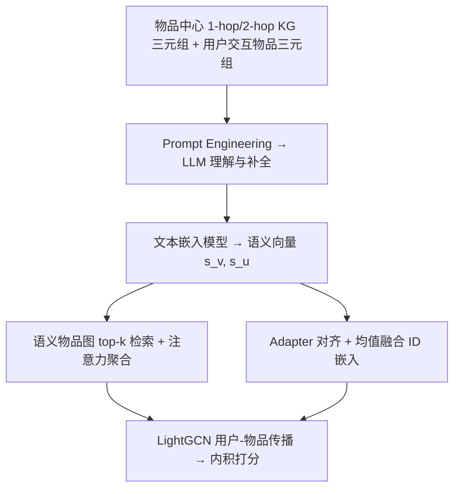
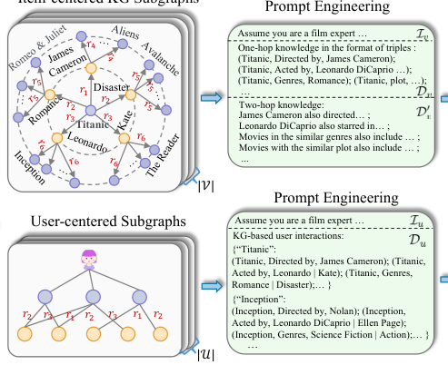

# Comprehending Knowledge Graphs with Large Language Models for Recommender Systems (用大语言模型理解知识图谱以增强推荐)

- **会议/期刊**: SIGIR 2025
- **作者与机构**: Ziqiang Cui, Chen Ma (City University of Hong Kong)；Yunpeng Weng, Xing Tang (FiT, Tencent)；Fuyuan Lyu (McGill/MILA)；Dugang Liu (Shenzhen University)；Xiuqiang He (Shenzhen Technology University)
- **推荐链路定位**: 召回（表征增强层，可插入任意协同过滤骨干）
- **研究方向**: 图神经网络与知识图谱推荐 / 大语言模型推荐
- **论文原文**: [https://arxiv.org/abs/2410.12229v3](https://arxiv.org/abs/2410.12229v3)
- **开源代码**: [https://github.com/ziqiangcui/CoLaKG](https://github.com/ziqiangcui/CoLaKG)

## TL;DR (1分钟核心速览)

现有 KG 增强推荐受困于三类硬伤：KG 事实缺失、文本实体被压成无语义 ID、GNN 逐层传播难以捕获全局高阶关联。CoLaKG 用 LLM 对以物品为中心的局部 KG 子图做提示理解（补全缺失事实 + 生成语义画像），再用文本嵌入模型把画像编码为向量，据此构建语义物品-物品图并检索 top-$k$ 邻居做注意力聚合，最后与 ID 嵌入对齐融合后喂入 LightGCN。在 4 个数据集、全库排序协议下，Recall@20 相对最强基线 KGRec 提升约 1.0%–2.8%，NDCG@20 提升约 0.9%–3.4%。

## Background & Motivation (背景与核心矛盾)

- **主流范式**: KG 增强推荐以 KGAT/KGIN/KGCL/KGRec 为代表，将 KG 三元组中的实体与关系映射为 ID 嵌入，在知识感知图上堆叠 GNN 层做消息传播与聚合。
- **前人局限一（知识不完整）**: KG 多为人工构建，关键属性缺失会直接切断本应存在的连接（如物品 A 缺 genre 属性，导致 A 与同类型 B 在图中失联），错误知识进一步污染表征。
- **前人局限二（语义丢失 + 全局失明）**: 文本实体被离散化为 ID（"horror"=51、"thriller"=320），天然语义近邻被抹平；同时逐层传播对 KG 中远距离但强语义关联的节点（如 A 与 H）几乎不可达，且层数堆叠带来过平滑与无关节点噪声累积。
- **核心洞察 (Key Insight)**: LLM 的世界知识与推理能力恰好能补全 KG 缺失事实、并以自然语言保留实体语义；而"把整张 KG 塞进 LLM"不现实，因此必须做**局部子图理解 + 全局语义检索**的分层设计。
- **本文切入点**: 用 LLM 把 KG 子图"翻译"为语义向量，将 KG 上的高阶关联降维成物品-物品语义图上的直接边，从而绕开 GNN 多层传播。

## Method (核心方法设计)

### 1. 整体框架 (Overall Architecture)

CoLaKG 是**两阶段解耦**框架。第一阶段（离线，无梯度）：对每个物品抽取以它为中心的 1 跳三元组集合 $\mathcal{T}_v$与随机采样的 2 跳三元组，经提示模板送入 LLM（DeepSeek-V2）生成 KG 理解文本$\mathcal{C}_v$，再由冻结的文本嵌入模型（sup-simcse-roberta-large）编码为语义向量$\mathbf{s}_v$；用户侧同理，把其交互物品的 KG 三元组拼接后由 LLM 推断偏好文本$\mathcal{C}_u$并编码为$\mathbf{s}_u$。第二阶段（有监督）：语义向量经 Adapter 对齐到 ID 空间并与 ID 嵌入均值融合，物品侧再用语义物品图上的 top-$k$ 邻居做注意力增强，最终送入 LightGCN 做用户-物品传播与内积打分。关键工程价值在于**推荐推理阶段完全不调用 LLM**。

<figure class="paper-figure" markdown="span">
  <figcaption>图2：我们提出的CoLaKG框架。</figcaption>
</figure>

### 2. 关键设计拆解 (Key Designs)

1. **局部 KG 理解（Local KG Comprehension）**：痛点是把整张 KG 输入 LLM 不可行、且 2 跳邻居数随半径指数爆炸。做法是 1 跳用完整三元组文本 $\mathcal{D}_v$，2 跳对每个 1 跳邻居$e$随机采样$m$条三元组并模板化为连贯句子$\mathcal{D}'_v$，与系统提示$\mathcal{I}_v$ 拼接后生成理解文本，再编码为向量：
$$\mathcal{C}_v=\mathrm{LLMs}(\mathcal{I}_v,\mathcal{D}_v,\mathcal{D}'_v),\qquad \mathbf{s}_v=\mathcal{P}(\mathcal{C}_v)$$
直觉：LLM 在生成过程中会主动"补全"缺失属性（如为缺 genre 的电影推断类型），把结构化稀疏的 KG 转成稠密语义描述，同时随机采样把提示长度控制在常数级。

2. **基于检索的全局 KG 利用（Retrieval-based Global KG Utilization）**：痛点是 GNN 需多层传播才能触及远距离节点。本文直接用语义余弦相似度定义任意两物品的全局关系，并以此作为边权构建语义物品图：
$$r(v_i,v_j)=\mathrm{sim}(\mathbf{s}_{v_i},\mathbf{s}_{v_j}),\qquad \mathcal{G}_v=\{(v_i,r(v_i,v_j),v_j)\}$$
再按相似度降序取 top-$k$构成$\mathcal{N}_k(v_i)$。直觉：把"KG 上的多跳路径"压缩为"语义空间中的一次近邻检索"，任意阶关联一步可达，且低相似度邻居被阈值化的 top-$k$ 直接过滤掉，天然抑制噪声。

3. **检索增强表征与训练目标**：Adapter 用单层线性 + ELU 把 $\mathbf{s}$投影到$d$维（$\mathbf{s}'_v=\sigma(\mathbf{W}_1\mathbf{s}_v)$），与 ID 嵌入均值融合$\mathbf{h}_v=\frac{1}{2}(\mathbf{e}_v+\mathbf{s}'_v)$；物品侧用**仅依赖语义向量**的注意力聚合邻居：
$$\alpha_{ij}=\mathrm{softmax}_j\big(a(\mathbf{W}\mathbf{s}_{v_i}\|\mathbf{W}\mathbf{s}_{v_j})\big),\qquad \mathbf{h}'_{v_i}=\sigma\Big(\tfrac{1}{2}\big(\mathbf{h}_{v_i}+\textstyle\sum_{j\in\mathcal{N}_k(v_i)}\alpha_{ij}\mathbf{h}_{v_j}\big)\Big)$$
注意力只算语义不算协同，是为了让邻居权重反映"知识层面的相关性"而非热门度偏置。总损失为标准 BPR：$\mathcal{L}=\sum_{(u,v^+,v^-)}-\ln\sigma(\hat{y}_{uv^+}-\hat{y}_{uv^-})+\lambda\|\Theta\|_2^2$，负采样为**每正样本配 1 个均匀采样负例**，无额外对比/自监督损失。

## Experimental Setup & Evaluation Protocol (实验设置与评估协议)

- **数据集与预处理**（均按 5-core 过滤）：

| 数据集 | #Users | #Items | #Interactions | KG 三元组 | 场景说明 |
| :--- | :---: | :---: | :---: | :---: | :--- |
| MovieLens | 6,040 | 3,260 | 998,539 | 62,958 | 电影评分 |
| Last-FM | 1,859 | 2,813 | 86,608 | 118,500 | 音乐收听 |
| MIND | 44,603 | 15,174 | 1,285,064 | 307,140 | 新闻点击 |
| Funds | 209,999 | 5,701 | 1,225,318 | 65,697 | 工业金融理财 |

- **数据划分与防穿越**: 每个用户随机取 80% 交互为训练集、20% 为测试集（比例划分，非时间切分，存在轻度未来信息泄漏风险）。
- **排名评测协议**: 无偏 **Full-Ranking（全库未交互物品排序）**，指标 Recall@{10,20} 与 NDCG@{10,20}，每实验跑 5 次取均值，显著性水平 $p<0.01$。
- **对比基线与超参**: 12 个基线分三类——经典（BPR-MF / NFM / LightGCN）、KG 增强（CKE / RippleNet / KGAT / KGIN / KGCL / KGRec）、LLM 增强（RLMRec / KAR / CLLM4Rec）。统一 $d=64$、LightGCN 层数$L=3$、Adam 学习率 0.001、batch 1024（Last-FM）/4096（其余）、LLM 温度$\tau=0$、top-$p=0.001$。

## Key Experimental Results (实验关键数据)

### 1. 主实验对比 (Main Results)

| Model | ML R@20 | ML N@20 | Last-FM R@20 | Last-FM N@20 | MIND R@20 | MIND N@20 | Funds R@20 | Funds N@20 |
| :--- | :---: | :---: | :---: | :---: | :---: | :---: | :---: | :---: |
| BPR-MF | 0.2048 | 0.3062 | 0.1971 | 0.1685 | 0.0537 | 0.0310 | 0.5806 | 0.3809 |
| LightGCN | 0.2512 | 0.3769 | 0.3642 | 0.3321 | 0.0998 | 0.0609 | 0.6353 | 0.4204 |
| KGAT | 0.2451 | 0.3661 | 0.3433 | 0.3075 | 0.0955 | 0.0571 | 0.6418 | 0.4182 |
| KGIN | 0.2562 | 0.3831 | 0.3611 | 0.3215 | 0.1022 | 0.0639 | 0.6428 | 0.4259 |
| KGCL | 0.2465 | 0.3677 | 0.3652 | 0.3284 | 0.1059 | 0.0670 | 0.6355 | 0.4273 |
| KGRec | 0.2571 | 0.3842 | 0.3617 | 0.3251 | 0.1003 | 0.0625 | 0.6467 | 0.4304 |
| RLMRec | 0.2524 | 0.3787 | 0.3651 | 0.3335 | 0.0990 | 0.0602 | 0.6351 | 0.4210 |
| CLLM4Rec | 0.2433 | 0.3637 | 0.3642 | 0.3268 | 0.1012 | 0.0628 | 0.6273 | 0.4103 |
| **CoLaKG** | **0.2642** | **0.3974** | **0.3803** | **0.3471** | **0.1087** | **0.0684** | **0.6524** | **0.4392** |
| Improv.% vs 最强基线 | +2.76% | +3.44% | +4.16% | +4.08% | +2.64% | +2.09% | +0.88% | +2.04% |

**泛化性验证**（表 3）：把 CoLaKG 的语义增强插入 BPR-MF / NFM / LightGCN 三种骨干，R@20 分别提升 8.1% / 7.3% / 5.2%（MovieLens），说明增益来自语义模块本身而非特定骨干。

### 2. 消融实验 (Ablation Study)

| 变体 | ML R@20 | Last-FM R@20 | MIND R@20 | Funds R@20 | ML N@20 |
| :--- | :---: | :---: | :---: | :---: | :---: |
| w/o $\mathbf{s}_v$（去物品语义） | 0.2553 | 0.3628 | 0.1043 | 0.6382 | 0.3811 |
| w/o $\mathbf{s}_u$（去用户语义） | 0.2613 | 0.3785 | 0.1048 | 0.6481 | 0.3948 |
| w/o $\mathcal{N}_k(v)$（去全局邻居增强） | 0.2603 | 0.3725 | 0.1064 | 0.6455 | 0.3902 |
| w/o $\mathcal{D}'_v$（去 2 跳三元组） | 0.2628 | 0.3789 | 0.1076 | 0.6499 | 0.3960 |
| **CoLaKG** | **0.2642** | **0.3803** | **0.1087** | **0.6524** | **0.3974** |

### 3. 关键实验发现 (Key Findings)

1. **物品语义嵌入是最大贡献源**：去掉 $\mathbf{s}_v$ 后 MovieLens R@20 从 0.2642 掉到 0.2553（-3.4%），跌幅超过去掉用户语义（-1.1%）与全局邻居（-1.5%），说明 LLM 对局部 KG 子图的补全与语义化是收益主引擎；而 2 跳三元组贡献最小（-0.5%），属于"锦上添花"。
2. **稀疏用户群体收益更显著**：按交互频次四等分后，最稀疏组（Group 01）上 CoLaKG 相对基线的领先幅度最大，说明语义先验有效补偿了协同信号的稀缺；这与"KG 缓解冷启动/稀疏"的经典论断一致，但本文给出了 LLM 语义化路径下的定量证据。
3. **对 KG 缺失事实鲁棒**：随机丢弃 30% KG 实体与关系后，所有 KG 基线均下降，但 CoLaKG 的**性能衰减比例最小**且仍保持领先——直接验证了 LLM 补全缺失事实的设计动机；超参上 $k\in[10,30]$、$m$适中时最优，$k$ 过大引入低相关邻居噪声导致回落。

## Highlights & Limitations (亮点、对比与审稿批判)

- **与代表作对比**: 相比 KGAT/KGIN 依赖 ID 化实体 + 多层 GNN 传播，CoLaKG 用语义向量替代 ID 语义、用一次 top-$k$ 检索替代多跳传播；相比 RLMRec/KAR 仅用 LLM 生成物品画像文本，本文额外挖掘了 KG 的**结构信息**（1/2 跳三元组）并构建了全局语义物品图；相比 CLLM4Rec 把 LLM 当推荐器直接生成，本文保持 LLM 完全离线，工程可行性更高。
- **可迁移亮点**: (1) "LLM 离线生成语义向量 + Adapter 对齐 + 均值融合"是极低成本的语义增强范式，可无痛插入任意 ID-based 召回模型；(2) 用语义相似度构建物品-物品图并做 top-$k$ 注意力聚合，可作为 GNN 多跳传播的轻量替代方案，尤其适合图直径大、长尾关联多的场景。
- **审稿级局限批判**: (1) 语义向量依赖 LLM 与文本编码器的**离线一次性预计算**，新物品上架需重新调用 LLM，冷启动更新延迟与 API 成本未被量化讨论；(2) 80/20 随机划分而非时间切分，且 LLM 提示中使用了完整训练集交互构造用户画像，存在轻度信息泄漏隐忧；此外 $k$、$m$ 需逐数据集调参，跨域迁移的鲁棒性证据不足。

## Rating (四维评分)

- **方法创新性 (Novelty)**: ⭐⭐⭐⭐ （"局部子图 LLM 理解 + 全局语义检索图"的双层 KG 消费范式清晰，但各组件（提示工程、Adapter、注意力聚合）均为成熟技术的组合，理论新意有限）
- **评估协议与实验扎实度 (Protocol & Experiments)**: ⭐⭐⭐⭐ （4 数据集含工业数据、12 基线、Full-Ranking + 5 次重复 + $p<0.01$ 显著性、消融/泛化/稀疏分桶/缺失事实鲁棒性齐全，扣分在随机划分而非时间切分）
- **写作与数学规范度 (Clarity & Rigor)**: ⭐⭐⭐⭐ （公式简洁、符号统一、框架图与提示模板交代清楚，但部分模块（如 Adapter 训练细节、LLM 调用成本）描述偏简，缺少复杂度分析）
- **工业落地与复现价值 (Industrial & Practical Value)**: ⭐⭐⭐⭐⭐ （LLM 完全离线、推理零额外开销、代码开源、已在腾讯金融场景 Funds 数据验证，是 LLM4Rec 中落地门槛最低的路线之一）

