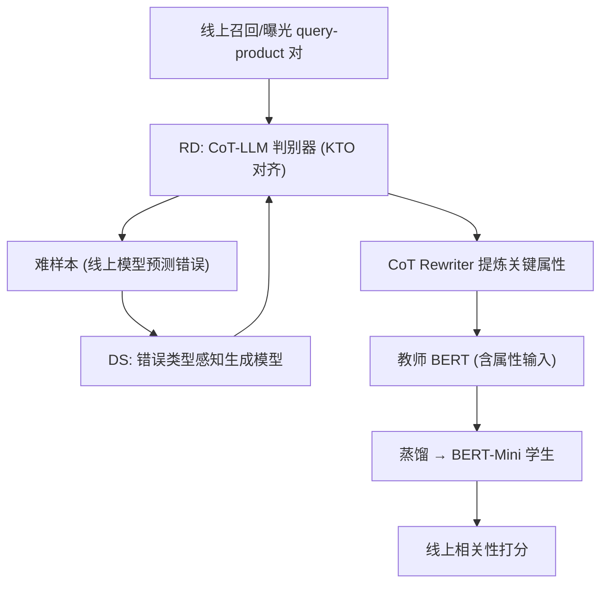
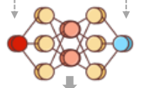

# ADORE: Autonomous Domain-Oriented Relevance Engine for E-commerce (面向电商领域的自主相关性引擎)

- **会议/期刊**: SIGIR 2025
- **作者与机构**: Zheng Fang, Donghao Xie, Ming Pang, Chunyuan Yuan, Xue Jiang, Changping Peng, Zhangang Lin, Zheng Luo（京东广告部）
- **推荐链路定位**: 精排（相关性判别 / 广告检索后置过滤）
- **研究方向**: 大语言模型推荐 / CTR 预估与特征交叉
- **论文原文**: [https://arxiv.org/abs/2512.02555v1](https://arxiv.org/abs/2512.02555v1)
- **开源代码**: 暂未开源

## TL;DR (1分钟核心速览)

电商搜索相关性建模长期受困于两点：领域难样本稀缺、线上轻量模型推理能力不足。ADORE 构建了一个自循环框架——用 CoT 微调的 LLaMA-3 做领域规则感知的相关性判别器自动挖掘难样本，用 KTO 以真实购买行为纠正其"过严"偏置，再用错误类型感知的生成模型合成对抗样本，最后把 CoT 提炼出的关键属性显式注入教师 BERT 并蒸馏到 BERT-Mini。在京东 322 万人工标注 query-product 对上，离线 F1 达 85.45%（较 BERT-Mini 提升 3.16 个点），线上 A/B 广告 CTR +1.24%、广告收入 +1.58%、相关性好评率 +1.75%。

## Background & Motivation (背景与核心矛盾)

- **主流范式**: 线上以 BERT 类 cross-encoder 做 query-product 二分类相关性判别，辅以 BM25 词匹配兜底；LLM 路线则多取最后一层 token 表征做分类并软标签蒸馏。
- **前人局限**: 其一，领域难样本（如"80 寸电视"对"85 寸电视"）人工标注成本极高且难以规模化；其二，轻量 BERT 参数受限，无法完成属性级推理，而直接用 LLM 分类的效果甚至弱于 BERT（表 2 中 LLM-Classify F1 仅 83.70%）。
- **核心洞察 (Key Insight)**: 作者发现 CoT 微调后的 LLM 存在系统性"过严"偏置——查询中非关键属性缺失即判不相关，导致假阴性上升、平台成交受损；而真实购买日志恰好是纠正该偏置的天然偏好信号。
- **本文切入点**: 把"难样本挖掘—行为对齐—对抗合成—显式蒸馏"串成无需人工介入的闭环，让 LLM 的推理能力以属性特征形式落到可部署的小模型上。

## Method (核心方法设计)

### 1. 整体框架 (Overall Architecture)

ADORE 由三个模块构成闭环：RD 模块先用 GPT-4o 模拟人工标注流程生成 CoT 数据微调 LLaMA-3，再以 KTO 用购买日志对齐，得到一个领域规则感知的标注器，对线上召回曝光对打标并挑出线上模型预测错误的难样本；DS 模块训练一个错误类型感知的生成模型，按指令改写 query/product 属性批量合成易混淆样本，并经 RD 模型过滤噪声；KD 模块将 CoT 推理中的关键属性经 CoT Rewriter 压缩为结构化描述，仅注入教师 BERT 输入（保证线上线下输入一致），再通过表征对齐把知识传给 BERT-Mini 学生模型。

<figure class="paper-figure" markdown="span">
  <figcaption>图1：面向自主领域的相关性引擎架构。</figcaption>
</figure>

### 2. 关键设计拆解 (Key Designs)

1. **规则感知相关性判别 + KTO 行为对齐**：先用 GPT-4o 按领域标注规范生成 CoT 链，仅保留与人工标签一致的样本微调 LLaMA-3（标准 LM 损失 $\mathcal{L}_{\text{LLM}}=-\frac{1}{N}\sum_{i}\log P(w_i|w_{<i})$）。针对过严偏置，将模型误判为"Irrelevant"的历史购买对作为 loser、GPT-4o 重写的"Relevant"CoT 作为 winner，用 KTO 做二元偏好对齐。直觉是：购买行为是用户用真金白银投出的相关性票，比标注规范更贴近真实决策边界，且 KTO 只需单样本二元标签，构造成本远低于成对偏好。

2. **错误类型感知数据合成**：逐条挖掘难样本只能解决孤立错误，无法覆盖一类错误模式。DS 模块用 few-shot 提示 GPT-4o 按指令改写原 query/product 属性，生成"相关/不相关"两类新样本，并迭代地把线上模型预测错误的生成结果回流为微调数据，使生成器逐步学会"专攻线上模型的盲区"；合成结果再经 RD 判别器过滤以抑制噪声。

3. **关键属性增强的知识蒸馏**：教师选用同为 encoder-only 的深层 cross-encoder BERT 而非自回归 LLM，以保证与学生分布一致。CoT 原文冗长含噪，故用 CoT Rewriter 抽取与 query 对齐/冲突的产品属性（品名、品牌、型号、目标人群）拼入教师输入，实现显式知识增强；学生实时推理拿不到 CoT，故仅在教师侧注入，靠表征对齐传递。损失为
$$\mathcal{L}_{\text{kd}}=\alpha\cdot\!\left(-\sum_i y_i\log\hat{y}_i\right)+(1-\alpha)\cdot\frac{1}{H}\sum_{i=1}^{H}(h_i-\hat{h}_i)^2$$
其中 $h_i,\hat{h}_i$为教师/学生的 [CLS] 表征，$\alpha$ 平衡硬标签 BCE 与表征 MSE。负采样方面本文为监督二分类任务，不涉及对比负采样；推理开销与原始 BERT-Mini 完全一致。

## Experimental Setup & Evaluation Protocol (实验设置与评估协议)

- **数据集与预处理**: 京东 App 搜索日志人工标注数据，无公开中文电商相关性基准，故全部自建。

| 数据集 | #Users | #Items | #Interactions | 稀疏度/密度 | 特征/场景说明 |
| :--- | :---: | :---: | :---: | :---: | :--- |
| JD-Train | — | 3,019,999 (商品) | 3,226,439 | — | 2,862,473 条唯一 query，人工二分类标注 |
| JD-Valid | — | 98,530 | 100,000 | — | 87,706 条唯一 query |
| JD-Test | — | 50,090 | 50,961 | — | 45,464 条唯一 query |

- **数据划分与防穿越 (Splitting Strategy)**: 按 query 维度划分 train/valid/test（唯一 query 数三者互不重叠），属**按查询隔离的比例划分**，避免同一 query 跨集泄漏。
- **排名评测协议 (Ranking Protocol)**: 本文为相关性二分类而非排序任务，采用 Precision / Recall / F1 分类指标，未使用 Full-Ranking 或 Sampled Ranking；线上以广告 CTR、广告收入、人工相关性好评率（Good rate）评估，配对 t 检验 $p<0.05$。
- **对比基线与超参设置**: 基线含 DSSM 双塔、BERT cross-encoder、BERT-CoT、LLM-Classify（LLaMA-3-8B 末 token 分类）、BERT-Mini（与学生同架构同参数量），以及 ADORE 的逐模块累加变体；学生模型即 BERT-Mini，教师为深层 BERT cross-encoder。

## Key Experimental Results (实验关键数据)

### 1. 主实验对比 (Main Results)

| Models | Precision | Recall | F1 |
| :--- | :---: | :---: | :---: |
| DSSM (bi-encoder) | 72.72% | 78.54% | 75.52% |
| BERT (cross-encoder) | 84.21% | 83.93% | 84.07% |
| BERT-CoT (cross-encoder) | 85.35% | 84.41% | 84.88% |
| LLM-Classify (LLaMA-3-8B) | 84.12% | 83.28% | 83.70% |
| BERT-Mini (cross-encoder) | 81.10% | 83.52% | 82.29% |
| BERT-CoT (+RD&DS) | 86.82% | 85.56% | **86.19%** |
| ADORE (+RD) | 82.61% | 84.56% | 83.57% |
| ADORE (+RD&DS) | 84.88% | 83.96% | 84.42% |
| ADORE (+RD&DS&KD) | 85.92% | 84.98% | 85.45% |

线上 A/B（相对线上基线，均显著 $p<0.05$）：

| 变体 | Ad. CTR | Ad. Revenue | 相关性好评率 |
| :--- | :---: | :---: | :---: |
| ADORE (+RD-CoT) | +0.48% | +0.23% | +0.50% |
| ADORE (+RD-CoT-KTO) | +0.98% | +1.28% | +1.17% |
| ADORE (+RD-CoT-KTO&DS) | +0.97% | +1.07% | +1.82% |
| ADORE (+RD-CoT-KTO&DS&KD) | **+1.24%** | **+1.58%** | +1.75% |

### 2. 消融实验 (Ablation Study)

| 配置 | Precision | Recall | F1 | 说明 |
| :--- | :---: | :---: | :---: | :--- |
| BERT-Mini (baseline) | 81.10% | 83.52% | 82.29% | 线上学生模型 |
| +RD | 82.61% | 84.56% | 83.57% | 仅难样本挖掘，Recall 升 Precision 平 |
| +RD&DS | 84.88% | 83.96% | 84.42% | 对抗合成补 Precision |
| +RD&DS&KD | 85.92% | 84.98% | 85.45% | 显式属性蒸馏双升 |
| BERT-CoT (+RD&DS) | 86.82% | 85.56% | 86.19% | 大模型上界参照 |

### 3. 关键实验发现 (Key Findings)

1. **RD 主攻召回、DS 主攻精度**：仅加 RD 时 Recall 从 83.52% 升至 84.56% 而 Precision 反降至 82.61%，说明难样本挖掘把边界样本拉回正类；叠加 DS 后 Precision 跳升 2.27 个点至 84.88%，验证对抗合成补齐了"易混淆负例"这一侧。
2. **显式属性蒸馏是学生模型逼近教师的关键**：KD 模块使 F1 再涨 1.03 个点至 85.45%，与含 CoT 输入的教师 BERT-CoT（86.19%）仅差 0.74 个点，而学生推理时完全不接触 CoT，证明属性级知识可被有效压缩进轻量模型。
3. **KTO 对齐是线上收益的分水岭**：线上从 +RD-CoT 到 +RD-CoT-KTO，CTR 由 +0.48% 跃至 +0.98%、收入由 +0.23% 跃至 +1.28%，说明纠正过严偏置直接释放了被误杀的交易流量；而 DS 主要贡献相关性好评率（+1.17%→+1.82%）。

## Highlights & Limitations (亮点、对比与审稿批判)

- **与代表作对比 (vs. Prior Work)**: 相较 LLM-Classify 这类"末 token 分类 + 软标签蒸馏"的判别式范式，ADORE 把 CoT 推理结果转成可解释的属性特征注入教师输入，实现显式而非隐式知识迁移；相较 BERT-CoT 直接把 CoT 拼进输入的做法，ADORE 通过 Rewriter 压缩去噪并只在教师侧使用，规避了线上无法获取 CoT 的部署鸿沟。
- **可迁移亮点**: ①用真实成交/点击日志构造 KTO 二元偏好对来纠正 LLM 标注器的系统性偏置，成本极低且适用于任何"LLM 当标注器"的场景；②把生成模型的迭代训练目标设为"线上模型预测错误的样本"，使合成数据自动对准模型盲区。
- **审稿级局限批判**: ①离线实验仅在京东自有人工标注集上完成，无公开基准与跨域复现，且未报告方差或多次运行结果，泛化性存疑；②框架重度依赖 GPT-4o 生成 CoT 与合成数据，标注器、生成器、Rewriter 三级 LLM 调用的成本与延迟未做量化，且 CoT 质量对最终效果的影响缺乏敏感性分析。

## Rating (四维评分)

- **方法创新性 (Novelty)**: ⭐⭐⭐⭐ （将 KTO 行为对齐引入相关性标注器纠偏、并以错误类型驱动对抗合成，组合新颖但单点技术多为已有组件的巧妙编排）
- **评估协议与实验扎实度 (Protocol & Experiments)**: ⭐⭐⭐ （具备 322 万级工业数据与线上 A/B，但缺公开基准、无方差报告、消融仅单次结果）
- **写作与数学规范度 (Clarity & Rigor)**: ⭐⭐⭐ （三模块闭环叙述清晰，但公式极简、KTO 目标与生成模型训练细节均未展开）
- **工业落地与复现价值 (Industrial & Practical Value)**: ⭐⭐⭐⭐ （已在京东搜索广告全量部署，学生模型推理开销与 BERT-Mini 持平，但未开源且依赖闭源 GPT-4o）

