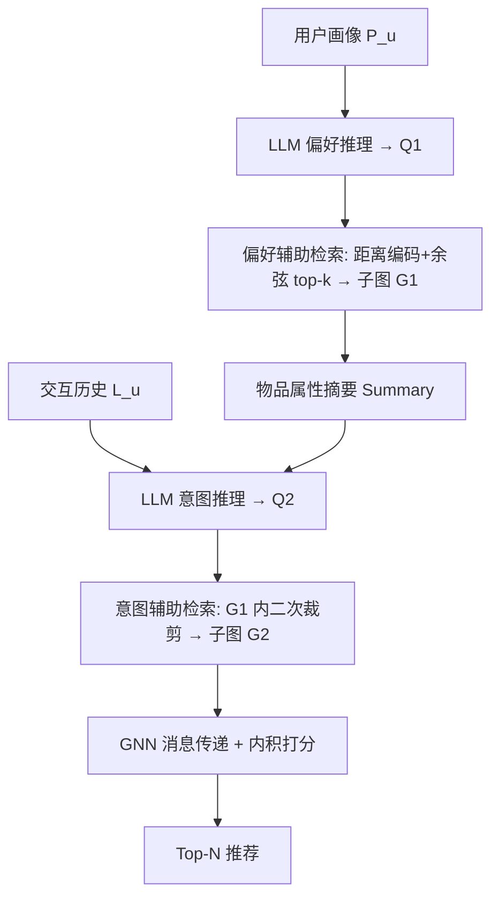
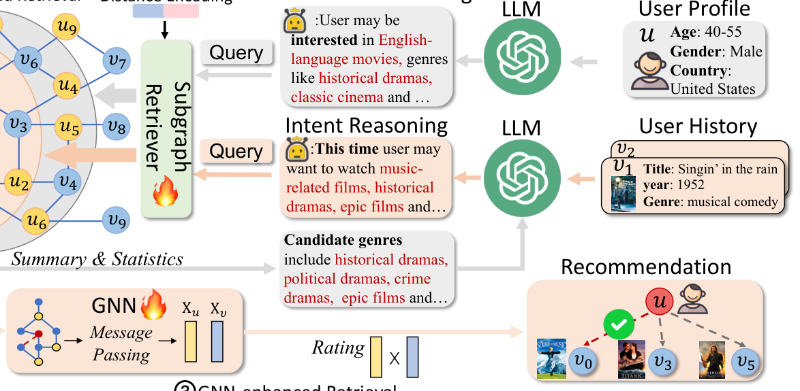

# CORONA: A Coarse-to-Fine Framework for Graph-based Recommendation with Large Language Models (基于大语言模型的由粗到细图推荐框架)

- **会议/期刊**: SIGIR 2025
- **作者与机构**: Junze Chen, Xinjie Yang, Cheng Yang (通讯), Junfei Bao, Zeyuan Guo, Yawen Li, Chuan Shi（北京邮电大学 GAMMA 实验室）
- **推荐链路定位**: 召回（候选过滤阶段）
- **研究方向**: 大语言模型推荐 / 图神经网络推荐
- **论文原文**: [https://arxiv.org/abs/2506.17281v1](https://arxiv.org/abs/2506.17281v1)
- **开源代码**: [https://github.com/BUPT-GAMMA/CORONA](https://github.com/BUPT-GAMMA/CORONA)

## TL;DR (1分钟核心速览)

现有 LLM4Rec 要么把 LLM 放在候选过滤**之后**做重排（受限于传统召回质量），要么放在**之前**做数据增强（无法感知动态意图），都未让 LLM 参与候选过滤本身。CORONA 提出"检索链"：先用 LLM 基于用户画像做**偏好推理**、再结合历史做**意图推理**，两次把 LLM 输出编码为 query 向量，在交互图上逐级检索出更小的用户/物品子图，最后交给 GNN 做细粒度打分。在 Netflix/MovieLens/Amazon-book 三个数据集、全库排序协议下，Recall 平均相对提升 18.6%、NDCG 提升 18.4%。

## Background & Motivation (背景与核心矛盾)

- **主流范式**: 图推荐以 LightGCN/NGCF 为代表，在全量二部图上做高阶消息传递；LLM4Rec 则分两派——过滤后重排（TALLRec、BinLLM）与过滤前数据增强（LLMRec、RLMRec）。
- **前人局限**: ① 重排派受制于传统召回生成的候选集质量，LLM 只能在"矮子里拔将军"；② 增强派把 LLM 当离线预处理器，无法在推理时捕捉用户**动态变化的短期意图**，且需对全量物品/交互做增强，开销大。
- **核心洞察 (Key Insight)**: LLM 的强项是**世界知识与粗粒度推理**，而非在相似物品间做细粒度判别；因此应让 LLM 负责"缩小搜索空间"，把细粒度协同信号判别留给 GNN。作者统计发现 Netflix 仅 3%、MovieLens 仅 0.4% 的用户会关注二跳以外邻居的物品，说明**局部子图足以覆盖绝大多数相关候选**。
- **本文切入点**: 把 LLM 推理嵌入候选过滤流程，用"偏好→意图"两级语义 query 在图上做由粗到细的子图裁剪。

## Method (核心方法设计)

### 1. 整体框架 (Overall Architecture)

输入为目标用户画像 $P_u$、交互历史$L_u$与全量交互图$\mathcal{G}$。第一阶段 LLM 读画像输出偏好文本$Q_1$，编码为 query 向量后与带距离编码的用户表征做余弦检索，取 top-$k$相似用户及其物品构成子图$\mathcal{G}'_1$；第二阶段把$\mathcal{G}'_1$的物品属性统计成自然语言摘要，连同历史$L_u$再喂 LLM 做意图推理得$Q_2$，在$\mathcal{G}'_1$内二次检索得$\mathcal{G}'_2$；第三阶段在$\mathcal{G}'_2$ 上跑 GNN 消息传递，用内积打分输出 Top-N。

<figure class="paper-figure" markdown="span">
  <figcaption>图2：本文提出的CORONA的整体框架，包含三个不同粒度的检索阶段。前两个阶段利用大语言模型基于用户画像/历史进行粗粒度偏好/意图推理，帮助从交互图中逐步提取相关用户和物品的子图。最终子图将由图神经网络编码以进行细粒度推荐。</figcaption>
</figure>

### 2. 关键设计拆解 (Key Designs)

1. **距离编码的子图检索器（Preference-assisted Retrieval）**：痛点是不加区分地在全图上检索会引入大量远距离噪声用户。作者按跳数给用户拼接可学习距离编码 $\boldsymbol{e}_j$（$j\in\{1,2,3\}$，三跳及以上统一为$\boldsymbol{e}_3$），再经线性层降维：
$\boldsymbol{X}_{u'}=\mathrm{Linear}_\theta(\mathrm{CONCAT}(\boldsymbol{F}_{u'},\boldsymbol{e}_{\mathrm{dist}(u',u)}))$，随后$\mathcal{U}'_1=\mathrm{argtop}_k\{\cos(\boldsymbol{E}_{Q_1},\boldsymbol{X}_{u'})\}\cup\{u\}$。直觉是"近邻即兴趣相似"，距离编码让模型自动学会对远邻降权，避免固定跳数的硬截断。

2. **意图推理与二次裁剪（Intent-assisted Retrieval）**：偏好是长期静态的，意图是短期动态的。作者把上一步子图的 top-20 高频属性（题材、年代等）汇总为自然语言摘要，与用户历史一起提示 LLM 输出 $Q_2$，再在$\mathcal{U}'_1$内部做第二次 top-$k_2$检索得$\mathcal{U}'_2$。这一步把"长期偏好"收敛为"本次购买意图"，是消融中贡献最大的模块。

3. **训练目标、负采样与推理效率**：检索器用双 query 的 softmax 交叉熵训练，正样本为与真实物品 $v$交互过的用户集$\mathcal{N}_v$：
$\mathcal{L}_1=-\sum_{u'\in\mathcal{N}_v}\left[\frac{\exp(\boldsymbol{E}_{Q_1}^\top\boldsymbol{X}_{u'})}{\sum_{u''}\exp(\boldsymbol{E}_{Q_1}^\top\boldsymbol{X}_{u''})}+\frac{\exp(\boldsymbol{E}_{Q_2}^\top\boldsymbol{X}_{u'})}{\sum_{u''}\exp(\boldsymbol{E}_{Q_2}^\top\boldsymbol{X}_{u''})}\right]$GNN 侧沿用 BPR 损失$\mathcal{L}_2=-\sum_{v'\in\mathcal{V}_{neg}}\log\sigma(s(u,v)-s(u,v'))$，负样本从最终子图$\mathcal{V}'_2$ 内随机采 10 个（子图内负采样，天然偏难）。LLM 只对**用户**做两次推理，不对物品/交互做全量推理，GPT-4o-mini 下单用户约 1 美分、<1.5 秒，本地 Vicuna 可压到 1 秒内。

## Experimental Setup & Evaluation Protocol (实验设置与评估协议)

- **数据集与预处理**: 三个公开数据集，文本经 BERT 编码为 128 维特征；沿用 LLMRec / RLMRec 的划分与过滤设定。

| 数据集 | 来源 | 特征/场景说明 |
| :--- | :---: | :--- |
| Netflix | Kaggle Netflix Prize | 电影，用户画像+影片元数据 |
| MovieLens | ML-10M | 电影评分，含题材/年代 |
| Amazon-book | Amazon 2000–2014 | 图书评论，稀疏度高 |

- **数据划分与防穿越 (Splitting Strategy)**: Netflix/MovieLens 沿用 LLMRec 划分，Amazon-book 沿用 RLMRec 划分；训练/测试交互均从邻接矩阵 $\boldsymbol{A}$ 中剔除，防止信息泄漏。
- **排名评测协议 (Ranking Protocol)**: 无偏 **Full-Ranking（全库未交互物品排序）**，指标 Recall@10/20/50 与 NDCG@10/20/50，五次独立运行取均值。
- **对比基线与超参设置**: 三组基线——图协同过滤（NGCF、LightGCN、GraphPro、GRCN）、LLM 推荐（TALLRec、BinLLM、RLMRec、LLMRec）、LLM 检索（G-Retriever）；冷启动实验另加 DropoutNet、ALDI、LLM-Ins。用户/物品特征 128 维，距离编码 2 维，线性层 $130\times128$，两层 GCN 隐层 128，负样本数 10，Adam 学习率 1e-6，早停 patience=10。

## Key Experimental Results (实验关键数据)

### 1. 主实验对比 (Main Results)

| 方法 | Netflix R@20 | Netflix N@20 | MovieLens R@20 | MovieLens N@20 | Amazon R@20 | Amazon N@20 |
| :--- | :---: | :---: | :---: | :---: | :---: | :---: |
| LightGCN | 0.0661 | 0.0222 | 0.1314 | 0.1173 | 0.1303 | 0.0791 |
| GraphPro | 0.0701 | 0.0235 | 0.1462 | 0.1296 | 0.1345 | 0.0839 |
| TALLRec | 0.0795 | 0.0338 | 0.3522 | 0.1748 | 0.1277 | 0.0838 |
| BinLLM | 0.0797 | 0.0340 | 0.3657 | 0.1771 | 0.1512 | 0.0939 |
| RLMRec | 0.0806 | 0.0341 | 0.3668 | 0.1779 | 0.1499 | 0.0913 |
| LLMRec | 0.0808 | 0.0342 | 0.3528 | 0.1750 | 0.1285 | 0.0840 |
| G-Retriever | 0.0678 | 0.0213 | 0.1294 | 0.1121 | 0.1248 | 0.0719 |
| **CORONA** | **0.0938** | **0.0416** | **0.4214** | **0.2017** | **0.1857** | **0.1089** |
| Improv. | +16.09% | +21.64% | +14.89% | +13.38% | +22.82% | +15.97% |

冷启动设定（交互 ≤2 的物品）下 CORONA 仍全面领先：MovieLens R@20 达 0.2917（较最强基线 LLM-Ins 的 0.2689 提升 8.48%），Amazon-book R@20 提升 3.86%，平均 Recall +8.24%、NDCG +10.68%。

### 2. 消融实验 (Ablation Study)

| 变体 | Netflix R@20 | MovieLens R@20 | Amazon R@20 | 说明 |
| :--- | :---: | :---: | :---: | :--- |
| w/o Preference-assisted Retrieval | 0.0848 | 0.3873 | 0.1535 | 去掉第一级裁剪 |
| w/o Intent-assisted Retrieval | 0.0785 | 0.3590 | 0.1643 | 去掉第二级裁剪 |
| w/o GNN-enhanced Retrieval | 0.0917 | 0.4088 | 0.1729 | 去掉 GNN 消息传递 |
| w/o Preference Reasoning | 0.0759 | 0.3316 | 0.1490 | 直接编码画像当 query |
| w/o Intent Reasoning | 0.0735 | 0.3221 | 0.1215 | 直接编码历史当 query |
| **Full CORONA** | **0.0938** | **0.4214** | **0.1857** | — |

子图检索方式对比（表 3）：同为 GCN 骨干，CORONA 检索较 full graph / fixed 1-hop / fixed 2-hop 平均 Recall 相对提升 **110.73%**、NDCG 提升 **112.03%**；换成 GraphTransformer 骨干仍保持同等优势，说明框架与 GNN 解耦。

### 3. 关键实验发现 (Key Findings)

1. **LLM 推理本身比"多一级检索"更值钱**：去掉推理（直接编码画像/历史）的变体比去掉整级检索的变体更差（Netflix 0.0735 vs 0.0785），证明增益来自 LLM 的世界知识而非单纯的子图裁剪。
2. **意图级裁剪贡献大于偏好级**：w/o Intent-assisted 在 Amazon-book 掉到 0.1643（全模型 0.1857），降幅大于 w/o Preference-assisted，印证"动态短期意图"是传统增强派方法的结构性盲区。
3. **子图规模存在甜点**：$k$从 1000 增至 4000 时性能先升后降，三数据集均在$k\approx3000$最优；距离编码维度 2 维最佳（0 维无法区分跳数、过大过拟合），LLM 温度$\tau$ 轻微上调有益、继续增大则退化。

## Highlights & Limitations (亮点、对比与审稿批判)

- **与代表作对比 (vs. Prior Work)**: 相比 TALLRec/BinLLM 的"过滤后重排"，CORONA 让 LLM 直接参与候选过滤，摆脱对传统召回质量的依赖；相比 LLMRec/RLMRec 的"过滤前增强"，CORONA 在推理时在线调用 LLM，能响应动态意图且无需全量物品增强，效率更高（LLMRec 在稠密 Amazon-book 上耗时显著更长）。
- **可迁移亮点**: ① "LLM 出语义 query + 图检索裁剪 + GNN 精排"的三段式范式可平移到任意带文本属性的二部图召回场景；② 距离编码 + 可学习线性层的轻量检索器设计，几乎零额外推理成本即可替代固定跳数邻居采样。
- **审稿级局限批判**: ① 依赖 GPT-4o-mini 等闭源 LLM 的推理质量，Vicuna-7B 版本虽有提升但明显弱于 GPT-4o-mini（平均差 15.87%），成本与效果强耦合；② 每用户两次 LLM 调用在亿级用户工业场景下延迟与费用仍是瓶颈，论文仅在 A800 单机、三中小规模数据集上验证，缺少大规模在线 A/B 与延迟压测。

## Rating (四维评分)

- **方法创新性 (Novelty)**: ⭐⭐⭐⭐ （首次把 LLM 推理嵌入候选过滤环节，"偏好→意图"两级语义 query 裁剪思路清晰，但单点算子创新有限）
- **评估协议与实验扎实度 (Protocol & Experiments)**: ⭐⭐⭐⭐ （三数据集 + 全库排序 + 冷启动 + 五种子均值 + 完整消融与超参分析，惟缺显著性检验与线上验证）
- **写作与数学规范度 (Clarity & Rigor)**: ⭐⭐⭐⭐ （框架图与 prompt 模板交代清楚，公式简洁；检索器训练目标与 GNN 损失的耦合关系略欠推导）
- **工业落地与复现价值 (Industrial & Practical Value)**: ⭐⭐⭐⭐ （代码开源、框架与 GNN 解耦易插拔，单用户 <1.5 秒可接受，但闭源 LLM 依赖与规模化成本待解）

