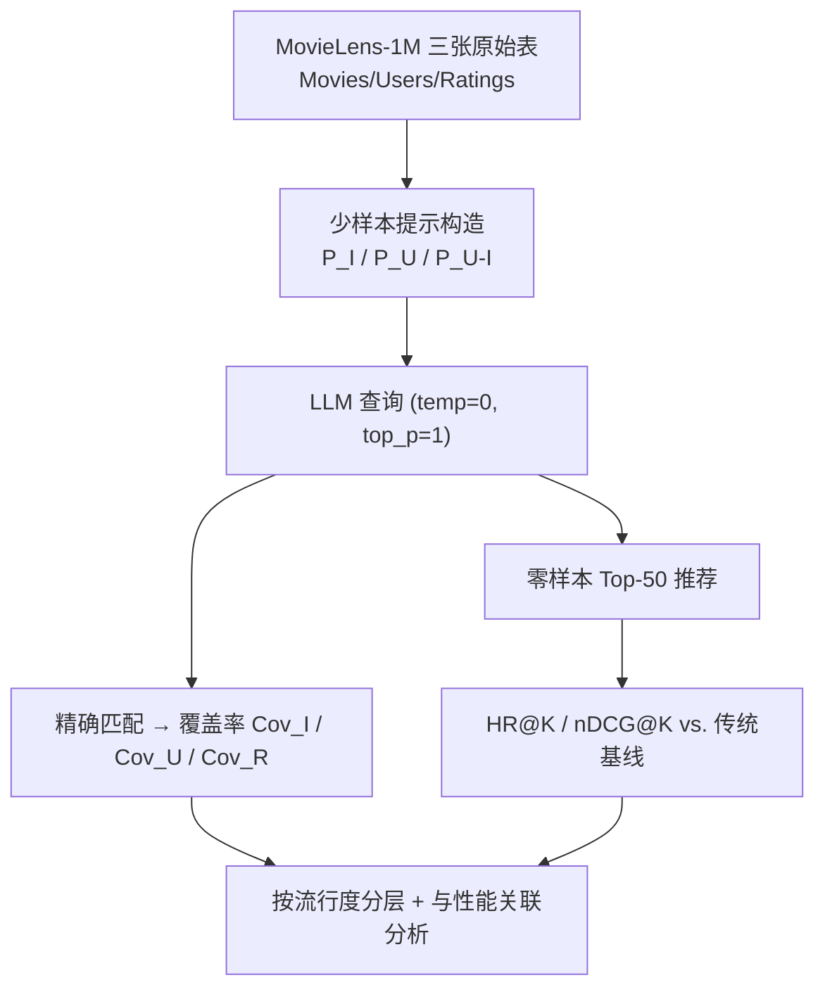

# Do LLMs Memorize Recommendation Datasets? A Preliminary Study on MovieLens-1M (大语言模型是否记住了推荐数据集？基于 MovieLens-1M 的初步研究)

- **会议/期刊**: SIGIR 2025
- **作者与机构**: Dario Di Palma, Felice Antonio Merra, Maurizio Sfilio, Vito Walter Anelli, Fedelucio Narducci, Tommaso Di Noia（Politecnico di Bari；Cognism）
- **推荐链路定位**: 端到端生成式（LLM-as-Recommender 评测有效性）
- **研究方向**: 大语言模型推荐 / 去偏与可信评测
- **论文原文**: [https://arxiv.org/abs/2505.10212v1](https://arxiv.org/abs/2505.10212v1)
- **开源代码**: [https://github.com/sisinflab/LLM-MemoryInspector](https://github.com/sisinflab/LLM-MemoryInspector)

## TL;DR (1分钟核心速览)

本文质疑 LLM4Rec 评测的有效性：若公开推荐数据集已进入 LLM 预训练语料，则在其上测得的指标反映的是"记忆"而非"泛化"。作者将数据集记忆形式化为物品属性、用户画像、用户-物品交互三类可检索性，用少样本提示在 GPT-4o/3.5 与 Llama-1B~405B 上探测 MovieLens-1M。结果显示 GPT-4o 可复原 **80.76%** 的 `MovieID::Title`、9.37% 的交互行；且记忆覆盖率越高的模型推荐 HR@1 越高（GPT-4o 0.2796 vs. 最强传统基线 BPRMF 0.0406），同时高流行度物品记忆率（89.06%）远超长尾（63.97%）。

## Background & Motivation (背景与核心矛盾)

- **主流范式**: LLM 以微调、提示（prompt-based）、数据增广三种方式进入推荐，甚至直接充当 standalone recommender；社区普遍以 MovieLens-1M 作为主评测集（RecSys 2024 占 17.2%、SIGIR 2024 占 22%）。
- **前人局限**: 已有工作只关心"如何用 LLM 提升指标"，几乎无人验证测试集是否已被预训练污染；NLP 领域（Carlini 等对 Pile、Al-Kaswan 等对 GPT-Neo 代码样本）已证明大规模记忆普遍存在，推荐社区却缺少对应审计。
- **核心洞察 (Key Insight)**: 记忆会带来三重危害——(i) 指标不可泛化到未见数据；(ii) 放大数据固有流行度偏置；(iii) 与传统推荐器比较不公（后者无跨域世界知识）。
- **本文切入点**: 把"记忆"降维成可用提示直接测量的**覆盖率**问题，用统一少样本模板对多家族多规模模型做横向审计，并将记忆量与推荐精度做相关性对照。

## Method (核心方法设计)

### 1. 整体框架 (Overall Architecture)

论文不训练任何模型，而是一套"探测-度量-关联"的评测框架：将数据集 $\mathcal{D}=\{\mathcal{I},\mathcal{U},\mathcal{U\text{-}I}\}$拆为物品元数据、用户画像、交互三元组三张表；对每类分别设计少样本提示$P_{\mathcal{I}}$、$P_{\mathcal{U}}$、$P_{\mathcal{U\text{-}I}}$ 逐条查询 LLM，将模型输出与真实记录做**精确字符串匹配**，统计被成功复原的记录占比作为记忆覆盖率；随后让同一批模型以零样本提示直接生成 Top-50 推荐列表，与 7 个传统推荐基线在同一划分下比较 HR/nDCG，最后按流行度分层统计覆盖率以检验偏置记忆。

### 2. 关键设计拆解 (Key Designs)

1. **三类记忆的形式化定义（把"记忆"变成可测的检索任务）**：痛点是"记忆"概念模糊、无法量化。作者定义为：给定物品 ID，模型能否输出其属性，即 $\mathrm{LLM}(P_{\mathcal{I}}(id_i)) = \text{attributes}_i$；用户记忆同理$\mathrm{LLM}(P_{\mathcal{U}}(id_u)) = \text{attributes}_u$；交互记忆则要求给定用户$id_u$与前$k$条交互，正确续写下一条$(id_u, id'_i, r'_{ui})$。直觉是：只有逐字级复原才构成"泄漏"证据，语义近似不算。
2. **覆盖率度量（Coverage-based Metric）**：定义 $Cov(\mathcal{I},P_{\mathcal{I}}) = \frac{|M(\mathcal{I},P_{\mathcal{I}})|}{|\mathcal{I}|}$，其中$M(\cdot)$ 为被精确复原的记录子集；用户与交互覆盖率同构。相比 perplexity 类指标，覆盖率直接对应"测试集中有多少比例是模型背下来的"，可解释性强且与推荐指标天然同尺度。
3. **提示工程与解码确定性**：对比 zero-shot、few-shot、CoT 三种策略后选定 **few-shot + "Let's think step by step"** 为最优抽取模板（图 1/图 2）；统一设 `temperature=0`、`top_p=1`、关闭 frequency/presence penalty、`seed=42`，保证跨模型可比。代价是每条记录一次 API 调用，全量探测 3883 物品 + 6040 用户 + 1M 交互，成本高但可离线一次性完成。

## Experimental Setup & Evaluation Protocol (实验设置与评估协议)

- **数据集与预处理**: 仅 MovieLens-1M，**不做任何过滤**（保留全部原始记录，避免过滤改变覆盖率分母）：

| 数据集 | #Users | #Items | #Interactions | 稀疏度/密度 | 特征/场景说明 |
| :--- | :---: | :---: | :---: | :---: | :--- |
| MovieLens-1M | 6,040 | 3,883 | 1,000,209 | 密度 ≈ 4.26% | 电影评分；Movies.dat / Users.dat / Ratings.dat 三表 |

- **数据划分与防穿越 (Splitting Strategy)**: 推荐任务采用 **leave-n-out**（80% 训练 / 20% 测试），沿用 [8,9,42] 的设定；记忆探测本身不涉及划分，直接对全量记录查询。
- **排名评测协议 (Ranking Protocol)**: LLM 侧为**生成式 Top-50 列表**（零样本提示，图 3），按 `Rank. Title` 解析后与测试集比对计算 HR@K/nDCG@K；传统基线为全库排序。注意两侧协议并非严格同构，这是本文评测的一个软肋。
- **对比基线与超参设置**: 传统基线 7 个——Random、MostPop、UserKNN、ItemKNN、BPRMF、EASE$^R$、LightGCN；LLM 侧 9 个——GPT-4o / GPT-4o mini / GPT-3.5 turbo，Llama-3.3 70B、Llama-3.2 3B/1B、Llama-3.1 405B/70B/8B。未报告显著性检验。

## Key Experimental Results (实验关键数据)

### 1. 主实验对比 (Main Results)

记忆覆盖率（表 1）与推荐精度（表 2）合并呈现，最优值加粗：

| 模型 | Item Cov. | User Cov. | Inter. Cov. | HR@1 | nDCG@5 | HR@10 |
| :--- | :---: | :---: | :---: | :---: | :---: | :---: |
| BPRMF | — | — | — | 0.0406 | 0.0350 | 0.2149 |
| LightGCN | — | — | — | 0.0358 | 0.0306 | 0.1882 |
| EASE$^R$ | — | — | — | 0.0295 | 0.0278 | 0.1975 |
| GPT-4o | **80.76%** | 16.52% | **9.37%** | **0.2796** | **0.2276** | **0.6897** |
| GPT-3.5 turbo | 60.47% | **17.38%** | 8.92% | 0.2298 | 0.1281 | 0.5902 |
| GPT-4o mini | 8.47% | 13.34% | 7.17% | 0.0316 | 0.0451 | 0.3091 |
| Llama-3.1 405B | 15.09% | 15.30% | 8.32% | 0.1975 | 0.1294 | 0.5119 |
| Llama-3.3 70B | 7.65% | 5.84% | 2.08% | 0.2293 | 0.1693 | 0.5922 |
| Llama-3.1 8B | 3.71% | 13.59% | 3.82% | 0.0687 | 0.0609 | 0.3500 |
| Llama-3.2 1B | 1.93% | 10.98% | 6.49% | 0.0222 | 0.0234 | 0.1419 |

GPT-4o 相对最强传统基线 BPRMF 的 HR@1 提升约 **+588%**，nDCG@5 提升约 **+550%**——这一异常幅度本身就是"记忆污染"的直接信号。

### 2. 消融实验 (Ablation Study)

本文为分析型工作，无模块消融，但提供了两组等价于"控制变量"的对照：

| 对照维度 | 设置 | 关键数值 | 结论 |
| :--- | :--- | :--- | :--- |
| 模型规模（Llama-3.1） | 405B → 8B | 平均记忆率 12.9% → 5.82%（↓54.88%）；nDCG ↓54.23%，HR ↓47.36% | 规模与记忆、性能同向变化 |
| 提示策略 | zero-shot / few-shot / CoT | few-shot 最优 | 抽取能力受提示影响，存在低估风险 |
| 流行度分层 | Top20% / Mid20% / Bottom20% | GPT-4o: 89.06% / 86.68% / 63.97%；GPT-4o mini: 13.48% / 9.49% / 2.29% | 记忆显著偏向热门物品 |

### 3. 关键实验发现 (Key Findings)

1. **记忆与性能同向，且规模是共同驱动因子**：Llama-3.1 从 405B 缩到 8B，记忆率降 54.88%，HR 同步降 47.36%、nDCG 降 54.23%，两条曲线几乎平行——说明排行榜上的"LLM 更强"很可能部分来自训练集泄漏而非推理能力。
2. **记忆不是全有全无，而是分层偏斜**：GPT-4o 对热门物品记忆率 89.06%，对长尾仅 63.97%，绝对差 25 个百分点；小模型上差距更极端（13.48% vs. 2.29%，近 6 倍），意味着在记忆数据集上评测会系统性掩盖长尾推荐能力的缺陷。
3. **闭源与开源差距主要在物品表**：GPT-4o 物品覆盖率 80.76%，而最强开源 Llama-3.1 405B 仅 15.09%；但用户覆盖率上 GPT-3.5（17.38%）与 Llama-3.1 70B（15.81%）接近，说明 `Movies.dat` 这类结构化条目更易被逐字记住，用户画像则更多是分布性习得。

## Highlights & Limitations (亮点、对比与审稿批判)

- **与代表作对比 (vs. Prior Work)**: 相较 Carlini 等对 Pile、Al-Kaswan 等对代码语料的记忆审计，本文首次把该范式迁移到推荐数据集，并额外建立"记忆量 ↔ 推荐指标"的定量关联；相较常规 LLM4Rec 工作（如 TALLRec、LLaRA 类微调方案）只报告提升，本文提供了"提升可能来自泄漏"的反向证据链。
- **可迁移亮点**: (i) 覆盖率式记忆度量可直接套用到 Amazon、Yelp 等常用推荐集，作为投稿前的"污染自检"；(ii) 流行度分层覆盖率是一种低成本、无需训练的偏置诊断工具，可替代部分昂贵的人工评测。
- **审稿级局限批判**: (i) 仅覆盖 MovieLens-1M 单一数据集，且精确字符串匹配会**低估**记忆（模型答对语义但格式不同即判失败），结论的普适性受限；(ii) LLM 生成 Top-50 与传统全库排序协议不同构，且未做显著性检验，"记忆导致高性能"目前只是相关性而非因果，缺少干预实验（如对去重后子集重测）。

## Rating (四维评分)

- **方法创新性 (Novelty)**: ⭐⭐⭐⭐ （首次将数据集记忆审计引入推荐领域，三类记忆的形式化定义清晰，但技术手段本身是提示+精确匹配，工程性大于算法创新）
- **评估协议与实验扎实度 (Protocol & Experiments)**: ⭐⭐⭐ （9 个模型跨两家族多规模、控制解码随机性做得规范，但单数据集、无显著性检验、生成式与传统排序协议不同构）
- **写作与数学规范度 (Clarity & Rigor)**: ⭐⭐⭐⭐ （定义、度量、提示模板全部公开且符号简洁，Observation 逐条对应证据；不足是缺少对匹配阈值与提示敏感度的量化讨论）
- **工业落地与复现价值 (Industrial & Practical Value)**: ⭐⭐⭐⭐⭐ （代码与提示全开源，审计流程可直接复用于任何公开推荐集的污染排查，对 LLM4Rec 论文的评测规范有直接约束价值）

