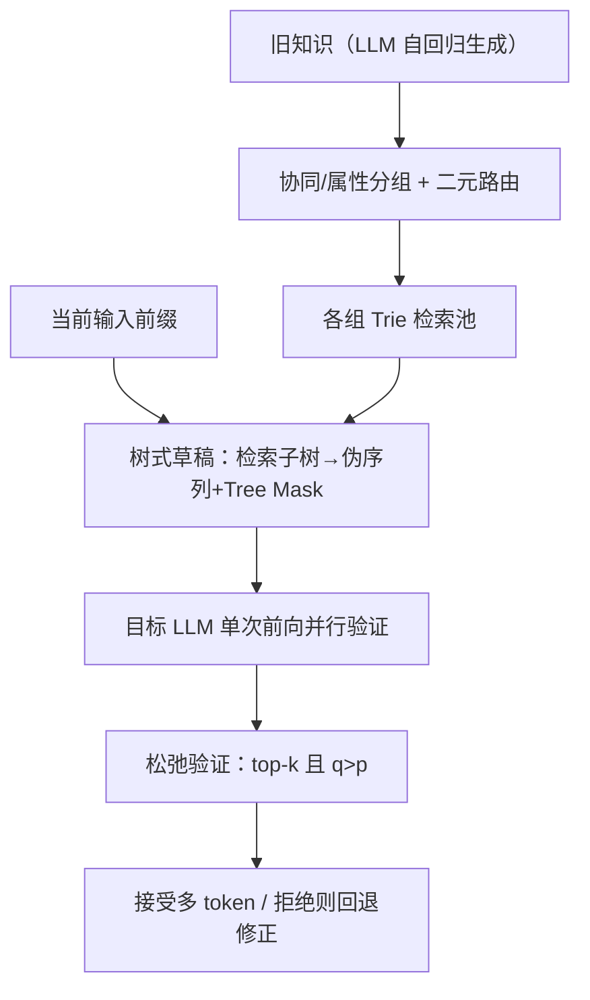

# Efficiency Unleashed: Inference Acceleration for LLM-based Recommender Systems with Speculative Decoding (释放效率：基于推测解码的 LLM 推荐系统推理加速)

- **会议/期刊**: SIGIR 2025
- **作者与机构**: Yunjia Xi, Hangyu Wang, Jianghao Lin, Weinan Zhang, Yong Yu 等（上海交通大学）；Bo Chen, Menghui Zhu, Weiwen Liu, Ruiming Tang（华为诺亚方舟实验室）；Zhewei Wei（中国人民大学）
- **推荐链路定位**: 离线知识生成（LLM 作为特征增强器，服务于下游 CTR/CVR 精排）
- **研究方向**: 大语言模型推荐 / 生成式推荐
- **论文原文**: [https://arxiv.org/abs/2408.05676v2](https://arxiv.org/abs/2408.05676v2)
- **开源代码**: [https://github.com/YunjiaXi/LASER](https://github.com/YunjiaXi/LASER)

## TL;DR (1分钟核心速览)

工业界主流把 LLM 当离线特征增强器，为海量用户/物品生成画像知识，但自回归解码每步只吐一个 token，千万级用户需约 565 GPU 天，成为部署瓶颈。本文首次把**检索式推测解码**引入推荐知识生成，针对推荐场景两大特性设计 **定制检索池**（协同/属性分组 + 二元路由，降低检索耗时）与**松弛验证**（top-$k$+ 概率阈值$p$，提升草稿接受率）。在 ML-10M / Amazon-Books 上对 KAR、TRAWL、ONCE、RLMRec 四框架实现 **3-5× 加速**，下游 CTR 指标无损；华为广告线上 A/B 省约 **67%** 算力。

## Background & Motivation (背景与核心矛盾)

- **主流范式**: 因在线延迟需 <100ms，工业界普遍将 LLM 置于离线，生成用户画像/物品标签等增强知识，再经 BERT 编码或离散化为 ID 特征喂给 DIN/DCNv2 等传统模型。
- **前人局限**: ① 自回归解码不可并行，Qwen-7B 生成 250 token 需 4.88s，千万用户约 565 GPU 天，且用户偏好漂移要求持续更新；② 通用推测解码（小模型草稿、EAGLE 微调）未利用推荐场景"新旧知识高度重叠"的结构性冗余。
- **核心洞察 (Key Insight)**: 推荐知识生成是**持续过程**，旧知识可作为天然检索池；且下游任务对文本**多样性容忍度高**——实验显示四组不同采样知识喂给 DIN/DCNv2，AUC 差异 <0.1%，而相比无增强提升 1.5%-2%，这为"放宽验证"提供了合法性。
- **本文切入点**: 用检索式推测解码（REST）替代自回归，并针对"检索低效"与"多样性容忍"两点做定制化改造。

## Method (核心方法设计)

### 1. 整体框架 (Overall Architecture)

LASER 分三阶段闭环：**① 定制检索池构建**——先用 LLM 自回归生成旧知识，按协同信号（LightGCN 嵌入 + K-means）或属性（类目/子类目）将用户/物品分组，每组以 Trie 树存旧知识，二元路由按交互丰富度分配（老用户/物品走协同池，冷启走属性池）；**② 树式草稿**——以当前输入末 $n$个 token 为前缀从对应 Trie 检索子树，经 DFS 转伪序列并配 tree attention mask 与 position IDs，单次前向并行验证多分支；**③ 松弛验证**——将贪心验证放宽为 top-$k$且概率超阈值$p$，接受更多草稿 token。生成时 prompt 与新文本作为临时分支动态挂入 Trie，生成结束即删除。

### 2. 关键设计拆解 (Key Designs)

1. **定制检索池 (Customized Retrieval Pool)**：全局池虽召回高但检索时间占比超 20%，生成速度从峰值 134.5 跌至 94.8 token/s。本文按组切分：协同池用推荐模型已有嵌入聚类（复用现成嵌入，零额外训练），属性池按类目切分、超阈值再用子类目细分；路由规则为交互多者走协同池、冷启走属性池。效果是检索耗时从 GRP 的 1.019s 降至 0.121s（ML-10M），同时保持较高接受长度。

2. **树式草稿与 Tree Attention**：从 Trie 检索子树 $T_t=\text{Retrieve}(D,\{x_{t-n},...,x_t\},K)$，前缀长度$n$动态调整（先长保相关性，召回不足则缩短重试）。DFS 展开为伪序列$S_t$，构造 mask 使各分支仅可见自身前缀，从而**一次前向验证多条候选路径**，避免逐条串行验证。

3. **松弛验证 (Relaxed Verification)**：贪心验证仅接受 $\arg\max q_i$，接受率受限。本文放宽为
$$\tilde{x}_i \in \text{TopK}(q_i,k),\quad q_i(\tilde{x}_i)>p$$
其中 $k=2$、$p=0.1$。仅用 top-$k$会发散（生成长度暴涨、总耗时反超），仅用 top-$p$在不同数据集上不稳定；二者结合既提升接受率又抑制发散。**训练目标**：本方法为免训练的解码策略，不引入新损失与负采样，仅需离线构建 Trie；推理开销为单次前向验证$K+1$ 个位置，额外成本主要是检索（已被定制池压至毫秒级）。

## Experimental Setup & Evaluation Protocol (实验设置与评估协议)

- **数据集与预处理**:

| 数据集 | #Users | #Items | #Interactions | 稀疏度/密度 | 特征/场景说明 |
| :--- | :---: | :---: | :---: | :---: | :--- |
| MovieLens-10M | 72,000 | 10,000 | 10M ratings | 约 1.39% | 评分≥4 为正样本；模拟流式行为切分新旧历史 |
| Amazon-Books | 49,391 | 78,318 | 5,002,043 | 约 0.13% | 过滤低交互用户/物品；评分 5 为正 |

- **数据划分与防穿越**: 模拟流式行为，将用户历史切为**旧历史**（生成旧知识、建池）与**新历史**（加速评测）；物品随机均分为"已有物品"与"新引入物品"，加速与下游实验仅在新历史/新物品上进行，严格避免未来知识泄漏。
- **排名评测协议**: 加速侧用 Gen. Speed (token/s)、Speedup、AAL（平均接受长度）、ART（平均检索时间）；下游为 CTR 预测的 **AUC / Logloss**（DIN、DCNv2），非全库排序任务。
- **对比基线与超参**: 加速基线含 ReSD/REST、SpecInfer、Lookahead、EAGLE；框架基线 KAR、TRAWL、ONCE、RLMRec；骨干 LLM 为 Vicuna-7b-v1.3（默认）、Mistral-7B、ChatGLM2-6B、Qwen-7B/1.8B。检索池数 3-10，池大小在 {500,...,5000} 网格搜索，$k=2$、$p=0.1$，单卡 RTX 4090。

## Key Experimental Results (实验关键数据)

### 1. 主实验对比 (Main Results)

KAR 框架下 ReSD vs. LASER（ML-10M / Amazon-Books，用户任务）：

| 方法 | ML 用户 Speedup | ML 物品 Speedup | AMZ 用户 Speedup | AMZ 物品 Speedup | ML DIN AUC | AMZ DIN AUC |
| :--- | :---: | :---: | :---: | :---: | :---: | :---: |
| base（无增强） | 1.00× | 1.00× | 1.00× | 1.00× | 0.8163 | 0.8269 |
| ReSD | 2.53× | 2.21× | 1.71× | 2.01× | 0.8351 | 0.8360 |
| **LASER** | **4.58×** | **2.87×** | **4.77×** | **3.28×** | **0.8349** | **0.8358** |
| Improv. (vs ReSD) | +81.0% | +29.9% | +178.9% | +63.2% | -0.02% | -0.02% |

跨框架（ML-10M 用户任务 Speedup）：TRAWL 1.90×→**4.41×**，ONCE 1.84×→**4.14×**，RLMRec 1.66×→**4.09×**；下游 AUC 与 ReSD 差异均 <0.1%。与通用推测解码对比（图 5），LASER 全面领先 EAGLE/SpecInfer/Lookahead，且 REST 本身已优于 EAGLE，印证推荐场景与检索式解码高度契合。

### 2. 消融实验 (Ablation Study)

KAR 用户任务（ML-10M / Amazon-Books）：

| 变体 | ML AAL | ML ART(s) | ML Speedup | AMZ AAL | AMZ ART(s) | AMZ Speedup |
| :--- | :---: | :---: | :---: | :---: | :---: | :---: |
| GRP（全局池） | 6.20 | 1.019 | 2.53× | 5.64 | 4.120 | 1.71× |
| RRP（随机分组） | 5.41 | 0.383 | 3.44× | 5.12 | 0.181 | 3.43× |
| CRP（定制池） | 5.51 | 0.121 | 3.64× | 5.29 | 0.218 | 3.72× |
| RV+GRP | 8.32 | 1.976 | 2.37× | 7.25 | 7.235 | 1.53× |
| RV+RRP | 7.41 | 0.215 | 4.34× | 6.63 | 0.344 | 4.15× |
| **LASER (CRP+RV)** | **7.54** | **0.064** | **4.58×** | **6.76** | **0.108** | **4.77×** |

### 3. 关键实验发现 (Key Findings)

1. **两模块互补而非叠加冗余**：CRP 把 ART 从 1.019s 压到 0.121s（8.4×），RV 把 AAL 从 5.51 抬到 7.54；单独 RV+GRP 因检索耗时 1.976s 反而只有 2.37×，说明"小池 + 松验证"必须成对使用才能兑现加速。
2. **用户侧加速显著优于物品侧**（3.86-4.92× vs. 2.14-3.28×），根源是用户偏好连续性使新旧画像重叠度更高，草稿命中率更高——这为"按实体类型差异化配置池大小"提供了实证依据。
3. **松弛验证必须双条件约束**：仅 top-$k$会发散致生成长度暴涨、总耗时反超 top-1；仅 top-$p$在 Amazon-Books 上发散、在 ML-10M 上反而缩短文本；RV 在保持与 top-1 相近长度的同时取得接近 top-$k$ 的速度。线上侧，华为广告 7B 自研模型上 ReSD 仅 1.37×、LASER 达 3.23×，两周 A/B 省 67% 算力且 eCPM 无损，Trie 构建仅 91.31s（ReSD 为 728.93s）。

## Highlights & Limitations (亮点、对比与审稿批判)

- **与代表作对比 (vs. Prior Work)**: 相比 REST/ReSD 的全局池 + 贪心验证，LASER 用分组池解决检索瓶颈、用松弛验证利用推荐任务的多样性容忍；相比 EAGLE/SpecInfer 需额外小模型或 FFN 头微调，LASER **免训练、模型无关**，可直接套在任意 LLM 与任意 LLM4Rec 框架上。
- **可迁移亮点**: ① "复用推荐模型现成嵌入做聚类分组"零成本构建语义近邻池，可迁移到搜索 query 补全、摘要生成等持续生成场景；② "top-$k$ + 概率阈值"的松弛验证范式适用于一切下游对文本多样性容忍的任务。
- **审稿级局限批判**: ① 加速收益强依赖新旧知识重叠度，对偏好突变用户或全新类目物品，草稿命中率会显著下降，论文未给出重叠度与加速比的定量关系曲线；② 分组数、池大小、$k$、$p$ 均需网格搜索，且最优池大小随数据集/框架漂移，冷启动属性池在属性稀疏场景的鲁棒性缺乏压力测试；③ 下游评估仅 CTR 一个任务、两个模型，未验证生成式推荐（TIGER 类）或排序指标上的无损性。

## Rating (四维评分)

- **方法创新性 (Novelty)**: ⭐⭐⭐⭐ （首次将检索式推测解码系统引入 LLM4Rec，两处改造均紧扣推荐场景特性，但推测解码骨架本身非原创）
- **评估协议与实验扎实度 (Protocol & Experiments)**: ⭐⭐⭐⭐ （四框架 × 两数据集 × 五骨干 LLM + 消融 + 线上 A/B 相当完整，扣分在仅 CTR 单一任务与缺乏重叠度敏感性分析）
- **写作与数学规范度 (Clarity & Rigor)**: ⭐⭐⭐⭐ （三阶段流程与公式定义清晰，动机实验（图 2、表 1）直接支撑设计，复杂度分析略简）
- **工业落地与复现价值 (Industrial & Practical Value)**: ⭐⭐⭐⭐⭐ （免训练、模型无关、仅改解码策略不动在线服务，线上省 67% 算力且代码开源，落地价值极高）

