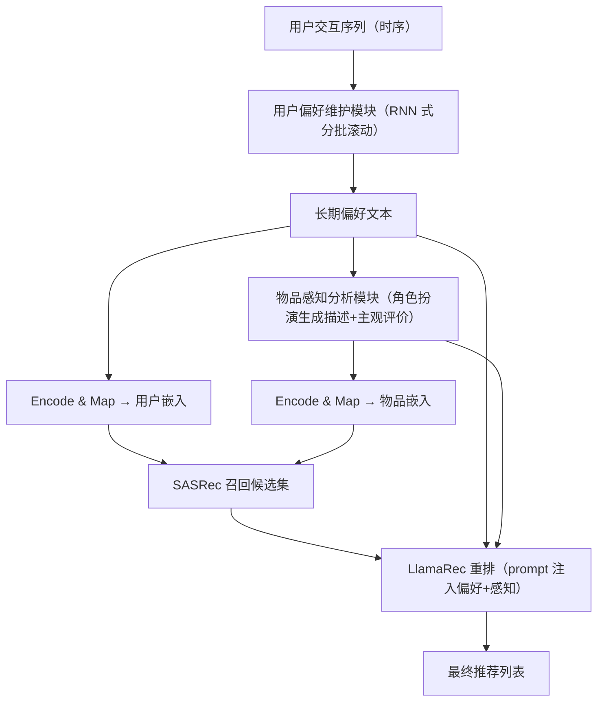
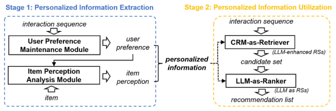

# Improving LLM-powered Recommendations with Personalized Information (以个性化信息增强 LLM 驱动推荐)

- **会议/期刊**: SIGIR 2025 (short paper, 7 pages)
- **作者与机构**: Jiahao Liu, Xueshuo Yan, Dongsheng Li, Guangping Zhang, Hansu Gu, Peng Zhang, Tun Lu, Li Shang, Ning Gu（复旦大学、微软亚洲研究院）
- **推荐链路定位**: 召回（CRM-as-Retriever）+ 重排（LLM-as-Ranker）
- **研究方向**: 大语言模型推荐 / 序列推荐
- **论文原文**: [https://arxiv.org/abs/2502.13845v2](https://arxiv.org/abs/2502.13845v2)
- **开源代码**: [https://github.com/jhliu0807/CoT-Rec](https://github.com/jhliu0807/CoT-Rec)

## TL;DR (1分钟核心速览)

现有 LLM 推荐直接把交互历史塞进 prompt，缺少显式推理建模，LLM 的推理能力被浪费，且重排阶段存在严重位置偏差。本文提出 CoT-Rec 流水线：离线阶段用「用户偏好维护 + 物品感知分析」两条 CoT 抽取个性化信息，在线阶段把偏好文本经 Encode & Map 初始化 SASRec 的用户/物品嵌入做召回，再把偏好与主观感知写入 LlamaRec 的 prompt 做重排。在 MIND/Food/Yelp 三数据集 Leave-One-Out 全库排序下，召回 Hit@10 相对提升 3.6%–11.0%，重排 MAPB 最多下降约 28%。

## Background & Motivation (背景与核心矛盾)

- **主流范式**: LLM 参与推荐分两路——LLM-as-RS（LLM 直接做 Retriever 或 Ranker）与 LLM-enhanced RS（LLM 离线增强传统模型 CRM，推理时不调用 LLM）。
- **前人局限**: 其一，两类范式都直接以交互历史驱动 LLM，**没有显式建模"用户为什么喜欢"的推理链**，CoT 能力未被激活；其二，LLM-as-Retriever 推理速度比 CRM 慢数个数量级，无法支撑全库召回；其三，LLM-as-Ranker 对候选位置高度敏感（位置偏差），排序稳定性差。
- **核心洞察 (Key Insight)**: 作者指出推荐场景中存在两条天然 CoT——**用户偏好分析**（从时序交互中归纳长期兴趣）与**物品感知分析**（同一物品在不同用户眼中被理解成不同样子）；这两条链的中间产物恰好可以同时喂给召回与重排两个阶段。
- **本文切入点**: 把 CoT 的中间结果"物化"为可复用文本，离线抽取、在线复用，从而在不增加服务端推理开销的前提下同时提升召回精度与重排鲁棒性。

## Method (核心方法设计)

### 1. 整体框架 (Overall Architecture)

CoT-Rec 分两阶段。**个性化信息抽取（离线）**：用户偏好维护模块按时间顺序分批读入交互序列，模拟 RNN 的隐状态更新机制滚动维护长期偏好；物品感知分析模块以角色扮演方式，基于该偏好为每个 (用户, 物品) 对生成客观描述与主观评价关键词。**个性化信息利用（在线）**：召回侧用 Encode & Map 把偏好文本映射进 CRM 嵌入空间，初始化 SASRec 的用户嵌入与物品嵌入（物品侧用 caption+description），并把 user ID 前置到序列中；重排侧把偏好与候选物品的主观感知写入 LlamaRec 的 prompt，用 LoRA 指令微调后做 list-wise 排序。全流程模型无关，可替换任意 CRM 与 LLM。

<figure class="paper-figure" markdown="span">
  <figcaption>图1：CoT-Rec 概览。</figcaption>
</figure>

### 2. 关键设计拆解 (Key Designs)

1. **RNN 式用户偏好维护（解决 LLM 时序不敏感）**：已有研究表明即便 prompt 中显式标注时间戳，LLM 仍难以准确捕捉序列时序关系。本文将交互序列按时间分批，相邻批次部分重叠以保持信息连续性，每批输出"短期兴趣"，再与上一轮长期偏好融合更新：

$$\mathbf{p}^{(t)} = \mathrm{LLM}\big(\mathbf{p}^{(t-1)} \oplus \mathrm{ShortTerm}(\mathcal{S}_{t})\big)$$

其中 $\mathcal{S}_t$为第$t$批交互、$\oplus$ 为文本拼接。直觉上这是把 RNN 的"隐状态递推"搬到文本空间，用分批+重叠强制 LLM 沿时间轴做增量归纳，而非一次性面对长序列。

2. **角色扮演式物品感知分析（解决物品理解千人一面）**：同一物品对不同用户意义不同，但传统 item caption 是全局唯一的。该模块三步走：先生成物品客观描述，再以"该用户"身份基于长期偏好撰写一条模拟评论，最后从评论中抽取关键词作为主观感知。这样同一物品在不同偏好下产出差异化感知文本，为后续重排提供用户侧证据。

3. **Encode & Map 与双阶段注入（解决文本-嵌入空间错位）**：定义映射 $T:\text{string}\to\mathbb{R}^{d_{\text{LM}}}\to\mathbb{R}^{d_{\text{CRM}}}$，先用 LM 编码文本再降维到 CRM 空间。相比仅用 caption 初始化物品嵌入的既有做法，本文额外用偏好文本初始化用户嵌入，并把 user ID 前置进序列显式绑定用户。总训练目标沿用 SASRec 的 next-item 交叉熵与 LlamaRec 的指令微调损失（LoRA 低秩适配），**召回侧无需负采样改造**（全库 softmax），重排侧为 list-wise 候选索引预测。推理开销：抽取阶段全离线；召回侧仅多一路用户嵌入，几乎零额外成本；重排部署在客户端，不占服务端算力。

## Experimental Setup & Evaluation Protocol (实验设置与评估协议)

- **数据集与预处理**（均保留至少 5 次交互的用户与物品，按时间排序）：

| 数据集 | 领域 | 过滤方式 | 特征/场景说明 |
| :--- | :---: | :---: | :--- |
| MIND | 新闻 | 5-core | 新闻标题/摘要文本丰富，时效性强 |
| Food (Amazon Review) | 电商 | 5-core | 食品评论，长尾明显 |
| Yelp | 本地生活评论 | 5-core | 商户评论文本，稀疏度高 |

- **数据划分与防穿越**: `Leave-One-Out`，取每个用户最后一条交互为测试目标，之前为训练/验证，严格按时间顺序，无未来信息泄漏。
- **排名评测协议**: 召回阶段为无偏 `Full-Ranking`（从全物品库中排序目标物品），指标 Hit@10、NDCG@10；重排阶段在召回候选集上评估 NDCG@10 与自提出的 **MAPB（Mean Absolute Position Bias）**，即把目标物品轮换放置于候选集全部 $M$ 个位置，度量其预测名次相对均值的平均绝对偏移：

$$\text{MAPB}=\frac{1}{n}\sum_{i=1}^{n}\frac{1}{M}\sum_{j=1}^{M}\left|r_{i,j}-\bar{r}_{i}\right|$$

- **对比基线与超参**: 召回侧对比用户嵌入 {None, Random, Preference} × 物品嵌入 {Random, Caption, Description} 的 3×3 组合；重排侧对比 {无重排, LLM, LLM++}。骨干为 SASRec + Qwen2.5-7B-Instruct，固定 $K=10$，报告 5 次独立运行均值。注意本文**不与其它 LLM 推荐架构横向对比**，定位是"可插拔增强管线"。

## Key Experimental Results (实验关键数据)

### 1. 主实验对比 (Main Results)

召回阶段（Hit@10 / NDCG@10，节选关键组合）：

| 用户嵌入 | 物品嵌入 | MIND Hit | MIND NDCG | Food Hit | Food NDCG | Yelp Hit | Yelp NDCG |
| :--- | :--- | :---: | :---: | :---: | :---: | :---: | :---: |
| None | Random | 0.1387 | 0.0737 | 0.0182 | 0.0096 | 0.0297 | 0.0148 |
| None | Description | 0.1498 | 0.0807 | 0.0281 | 0.0150 | 0.0313 | 0.0155 |
| Random | Description | 0.1396 | 0.0747 | 0.0284 | 0.0155 | 0.0313 | 0.0157 |
| **Preference** | **Description** | **0.1551** | **0.0836** | **0.0295** | **0.0158** | **0.0348** | **0.0171** |
| Improv. (vs. None+Random) | | +11.8% | +13.4% | +62.1% | +64.6% | +17.2% | +15.5% |

重排阶段（NDCG@10 / MAPB，MAPB 越低越好）：

| Retriever | Ranker | MIND NDCG | MIND MAPB | Food NDCG | Food MAPB | Yelp NDCG | Yelp MAPB |
| :--- | :--- | :---: | :---: | :---: | :---: | :---: | :---: |
| CRM | None | 0.0737 | - | 0.0096 | - | 0.0148 | - |
| CRM | LLM | 0.0763 | 0.9723 | 0.0112 | 0.9819 | 0.0148 | 1.4928 |
| CRM | **LLM++** | **0.0765** | **0.8413** | **0.0113** | **0.8086** | **0.0151** | **1.1060** |
| CRM++ | None | 0.0836 | - | 0.0158 | - | 0.0171 | - |
| CRM++ | LLM | 0.0837 | 1.0336 | 0.0176 | 1.0664 | 0.0172 | 1.3716 |
| CRM++ | **LLM++** | **0.0840** | **0.8168** | **0.0177** | **0.7641** | **0.0174** | **1.1964** |

### 2. 消融实验 (Ablation Study)

| 配置 | MIND Hit | Food Hit | Yelp Hit | 说明 |
| :--- | :---: | :---: | :---: | :--- |
| w/o 用户嵌入（None+Description） | 0.1498 | 0.0281 | 0.0313 | 去掉用户侧信息 |
| w/ 随机用户嵌入（Random+Description） | 0.1396 | 0.0284 | 0.0313 | 用户嵌入存在但无语义 |
| w/o 物品描述（Preference+Caption） | 0.1539 | 0.0291 | 0.0346 | 物品侧仅用短 caption |
| **完整模型（Preference+Description）** | **0.1551** | **0.0295** | **0.0348** | 双 CoT 全量注入 |
| 重排 w/o 感知（LLM） | NDCG 0.0765 | MAPB 0.9723 | — | 仅偏好、无主观感知 |
| 重排 w/ 感知（LLM++） | NDCG 0.0765 | MAPB 0.8413 | — | 位置偏差显著下降 |

### 3. 关键实验发现 (Key Findings)

1. **用户嵌入必须"有语义"才有用**：Random 用户嵌入在 MIND 上反而把 Hit 从 0.1498 拉低到 0.1396，与 SASRec 原文"额外用户嵌入无益"的结论一致；而 Preference 初始化在全部 9 个格子中稳定超过 None，说明增益来自偏好文本的语义而非用户 ID 本身。
2. **物品侧信息越丰富越好，且与用户侧互补**：物品嵌入排序恒为 Description > Caption > Random（MIND 上 0.1498 > 0.1447 > 0.1387），叠加偏好后 Food 的 Hit 从 0.0182 提升到 0.0295（+62%），稀疏域受益最大。
3. **CoT 注入的主要收益在"稳"而非"准"**：LLM++ 相对 LLM 的 NDCG 提升仅 0.0002–0.0003，但 MAPB 在 CRM++ 下从 1.0336 降至 0.8168（−21%），Yelp 上从 1.3716 降至 1.1964（−13%），验证了"个性化信息帮助 LLM 聚焦任务相关线索、抑制位置先验"的假设。

## Highlights & Limitations (亮点、对比与审稿批判)

- **与代表作对比 (vs. Prior Work)**: 相比 LLM-as-Retriever（如 Bi-Step Grounding、语义 ID 索引），本文承认 LLM 召回不可扩展，改用 CRM 召回、LLM 只做客户端重排；相比 LlamaRec 等纯 LLM 重排，本文额外注入离线 CoT 中间产物，把"推理"从在线 prompt 里前移到离线抽取；相比 LLM-enhanced RS 只用 LLM 造特征/造交互，本文的中间产物同时服务召回与重排两个阶段。
- **可迁移亮点**: ① "RNN 式分批+重叠"的文本隐状态递推，可直接用于任何需要 LLM 处理长时序行为的场景；② MAPB 这一位置偏差度量与"轮换目标位置"的评测构造，可低成本移植到任意 list-wise 重排模型的鲁棒性评估。
- **审稿级局限批判**: ① 实验仅与自身变体对比，未与任何外部 LLM 推荐 SOTA 横向比较，且三数据集均无统计显著性检验，"提升"的说服力有限；② 离线抽取需为每个 (用户, 物品) 对调用 LLM 生成感知文本，冷启动新物品与用户规模增长时的抽取成本与文本陈旧问题未被讨论；③ 重排"部署在客户端"的假设缺乏延迟与隐私层面的实证支撑。

## Rating (四维评分)

- **方法创新性 (Novelty)**: ⭐⭐⭐ （把 CoT 中间产物物化为可复用文本并双阶段注入，思路清晰但属工程化组合创新，缺少理论刻画）
- **评估协议与实验扎实度 (Protocol & Experiments)**: ⭐⭐⭐ （Leave-One-Out 全库排序与 MAPB 设计合理，但缺外部 SOTA 对比与显著性检验，数据集统计表缺失）
- **写作与数学规范度 (Clarity & Rigor)**: ⭐⭐⭐⭐ （两阶段流程与公式定义干净，MAPB 定义严谨，符号无冗余）
- **工业落地与复现价值 (Industrial & Practical Value)**: ⭐⭐⭐⭐ （模型无关、离线抽取零在线开销、代码已开源，但大规模抽取成本与客户端部署假设待验证）

