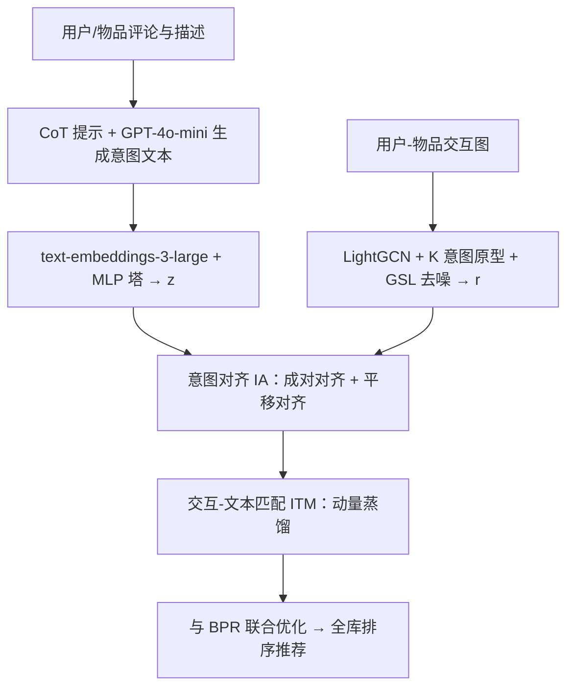

# Intent Representation Learning with Large Language Model for Recommendation (基于大语言模型的推荐意图表征学习)

- **会议/期刊**: SIGIR 2025 (Full Paper)
- **作者与机构**: Yu Wang, Lei Sang (通讯), Yi Zhang, Yiwen Zhang — 安徽大学
- **推荐链路定位**: 召回（作为模型无关插件增强 LightGCN/SGL/SimGCL/DCCF/BIGCF 等 CF 主干）
- **研究方向**: 大语言模型推荐 / 自监督对比与去噪
- **论文原文**: [arXiv:2502.03307v4](https://arxiv.org/abs/2502.03307v4)
- **开源代码**: [wangyu0627/IRLLRec](https://github.com/wangyu0627/IRLLRec)

## TL;DR (1分钟核心速览)

现有意图解耦推荐把意图当作与交互一起更新的可学习参数，完全丢弃了评论/描述等文本中蕴含的细粒度意图，且文本意图与交互意图天然处于不同表征空间、彼此含噪。本文提出模型无关框架 IRLLRec：用 GPT-4o-mini 的 CoT 提示抽取用户/物品文本意图，与 LightGCN 交互意图构成双塔，经成对对齐+平移对齐消除模态差异，再用动量蒸馏的交互-文本匹配（ITM）筛选关键意图。在 Amazon-book/Yelp/Amazon-movie 三个数据集、五种 CF 主干上，Recall@20/NDCG@20 相对最强基线最高提升 15.37%/14.11%（Amazon-movie），且在最稀疏用户组上 NDCG@20 提升 2.31%–5.20%。

## Background & Motivation (背景与核心矛盾)

- **主流范式**: KGIN/DCCF/BIGCF 等把意图建模为与交互联合优化的隐变量或原型，通过解耦表征刻画"用户为何点击"；RLMRec/AlphaRec/KAR 则用 LLM 生成用户画像或语义嵌入来增强 CF。
- **前人局限**: ① 意图仅由交互驱动，交互稀疏时意图几乎不可辨识，而评论、物品描述中的显式偏好被完全浪费；② 文本语义与交互语义分布差异显著（图 1(c) 的 KDE 显示 profile/intent 嵌入与交互嵌入重叠但形状不同），直接拼接或简单对齐会被噪声与稀疏信号带偏。
- **核心洞察 (Key Insight)**: 文本意图与交互意图是同一潜在意图的两个"视图"——文本侧提供可解释的细粒度偏好（喜欢"菜单多样"、讨厌"停车难"），交互侧提供真实行为证据；二者应先在共享空间对齐、再在样本级做精细匹配，而非粗暴融合。
- **本文切入点**: 把"意图对齐"拆成"空间拉近（IA）"与"关键意图匹配（ITM）"两步，用对比学习 + 动量蒸馏分别解决，且整体作为插件挂在任意 CF 主干上。

## Method (核心方法设计)

### 1. 整体框架 (Overall Architecture)

输入分两路：文本侧用 CoT 三步提示（抽取属性 → 归纳喜好/厌恶 → 汇总意图）让 GPT-4o-mini 生成用户意图 $I_u$与物品意图$I_i$，再经 text-embeddings-3-large 编码、两层 MLP 映射为$z$；交互侧用 LightGCN 传播得到全局嵌入$e$，再经$K$个意图原型做期望映射得到意图感知表征$r$，并用图结构学习（GSL）掩码重建干净交互图。两路表征进入 IA 做成对/平移对齐，再进入 ITM 以动量教师-学生蒸馏做交互↔文本双向匹配，最终与 BPR 主损失联合训练。

### 2. 关键设计拆解 (Key Designs)

1. **交互意图的期望映射与图结构去噪**：痛点是把意图当自由参数在稀疏交互下不可辨识。本文假设意图服从 $P(c_u|u)$，将预测近似为期望$\mathbb{E}_{P(c_u|e_u)}[c_u]$，用$K$个原型加权得到$r_u^{(l)}=\sum_{k=1}^{K}c_u^{k}P(c_u^{k}|e_u^{(l)})$，其中$P$为原型上的 softmax。随后用余弦相似度构造掩码$M_{ij}=D^{-1}\cdot\alpha_{ij},\ \alpha_{ij}=(s(r_u,r_i)+1)/2$ 重建交互图，逆度归一化抑制 hub 节点主导。直觉：意图原型把"全局嵌入"投影到语义子空间，掩码则把与意图不符的边（误点击/流行度偏置）压权。

2. **成对对齐 + 平移对齐（IA）**：痛点在于两模态空间差异大且正负样本难定义。成对对齐用标准 InfoNCE 在 batch 内拉近同一用户/物品的 $(r_i,z_i)$、推远其他样本，分别对 user/pos/neg 三类样本计算；平移对齐则对两路嵌入加高斯扰动$r'=r+\epsilon_r\odot r,\ z'=z+\epsilon_z\odot z$，以相似度矩阵对角线为正样本、其余为负样本构造对称对比损失$\mathcal{L}_{tran}^{text}$与$\mathcal{L}_{tran}^{inter}$。直觉：扰动等价于在嵌入邻域内做一致性约束，使对齐对输入噪声（冗余描述、误点击）鲁棒。

3. **动量蒸馏的交互-文本匹配（ITM）与训练目标**：对齐只是弱相关，文本中仍含与真实意图无关的词。ITM 维护两个动量单模态编码器 $g'_t,g'_i$生成伪标签分布$q_{t2i},q_{i2t}$，学生分布$p_{t2i}=z^{\top}r$，以 KL 散度双向蒸馏：$\mathcal{L}_{ITM}=(1-\alpha)\mathcal{L}_{tran}+\alpha\mathbb{E}[\mathrm{KL}(q_{i2t}\|p_{i2t})+\mathrm{KL}(q_{t2i}\|p_{t2i})]$，教师参数按$\theta_{teacher}=\beta\theta_{teacher}+(1-\beta)\theta_{student}$（$\beta=0.999$）更新。总损失$\mathcal{L}_{IRLLRec}=\mathcal{L}_{IA}+\lambda_3\mathcal{L}_{ITM}+\|\Theta\|_2^2$，其中$\mathcal{L}_{IA}=\lambda_1(\mathcal{L}_{pair}^{user}+\mathcal{L}_{pair}^{pos}+\mathcal{L}_{pair}^{neg})+\lambda_2(\mathcal{L}_{tran}^{text}+\mathcal{L}_{tran}^{inter})$。负采样完全依赖 in-batch 与扰动构造，无需额外负采样器；推理时仅保留主干 + 融合意图表征，LLM 调用离线完成，在线开销与主干同阶。

## Experimental Setup & Evaluation Protocol (实验设置与评估协议)

- **数据集与预处理**: 过滤低评分（Amazon-book <2，Yelp/Amazon-movie <3）后做 k-core 过滤：

| 数据集 | #Users | #Items | #Interactions | 密度 | 场景说明 |
| :--- | :---: | :---: | :---: | :---: | :--- |
| Amazon-book | 11,000 | 9,332 | 200,860 | 2.0×10⁻³ | 图书购买+评论 |
| Yelp | 11,091 | 11,010 | 277,535 | 2.3×10⁻³ | 本地商户评论 |
| Amazon-movie | 16,994 | 9,370 | 168,243 | 1.1×10⁻³ | 电影观看+评论 |

- **数据划分与防穿越**: Amazon-book/Yelp 按 3:1:1 比例划分，Amazon-movie 按 8:1:1 比例划分（非时间戳切分，存在轻度信息泄漏风险）。
- **排名评测协议**: 采用 SSLRec 开源框架的采样评测，报告 Recall@{5,10,20} 与 NDCG@{5,10,20}，结果为 5 次运行均值；显著性以 $p<0.05$ 标注（表中 `*`）。
- **对比基线与超参设置**: 基线为 KAR、RLMRec-Con/Gen、AlphaRec；主干为 LightGCN、SGL、SimGCL、DCCF、BIGCF。嵌入维度统一 32，Adam + Xavier 初始化，batch 4096，学习率 1e-3，早停；意图生成用 GPT-4o-mini，语义编码用 text-embeddings-3-large；$\alpha=0.4$，$\lambda_1$ 最优区间 0.01–0.03。

## Key Experimental Results (实验关键数据)

### 1. 主实验对比 (Main Results)

以 LightGCN 与 DCCF 两个代表性主干为例（完整表覆盖 5 个主干 × 3 数据集）：

| 主干 / 方法 | Amazon-book R@20 | N@20 | Yelp R@20 | N@20 | Amazon-movie R@20 | N@20 |
| :--- | :---: | :---: | :---: | :---: | :---: | :---: |
| LightGCN | 0.1411 | 0.0856 | 0.1157 | 0.0733 | 0.1661 | 0.0891 |
| AlphaRec | 0.1412 | 0.0873 | 0.1212 | 0.0752 | 0.1661 | 0.0958 |
| KAR | 0.1416 | 0.0860 | 0.1194 | 0.0756 | 0.1653 | 0.0905 |
| RLMRec-Con | 0.1483 | 0.0903 | 0.1230 | 0.0776 | 0.1697 | 0.0918 |
| RLMRec-Gen | 0.1446 | 0.0887 | 0.1209 | 0.0761 | 0.1705 | 0.0921 |
| **IRLLRec (LightGCN)** | **0.1538** | **0.0938** | **0.1278** | **0.0810** | **0.1855** | **0.1032** |
| Improv. | +3.71% | +3.85% | +3.90% | +4.39% | +8.82% | +12.03% |
| DCCF | 0.1517 | 0.0943 | 0.1249 | 0.0800 | 0.1723 | 0.1014 |
| RLMRec-Con | 0.1563 | 0.0968 | 0.1321 | 0.0836 | 0.1790 | 0.1048 |
| **IRLLRec (DCCF)** | **0.1590** | **0.0992** | **0.1360** | **0.0864** | **0.1826** | **0.1066** |
| Improv. | +1.73% | +2.41% | +2.96% | +3.35% | +2.00% | +1.72% |

### 2. 消融实验 (Ablation Study)

| 变体 (Amazon-movie, LightGCN 主干) | R@20 | N@20 | 说明 |
| :--- | :---: | :---: | :--- |
| 完整 IRLLRec | 0.1855 | 0.1032 | 全模块 |
| w/o IA | 显著下降（低于主干） | — | 去掉意图对齐 |
| w/o ITM | 下降，但仍优于主干 | — | 去掉动量匹配 |
| w/o Graph | 下降 | — | 交互意图塔退化为普通嵌入 |
| w/o Text | 下降 | — | 文本塔退化为直接对齐 |

语义编码器替换（Amazon-movie, BIGCF 主干）：Llama3-8B-Instruct 0.1859/0.1074 < text-embedding-ada-002 0.1898/0.1102 < text-embeddings-3-large 0.1916/0.1115 < SFR-Embedding-Mistral **0.1935/0.1123**。

### 3. 关键实验发现 (Key Findings)

1. **IA 是收益主引擎，且不可单独使用**：去掉 IA 后性能甚至低于原始主干，说明单模态意图无法刻画细粒度偏好，必须"拉近空间 + 滤噪"同时发生；$\lambda_1$ 最优区间仅 0.01–0.03，过大则非主损失阻碍收敛。
2. **稀疏用户获益最大**：按交互数四分组后，最稀疏组上 IRLLRec 相对 RLMRec 的 NDCG@20 分别提升 2.31%/2.51%/5.20%（book/Yelp/movie），验证文本意图对"准冷启动"用户的补位价值。
3. **LLM 规模不等于效果**：4096 维的 Llama3-8B 嵌入反而最差，而 SFR-Embedding-Mistral 最优，说明意图摘要质量取决于语义编码器的表征能力而非参数量；案例中用户 2025 的交互-文本匹配分数从训练前 -0.0005 升至训练后 0.0399，证明 ITM 确实在收敛到关键意图。

## Highlights & Limitations (亮点、对比与审稿批判)

- **与代表作对比 (vs. Prior Work)**: 相比 RLMRec 只做"画像-交互"的对比/生成对齐，本文把对齐对象升级为"意图"并增加样本级动量匹配，且显式建模交互意图原型；相比 DCCF/BIGCF 仅从交互解耦意图，本文引入 LLM 文本意图作为第二视图；相比 AlphaRec 用语言嵌入替换 ID，本文保留 ID 主干、以插件方式注入语义，兼容性更强。
- **可迁移亮点**: ① "成对对齐 + 高斯扰动平移对齐"的组合可直接移植到任何双模态（图文、音视频）推荐对齐；② 动量教师生成伪标签做跨模态匹配，可复用于多行为/多场景的弱监督对齐。
- **审稿级局限批判**: ① 依赖 GPT-4o-mini 离线生成意图，成本与可复现性受 API 版本漂移影响，且未报告意图生成的总 token 开销；② 数据按比例随机划分而非全局时间戳切分，存在未来交互泄漏，采样评测也弱于 Full-Ranking；③ 动量蒸馏使编码开销翻倍，论文未给出在线延迟实测。

## Rating (四维评分)

- **方法创新性 (Novelty)**: ⭐⭐⭐⭐ （把意图对齐拆为空间对齐+样本匹配两级，并用动量蒸馏做跨模态伪标签，组合新颖但单点技术均为已有组件的巧妙拼装）
- **评估协议与实验扎实度 (Protocol & Experiments)**: ⭐⭐⭐⭐ （5 主干 × 3 数据集 × 6 指标 + 稀疏分桶 + 编码器替换 + 超参敏感性齐全，但采样评测与随机划分削弱说服力）
- **写作与数学规范度 (Clarity & Rigor)**: ⭐⭐⭐⭐ （公式与模块对应清晰、复杂度分析完整，但 Eq.5–6 的期望近似推导仅引用文献、未自证误差界）
- **工业落地与复现价值 (Industrial & Practical Value)**: ⭐⭐⭐⭐ （代码开源、插件式即插即用、LLM 调用可离线批处理，但意图生成成本与动量双塔开销需在线上权衡）

