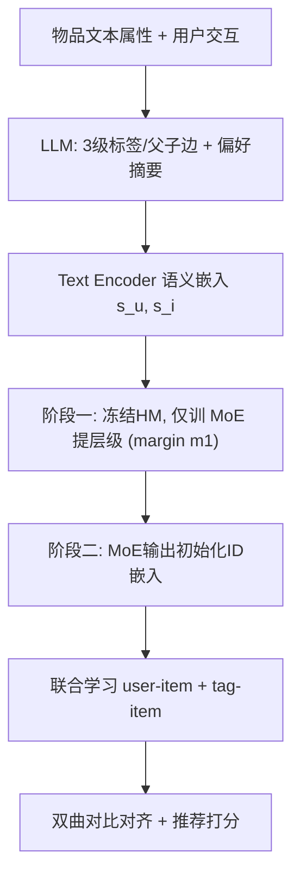
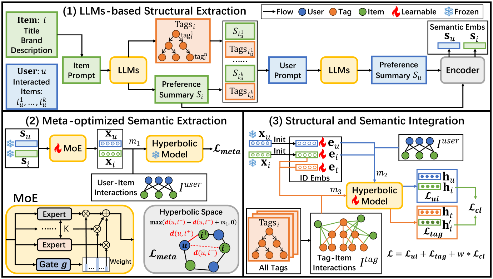

# Large Language Models Enhanced Hyperbolic Space Recommender Systems (大语言模型增强的双曲空间推荐系统)

- **会议/期刊**: SIGIR 2025 (Full Paper)
- **作者与机构**: Wentao Cheng, Zhida Qin, Zexue Wu, Tianyu Huang (北京理工大学); Pengzhan Zhou (重庆大学)
- **推荐链路定位**: 召回 (双曲空间协同召回)
- **研究方向**: 大语言模型推荐 / 图神经网络与知识图谱推荐
- **论文原文**: [https://arxiv.org/abs/2504.05694v2](https://arxiv.org/abs/2504.05694v2)
- **开源代码**: [https://github.com/Qin-lab-code/HyperLLM](https://github.com/Qin-lab-code/HyperLLM)

## TL;DR (1分钟核心速览)

双曲空间推荐能建模用户-物品的层级结构，但现有 LLM4Rec 语义增强方法均在欧氏空间完成，无法把文本/语义中丰富的层级信息注入双曲模型，且语义空间与双曲协同空间存在巨大鸿沟。本文提出模型无关框架 HyperLLM：结构侧用 LLM 生成多级父子标签并构建 tag-item 交互，以双曲对比学习对齐；语义侧用 MoE + 元优化两阶段训练把语义嵌入桥接到双曲协同空间。在 Amazon 三数据集、8:1:1 随机划分、Full-Ranking 协议下，Recall@20 相对 HRCF 最高提升 41.67%，且训练收敛更快、稀疏用户组增益更大。

## Background & Motivation (背景与核心矛盾)

- **主流范式**: 双曲推荐 (HGCF/HRCF/HICF/HGCH/HyperCL) 用双曲距离 + margin ranking loss 建模层级；LLM4Rec 则用 LLM 抽取语义表征增强下游模型 (KAR/RLMRec)。
- **前人局限**: 其一，LLM 语义增强框架 (KAR、RLMRec) 全部在欧氏空间做对齐，语义数据中固有的层级结构被欧氏几何的线性容量"压平"，无法被双曲模型利用；其二，语义嵌入空间与双曲协同空间不仅跨几何 (欧氏 vs. 双曲)，还跨语义-协同语义，直接拼接/对齐会造成训练不稳定甚至 NaN。
- **核心洞察 (Key Insight)**: 推荐数据中的层级信息有两条互补来源——**结构层级** (LLM 生成的 broad-to-specific 分类标签，天然是树) 与**语义层级** (偏好摘要嵌入中的隐式层次)；双曲空间的指数级容量恰好是承载二者的理想几何。
- **本文切入点**: 不改动任何双曲 backbone，而是把两类层级信息"外挂式"注入：结构侧走 tag-item 图 + 对比对齐，语义侧走元优化两阶段"先提层级、再迁移"。

## Method (核心方法设计)

### 1. 整体框架 (Overall Architecture)

HyperLLM 由三个顺序执行的模块构成，且**两阶段训练解耦**（阶段一完成后才启动阶段二）。首先用 LLaMA3-8B 为每个物品生成 3 级父子标签、边集合与偏好摘要，并为用户聚合交互物品的摘要/标签生成用户摘要，再由 text-embedding-3-large 编码为语义嵌入。阶段一冻结语义嵌入与双曲模型参数，仅训练 MoE 将语义嵌入变换到双曲协同空间，用较小 margin 的双曲 ranking loss 驱动其"提取层级"；阶段二用变换后的嵌入初始化 ID 嵌入，联合学习 user-item 与 tag-item 两个交互矩阵，并以双曲对比损失对齐两侧物品表征。

<figure class="paper-figure" markdown="span">
  <figcaption>图1：我们提出的HyperLLM的整体架构。它由三个模块组成：基于LLM的结构提取、元优化语义提取以及结构与语义集成。这些模块按指定顺序运行。</figcaption>
</figure>

### 2. 关键设计拆解 (Key Designs)

1. **结构层级注入：tag-item 联合学习 + 双曲对比对齐**：LLM 为物品生成 3 层标签及父子边，构成 tag-item 矩阵 $\mathbf{I}_{tag}$，与$\mathbf{I}_{user}$共享同一双曲模型学习：$\mathbf{h}_t, \mathbf{h}'_i, \mathcal{L}_{tag} = \mathrm{HM}(\mathbf{e}_t, \mathbf{e}_i, m_3, \mathbf{I}_{tag})$。随后用双曲距离构造 InfoNCE 对齐同一物品在两条交互视图下的表征：
$$\mathcal{L}_{cl} = \sum_{i \in \mathcal{I}} -\log \frac{\exp(-d^2(\mathbf{h}_i, \mathbf{h}'_i)/\tau)}{\sum_{j \in \mathcal{I}} \exp(-d^2(\mathbf{h}_i, \mathbf{h}'_j)/\tau)}$$
直觉：标签树把"宽泛→具体"的偏序关系显式写进图结构，对比对齐则强制协同表征吸收这一偏序，而非仅做特征拼接。

2. **元优化两阶段语义桥接 (Meta-optimized Semantic Extraction)**：直接联合优化语义嵌入与推荐任务会因跨空间鸿沟发散（消融中 HICF/HyperCL 首 epoch 即 NaN）。本文借元学习"冻结参数以学通用知识"的思想：阶段一冻结 $\mathrm{HM}^*$与$\mathbf{s}^*$，只训 MoE 做空间变换$\mathbf{x}_u = \sum_{k=1}^{K} g_k(\mathbf{s}^*_u)\cdot \mathrm{Expert}_k(\mathbf{s}^*_u)$，损失$\mathcal{L}_{meta} = \mathrm{HM}^*(\mathbf{x}_u, \mathbf{x}_i, m_1, \mathbf{I}_{user})$，其中$m_1$刻意取小值，使 MoE 只做"细微调整"避免过度分离导致过拟合；阶段二以$\mathbf{e}_u = \mathbf{x}_u, \mathbf{e}_i = \mathbf{x}_i$初始化 ID 嵌入，用$m_2$ 训练真实推荐任务。两阶段用不同 margin 的 ranking loss 区分任务，促进共享知识迁移。

3. **训练目标与推理开销**：阶段二总损失 $\mathcal{L} = \mathcal{L}_{ui} + \mathcal{L}_{tag} + w\cdot\mathcal{L}_{cl}$，$w=0.01$、$\tau=0.5$；负采样沿用 backbone 的 margin ranking 负样本（HICF 自带 informative negative sampling）。语义嵌入维度$d_1=3072$、ID 维度$d_2=50$、专家数$K\in\{12,16,20\}$。LLM 生成与编码为一次性离线开销，在线仅需双曲距离计算，单卡 RTX 3090 可完成全部实验。

## Experimental Setup & Evaluation Protocol (实验设置与评估协议)

- **数据集与预处理**: Amazon 三域，保留评分 $\geq 4$ 并施加 `5-core` 过滤构造隐式反馈：

| 数据集 | #Users | #Items | #Interactions | 密度 | 平均 Token |
| :--- | :---: | :---: | :---: | :---: | :---: |
| Toys | 11,268 | 7,309 | 95,420 | 0.12% | 125 |
| Sports | 22,686 | 12,301 | 185,718 | 0.07% | 159 |
| Beauty | 10,553 | 6,086 | 94,148 | 0.15% | 138 |

- **数据划分与防穿越 (Splitting Strategy)**: 随机 `8:1:1` 比例划分为 train/valid/test，按验证集最优超参定模后报告测试集结果。
- **排名评测协议 (Ranking Protocol)**: 采用无偏 `Full-Ranking`（全库未交互物品排序），指标为 Recall@{10,20} 与 NDCG@{10,20}。
- **对比基线与超参设置**: 5 个双曲 backbone（HGCF、HRCF、HICF、HGCH、HyperCL，覆盖 Hyperboloid/Poincaré 与部分/完全双曲架构）× 4 种变体（Base / Structural / Semantic / HyperLLM）；框架级对比 KAR、RLMRec-Con、RLMRec-Gen。LLM 为 LLaMA3-8B，编码器 text-embedding-3-large，训练 500 epoch、early stopping 50。

## Key Experimental Results (实验关键数据)

### 1. 主实验对比 (Main Results)

以最具代表性的 HRCF 与 HICF 为例（Recall@20 / NDCG@20，Full-Ranking）：

| Backbone | 变体 | Toys R@20 | Toys N@20 | Sports R@20 | Beauty R@20 |
| :--- | :--- | :---: | :---: | :---: | :---: |
| HRCF | Base | 0.1200 | 0.0576 | 0.0854 | 0.1607 |
| HRCF | Structural | 0.1374 | 0.0632 | 0.0952 | 0.1694 |
| HRCF | Semantic | 0.1654 | 0.0776 | 0.1111 | 0.1890 |
| HRCF | **HyperLLM** | **0.1700** | **0.0789** | **0.1133** | **0.1904** |
| HRCF | Improv. | +41.67% | +36.98% | +32.67% | +18.48% |
| HICF | Base | 0.1345 | 0.0636 | 0.0912 | 0.1685 |
| HICF | **HyperLLM** | **0.1690** | **0.0798** | **0.1175** | **0.1978** |
| HICF | Improv. | +25.65% | +25.47% | +28.84% | +17.39% |

框架级对比（Toys, HGCF backbone, Recall@20 / 训练秒数）：KAR 0.1331/53s、RLMRec-Con 0.1249/1121s、RLMRec-Gen 0.1205/513s、**HyperLLM 0.1638/261s**；KAR 在 Sports/Beauty 上甚至负增长（-14.3%/-2.43%）。

### 2. 消融实验 (Ablation Study)

| 变体 | 说明 | 表现趋势 |
| :--- | :--- | :--- |
| w/o Meta | 去掉元优化，语义嵌入与 MoE 联合优化 | 最差；HICF/HyperCL 首 epoch NaN |
| only Semantic | 仅保留语义层级，去掉结构整合 | 显著优于 w/o Meta，但 Sports/Beauty 低于 Base |
| w/o Semantic | 去掉语义层级 | 增益明显小于去掉结构侧 |
| w/o Structural | 去掉结构层级 | 增益下降但幅度小于语义侧 |
| w/o CL | 去掉双曲对比损失 | 性能下降，验证对齐的必要性 |
| **HyperLLM** | 全组件 | **最优** |

### 3. 关键实验发现 (Key Findings)

1. **语义层级贡献 > 结构层级，但二者互补**：HRCF 上 Semantic 变体把 Toys R@20 从 0.1200 拉到 0.1654，Structural 仅到 0.1374，而 HyperLLM 进一步到 0.1700——说明隐式语义层次携带更细粒度的偏好信号，标签树则提供显式偏序骨架。
2. **元优化是"防崩"关键而非锦上添花**：w/o Meta 在 HICF 与 HyperCL 上直接 NaN，only Semantic 又显著优于 w/o Meta，证明跨几何+跨语义的双重鸿沟必须靠"冻结-提取-迁移"的两阶段解耦来跨越；同时 HyperLLM 在验证集上起始点更高、收敛 epoch 远少于 w/o Meta（图 3）。
3. **稀疏用户获益更大，且效率稳定**：按交互数五等分后，HyperLLM 在 G1（最稀疏）组提升百分比最高，多数数据集上提升随稀疏度上升而增大；训练时间在 170–821s 区间，远低于 RLMRec-Con（最高 1927s）与 KAR（最高 9485s），兼顾效果与稳定性。

## Highlights & Limitations (亮点、对比与审稿批判)

- **与代表作对比 (vs. Prior Work)**: 与 KAR 的本质差异在于 KAR 用 MoE 变换语义后**拼接**进欧氏 ID 嵌入，而 HyperLLM 用 MoE 做**跨几何初始化 + 元优化解耦**；与 RLMRec 的差异在于对齐发生在**双曲距离空间**且额外引入 tag-item 结构视图；与 HRCF/HICF 的差异在于不改动其几何算子，纯做模型无关的层级信息注入。
- **可迁移亮点**: ①"冻结 backbone、只训适配器"的两阶段元优化范式可直接迁移到任何欧氏/双曲语义融合场景；②用 LLM 生成多级标签构造辅助交互图，是一种低成本、无需人工分类体系的层级先验注入手段。
- **审稿级局限批判**: ①LLM 生成标签与摘要的质量未被量化评估（无人工校验或标签一致性指标），且 3 层标签深度为硬编码，对浅层类目数据可能过约束；②主实验仅在 Amazon 三域、随机划分下进行，缺少时间切分与冷启动划分，且未报告显著性检验；③语义嵌入 3072 维 + MoE 的离线预处理成本与 LLM 调用开销未做量化对比。

## Rating (四维评分)

- **方法创新性 (Novelty)**: ⭐⭐⭐⭐ （首次系统性地把 LLM 层级信息以结构+语义双通道注入双曲推荐，元优化两阶段桥接思路新颖且模型无关）
- **评估协议与实验扎实度 (Protocol & Experiments)**: ⭐⭐⭐⭐ （5 个双曲 backbone × 4 变体 + 3 个 LLM4Rec 框架对比充分，Full-Ranking 协议规范，但缺时间切分与显著性检验）
- **写作与数学规范度 (Clarity & Rigor)**: ⭐⭐⭐⭐ （双曲模型与损失定义清晰、MoE 与对比损失公式完整，但部分符号如 $\mathrm{HM}(\cdot)$ 的输入输出约定略简）
- **工业落地与复现价值 (Industrial & Practical Value)**: ⭐⭐⭐⭐ （代码开源、单卡可复现、在线仅需双曲距离计算；但 LLM 离线生成与 3072 维语义嵌入的预处理成本需工程权衡）

