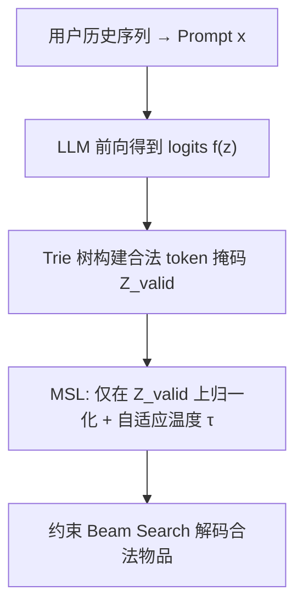
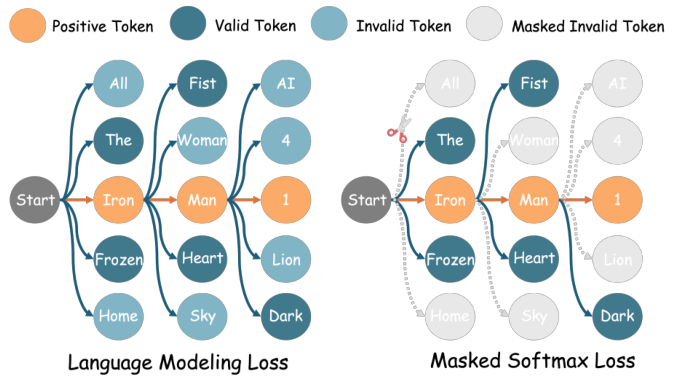

# MSL: Not All Tokens Are What You Need for Tuning LLM as a Recommender (并非所有 Token 都是你需要的：面向 LLM 推荐微调的掩码 Softmax 损失)

- **会议/期刊**: SIGIR 2025
- **作者与机构**: Bohao Wang, Jiawei Chen, Can Wang 等（浙江大学、OPPO 研究院、Intelligence Indeed）
- **推荐链路定位**: 端到端生成式（LLM 指令微调 + 约束 Beam Search 解码）
- **研究方向**: 大语言模型推荐 / 序列推荐
- **论文原文**: [https://arxiv.org/abs/2504.04178v4](https://arxiv.org/abs/2504.04178v4)
- **开源代码**: [https://github.com/WANGBohaO-jpg/MSL](https://github.com/WANGBohaO-jpg/MSL)

## TL;DR (1分钟核心速览)

LLM 推荐微调普遍沿用语言建模损失 (LML)，但 LML 的优化目标与推荐排序目标严重错位，且把全部虚构物品描述当作负样本，注入错误负信号。本文提出掩码 Softmax 损失 (MSL)：在 softmax 分母中屏蔽"无法构成合法物品描述"的无效 token，理论上证明其是 NDCG 的更紧上界；针对由此引发的梯度消失，进一步给出基于对数正态假设的自适应温度策略 (ATS)。在 4 个 Amazon 数据集、约束 Beam Search 全库排序协议下，MSL 使 BIGRec/LLaRA/A-LLM 三个骨干的 NDCG@10 平均提升 42.24%。

## Background & Motivation (背景与核心矛盾)

- **主流范式**: 将用户历史交互拼成 prompt，以正样本物品描述为目标做 SFT，损失函数直接沿用语言生成的 token-wise LML。
- **前人局限**: 其一，LML 追求"从整个语言空间中生成合法物品描述"，而推荐只关心"从系统合法物品集中排出正样本"，目标错位；其二，LML 隐式把一切非正样本 token（含虚构物品）都当负样本惩罚，而虚构物品可能与正样本语义高度相似（如漫威粉丝对"钢铁侠：AI 叛乱"），属错误负信号。
- **核心洞察 (Key Insight)**: 作者将 LML 分解为 $L^1_{LML}$（抬升合法 token 压制非法 token）与$L^2_{LML}$（抬升正样本压制合法负样本）。图 3 显示$L^1_{LML}$的梯度范数压倒性主导训练，$L^2_{LML}$ 几乎不收敛——即真正对齐推荐目标的那一项被"淹没"了。
- **本文切入点**: 直接砍掉 $L^1_{LML}$，只保留在合法 token 集合上归一化的$L^2_{LML}$，即 MSL。

## Method (核心方法设计)

### 1. 整体框架 (Overall Architecture)

输入为用户历史序列拼接的指令 prompt $x$，输出为正样本物品描述$y_p$的逐 token 生成。预处理阶段用 marisa-trie 前缀树枚举全部物品描述，构建"合法 token 掩码矩阵"；训练时在 softmax 分母中仅保留合法 token，配合自适应温度$\tau$ 调制梯度；推理时用约束 Beam Search 把候选限制在合法 token 上，杜绝虚构物品幻觉。整个改动仅替换损失函数，可无缝嵌入 BIGRec、LLaRA、A-LLM 等现有 LLM 推荐骨干。

<figure class="paper-figure" markdown="span">
  <figcaption>图2：示意图展示了语言建模损失（LML）和掩码Softmax损失（MSL）。</figcaption>
</figure>

### 2. 关键设计拆解 (Key Designs)

1. **掩码 Softmax 损失 (MSL)**：把 LML 分母从全词表 $\mathcal{Z}$收缩到合法 token 集$\mathcal{Z}_{valid}(y_{p,<t})$，即
$$\mathcal{L}_{MSL}=\sum_{t=1}^{|y_p|}-\log\frac{\exp(f_\theta(y_{p,t}))}{\sum_{z\in\mathcal{Z}_{valid}}\exp(f_\theta(z))}$$
直觉上，这既消除了对虚构物品的错误惩罚，又让梯度全部用于"正样本 vs 合法负样本"的判别。作者证明 $\mathcal{L}_{MSL}$是$-\log NDCG$的**更紧上界**：$-\log NDCG(S)\le\mathcal{L}_{MSL}\le\mathcal{L}_{LML}$，因为分母更小、界更紧。

2. **自适应温度策略 (ATS)**：MSL 分母项数骤减导致 $P^{valid}_\theta(y_{p,t})$偏大，梯度权重$w(y_{p,t})=1-P^{valid}_\theta(y_{p,t})$趋近 0（图 5 显示大量样本权重接近 0，且 61% 的低权重 token 集中在前三个 token）。引入温度$\tau$后$w=1-\frac{\exp(f_\theta(y_{p,t})/\tau)}{\sum_{z\in\mathcal{Z}_{valid}}\exp(f_\theta(z)/\tau)}$。假设合法 token logits 服从高斯$\mathcal{N}(\mu,\sigma^2)$，令目标概率$P^{valid}_\theta=\eta$，解得闭式全局温度：
$$\tau\approx\frac{(f_\theta(y_{p,t})-\mu)-\sqrt{(f_\theta(y_{p,t})-\mu)^2-2\sigma^2\log(m/\eta)}}{2\log(m/\eta)}$$
其中 $m$为数据集平均合法 token 数，$\eta=0.25$。这样无需网格搜索即可随训练状态自适应调温。

3. **训练目标、负采样与推理效率**：总损失即上述 MSL，**完全免负采样**（合法 token 集天然构成负样本池），避免了 S-DPO 采样带来的不稳定（表 3：S-DPO 多种子 NDCG@10 波动达 16.4%，MSL 仅 2.0%）。Trie 树构建时间与内存均为 $O(|\mathcal{V}|\hat{l})$，四个数据集构建耗时均 < 1 秒；因分母从 128k 词表缩至平均 9–71 个合法 token，训练反而比 LML 快 4.4%–6.7%，比 S-DPO 快约 3 倍。

## Experimental Setup & Evaluation Protocol (实验设置与评估协议)

- **数据集与预处理**: 四个 Amazon 数据集，均做 `5-core` 过滤；序列长度 > 11 时用长度 11 滑窗切分；Books 因规模过大先随机保留 10 万物品。

| 数据集 | #Users | #Items | #Interactions | 密度 | 平均合法 token 数 |
| :--- | :---: | :---: | :---: | :---: | :---: |
| Toy | 19,124 | 11,758 | 165,247 | 0.0735% | 54.38 |
| Book | 16,559 | 6,344 | 151,928 | 0.1446% | 70.90 |
| Clothing | 39,230 | 22,948 | 277,534 | 0.0308% | 53.74 |
| Office | 4,895 | 2,414 | 53,149 | 0.4498% | 8.98 |

- **数据划分与防穿越 (Splitting Strategy)**: 按时间戳升序后做 `8:1:1` 比例划分（训练/验证/测试），属比例划分 + 时序切分。
- **排名评测协议 (Ranking Protocol)**: 采用 `Full-Ranking`（约束 Beam Search，beam=10，候选为全库合法物品），同时报告 grounding 与约束 Beam Search 中较优者；指标为 NDCG@{5,10} 与 HR@{5,10}。
- **对比基线与超参设置**: 骨干统一为 LLaMA3-8B，训练 10 epoch，取 NDCG@5 最优 epoch。基线覆盖传统序列模型（SASRec、BERT4Rec、SASRec+DROS）、LLM 增强型（LLM-CF、DLLM2Rec）、LLM 基座型（BIGRec、LLaRA、A-LLM）及改进损失（S-DPO）。MSL 仅替换损失，其余超参沿用原骨干设置，$\eta=0.25$。

## Key Experimental Results (实验关键数据)

### 1. 主实验对比 (Main Results)

以 NDCG@10 为核心列（完整表见原文 Table 5）：

| 方法 | Toy | Book | Clothing | Office |
| :--- | :---: | :---: | :---: | :---: |
| SASRec | 0.0126 | 0.0133 | 0.0056 | 0.0183 |
| BERT4Rec | 0.0191 | 0.0171 | 0.0093 | 0.0307 |
| LLM-CF | 0.0132 | 0.0142 | 0.0052 | 0.0192 |
| DLLM4Rec | 0.0134 | 0.0136 | 0.0061 | 0.0198 |
| BIGRec+LML | 0.0182 | 0.0137 | 0.0073 | 0.0220 |
| BIGRec+SDPO | 0.0219 | 0.0145 | 0.0089 | 0.0256 |
| **BIGRec+MSL** | **0.0288** | **0.0172** | **0.0120** | **0.0438** |
| LLaRA+MSL | 0.0283 | 0.0175 | 0.0140 | 0.0417 |
| A-LLM+MSL | **0.0296** | **0.0184** | **0.0127** | 0.0388 |
| Improv.% (vs 最佳 LML/S-DPO) | +31.4% | +18.6% | +34.5% | +70.8% |

### 2. 消融实验 (Ablation Study)

NDCG@10，骨干为 BIGRec（原文 Table 6）：

| 变体 | Toy | Book | Clothing | Office |
| :--- | :---: | :---: | :---: | :---: |
| LML | 0.0182 | 0.0137 | 0.0073 | 0.0220 |
| LML + tuning $\tau$ | 0.0182 | 0.0146 | 0.0074 | 0.0248 |
| MSL (w/o $\tau$) | 0.0171 | 0.0151 | 0.0097 | 0.0135 |
| MSL + tuning lr | 0.0184 | 0.0151 | 0.0101 | 0.0177 |
| MSL + 负样本系数 $\alpha$ | 0.0202 | 0.0157 | 0.0078 | 0.0221 |
| MSL + tuning $\tau$ | 0.0280 | 0.0182 | 0.0130 | 0.0418 |
| **MSL (w/ ATS)** | **0.0288** | 0.0172 | 0.0120 | **0.0438** |

### 3. 关键实验发现 (Key Findings)

1. **温度是 MSL 生效的必要条件**：去掉 $\tau$后 MSL 在 Toy/Office 上反而劣于 LML（0.0171 vs 0.0182、0.0135 vs 0.0220），印证梯度消失确实存在；而给 LML 调$\tau$ 几乎无增益（Toy 持平），说明收益来自 MSL 本身而非调参红利。
2. **ATS 可替代暴力搜索且更稳**：ATS 在 Toy/Office 上超过网格搜索（0.0288 vs 0.0280、0.0438 vs 0.0418），在 Book/Clothing 上略低但无需逐数据集调参；调学习率、加负样本系数 $\alpha$ 等替代方案均显著劣于调温。
3. **稀疏/小规模场景收益最大**：Office（密度 0.45%、平均合法 token 仅 8.98）上 BIGRec+MSL 相对提升高达 213%（NDCG@5），说明合法 token 集越小、LML 的无效 token 干扰占比越高，MSL 的屏蔽收益越突出；同时 MSL 训练效率比 S-DPO 高 315%–324%。

## Highlights & Limitations (亮点、对比与审稿批判)

- **与代表作对比 (vs. Prior Work)**: 相比 BIGRec/LLaRA/A-LLM 仅换损失即全面提升，本质区别在于它们沿用 LML 而未处理目标错位；相比 S-DPO，MSL 无需参考模型、无需负采样、训练快约 4 倍且多种子方差从 16.4% 降至 2.0%，但 S-DPO 显式建模成对偏好，MSL 仍是逐 token 的 pointwise 归一化。
- **可迁移亮点**: ①"合法 token 掩码矩阵 + Trie 前缀树"的构造范式可迁移到任何受限词表生成任务（如语义 ID 生成式推荐中的码本约束解码）；②ATS 用高斯假设闭式解替代温度网格搜索，可复用到其他带温度的 softmax 对比损失。
- **审稿级局限批判**: ①ATS 依赖"合法 token logits 近似高斯"的假设（附录 C 仅做拟合展示，缺乏定量检验），分布漂移时闭式解可能失准；②实验仅在 Amazon 域、LLaMA3-8B 单骨干上验证，未涉及工业级千万物品规模下 Trie 掩码矩阵的内存开销与多 token 物品描述长度不均衡问题。

## Rating (四维评分)

- **方法创新性 (Novelty)**: ⭐⭐⭐⭐ （从 LML 梯度分解切入、以 NDCG 上界给出理论保证，视角新颖但本质是损失函数裁剪）
- **评估协议与实验扎实度 (Protocol & Experiments)**: ⭐⭐⭐⭐ （四数据集 + 三类骨干 + 全库 Beam Search 排序 + 多种子方差分析，消融完整；缺工业规模验证）
- **写作与数学规范度 (Clarity & Rigor)**: ⭐⭐⭐⭐ （引理 1/2 证明完整、梯度分解清晰，高斯假设的严谨性稍弱）
- **工业落地与复现价值 (Industrial & Practical Value)**: ⭐⭐⭐⭐⭐ （仅改损失、代码开源、训练反而更快，工程落地门槛极低）

